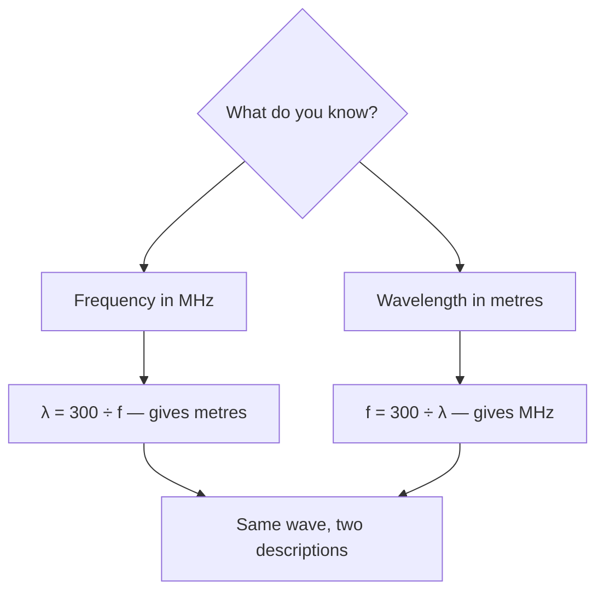
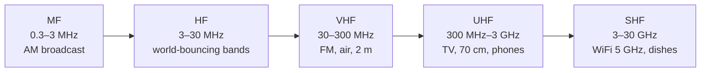

# Frequency & Wavelength

Ask any radio amateur where they were operating last night and you will hear answers like "forty metres" or "two metres" — distances, apparently, not frequencies. Yet their radio dials read `7.1 MHz` and `145.5 MHz`. These are two ways of describing the very same signal, and converting between them is the single most-used mental calculation in radio. This chapter gives you both numbers, the beautifully simple rule that connects them, and the intuition — especially about antenna sizes — that comes free with the arithmetic.

## Frequency: counting the wiggles

In [Electromagnetic Waves](outpost:entry/logbook73.handbook/electromagnetic-waves) we kept saying "wiggle rate". Its proper name is **frequency**: the number of complete back-and-forth cycles the wave makes each second. The unit is the **hertz** (Hz), named after Heinrich Hertz, and it means exactly "cycles per second". One complete cycle — up, down, and back to the start — per second is 1 Hz.

Some everyday calibration points:

- Mains electricity alternates at `50 Hz` in much of the world (`60 Hz` in the Americas) — fifty or sixty complete cycles a second.
- A low hum you can just about sing is around `100 Hz`; the highest note on a piano is about `4,000 Hz`; young ears give out near `20,000 Hz`.
- Radio starts roughly where hearing ends and runs up to _billions_ of cycles per second.

And frequency is not an abstraction that lives only on a dial: for a transmitter, it is literally how many times per second the current in the antenna reverses direction — the sway rate of the electrons from [What Is Radio](outpost:entry/logbook73.handbook/what-is-radio). Tune to `145 MHz` and you are asking your radio to shove charge back and forth 145 million times every second.

Those billions get unwieldy fast, so we use metric prefixes, and you should get fluent in hopping between them:

| Unit              | Means                 | In hertz         | Typical territory                    |
| ----------------- | --------------------- | ---------------- | ------------------------------------ |
| 1 kHz (kilohertz) | one thousand cycles/s | 1,000 Hz         | Audio, long-wave broadcast (198 kHz) |
| 1 MHz (megahertz) | one million cycles/s  | 1,000,000 Hz     | AM broadcast, HF amateur bands       |
| 1 GHz (gigahertz) | one billion cycles/s  | 1,000,000,000 Hz | WiFi, satellites, microwave bands    |

Each step is a factor of 1,000, so conversions are just decimal-point shuffles: `7,100 kHz = 7.1 MHz`; `145.5 MHz = 0.1455 GHz`; `433.5 MHz = 433,500 kHz`. You will see all three units in the wild — older HF operators often speak in kilohertz ("seven-one-two-five"), band plans use MHz, microwave folk use GHz — so practise until the shuffling is automatic. LogBook73 follows the common convention of MHz in frequency fields, so `7.074` means 7.074 MHz.

## Wavelength: the size of the wave

Frequency describes the wave in time. **Wavelength** describes it in space: the physical distance from one crest to the next — the length of one complete cycle as it flies along. Its symbol is the Greek letter lambda, `λ`, and it is measured in ordinary metres.

Here is the picture to hold. The wave streams past you at the speed of light — about 300 million metres every second, as we saw in [Electromagnetic Waves](outpost:entry/logbook73.handbook/electromagnetic-waves). If the source wiggles once per second (1 Hz), that single cycle gets stretched across the entire 300 million metres the wave travelled during it. If the source wiggles a million times per second (1 MHz), those million cycles share the same 300 million metres — so each one occupies 300 m. Wiggle faster, and each cycle gets less room: frequency up, wavelength down, always in exact inverse proportion.

```viz
{
  "type": "wave",
  "title": "Higher frequency, shorter wavelength",
  "caption": "Both waves cross this stretch of space at the same speed. Quadruple the frequency and four times as many cycles must share the distance — so each crest-to-crest step, the wavelength, shrinks to exactly a quarter.",
  "traces": [
    { "kind": "sine", "freq": 6, "label": "6 cycles — long λ", "tone": "primary" },
    { "kind": "sine", "freq": 24, "amp": 0.6, "label": "24 cycles — short λ", "tone": "muted" }
  ],
  "xLabel": "the same stretch of space →"
}
```

That is the whole relationship: **speed = frequency × wavelength**, with the speed fixed at `c`. Rearranged into its everyday form:

## The 300 rule

> **λ (in metres) = 300 ÷ f (in MHz)**

and, flipped around,

> **f (in MHz) = 300 ÷ λ (in metres)**

The 300 is just the speed of light — 300,000,000 m/s — with the "million" absorbed into the MHz. One number to remember, two directions to use it in, and it answers questions constantly:



Worked examples — real frequencies you will actually meet, so work through each one:

**Example 1 — an FT8 frequency.** The 40 m FT8 watering hole is `7.074 MHz`. λ = 300 ÷ 7.074 ≈ **42.4 m**. A wave longer than four buses, sweeping past 7 million times a second.

**Example 2 — a 2 m calling channel.** FM calling on VHF is `145.500 MHz`. λ = 300 ÷ 145.5 ≈ **2.06 m** — about the height of a door. Now you know why it is called the two-metre band.

**Example 3 — a 70 cm handheld channel.** `433.500 MHz`: λ = 300 ÷ 433.5 ≈ **0.69 m**, i.e. 69 cm. Hence "70 centimetres".

**Example 4 — medium-wave broadcast.** A broadcaster on `909 kHz` = 0.909 MHz. λ = 300 ÷ 0.909 ≈ **330 m** — a wave longer than three football pitches, which begins to explain why broadcast masts are colossal.

**Example 5 — WiFi.** `2,400 MHz` (2.4 GHz): λ = 300 ÷ 2400 = **0.125 m** = 12.5 cm. Small wave, small antenna — which is why one hides invisibly inside your router.

**Example 6 — the other direction.** Someone says they heard a beacon "on twenty metres". f = 300 ÷ 20 = **15 MHz** — so you would start looking around 14 MHz, where the 20 m amateur band actually sits (14.0–14.35 MHz; band names are rounded, as we are about to see).

**Example 7 — the other direction, VHF.** "Six metres is open!" f = 300 ÷ 6 = **50 MHz**. Spot on: the 6 m band starts at 50 MHz.

Do a few of these daily — every time a frequency crosses your screen — and within a fortnight the conversion is instant and unconscious. It is the radio equivalent of knowing your times tables, and the wavelength calculator in the Toolbox will check your answers while you learn.

## Why bands are named in metres

So why does everyone say "40 metres" instead of "7 MHz"? History. In the early days of radio there was no agreed way to measure frequency directly — counting millions of cycles per second was beyond the instruments of 1910 — but wavelength could be measured physically, with tuned lengths of wire (an instrument literally called a wavemeter). So operators talked in metres, licences were issued in metres, and the language stuck even after frequency counters made hertz the precise unit. Tradition kept the metre names because they are short, evocative, and handily group a whole range of frequencies under one label: "the 40 m band" is friendlier than "6.9990–7.2000 MHz".

The names are rounded, sometimes generously — the "80 m" band computes to 73–86 m across its width — so treat them as names, not measurements. Here is the table to bookmark, with ITU Region 1 frequency ranges shown (Regions 2 and 3 differ on several bands — check your national band plan):

| Band name              | Frequency range (Region 1)        | Exact λ at band centre | Character in one line                                   |
| ---------------------- | --------------------------------- | ---------------------- | ------------------------------------------------------- |
| 160 m ("top band")     | 1.810–2.000 MHz                   | ~157 m                 | Night-time only; giant antennas; old-school challenge   |
| 80 m                   | 3.500–3.800 MHz (Rgn 2: to 4.000) | ~82 m                  | Your own region by night; natters and nets              |
| 60 m                   | 5 MHz (country-specific segments) | ~55 m                  | Small shared band; check current licence terms          |
| 40 m                   | 7.000–7.200 MHz (Rgn 2: to 7.300) | ~42 m                  | The dependable workhorse, day and night                 |
| 30 m                   | 10.100–10.150 MHz                 | ~30 m                  | Data and Morse only; quiet and productive               |
| 20 m                   | 14.000–14.350 MHz                 | ~21 m                  | The classic daytime DX (long-distance) band             |
| 17 m                   | 18.068–18.168 MHz                 | ~16.6 m                | 20 m's calmer sibling                                   |
| 15 m                   | 21.000–21.450 MHz                 | ~14 m                  | Superb when the Sun is active                           |
| 12 m                   | 24.890–24.990 MHz                 | ~12 m                  | Sunspot-dependent; delightful when open                 |
| 10 m                   | 28.000–29.700 MHz                 | ~10.4 m                | Worldwide on watts at solar maximum; local FM otherwise |
| 6 m ("the magic band") | 50.000–52.000 MHz                 | ~5.9 m                 | Mostly local — until it suddenly isn't                  |
| 2 m                    | 144–146 MHz (Rgns 2/3: 144–148)   | ~2.07 m                | The VHF home band: FM, repeaters, satellites            |
| 70 cm                  | 430–440 MHz (Rgn 2: 420–450)      | ~69 cm                 | UHF partner to 2 m; handhelds and satellites            |
| 23 cm                  | 1,240–1,325 MHz                   | ~23.4 cm               | Microwave gateway; dishes and experiments               |

Notice the pattern in the names as you scan down: metres shrink as megahertz grow, in strict see-saw. Say "80 metres" and an amateur hears _low frequency, night band, big antennas_; say "70 centimetres" and they hear _UHF, line of sight, pocket-sized aerials_. The band name compresses a whole personality into two words — the personalities themselves are unpacked in [HF](outpost:entry/logbook73.handbook/hf), [VHF](outpost:entry/logbook73.handbook/vhf) and [UHF](outpost:entry/logbook73.handbook/uhf), and _why_ each behaves as it does is the story of [Propagation](outpost:entry/logbook73.handbook/propagation).

For orientation beyond amateur bands, the spectrum's broad regions are named by frequency decade, and these initialisms appear everywhere:



## Wavelength intuition: why antennas are the size they are

Here is where λ stops being arithmetic and starts paying rent. **Antennas work best when their size is a tidy fraction of the wavelength** — most often a half or a quarter. An antenna is a device for letting the passing wave shake electrons in sympathy (or the reverse), and the shaking builds up strongest — _resonates_, like a swing pushed at its natural rhythm — when the metal is the right length for one crest-to-trough swing of the wave to fit it neatly. The full story lives in [Antennas](outpost:entry/logbook73.handbook/antennas), but the sizing rule is pure chapter-three material:

 metres — 40 m on 80 m, a bus-length on 20 m, a broom handle on 2 m.')

- **Half-wave dipole** (the classic wire antenna, fed in the middle): overall length ≈ λ ÷ 2, in practice ≈ `143 ÷ f(MHz)` metres once real-world end effects are included — the dipole calculator does this sum, leg by leg, for any frequency.
- **Quarter-wave vertical or whip**: height ≈ λ ÷ 4 ≈ `71.5 ÷ f(MHz)` metres, worked against the ground or a car body.

Run the numbers and whole swathes of the hobby explain themselves:

**Example 8 — a 40 m dipole.** 143 ÷ 7.1 ≈ **20 m of wire**. That is why HF amateurs covet long gardens, and why so much ingenuity goes into folding, bending and loading antennas into small spaces.

**Example 9 — a 2 m whip.** 71.5 ÷ 145.5 ≈ **0.49 m**. A 49 cm whip on a car roof is a proper, full-size quarter-wave for 2 m. No compromise, no garden required.

**Example 10 — a 70 cm handheld antenna.** 71.5 ÷ 433.5 ≈ **0.165 m** — about 17 cm, which is roughly the length of a handheld's rubber antenna. The antenna on a ~$25/€25-class handheld is close to full-size for its band; the same cannot remotely be said of anything handheld on 40 m.

**Example 11 — why your car key fob is possible.** Key fobs use 433.92 MHz partly _because_ a quarter-wave is 17 cm — short enough to curl a little antenna inside a plastic teardrop. At 1 MHz the same design would need a 75 m whip. Physics, not fashion, sets the sizes of things.

This is the trade running silently through every band choice: **long wavelengths bounce off the ionosphere and cross oceans, but demand big metal; short wavelengths fit in your pocket, but mostly travel line-of-sight.** When you see a rooftop bristling with small beams (VHF/UHF) next to a garden strung with long wire (HF), you are looking at the 300 rule expressed in aluminium and copper.

One more resonance note while the idea is fresh: an antenna cut for one band is generally _wrong_ for another — a 20 m dipole is not half a 40 m dipole's performance on 40 m, it is nearly deaf there. Getting one antenna to serve several bands is a rich art involving tuners and traps, and the measuring side of it is exactly what a [NanoVNA](outpost:entry/logbook73.handbook/nanovna) is for.

## Try it yourself

1. **Convert live traffic.** Open the reporting map at **pskreporter.info** (or LogBook73's **Beacons** page, whose catalogue lists each beacon's frequency) and, for ten frequencies, convert to wavelength in your head with the 300 rule, then check which band the metre-name table says it is. `14.074` → 300 ÷ 14 ≈ 21 m → the 20 m band. After a page of these you will read frequencies like place names.
2. **Measure an antenna.** Find any accessible antenna — a car whip, a handheld's rubber duck, a TV aerial's elements — measure or estimate its length, multiply by 4 (whips) or 2 (dipole-like elements), and turn the resulting λ into MHz with `f = 300 ÷ λ`. You have just deduced what a mystery antenna is _for_, a genuinely useful field skill.
3. **Hear one band's width.** Tune anything that receives 40 m — an SDR dongle, a shortwave portable with SSB, or a WebSDR in a browser — from 7.000 to 7.200 MHz slowly. That entire safari, Morse at one end to voices at the other, spans wavelengths from 42.9 m to just 41.7 m: bands are _narrow_ slivers of spectrum, which is why we fit so many of them between 3 and 30 MHz.

## Key takeaways

- **Frequency** (hertz) counts cycles per second; radio runs from kHz through MHz to GHz, each step ×1,000 — get fluent at shuffling between them.
- **Wavelength** (λ, metres) is the physical crest-to-crest size of the wave; frequency and wavelength see-saw in exact inverse proportion.
- The one formula: **λ = 300 ÷ f(MHz)**, and back again **f = 300 ÷ λ** — the 300 is just the speed of light in convenient clothing.
- Band names in metres are rounded historical labels: 80 m ≈ 3.5 MHz, 40 m ≈ 7 MHz, 20 m ≈ 14 MHz, 2 m ≈ 144 MHz, 70 cm ≈ 433 MHz — exact edges vary by ITU region, so check your national band plan.
- Antennas resonate at tidy fractions of λ — half-wave dipole ≈ `143 ÷ f(MHz)` m, quarter-wave ≈ `71.5 ÷ f(MHz)` m — so wavelength literally sets the size of radio hardware.
- Long waves: worldwide reach, big antennas. Short waves: pocket hardware, local reach. Every band is a position on that trade.

You can now describe any signal's _where_ on the spectrum; next you need its _how strong_ — and radio measures strength in a wonderfully lazy logarithmic currency called the decibel, explained in [Decibels (dB, dBm, dBi)](outpost:entry/logbook73.handbook/decibels).
