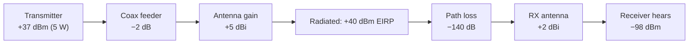
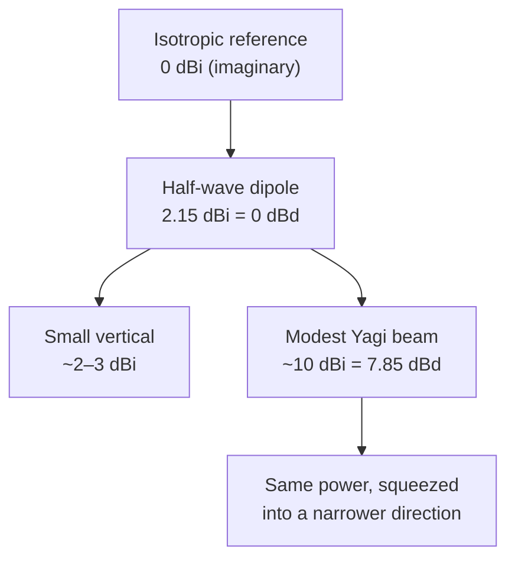

# Decibels (dB, dBm, dBi)

Radio deals in preposterous contrasts. Your transmitter might launch ten watts; the whisper arriving at a distant receiver might be a hundredth of a millionth of a millionth of a watt — and the receiver will read it happily. Writing numbers like `0.00000000000001 W` is miserable, comparing them is worse, and doing it across a chain of amplifiers, cables and antennas is hopeless. So radio uses a compressed, logarithmic currency for signal strength: the **decibel**. Learn its two little rules and you will out-calculate a calculator, in your head, for the rest of your radio life.

## Why logarithms (don't panic)

The word "logarithm" scares people unnecessarily. A logarithm just answers the question: _how many times must I multiply by ten?_ The logarithm of 100 is 2 (ten times ten); of 1,000 is 3; of 1,000,000 is 6. It counts zeros. That is genuinely all the maths this chapter needs.

Why is that useful? Two reasons.

**Reason one: it tames huge ranges.** The span from that received whisper (`0.00000000000001 W`) up to a big amateur station's `400 W` covers about seventeen multiplications by ten. As raw numbers, unmanageable; as "how many tens", it is the difference between −110 and +56 on one tidy scale. Logarithms turn astronomical ratios into small, walkable numbers.

**Reason two: it turns multiplication into addition.** Signals passing through a system get _multiplied_ at every stage — an amplifier ×100, a lossy cable ×0.5, another amplifier ×10. Chained multiplications are error-prone. But logarithms convert multiplying into adding (multiplying by 100 then by 10 is "add 2 tens, add 1 ten"). Since a radio path is one long chain of multiplications, working in logs means you just _add up a shopping list_. That single convenience is why every RF datasheet, S-meter, and FT8 report speaks decibels.

## The decibel defined

The decibel compares two power levels. The recipe:

> **dB = 10 × log₁₀ (P₂ ÷ P₁)**

Take the ratio of the two powers, count its tens (that is the log), multiply by ten for finer granularity. So:

- Power ×10 → ratio 10 → log = 1 → **+10 dB**
- Power ×100 → **+20 dB**
- Power ×1,000 → **+30 dB**
- No change (×1) → log of 1 is 0 → **0 dB**
- Power ÷10 (×0.1) → **−10 dB**

Positive decibels are **gain** (the signal grew), negative are **loss** (it shrank), and 0 dB means unchanged. Note carefully what a decibel is _not_: it is not an absolute amount. "The amplifier has 13 dB of gain" is meaningful (output is 20× input); "the signal is 13 dB" alone means nothing until you say 13 dB _relative to what_ — which is where dBm comes in shortly.

## The 3 dB and 10 dB rules

Here is the entire practical skill. Two facts:

- **+3 dB means double the power.** (Because log of 2 is 0.301 ≈ 0.3, and 10 × 0.3 = 3.) Correspondingly **−3 dB means half**.
- **+10 dB means ten times the power.** **−10 dB means one tenth.**

Every whole ratio you will ever need is built by stacking those two, because adding decibels multiplies ratios:

| dB     | Power ratio | Built from   |
| ------ | ----------- | ------------ |
| 0 dB   | × 1         | —            |
| 3 dB   | × 2         | one doubling |
| 6 dB   | × 4         | 3 + 3        |
| 9 dB   | × 8         | 3 + 3 + 3    |
| 10 dB  | × 10        | one ten      |
| 13 dB  | × 20        | 10 + 3       |
| 17 dB  | × 50        | 10 + 10 − 3  |
| 20 dB  | × 100       | 10 + 10      |
| 30 dB  | × 1,000     | 10 + 10 + 10 |
| −3 dB  | × 0.5       | one halving  |
| −6 dB  | × 0.25      | halve twice  |
| −20 dB | × 0.01      | ÷10 twice    |

Here is what those tidy little steps do to actual power:

```viz
{
  "type": "spectrum",
  "title": "Decibel steps, drawn as power",
  "caption": "Each −3 dB halves the bar and each −10 dB cuts it to a tenth — a handful of small-sounding decibel steps takes the signal down to a hundredth of the reference. This compression is the whole point.",
  "components": [
    { "f": 10, "amp": 1.0, "label": "0 dB", "tone": "primary" },
    { "f": 30, "amp": 0.5, "label": "−3 dB" },
    { "f": 50, "amp": 0.25, "label": "−6 dB" },
    { "f": 70, "amp": 0.1, "label": "−10 dB" },
    { "f": 90, "amp": 0.01, "label": "−20 dB" }
  ],
  "noiseFloor": 0,
  "xLabel": "each bar's height is its power relative to the 0 dB reference"
}
```

Worked warm-ups, the kind you will do daily:

**Example 1.** An amplifier turns 5 W into 100 W. Ratio = 20 = 10 × 2, so gain = 10 + 3 = **13 dB**.

**Example 2.** A long coax run loses 6 dB. 6 = 3 + 3: two halvings. Put 40 W in, get **10 W** out. (Let that sink in — a mediocre cable can quietly eat three-quarters of your power. This is why [Transmission Lines](outpost:entry/logbook73.handbook/transmission-lines) deserves its own chapter.)

**Example 3.** You drop your transmitter from 100 W to 25 W. That is ÷4 = two halvings = **−6 dB** — which, as [RF Power](outpost:entry/logbook73.handbook/rf-power) will show, is barely one S-unit at the far end. Decibels are the antidote to power anxiety.

## Adding up a signal chain

Because dB add, an entire station becomes a sum. Gains are positive, losses negative; total them and you know exactly what reaches the sky:



Read it left to right: `+37 − 2 + 5 = +40` leaving the antenna; subtract the journey's 140 dB; add the receiving antenna's 2 dB; **−98 dBm** arrives. No multiplication, no scientific notation — a shopping-list sum you can do on your fingers. (What those "dBm" and "dBi" suffixes mean is the next two sections; the shape of the sum is the point here.)

This additive habit also gives you the engineer's reflex of hunting the _biggest number in the list_. In that chain, arguing about 0.5 dB of connector loss is silly next to a 140 dB path; conversely, on a microwave link where the coax loses 10 dB, the cable _is_ the problem. Decibels make the pecking order of problems visible at a glance.

## dBm: giving decibels an anchor

Plain dB compares two powers. Anchor the comparison to a fixed reference — **one milliwatt** — and you get **dBm**, an absolute power level:

> **P(dBm) = 10 × log₁₀ (P ÷ 1 mW)**

So `0 dBm` _is_ 1 mW; `+30 dBm` is 1,000 mW = 1 W; `−30 dBm` is a microwatt. Now the whole universe of radio powers, from broadcast transmitters to the faintest decodable murmur, sits on one line of small numbers:

| dBm                | Power                 | Real-world meaning                                                      |
| ------------------ | --------------------- | ----------------------------------------------------------------------- |
| +47 dBm            | 50 W                  | Typical mobile HF transceiver at full output                            |
| +44 dBm            | 25 W                  | A typical entry-level licence power class                               |
| +40 dBm            | 10 W                  | Classic QRP-plus / data-mode power                                      |
| +37 dBm            | 5 W                   | A handheld, or a QRP (low-power) HF rig                                 |
| +30 dBm            | 1 W                   | The dBm/watt anchor point                                               |
| 0 dBm              | 1 mW                  | The reference itself; strong lab-bench signal                           |
| −73 dBm            | 50 picowatts arriving | **S9** — a genuinely strong received signal                             |
| −97 dBm            | —                     | S5: comfortable copy on a quiet band                                    |
| −121 dBm           | ~0.8 femtowatts       | **S1** — the S-meter's bottom rung                                      |
| −136 dBm           | —                     | Weakest voice (SSB) signal a good ear pulls from the noise              |
| −140 dBm and below | —                     | [FT8](outpost:entry/logbook73.handbook/ft8) territory on a quiet band: decodable yet inaudible |

Two rows there deserve unpacking, because they define the **S-meter** — the signal-strength needle on every receiver, and the "S" in the signal reports you log in LogBook73's Console. By convention (on HF), **S9 = −73 dBm** at the antenna socket, and each S-unit below it is a **6 dB** step — that is, one quarter of the power. Count down: S8 = −79 dBm, S7 = −85 dBm... S1 = −121 dBm. The whole S1-to-S9 ladder spans 48 dB — a 63,000-fold range of power folded into nine friendly numbers. Beyond the top, reports continue in raw decibels: "S9 plus 20" means −53 dBm, a hundred times stronger than S9. Meanwhile digital modes skip the ladder and report signal-to-noise ratio in dB directly — the `-12` on an FT8 report at **pskreporter.info**, or the SNR you tap into LogBook73's **Beacons** page, is a dB figure telling you the signal was 12 dB weaker than the noise in a reference bandwidth, and it still decoded. (How that sorcery works involves noise and bandwidth — the business of [Noise](outpost:entry/logbook73.handbook/noise).)

A caution that saves real embarrassment: **never add two dBm values.** dBm is an absolute level, like a temperature; "+37 dBm plus +37 dBm" is as meaningless as "20 °C plus 20 °C = 40 °C". The grammar is: _start_ with one dBm level, then add and subtract plain dB gains and losses. dBm + dB = dBm. ✔ dBm + dBm = nonsense. ✘

**Example 4.** Handheld at +37 dBm (5 W), 3 dB of cheap coax loss, antenna with 0 dB gain: `37 − 3 + 0 = +34 dBm` = 2.5 W actually radiated. Half your handheld's power just warmed a bad cable.

## dBi and dBd: decibels for antennas

Antennas do not create power, but they can _concentrate_ it in useful directions, and that concentration is expressed in decibels relative to a reference antenna. Two references are in common use, hence two suffixes:

- **dBi** — gain relative to an **isotropic** radiator: an imaginary point that sprays power equally in every direction, including straight up and straight down. No such antenna can exist, but it is a mathematically clean zero.
- **dBd** — gain relative to a real **half-wave dipole** in its best direction.

A dipole itself has 2.15 dB of gain over isotropic (it concentrates power broadside instead of wasting it off its ends), so the two scales are offset by a constant:

> **gain in dBi = gain in dBd + 2.15**

Same antenna, two honest numbers — but advertisers know which looks bigger. A "5.15 dBi" antenna and a "3 dBd" antenna are _identical_. When comparing antennas, first drag every figure onto the same scale, and treat any spec that omits the i or d as suspect. In link calculations (and throughout this handbook) dBi is the standard, and EIRP — met properly in [RF Power](outpost:entry/logbook73.handbook/rf-power) — is always reckoned with dBi.

Remember also that antenna gain is _redistribution_, not amplification: a 6 dBi beam gives you ×4 in its favoured direction by taking power away from the others. Nothing is free; it is just aimed. How different designs achieve this is the story of [Antennas](outpost:entry/logbook73.handbook/antennas).



## A worked link budget

Time to assemble everything into the calculation engineers call a **link budget** — the full ledger from your transmitter to a distant receiver's input. Scenario: you run a 5 W FT8 signal on the 20 m band from a small vertical; a station 3,000 km away listens on a dipole. Typical numbers:

| Stage                                      | Value   | Running total               |
| ------------------------------------------ | ------- | --------------------------- |
| Transmitter output (5 W)                   | +37 dBm | +37 dBm                     |
| Your feeder and connectors                 | −1 dB   | +36 dBm                     |
| Your vertical's gain                       | +2 dBi  | +38 dBm (EIRP)              |
| Ionospheric path, 3,000 km, mid conditions | −135 dB | −97 dBm                     |
| Their dipole's gain                        | +2 dBi  | −95 dBm                     |
| Their feeder loss                          | −1 dB   | **−96 dBm at the receiver** |

Verdict: −96 dBm is around S5 — an entirely comfortable signal, from five watts, across a continent. Now flex the budget, because this is where decibel thinking starts answering real questions:

- **Conditions sag 20 dB** (the ionosphere is moody — see [Propagation](outpost:entry/logbook73.handbook/propagation)): the signal lands at −116 dBm, under S2. An [SSB](outpost:entry/logbook73.handbook/modulation) voice contact would be a lost cause; FT8, which decodes some 20 dB below what an ear needs, carries on without drama. You have just previewed the central argument of [RF Power](outpost:entry/logbook73.handbook/rf-power).
- **You add an amplifier**, 5 W → 100 W: +13 dB everywhere down the chain. Useful — but notice that a band opening handed you 20 dB for free, and a better antenna could add 6 dB at both ends of every contact forever. The budget shows you where improvements are cheap.
- **You skimp on coax** and lose 3 dB: your amplifier's first several hundred dollars/euros just cancelled a bad cable. The ledger is ruthless and fair.

That mental motion — _everything in dB, add it up, compare against what the mode needs_ — is the single most transferable skill in this entire handbook. From here on, every chapter assumes it.

## Try it yourself

1. **Read spots in dB.** Open **pskreporter.info** and watch FT8 reports for ten minutes. Find the strongest (`+10`-ish) and weakest (`−20`-ish) SNR figures: that spread is 30 dB, a thousandfold power range, on one band at one moment. Then find two reports of the _same_ station heard by different receivers and subtract — you are seeing real path and antenna differences, in decibels, live.
2. **Practise the two rules cold.** Convert in your head: 200 W to dBm (+53: 30 for the watt, +10 +10, +3). An S7 report to dBm (−85). A ×400 amplifier to dB (26: 20 + 3 + 3). Check any of them the long way once — the dB converter in the Toolbox will referee — and trust the rules thereafter.
3. **Budget your own station** — even an imaginary one. Radio power in dBm, minus honest feeder loss (a cable datasheet gives dB per 10 m at your frequency), plus antenna dBi. The resulting EIRP figure in dBm is your station's true voice — the ERP/EIRP calculator runs the same ledger for you — and you will use it again in [RF Power](outpost:entry/logbook73.handbook/rf-power).

## Key takeaways

- Decibels are logarithms doing two favours: taming radio's trillion-fold power ranges and turning chain multiplication into simple addition.
- Memorise two facts — **+3 dB = double, +10 dB = ×10** — and stack them for everything else (13 dB = ×20, 20 dB = ×100, −6 dB = quarter).
- **dB** is a ratio; **dBm** is absolute power anchored to 1 mW (+30 dBm = 1 W). Add dB to dBm freely; never add dBm to dBm.
- The HF S-meter is a dB ladder: S9 = −73 dBm, 6 dB per S-unit, down to S1 = −121 dBm; FT8's SNR figures are decibels too.
- Antenna gain comes as **dBi** (vs an ideal point) or **dBd** (vs a dipole); dBi = dBd + 2.15, and gain is focus, not free power.
- A link budget is just a dB shopping list from transmitter to receiver — build one and the weakest link identifies itself.

You can now measure signals; next we ask what the watts themselves are worth — peak versus average, duty cycle, ERP, and why five watts sometimes beats fifty — in [RF Power](outpost:entry/logbook73.handbook/rf-power).
