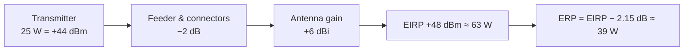
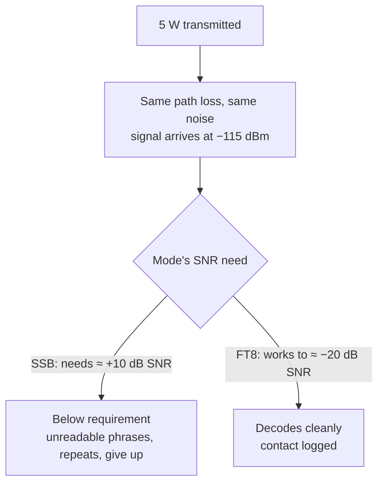

# RF Power

Ask a newcomer what they want from their first station and the answer is usually "more power". Ask an old hand and you will get a wry smile, because power is the most misunderstood commodity in radio: expensive to buy, weakly felt at the far end, and routinely beaten by a better antenna or a smarter mode. This chapter is about what watts actually purchase — and it ends with the most cheering fact in amateur radio: five of them, spent well, will reach the other side of the planet.

## What a watt of RF is

A **watt** is a rate of energy flow — one joule per second — the same unit as on a light bulb or a kettle. **RF power** (radio-frequency power) is that flow in the form of the fast-alternating currents a transmitter produces: your radio takes perhaps 50 W of steady DC from its supply and converts a portion of it into, say, 25 W of oscillation at 7 MHz, which the antenna then launches as the electromagnetic wave of [Electromagnetic Waves](outpost:entry/logbook73.handbook/electromagnetic-waves). (The remainder becomes heat in the transmitter — no converter is perfect, which is why radios have fins and fans.)

For scale: a phone transmits a fraction of a watt; a handheld amateur radio about 5 W; a typical HF transceiver 100 W; a local FM broadcast station tens of kilowatts. Amateurs live in the modest middle — and, as we are about to see, the far end of a contact barely notices whether you are at the top or bottom of it.

## Watts versus what the other station hears

Here is the uncomfortable arithmetic every operator eventually accepts. From [Decibels](outpost:entry/logbook73.handbook/decibels): doubling power buys +3 dB. From the S-meter ladder: one S-unit is 6 dB, a _quadrupling_ of power. Put those together:

| Power change  | In dB  | At the far S-meter   |
| ------------- | ------ | -------------------- |
| 5 W → 10 W    | +3 dB  | half an S-unit       |
| 5 W → 25 W    | +7 dB  | just over one S-unit |
| 25 W → 100 W  | +6 dB  | one S-unit           |
| 100 W → 400 W | +6 dB  | one S-unit           |
| 5 W → 400 W   | +19 dB | barely three S-units |

An eighty-fold increase in power — and in electricity, expense, heat and neighbourly goodwill — moves the distant needle from S4 to S7. Meanwhile the ionosphere hands out 20 dB swings for free ([Propagation](outpost:entry/logbook73.handbook/propagation)), and an antenna upgrade can add 6 dB to _every_ contact in both directions ([Antennas](outpost:entry/logbook73.handbook/antennas)). Received wisdom in the hobby, and it is correct: **the first hundred pounds is best spent above the roof, not inside the shack.** Power matters at the margins — it can lift a signal from unreadable to readable when conditions are marginal — but it is a logarithmic servant, not a linear one.

```viz
{
  "type": "wave",
  "title": "100 W versus 50 W, as the wave itself",
  "caption": "Halve the transmitter power and the wave only settles to about 71% of its height, because power rides on the square of the amplitude — a −3 dB change the far S-meter reads as half an S-unit.",
  "traces": [
    { "kind": "sine", "freq": 7, "amp": 1.0, "label": "100 W", "tone": "primary" },
    { "kind": "sine", "freq": 7, "amp": 0.71, "label": "50 W (−3 dB)", "tone": "muted" }
  ],
  "xLabel": "time →"
}
```

## PEP versus average: which watts are we counting?

"How much power?" turns out to need a second question: _measured how?_ An FM carrier is a steady, constant-amplitude wave — its power is one unmistakable number. But an SSB voice signal (see [Modulation](outpost:entry/logbook73.handbook/modulation) for why) rises and falls moment by moment with your speech: tall spikes on the consonants, near-silence in the gaps. Two honest but different measurements result:

- **PEP (peak envelope power)** — the power at the very crest of the tallest speech peaks. This is the number licence conditions regulate and transmitters are rated by.
- **Average power** — the power smoothed over time, heat-equivalent. For natural speech on SSB this is only about **20–40% of PEP**: a "100 W PEP" SSB signal is delivering perhaps 25 W on average.

Neither number is a fiddle; they answer different questions. PEP tells you what the transmitter must handle without distorting and what the rules cap; average tells you what heats the amplifier and — as the exposure section below shows — contributes to RF safety sums. Just be sure which one a spec, a meter or a licence clause means: a cheap power meter reads something close to average and will show your 100 W SSB rig "only" making 30 W on speech, panicking owners needlessly every day of the week.

## Duty cycle: how hard each mode works the transmitter

Related but distinct: **duty cycle**, the fraction of transmit time your radio spends at full output. Modes differ enormously:

| Mode                     | Transmit duty cycle                                                            | Character                                       |
| ------------------------ | ------------------------------------------------------------------------------ | ----------------------------------------------- |
| FM voice                 | **100%**                                                                       | Full carrier the whole time you hold the button |
| RTTY, many digital modes | **100%**                                                                       | Continuous full-power tones                     |
| [FT8](outpost:entry/logbook73.handbook/ft8)     | **100% while sending** (~13 s bursts each 15 s slot, alternating with receive) | Brutal on finals if run at full rated power     |
| Morse (CW)               | ~40–50%                                                                        | Power only during dits and dahs                 |
| SSB voice                | ~20–40%                                                                        | Power only on speech peaks                      |

Why care? Because transmitters are commonly rated for intermittent duty — "100 W" often means 100 W of SSB's peaks-and-pauses, not 100 W continuously. Run FT8 or FM at the full sticker rating for long overs and the output stage cooks; the standard, kit-preserving advice is to run constant-carrier modes at **half or less of rated power**. Duty cycle also multiplies into exposure calculations: averaged over time, 50 W of SSB speech deposits less energy into the world than 25 W of FT8. Keep this concept warm — it returns in [Transmitters](outpost:entry/logbook73.handbook/transmitters) and [Amplifiers](outpost:entry/logbook73.handbook/amplifiers).

## ERP and EIRP: the power that actually leaves

Licence documents and antenna maths care about one more refinement: not the watts your radio makes, but the watts _effectively radiated in your strongest direction_ after the feeder has taxed the signal and the antenna has focused it. Two closely related measures, differing only in the reference antenna (as in [Decibels](outpost:entry/logbook73.handbook/decibels)):

- **EIRP** (effective isotropic radiated power): transmitter power, minus feeder loss, plus antenna gain in **dBi**.
- **ERP** (effective radiated power): the same, but with gain in **dBd** — so ERP is always 2.15 dB less than EIRP for the same station.



Worked example, exactly as in the diagram: a modest station runs `25 W` (+44 dBm) into 2 dB of coax feeding a small beam of 6 dBi. EIRP = 44 − 2 + 6 = **+48 dBm ≈ 63 W** — a sum the ERP/EIRP calculator will run for your own station. In the beam's favoured direction, the world experiences this 25 W station as a 63 W one — while in other directions it experiences much less, because gain is focus, not creation. Swap the beam for a plain dipole and EIRP is nearer 40 W; use lossy cable and a compromised whip and your 25 W may leave as an effective 10. **Two stations with identical radios can differ by 10 dB before the wave clears the roof.** When you fill in the power field on LogBook73's Console, convention is transmitter output — but the number the ionosphere sees is EIRP, and the gap between the two is where stations are really won and lost.

## Why 5 W of FT8 works the world while 5 W of SSB struggles

Now the chapter's centrepiece — the puzzle that live data will happily confirm. Open the reporting map at **pskreporter.info** any evening: 5 W FT8 stations spanning oceans, while 100 W SSB stations grumble about a dead band. Same physics, same ionosphere. The explanation is that _watts are only half of a signal's fate; what the receiving system needs is the other half._

Every mode requires a certain signal-to-noise ratio (SNR) to convey its information — how far above (or below!) the local noise the signal must sit to be understood. The requirements differ staggeringly:

- **SSB voice** needs roughly **+10 dB SNR** in its ~2.4 kHz channel for comfortable copy. Ears and brains are marvels, but they need the voice audibly above the hiss.
- **FT8** decodes reliably down to about **−20 dB SNR** (referenced to a 2.5 kHz bandwidth) — the signal can be a _hundredth_ of the noise power and still print. It manages this by being slow and narrow: each transmission carries just a few dozen bits in 13 seconds within a ~50 Hz slice, letting the computer integrate coherently while the wideband noise averages away. (The full mechanism — narrow bandwidth admitting less noise, plus error-correcting coding — is unpacked in [Noise](outpost:entry/logbook73.handbook/noise) and [FT8](outpost:entry/logbook73.handbook/ft8).)

The gap between +10 and −20 is **30 dB — a factor of a thousand in power**. So for the same path and antennas:



Put the same 30 dB the other way round: for FT8 to match SSB's reach, the SSB station would need a thousand times the power — your 5 W FT8 signal is, in effective communication terms, a **5 kW** SSB signal. That is the entire modern QRP (low-power) revolution in one sentence, and it is why the trade-off is really _power versus patience versus information_: FT8 buys its miracle by sending only callsigns, locators and reports, slowly. You cannot chat over FT8; you can cross the Pacific with the output of a bicycle light. Choose per occasion — many operators run both in the same evening.

## Modest power, and why it is plenty

Entry-level licences typically allow modest power — often a few tens of watts, with higher licence classes permitting more (the class-ladder idea, and where to find your country's exact figures, live in [Getting Licensed](outpost:entry/logbook73.handbook/getting-licensed); limits do get revised, so always check your regulator's current terms). Newcomers often read such a limit as a training-wheels restriction. Take 25 W as a representative example and run the numbers from this chapter instead:

- 25 W is +44 dBm — only **6 dB**, one S-unit, below the 100 W of a typical full-size transceiver.
- Into a decent antenna, 25 W of SSB works real intercontinental contacts whenever conditions cooperate.
- On FT8, 25 W is frankly lavish: most FT8 stations worldwide, whatever their licence, choose to run 5–25 W because more adds little but interference to neighbours on the band.

An entry-level power limit teaches precisely the right lesson at precisely the right time: since brute force is capped, improvement must come from antennas, timing, band choice and operating skill — which is where improvement was always cheapest anyway. Many operators keep working at QRP levels long after their licence allows hundreds of watts, for the sport of it.

## RF exposure: the honest basics

RF energy is **non-ionising** — as [Electromagnetic Waves](outpost:entry/logbook73.handbook/electromagnetic-waves) explained, it cannot break chemical bonds or damage DNA the way X-rays can, at any power. Its one established biological effect at amateur levels is **heating** of tissue, the microwave-oven mechanism, and the safety framework is built around keeping that heating negligible. Exposure falls off rapidly with distance from an antenna, and it scales with _average_ power — which is where PEP, duty cycle and EIRP from earlier in this chapter all reconvene into one practical calculation.

Most regulators require amateurs to verify their station complies with exposure guidelines based on the international ICNIRP (or similar) limits — in practice, showing that people cannot linger closer to your antenna than a calculated safe distance. For typical entry-level stations the sums are reassuring: a few tens of watts of intermittent SSB into a wire at roof height clears the requirements with room to spare, and regulators and national societies (the RSGB and ARRL among them) publish free calculators and guidance that walk you through your specific case — do the check, keep the record; it takes an evening.

> **Safety note.** Keep antennas out of reach of people while transmitting — height does this for free. Never touch an antenna or exposed feeder when transmitting: even modest HF power can cause a startling, and at higher powers a burn-inducing, "RF bite". Think of higher-duty modes (FM, FT8) as counting double in exposure terms. And treat the _other_ energies around a station with more respect than the RF: mains wiring, antenna masts near power lines, and ladders account for the hobby's real accidents. None of this is alarming at amateur power levels — it is the same tier of care as handling a hot kettle sensibly.

## Try it yourself

1. **Watch power lose to propagation.** On **pskreporter.info**, find several FT8 spots and compare reported SNR against distance for stations you know run QRP (many callsigns advertise "5W" in comments on the air). You will find 5 W signals out-reporting 100 W ones constantly, because path and antenna dominate. Cross-check band conditions on LogBook73's Propagation page as you do it.
2. **Hear what an S-unit is worth.** With any receiver, find a steady signal (a beacon from LogBook73's Beacons page is ideal — beacons transmit at fixed, published powers) and watch the S-meter through fades. Notice how a "huge" 6 dB fade — a factor of four in power, your entire 25 W-vs-100 W debate — comes and goes within a minute of natural fading. That is why chasing watts underwhelms.
3. **Do a paper exposure check.** Take your real or planned station — power, mode duty cycle, antenna type, distance to where people can stand — and run it through your regulator's or national society's RF exposure calculator (Ofcom and the RSGB publish one in the UK, the FCC and ARRL in the US; others have equivalents). Seeing your own numbers pass, and by how much, converts a vague worry into a known quantity.

## Key takeaways

- Watts are felt logarithmically: ×4 power = one S-unit at the far end, so an 80-fold power increase buys barely three S-units — antennas and band choice are cheaper decibels.
- **PEP** is the regulated peak of a signal; **average** power (20–40% of PEP on SSB speech) is what heats things and drives exposure sums — know which your meter and your licence mean.
- **Duty cycle** varies from ~25% (SSB) to 100% (FM, FT8): run constant-carrier modes at half your radio's rating, and count them double for exposure.
- **ERP/EIRP** — transmitter power minus feeder loss plus antenna gain — is the power the world actually experiences; identical radios can differ by 10 dB at the antenna.
- Modes differ by ~30 dB in required SNR: that is why 5 W of FT8 genuinely equals kilowatt-class SSB reach, at the price of sending very little, slowly.
- A typical entry-level limit of a few tens of watts is about one S-unit below a 100 W station and forces exactly the right habits; RF is non-ionising, and a simple exposure check plus keep-out-of-reach common sense covers safety.

That closes the Foundations part: you can now place a signal on the spectrum, measure it in dB, and budget its power — next we make the wave actually _say_ something, in [Modulation](outpost:entry/logbook73.handbook/modulation).
