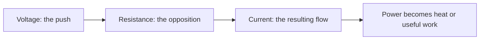
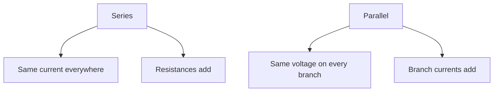

# Electrical Circuits & Components

A radio is a collection of small electrical decisions: where current may flow, how far a voltage is reduced, and which frequencies a circuit accepts. Once you can read those decisions, a circuit diagram stops looking like secret writing and starts looking like a map. This chapter builds that bridge from the values printed on components to the behaviour of a working radio.

## Voltage, current and resistance

**Voltage** is electrical push, measured in volts (`V`). **Current** is the rate at which charge flows, measured in amperes (`A`). **Resistance** opposes that flow and is measured in ohms (`Ω`). The three are tied together by Ohm's law:

`V = I × R`

The formula can be rearranged to `I = V / R` or `R = V / I`. Suppose a `12 V` supply feeds a `120 Ω` resistor. The current is `12 / 120 = 0.1 A`, or `100 mA`. That current also turns electrical energy into heat. Power is:

`P = V × I`

So the resistor dissipates `12 × 0.1 = 1.2 W`. A little `0.25 W` resistor would overheat; a `2 W` part would be a sensible minimum. A resistance value alone never tells you whether a resistor is physically large enough for the job.

Real components are not exact. A `1 kΩ` resistor with a `5%` **tolerance** may measure anywhere from `950 Ω` to `1.05 kΩ` and still be correct. Tolerance is a manufacturing promise, not a fault. Radio circuits are designed so ordinary variation does not upset them, while frequency-setting circuits use tighter-tolerance parts where it matters.

Temperature and age can move a value further. That is why a frequency reference, filter or measuring instrument may specify low-temperature-coefficient parts while an LED indicator uses ordinary ones. The right question is not “does this part equal the label to the last digit?” but “is its actual value suitable for this job, under the conditions in which it will work?”



Prefixes keep the numbers readable: `1 kΩ = 1,000 Ω`, `1 MΩ = 1,000,000 Ω`, `1 mA = 0.001 A`, `1 µF = 0.000001 F`, and `1 pF = 0.000000000001 F`. Converting the prefix before calculating prevents most mistakes.

## Reading a circuit as connected points

A circuit diagram shows electrical relationships, not the physical positions of parts. A line is a conductor; a filled dot means lines join; crossing lines without a junction dot normally do not. Every place joined by ideal wire is one **node** and therefore at one voltage. The ground symbol is the circuit's chosen `0 V` reference—it need not be connected to the soil.

Learn a small set of component symbols rather than trying to memorise a whole poster: cell and battery, resistor, variable resistor, capacitor, polarised capacitor, inductor, transformer, diode, light-emitting diode, NPN transistor, switch, fuse, earth, antenna, microphone and loudspeaker. A diagram then reads like a sentence: “battery through fuse and switch feeds the amplifier; capacitor passes audio into it; resistor returns the input to ground.”

Current requires a complete path back to its source. When a new circuit appears confusing, trace one loop at a time from the positive supply, through a component or block, and back to the negative return. Then mark the nodes whose voltages matter. This approach is more reliable than following the drawing from left to right, because a drafter may put the same supply rail at several places to avoid a forest of lines.

## Resistors in series and parallel

Components are **in series** when the same current must pass through each in turn. Series resistances add:

`Rtotal = R1 + R2 + R3`

Two `1 kΩ` resistors in series make `2 kΩ`. Put that chain across `12 V` and the current is `12 / 2,000 = 0.006 A`, or `6 mA`. Each equal resistor drops half the supply voltage.

Components are **in parallel** when both ends of each component join the same two points. Each branch sees the same voltage, while the branch currents add. For two resistors:

`1 / Rtotal = 1 / R1 + 1 / R2`

Two equal resistors in parallel always make half their individual value, so two `1 kΩ` resistors make `500 Ω`. The total resistance is lower than either branch because current has two paths. With `12 V` across the pair, each branch takes `12 mA`, giving `24 mA` in total.



A **potential divider** uses two series resistors to take a chosen fraction of a voltage from their junction:

`Vout = Vin × R2 / (R1 + R2)`

With `R1 = 3 kΩ`, `R2 = 1 kΩ` and `Vin = 12 V`, the output is `12 × 1 / 4 = 3 V`. This is how a circuit creates a bias or a measurement reference. It is not a free power supply: connecting a heavy load in parallel with `R2` changes the effective resistance and pulls the output down.

That droop introduces **source resistance**. An ideal `12 V` source would remain at `12 V` whatever current you asked for. A real battery, divider or signal source has internal resistance, so its terminal voltage falls as current rises. The open-circuit voltage is its **electromotive force** (EMF); the voltage available under load is the terminal potential difference (PD). The same idea explains a tired battery that reads normally with no load but collapses when the transmitter keys.

## Capacitors: charge stored in an electric field

A **capacitor** has two conductive plates separated by an insulator called the dielectric. It stores energy in an electric field and its capacitance is measured in farads (`F`). Larger plates, a smaller gap and a more effective dielectric all increase capacitance.

Capacitors in parallel add directly:

`Ctotal = C1 + C2 + C3`

For capacitors in series, the reciprocal values add:

`1 / Ctotal = 1 / C1 + 1 / C2`

This is the reverse of resistors. Two equal `100 nF` capacitors make `200 nF` in parallel but `50 nF` in series.

Some capacitors, especially electrolytics, are **polarised**. Their positive and negative markings must be respected; reverse connection can damage the part or make it vent violently. Every capacitor also has a maximum voltage rating. A large capacitor can retain a dangerous charge after equipment has been switched off, so never assume that unplugged means discharged.

## Inductors: energy stored in a magnetic field

Current in a wire creates a magnetic field. Wind the wire into a coil and the fields from each turn reinforce one another, making an **inductor**. Inductance is measured in henries (`H`). More turns, a wider coil, closer spacing and a high-permeability iron or ferrite core generally increase inductance. A movable ferrite slug provides a convenient way to tune a coil.

Inductors follow the opposite combination rules to capacitors. Series inductances add; for parallel inductors, the reciprocal values add. These simple rules assume the coils are far enough apart not to share their magnetic fields.

Moving a conductor through a magnetic field induces a voltage. Changing the current in a coil therefore induces a voltage that opposes the change which created it. This is why an inductor resists rapid changes of current and why interrupting current through a relay coil can produce a surprisingly high voltage spike.

## AC, RMS and phase

Direct current (`DC`) keeps one direction. Alternating current (`AC`) reverses repeatedly. A sine wave needs both an amplitude and a frequency; its **period** is the time taken for one complete cycle:

`T = 1 / f` and `f = 1 / T`

A `1 kHz` signal has a period of `1 / 1,000 = 0.001 s`, or `1 ms`. A square wave switches abruptly between levels and contains many harmonics, so it occupies much more spectrum than a pure sine wave.

The peak of an AC waveform is not the same as its heating effect. The **root mean square** (`RMS`) value is the DC value that would produce the same heating in a resistor. For a sine wave:

`Vrms = 0.707 × Vpeak`

A `10 V` peak sine wave is therefore about `7.07 V RMS`. Mains and audio voltages are normally quoted as RMS unless stated otherwise.

Voltage and current through a resistor rise and fall together: they are **in phase**. Capacitors and inductors store and return energy, so voltage and current no longer reach their peaks together. The separation is a **phase difference**, measured in degrees around one cycle. The Intermediate-level idea to hold onto is that pure reactance shifts timing but does not consume average power as heat.

## Reactance and impedance

A capacitor blocks steady DC after charging, but repeated reversal lets AC current pass. Its opposition, **capacitive reactance**, falls as frequency rises:

`XC = 1 / (2 × π × f × C)`

An inductor passes steady DC but increasingly resists rapid change. Its **inductive reactance** rises with frequency:

`XL = 2 × π × f × L`

Both are measured in ohms. **Impedance** is the wider name for a circuit's opposition when resistance and reactance are both present. The detailed vector maths belongs later; for now, remember that resistance transfers energy into heat while reactance stores and returns it. [Impedance](outpost:entry/logbook73.handbook/impedance) develops this in the context of feedlines and antennas.

```viz
{"type":"wave","title":"Reactance changes in opposite directions","caption":"Capacitive reactance falls with frequency while inductive reactance rises.","xLabel":"Frequency","traces":[{"kind":"points","points":[[0,0.9],[0.2,0.45],[0.4,0.2],[0.6,0.05],[0.8,-0.05],[1,-0.12]],"label":"XC","tone":"primary"},{"kind":"points","points":[[0,-0.75],[0.2,-0.45],[0.4,-0.15],[0.6,0.15],[0.8,0.45],[1,0.75]],"label":"XL","tone":"success"}]}
```

## Resonance, selectivity and Q

Put an inductor and capacitor together and energy shuttles between the capacitor's electric field and the inductor's magnetic field. At one frequency their reactances are equal: `XL = XC`. The circuit is then **resonant**.

A series-tuned circuit presents low impedance at resonance, so it readily passes that frequency. A parallel-tuned circuit presents high impedance at resonance. Both can select one part of the spectrum. Increasing either `L` or `C` lowers the resonant frequency; decreasing either raises it.

```viz
{"type":"response","title":"A tuned circuit selects a neighbourhood","caption":"The centre is resonance; the width is the accepted bandwidth.","curve":{"preset":"resonance","f0":50,"bw":18},"markers":[{"x":50,"label":"Resonance"}],"xLabel":"Frequency","yLabel":"Response"}
```

The sharpness is described by the **Q factor**. A high-Q circuit has a narrow bandwidth and strong selectivity; a low-Q circuit accepts a wider range. Real coils have wire resistance and real capacitors have losses, so energy leaks away and Q is finite. The ideas appear again in [Filters](outpost:entry/logbook73.handbook/filters), where low-pass, high-pass, band-pass and band-stop networks turn these component behaviours into useful signal shaping.

Component choice decides whether the calculation survives reality. A coil's core material may become lossy outside its intended frequency range. A capacitor may have the right capacitance but an inadequate voltage rating or dielectric. Stray capacitance between tracks and stray inductance in long leads become part of the tuned circuit at VHF and above. The schematic tells you the intended components; construction decides how closely the physical circuit behaves like that schematic.

## Try it yourself

Use the Ohm's law calculator to design a divider that turns `12 V` into about `5 V`. Choose ordinary resistor values, then calculate what happens if a `10 kΩ` load is connected across the lower resistor. If you have a multimeter and a breadboard, build the divider from a battery or low-voltage supply and compare the measured unloaded and loaded voltages. Never practise inside mains-powered or transmitting equipment.

## Key takeaways

- Ohm's law connects voltage, current and resistance; `P = V × I` connects them to heat and useful power.
- Series components share current; parallel branches share voltage.
- A potential divider creates a fraction of a voltage, but a load and source resistance can pull it down.
- Capacitors store energy in an electric field; inductors store it in a magnetic field.
- Capacitive reactance falls with frequency while inductive reactance rises.
- At resonance, equal and opposite reactances create a frequency-selective circuit; Q describes how sharp it is.

Next, [Semiconductors & Power Supplies](outpost:entry/logbook73.handbook/semiconductors-and-power-supplies) turns these passive building blocks into rectifiers, amplifiers, oscillators and a clean source of DC.
