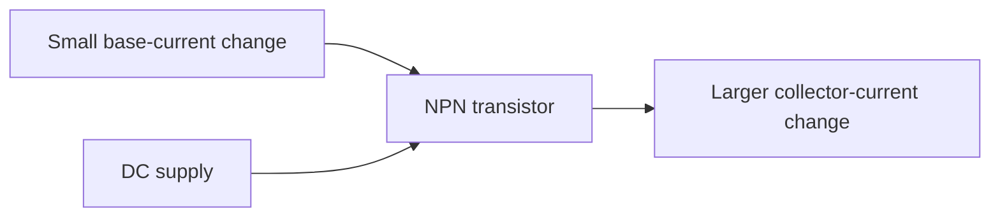
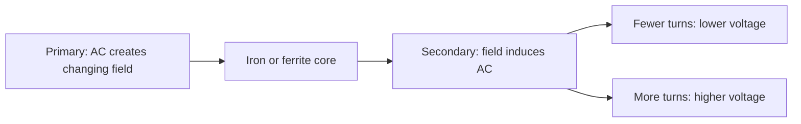

# Semiconductors & Power Supplies

Resistors, capacitors and inductors shape electricity, but they do not make decisions. Semiconductors do: a diode chooses a direction, a transistor lets a small signal control a larger one, and an integrated circuit puts thousands or millions of those choices in one package. Together with transformers and power supplies, they are the active machinery inside a radio.

## Diodes: the one-way junction

A **diode** is made from a semiconductor junction with two terminals, anode and cathode. When it is **forward biased**, the applied voltage pushes charge carriers across a thin depletion region and current flows. Reverse the voltage and the depletion region widens, so ordinary current stops. That one-way behaviour makes the diode radio's electrical check valve.


Using a diode to turn AC into DC is **rectification**. A half-wave rectifier uses one half of each AC cycle and wastes the other. A full-wave circuit uses both halves; a four-diode **bridge rectifier** does this without needing a centre-tapped transformer. The raw output is still a train of pulses. A large **reservoir capacitor** charges near each peak and releases energy between peaks, filling the gaps and reducing ripple.

Diodes have limits: maximum forward current, reverse voltage and power dissipation. A reversed electrolytic capacitor or an underrated rectifier can fail dramatically, so component ratings matter as much as nominal values.

A reverse-biased **variable-capacitance diode** or varicap deliberately uses the junction as a tiny capacitor. Increasing reverse bias changes the depletion-layer width and therefore its capacitance. Put it in a tuned circuit and a control voltage can tune an oscillator or create frequency modulation with no moving parts.

Several other diode roles appear around a radio. A diode across a relay coil provides a safe route for the voltage spike when current is switched off. A pair of diodes can limit an audio signal before it overloads a following stage. A light-emitting diode (`LED`) turns current into light, but still needs a series resistor to limit that current. The symbol and package may differ, yet the design question stays the same: which way may current flow, and what voltage and current can the junction tolerate?

## Transistors: a small control, a larger result

A bipolar junction transistor (`BJT`) has three terminals: emitter, base and collector. In an NPN transistor, a small base current controls a larger collector current. Their ratio is the current gain, written `β` or `hFE`:

`β = Ic / Ib`

If `1 mA` of base current produces `100 mA` of collector current, the current gain is `100`. This is not free energy—the power supply provides the collector power—but the small input signal controls it.



A transistor needs the correct steady DC operating conditions, called **bias**. Bias places it in the useful part of its range so an alternating signal can swing both ways without clipping. A simple **common-emitter amplifier** applies the signal to the base and takes the output from the collector. The output is amplified and inverted: when base current rises, collector voltage falls.

Drive the base gently and the transistor behaves as an amplifier. Drive it hard between fully off and fully on and it behaves as a switch, controlling a relay, LED or keying line. [Amplifiers](outpost:entry/logbook73.handbook/amplifiers) explores gain, linearity, classes and heat in more depth.

A field-effect transistor (`FET`) controls current using an electric field at its gate rather than base current. The detailed bias arrangements differ, but the useful picture is the same: a small input controls a larger current. FETs' very high input resistance makes them especially useful at receiver inputs and in measurement circuits.

Bias and signal must be kept distinct. The DC bias establishes a quiet operating point; the wanted AC audio or RF then moves around it. **Coupling capacitors** pass the changing signal between stages while blocking their different DC bias voltages. **Decoupling capacitors** give unwanted AC or RF on a supply rail a short local route to the return. A circuit may therefore contain capacitors that look similar but perform opposite-sounding jobs: one deliberately carries the wanted change onward, while another removes unwanted change from a supply.

## Oscillators and integrated circuits

Feed some of an amplifier's output back to its input with the correct phase and amount and it can sustain an oscillation. A tuned `LC` circuit produces a variable-frequency oscillator (`VFO`); a quartz crystal produces a much more stable reference. A buffer stage isolates the oscillator from changing loads so tuning elsewhere does not pull its frequency. Modern rigs usually derive their frequencies from a crystal reference and digital synthesis, as described in [Oscillators](outpost:entry/logbook73.handbook/oscillators).

An **integrated circuit** (`IC`) fabricates many semiconductor devices and their connections on one substrate. An IC may be a complete audio amplifier, voltage regulator, oscillator, mixer, analogue-to-digital converter or digital processor. Treat the package as a functional block while remembering that familiar diodes and transistors are working inside it.

## Transformers: transferring changing fields

A transformer has two coils sharing a magnetic field. Alternating current in the primary creates a changing field; that field induces an alternating voltage in the secondary. Constant DC creates no continuing change, so an ordinary transformer cannot pass steady DC.



The turns ratio sets the voltage ratio:

`Vs / Vp = Ns / Np`

A mains transformer with `1,150` primary turns and `60` secondary turns gives about `230 × 60 / 1,150 = 12 V AC` before rectification. Ignoring losses, power in roughly equals power out, so stepping voltage down allows current to rise. Never experiment on mains transformers unless you are trained and properly equipped; an isolated low-voltage signal transformer is the safe teaching version.

Iron cores suit low frequencies such as mains. Ferrite cores lose less energy at radio and intermediate frequencies. Transformers can also isolate circuits and transform impedance, which is why small ferrite transformers appear in mixers, antenna matching units and baluns.

## Cells, batteries and capacity

A cell converts stored chemical energy into electrical energy; a battery is one or more cells. Different chemistries produce different cell voltages and behave differently under load. Nickel-metal hydride, lead-acid, lithium-ion and lithium iron phosphate are not interchangeable merely because a pack has similar dimensions.

Battery capacity is quoted in ampere-hours (`Ah`). A `6 Ah` battery could ideally supply `1 A` for six hours or `3 A` for two hours. Real capacity changes with current, temperature, age and the safe discharge limit. A radio drawing `0.5 A` on receive and `8 A` on transmit will not last `6 / 8` hours because it does not transmit continuously; estimate an average from the operating duty cycle.

Rechargeable cells require a charger designed for their chemistry and series-cell count. Battery terminals can deliver enough current to melt tools and start fires, even at only `12 V`, so fuse close to the positive terminal. Recycle spent cells through an appropriate collection scheme.

## From mains AC to clean DC

A traditional linear station supply follows a recognisable chain:


The transformer isolates and lowers the voltage. The bridge uses both halves of the waveform. The reservoir capacitor smooths the pulsed DC, and the regulator removes most remaining ripple while holding a steady output as load changes.

These stages can be diagnosed from their waveforms. Before the bridge is a sine wave centred around zero. Immediately after it, both half-cycles point the same way. After the reservoir, the voltage rises quickly near each peak and slopes down between them. After a healthy regulator, it is almost flat. Following that sequence is more useful than memorising a drawing: if the expected shape disappears between two points, the faulty stage lies between them.

The transformer and rectifier must be sized for more than the final DC number. Diodes conduct in short, heavy pulses near the AC peaks while they recharge the reservoir, and the unloaded DC voltage can rise above the nominal value. Designers allow margin in diode current, reverse-voltage and capacitor-voltage ratings rather than choosing parts exactly at the calculated limit.

A **linear regulator** is electrically quiet but burns the unwanted voltage as heat. Dropping `18 V` to `13.8 V` at `10 A` means about `(18 − 13.8) × 10 = 42 W` of heat. That calls for a substantial heatsink.

A **switch-mode power supply** (`SMPS`) switches current rapidly and uses compact magnetic components, making it lighter and more efficient. Poor designs can radiate or conduct switching noise across HF. A good amateur-radio supply combines proper filtering, screening and layout with adequate current capacity. Light and efficient does not mean inherently noisy; it means RF performance belongs on the buying checklist.

Supplies also need protection. A fuse protects wiring against excess current; it does not guarantee that a sensitive transistor survives first. Reverse-polarity protection, transient suppression, thermal shutdown and current limiting each address a different failure. When replacing a fuse, use the stated current and time characteristic—fast and time-delay fuses are not interchangeable merely because the number on them matches.

Regulation and smoothing solve different problems. The reservoir capacitor reduces the deep gaps between rectifier peaks; the regulator holds the output at the chosen voltage as the input and load vary. Small capacitors close to each IC then handle rapid local current changes that a distant reservoir cannot supply through long wiring. If a receiver has a steady hum at twice the mains frequency, suspect rectification or smoothing. If it breaks into a buzzing comb of evenly spaced signals across HF, suspect switching noise or poor decoupling. The sound or spectrum is evidence about which part of the supply chain is failing.

Current rating needs headroom. A `20 A` transceiver does not belong on a supply that can deliver `20 A` only briefly or with its cooling fan obstructed. Voltage drop in thin DC leads can make a perfectly healthy supply look faulty at the radio, especially on transmit. Measure at the radio while it is keyed into a dummy load: the difference from the supply terminals reveals cable and connector loss under real current.

```viz
{"type":"wave","title":"Smoothing a rectified supply","caption":"The reservoir capacitor charges at each peak and supports the load between them.","xLabel":"Time","traces":[{"kind":"points","points":[[0,0],[0.08,0.85],[0.16,0.25],[0.24,0.85],[0.32,0.25],[0.40,0.85],[0.48,0.25],[0.56,0.85],[0.64,0.25],[0.72,0.85],[0.80,0.25],[0.88,0.85],[1,0.25]],"label":"Rectified","tone":"muted"},{"kind":"points","points":[[0,0.55],[0.08,0.78],[0.16,0.64],[0.24,0.78],[0.32,0.64],[0.40,0.78],[0.48,0.64],[0.56,0.78],[0.64,0.64],[0.72,0.78],[0.80,0.64],[0.88,0.78],[1,0.64]],"label":"Smoothed","tone":"primary"}]}
```

## Try it yourself

Without opening any mains equipment, follow the DC path on a circuit diagram for a small battery-powered project. Mark the input protection, regulator, smoothing or decoupling capacitors, and every point at which the supply feeds another block. If you have a breadboard, a low-voltage AC source and suitable components, compare the waveform or multimeter voltage after a diode and after a reservoir capacitor. Use current-limited, isolated low voltage only.

For a no-hardware exercise, size a portable battery. Suppose a radio receives at `0.6 A`, transmits at `6 A`, and you expect to transmit for one minute in every ten. The average is `(0.9 × 0.6) + (0.1 × 6) = 1.14 A`. A `6 Ah` battery gives a theoretical `6 / 1.14 ≈ 5.3 hours`; allowing margin for temperature, voltage sag and avoiding a complete discharge turns that into a more credible operating plan.

## Key takeaways

- A diode conducts mainly in one direction; rectifiers use that behaviour to produce pulsing DC from AC.
- A reservoir capacitor stores charge between rectifier peaks and reduces ripple.
- A transistor lets a small input control a larger current; correct DC bias makes linear amplification possible.
- Transformers transfer changing magnetic fields, change AC voltage according to turns ratio and provide isolation.
- Battery capacity is stored charge in ampere-hours, not a promise of runtime under every load.
- Linear supplies are quiet but hot and heavy; switch-mode supplies are efficient and light but demand good RF filtering.

Next, [Measurement, Soldering & Fault Finding](outpost:entry/logbook73.handbook/measurement-and-construction) shows how to test these ideas without guessing—or damaging the circuit under test.
