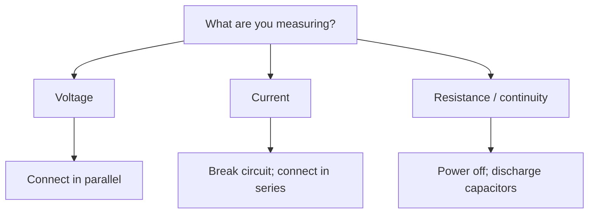
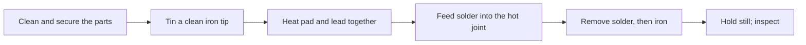
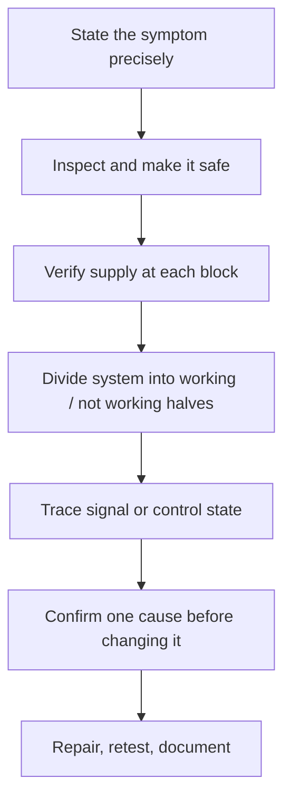

# Measurement, Soldering & Fault Finding

Building radio equipment is not a contest to solder the most parts. The real skill is making one sound joint, measuring without disturbing the circuit, and narrowing a fault until only one explanation remains. Those habits turn a kit from a bag of components into a dependable station—and make repairs calm rather than mysterious.

## The multimeter: three instruments in one

A digital multimeter normally measures voltage, current and resistance. Before connecting it, decide which quantity you need, whether it is AC or DC, the expected range, and the correct socket for the leads. If the value is uncertain, start on a range safely above it and work down.

To measure **voltage**, connect the meter in parallel across the two points. A voltmeter has high internal resistance so it draws very little current and changes the circuit as little as possible.

To measure **current**, the meter must become part of the current path, so connect it in series. An ammeter has very low internal resistance to minimise its voltage drop. Placing a meter set to current directly across a battery makes a short circuit; at best the meter fuse blows, and at worst the leads or battery overheat.

Resistance and continuity measurements use the meter's own small test source, so switch the circuit off and discharge capacitors first. Measuring resistance in-circuit may include parallel paths and produce a lower value than the component marking. When the number matters, lift one component lead or understand the surrounding circuit.

Analogue meters make trends and peaks easy to see, but their movement is fragile and their lower input resistance can load a circuit. Digital meters are robust, accurate and easy to read, though a rapidly changing last digit can hide the direction of change. Neither is universally better; choose the display that answers the question.

## Measurement changes the thing measured

Every instrument becomes part of the circuit. A voltmeter's high resistance is still finite; an ammeter adds a small resistance; an oscilloscope probe adds resistance and capacitance. At audio or DC this effect is often negligible. In a high-impedance tuned circuit at VHF, touching a probe can shift the frequency enough to make the apparent fault disappear.

This is called **loading**. Record the instrument, range, probe setting and measurement point when a result is important. Repeatable measurements beat impressive-looking precision.

Accuracy and resolution are different. A display may show six digits while its calibration only supports four of them. Leads have resistance, probes pick up hum, instrument references drift with time and every specification applies over a stated range. For ordinary fault finding, a stable result that clearly separates `0 V`, `5 V` and `12 V` is often more valuable than chasing the last millivolt. For frequency alignment or power verification, calibration and uncertainty become part of the answer.

The safest first checks are often unpowered:

1. Compare component values and polarities with the diagram.
2. Check continuity where a connection should exist.
3. Check resistance where a short must not exist.
4. Inspect for solder bridges, clipped leads and connectors fitted to the wrong pins.
5. Only then apply a current-limited supply and measure voltages.

## Reading component markings

Through-hole resistor bands encode digits, a multiplier and tolerance. The digit colours are:

| Colour | Digit |
| ------ | ----: |
| Black  |     0 |
| Brown  |     1 |
| Red    |     2 |
| Orange |     3 |
| Yellow |     4 |
| Green  |     5 |
| Blue   |     6 |
| Violet |     7 |
| Grey   |     8 |
| White  |     9 |

On a four-band resistor, the first two bands are digits, the third is the multiplier and the fourth is tolerance. Brown-black-red-gold is `10 × 100 = 1,000 Ω`, or `1 kΩ`, at `5%`. A five-band precision resistor uses three digits before the multiplier. Gold tolerance is `5%`; silver is `10%`.

Printed notation avoids a decimal point that could vanish: `4R7` means `4.7 Ω`, `3k3` means `3.3 kΩ`, and `1M0` means `1.0 MΩ`. A three-digit capacitor code gives two significant figures and a picofarad multiplier, so `103` means `10 × 10³ pF = 10 nF`. Always check the component family and circuit context rather than decoding a marking in isolation.

## Choosing the instrument that answers the question

A multimeter is excellent for steady or slowly changing values, but it cannot show waveform shape. An **oscilloscope** plots voltage against time, revealing clipping, ripple, oscillation and timing. Its vertical scale says volts per division and its horizontal scale says time per division. If one cycle spans four divisions at `0.5 ms/div`, the period is `2 ms` and the frequency is `1 / 0.002 = 500 Hz`.

A **frequency counter** counts cycles against an internal time reference. It gives a precise-looking number, but accuracy can be no better than its reference and a weak, distorted or wrongly levelled input can produce nonsense. A **signal generator** supplies a known test signal to a receiver stage. It too has a source impedance—often `50 Ω`—so its displayed level assumes the intended load.

An RF power meter measures energy delivered to a load. For DC circuits you can determine power from measured voltage and current using `P = V × I`. For a transmitter, use a correctly rated `50 Ω` dummy load and an RF instrument designed for the frequency and power. Never connect a transmitter directly to an oscilloscope, counter or spectrum analyser unless a proven attenuation chain reduces the signal below every input limit.

An SWR meter separates forward and reflected samples on a feedline. It answers whether the load is matched, not whether the transmitted signal is clean. A spectrum analyser answers the different question by showing energy against frequency, making harmonics and spurious outputs visible. Good measurement begins by naming the question before choosing the instrument.

## Soldering: heat the joint, not the solder

Solder is a low-melting alloy that forms an electrical and mechanical bond. **Flux** removes surface oxide while the joint is hot and helps molten solder wet clean metal. The iron's tip must be clean and lightly tinned so heat crosses into the work efficiently.

For a good joint:

1. Mechanically place the lead so it will not move.
2. Touch the iron to both pad and lead.
3. Feed a small amount of solder to the heated joint—not onto the iron tip.
4. Remove the solder, then the iron, and hold everything still while it freezes.

A sound joint has flowed over both surfaces. A dull blob sitting on one part often means insufficient heat, contamination or movement while cooling. Too much heat can lift a PCB pad, melt insulation or damage a semiconductor. Work briskly, allow parts to cool, and use ventilation because flux fumes are irritating.

**Tinning** a stranded wire before joining it keeps the strands together and helps heat flow quickly. Do not let solder wick far under flexible insulation where it creates a rigid point that will fatigue and break.

## Layout, screening and RF behaviour

At DC, a wire is mostly just a connection. At RF, its length and route add inductance, capacitance and unintended coupling. Keep signal paths short, give currents a clear return path, place decoupling capacitors close to the devices they serve, and separate sensitive inputs from power-amplifier outputs.

Thin metal screening between stages can reduce unwanted radiation and feedback. The screen only works when it has a low-impedance connection to the circuit reference and does not leave signal-carrying wires wandering around it. A neat layout is not cosmetic; it makes the intended circuit stronger than all the accidental ones.

Connectors need strain relief so cable movement does not stress soldered joints. Coaxial cable shields should be terminated around the connector rather than by a long thin pigtail at VHF and above. Label both ends of field cables while you still remember where they go.

## Fault finding as a sequence

Randomly replacing parts is expensive and can introduce new faults. A better method follows the signal and the power.

Start with a precise symptom: “receiver has normal display and audio hiss but no signals on any band” is useful; “radio dead” is not. Check what still works, what changed before the fault, and whether the problem follows a cable, antenna, power source or operating mode.

Then divide the equipment into blocks. If the transmitter produces correct power into a dummy load, the fault lies beyond the transmitter. If audio reaches the input of an amplifier but not its output, the suspect area is now one stage. **Half-split testing**—checking near the middle of a chain, then choosing the faulty half—finds a bad block quickly.

Power-rail checks come before signal tracing. A stage with no supply cannot amplify anything. Compare measured voltages with the diagram, a service manual or an identical working channel. A voltage that is too low may be the cause, or it may be evidence that a downstream part is drawing too much current.

Use a dummy load for transmitter tests so faults do not become unwanted emissions. Begin at the lowest practical power. An RF power/SWR meter confirms energy is moving but does not prove spectral cleanliness; a receiver, spectrum analyser or properly arranged off-air check is needed for harmonics and spurious signals. [TinySA](outpost:entry/logbook73.handbook/tinysa) covers safe spectrum checks, including the attenuation required before any wired transmitter measurement.

## Safe workshop habits

Work on low-voltage, current-limited projects while learning. Remove rings and metal watch straps around batteries. Fuse power leads close to the source. Wear eye protection when clipping leads, drilling or cutting wire, and hold work in a vice rather than in your hand.

Mains-powered equipment, valve amplifiers and large power supplies can retain lethal voltages after disconnection. Do not open or probe them unless you have the training, isolation arrangements and discharge procedure for that equipment. “Switched off” and “unplugged” are not measurements.

Before a first power-up, use a current-limited bench supply if available. Set a conservative limit, watch the current and be ready to disconnect. Unexpected current, smell, heat or smoke means remove power immediately and investigate; it is not a cue to turn the limit higher.

## Try it yourself

Take a discarded low-voltage cable or an unpowered kit board and perform a five-minute inspection: identify the supply path, check continuity end to end, look for a short between positive and negative, decode three resistor markings, and inspect every solder joint under strong light. Write the expected result before each measurement. That one habit—predict, measure, explain—turns meter readings into understanding.

## Key takeaways

- A voltmeter goes in parallel; an ammeter goes in series; resistance is measured with power removed.
- Instruments load circuits, so range, probe and connection method are part of the result.
- Component markings include value and tolerance; verify them before soldering.
- A clean, tinned tip transfers heat to both surfaces so solder flows into the joint.
- Short paths, good returns, decoupling and screening matter increasingly as frequency rises.
- Fault finding is a controlled sequence: define, inspect, verify power, divide, trace, confirm, repair and retest.
- Use low-voltage, current-limited practice circuits; leave mains and stored high voltage to properly trained work.

With circuits understood and measurements under control, [Modulation](outpost:entry/logbook73.handbook/modulation) is the next step: how those building blocks place speech and data onto radio waves.
