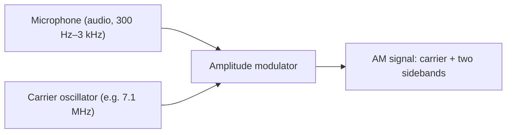
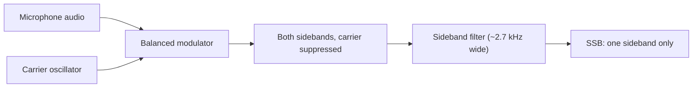
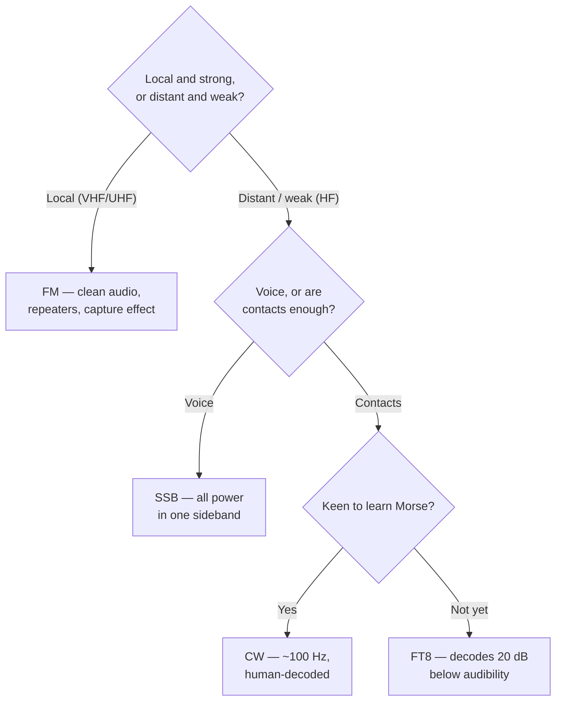

# Modulation

Your voice, coming out of a microphone, is an electrical wiggle between roughly 300 Hz and 3,000 Hz — far too low in frequency to radiate from any antenna you could actually build. Radio solves this with a beautiful trick: it takes a high-frequency wave that _can_ radiate, called a carrier, and gently reshapes it so that it carries your voice along for the ride. That reshaping is **modulation**, and every mode you will ever log in LogBook73 — SSB, FM, CW, FT8 — is just a different answer to the question "which part of the carrier shall we wiggle?"

## Why you need a carrier at all

Suppose you wired your microphone straight to an antenna. Two things go wrong immediately.

First, the antenna problem. As you saw in [Frequency & Wavelength](outpost:entry/logbook73.handbook/frequency-and-wavelength), an efficient antenna needs to be a decent fraction of a wavelength long — typically a quarter or a half wave. A 1 kHz audio tone has a wavelength of `300,000 / 0.001 = 300,000 km`. A quarter-wave antenna for it would be 75,000 km long, nearly twice around the Earth. Audio frequencies are physically hopeless as radio waves.

Second, the sharing problem. Even if everyone _could_ radiate raw audio, every voice on the planet would occupy the same 300 Hz–3 kHz slice of spectrum, all mixed together into a single unintelligible roar. There would be no way to tune to one station and ignore the rest.

A carrier fixes both problems at once. It is a pure, steady sine wave at a radio frequency — say `7.1 MHz`, where a quarter-wave antenna is a very buildable 10.5 metres. Because each station uses a _different_ carrier frequency, receivers can pick one station out by tuning, exactly as you turn a dial to choose between broadcast stations. The carrier is like a delivery van: it does not contain any information itself, but it can travel where your voice cannot, and each van has its own lane.

A sine wave has only three properties you can change: its **amplitude** (how big it is), its **frequency** (how fast it oscillates) and its **phase** (where it is in its cycle right now). Modulation means varying one or more of these in step with your information. That single sentence is the whole subject — everything below is just working through the options.

## Amplitude modulation: the obvious first idea

The oldest voice mode is **amplitude modulation (AM)**: make the carrier louder and quieter in step with the audio. When you speak loudly, the carrier swells; in the gaps between words, it settles back to its resting level. If you drew the transmitted waveform, the audio would appear as a wavy outline — the _envelope_ — traced along the tops of the fast carrier oscillations. Receiving AM is wonderfully easy: a receiver only has to follow that envelope, which a single diode can do. That is why the crystal sets you will meet in [Receivers](outpost:entry/logbook73.handbook/receivers) could receive AM broadcasts with no battery at all.

```viz
{
  "type": "wave",
  "title": "AM: the audio rides as an envelope",
  "caption": "The fast carrier swells and shrinks in step with the slow audio; the dashed outline — the envelope — is the voice, and following that outline is all an AM receiver has to do.",
  "traces": [
    { "kind": "am", "freq": 24, "mod": 2, "depth": 0.8, "label": "AM signal", "tone": "primary" },
    { "kind": "envelope", "mod": 2, "depth": 0.8, "style": "dashed", "tone": "muted", "label": "audio envelope" }
  ],
  "xLabel": "time →"
}
```



But something interesting happens in the frequency domain. Multiplying audio onto a carrier does not keep the signal at a single frequency. An AM transmitter on `7.100 MHz` carrying a 1 kHz tone actually emits _three_ frequencies: the carrier at 7.100 MHz, plus new components at `7.101 MHz` and `7.099 MHz`. Real speech, containing frequencies up to about 3 kHz, produces two mirror-image bands of energy: one from 7.100 to 7.103 MHz (the **upper sideband**) and one from 7.097 to 7.100 MHz (the **lower sideband**). Each sideband is a complete copy of your voice, translated up to radio frequencies.

```viz
{
  "type": "spectrum",
  "title": "The AM signal in the frequency domain",
  "caption": "A 1 kHz tone AM-modulated onto 7.100 MHz emits exactly three frequencies. Even at full modulation the carrier — which carries no information — takes at least two-thirds of the power; each sideband is a complete copy of the audio.",
  "components": [
    { "f": 30, "amp": 0.5, "label": "LSB 7.099", "tone": "muted" },
    { "f": 50, "amp": 1.0, "label": "carrier 7.100 MHz", "tone": "primary" },
    { "f": 70, "amp": 0.5, "label": "USB 7.101", "tone": "muted" }
  ],
  "noiseFloor": 0.05,
  "xLabel": "frequency →"
}
```

Look at the arithmetic of that. An AM signal is about 6 kHz wide (twice the highest audio frequency), and at best only a sixth of the transmitted power is in each sideband — the carrier, which carries no information at all, soaks up at least two-thirds of your power even at full modulation. For a broadcaster running 100 kW to a million cheap receivers, that trade makes sense: spend power at the transmitter so receivers can be a diode and a pair of headphones. For an amateur with 10 W and one distant listener, it is painfully wasteful.

## Single sideband: AM with the waste removed

Amateurs looked at AM and asked two ruthless questions. The carrier contains no information — why transmit it? The two sidebands are identical copies — why send both? Strip out the carrier and one sideband, and what remains is **single sideband (SSB)**: one copy of your voice, translated to radio frequency, and nothing else.

The classic way to build it is in two steps. A **balanced modulator** — a mixer arranged so the carrier cancels itself out — produces both sidebands with the carrier already suppressed (mixers get their own chapter: [Mixers](outpost:entry/logbook73.handbook/mixers)). Then a narrow **band-pass filter** lets one sideband through and blocks the other. What emerges is only about 2.7 kHz wide, and _every_ watt of transmitted power carries speech.



The gains are dramatic. Compared with AM, SSB puts all the power where it counts and occupies less than half the bandwidth, which also means the receiver can use a narrower filter and admit less noise (a story continued in [Noise](outpost:entry/logbook73.handbook/noise)). In practice SSB gives roughly a 9 dB advantage over AM — from [Decibels](outpost:entry/logbook73.handbook/decibels), that is like multiplying your transmitter power by eight. This is why SSB has been the standard voice mode on the HF bands since the 1960s.

There is a price, and you have heard it. Because the carrier was removed at the transmitter, the receiver must generate its own replacement locally and re-insert it to make the audio intelligible. If the receiver's re-inserted carrier is off by even 50 Hz, every frequency in the voice shifts by 50 Hz — which is why an untuned SSB signal sounds like Donald Duck, and why tuning SSB takes a moment of care. By convention, amateurs use **lower sideband (LSB)** on bands below 10 MHz and **upper sideband (USB)** above, a habit inherited from how early transmitters were built.

## FM and PM: wiggle the frequency instead

**Frequency modulation (FM)** leaves the amplitude alone and varies the carrier's _frequency_ in step with the audio. Speak louder and the carrier swings further from its centre frequency; the maximum swing is called the **deviation**, typically ±2.5 kHz for the narrow FM used on the 2 m and 70 cm amateur bands. Its close cousin **phase modulation (PM)** varies the phase instead; because frequency is just how fast phase changes, the two are near-identical in practice, and many "FM" rigs are actually phase-modulated inside.

```viz
{
  "type": "wave",
  "title": "FM: constant height, wobbling rate",
  "caption": "The carrier's amplitude never changes — the audio lives entirely in how the cycles bunch up and stretch out, which is why noise and fading, which mostly disturb amplitude, barely touch FM.",
  "traces": [
    { "kind": "fm", "freq": 18, "mod": 1.5, "depth": 3, "label": "FM signal", "tone": "primary" },
    { "kind": "sine", "freq": 1.5, "amp": 0.3, "style": "faint", "tone": "muted", "label": "audio (reference)" }
  ],
  "xLabel": "time →"
}
```

FM's superpower is that the amplitude of the received signal _does not matter_ — all the information lives in the frequency. Ignition noise, static crashes and fading mostly disturb amplitude, so an FM receiver can clip the signal to a constant level and discard nearly all of that racket. This is why 2 m FM through your local repeater sounds clean, almost like a telephone. FM also exhibits the **capture effect**: when two FM signals arrive on the same frequency, the receiver locks onto the stronger one and suppresses the weaker almost completely, rather than mixing them audibly as AM would.

The cost is bandwidth and a threshold. Narrow FM occupies around 12 kHz — more than four SSB signals' worth — and below a certain signal strength FM collapses abruptly into harsh noise, whereas SSB degrades gracefully, staying readable (if effortful) far deeper into the noise. That is why FM rules local, strong-signal VHF/UHF work and repeaters, while SSB rules weak-signal HF and long-haul VHF. One engineering bonus: because an FM wave has constant amplitude, its power amplifier does not need to be linear — a distinction that matters in [Transmitters](outpost:entry/logbook73.handbook/transmitters).

## CW: the original on-off keying

Morse code — which amateurs call **CW**, for _continuous wave_ — is the minimalist extreme: the modulation is switching the carrier on and off. Key down, carrier present; key up, silence. Dits, dahs and the spaces between them are just a pattern of on and off. In modern terms CW is a digital mode — on-off keying, the simplest possible one — that happens to be sent and decoded by human beings.

Its virtue is astonishing narrowness. A hand-sent CW signal occupies on the order of 100 Hz, roughly 1/27th the bandwidth of SSB. A receiver can therefore use a razor-thin filter that excludes almost all the band's noise, and a skilled ear can copy CW at signal levels where speech would be hopeless — worth 10 dB or more over SSB, comparable to a tenfold power increase. This is why CW remains beloved for low-power (**QRP**) operating and modest antennas: a few watts of CW routinely crosses oceans. One subtlety: the carrier cannot be switched on and off _instantly_, or the sharp edges spray energy across the band as key clicks; transmitters deliberately soften each edge over a few milliseconds, a detail picked up in [Transmitters](outpost:entry/logbook73.handbook/transmitters).

## Digital modulation, gently

Every digital mode faces the same task: represent 1s and 0s using the only three knobs a sine wave has. You already know enough to understand all of them at the intuition level.

- **FSK (frequency-shift keying)**: use two (or more) frequencies — one means `0`, the other means `1`. It is FM for bits. RTTY, the teleprinter mode from the 1940s, hops between two tones 170 Hz apart. FT8 uses eight tones, each carrying three bits at once — see [FT8](outpost:entry/logbook73.handbook/ft8).
- **PSK (phase-shift keying)**: keep frequency and amplitude fixed and flip the _phase_. Picture the carrier as a spinning clock hand: to send a `1`, jump the hand half a turn (180°). The mode PSK31 does exactly this, 31 times a second, and fits a keyboard conversation into about 60 Hz — narrower than CW.
- **QAM (quadrature amplitude modulation)**: vary amplitude _and_ phase together, giving a whole alphabet of distinct states — 16, 64 or more — so each transmitted symbol carries several bits. This is how Wi-Fi and digital television pack data in so densely. The trade is fragility: the more states you cram in, the more alike they look, and the stronger and cleaner the signal must be for the receiver to tell them apart.

That last sentence is the deepest idea in this chapter: **speed costs bandwidth or signal strength, usually both**. FT8 is slow — about six characters per second — precisely so that it stays decodable at signal levels 20 dB below what your ear needs. Wi-Fi is fast precisely because your router is metres away. There is no free lunch; there is only choosing where to eat. How receivers see phase at all is the two-channel trick explained in [IQ Signals](outpost:entry/logbook73.handbook/iq-signals).

## Bandwidth: every mode has a footprint

Bandwidth is the width of spectrum a signal occupies, and it decides how many stations share a band and how much noise a receiver must accept. Typical figures:

| Mode            | Typical bandwidth | Notes                                   |
| --------------- | ----------------- | --------------------------------------- |
| CW              | ~100 Hz           | On-off keying; narrowest common mode    |
| PSK31           | ~60 Hz            | Keyboard chat; narrower than CW         |
| FT8             | ~50 Hz per signal | Dozens fit in one 3 kHz slice           |
| RTTY            | ~250 Hz           | Two-tone FSK, 170 Hz shift              |
| SSB voice       | ~2.7 kHz          | Standard HF voice                       |
| AM voice        | ~6 kHz            | Carrier + both sidebands                |
| Narrow FM voice | ~12 kHz           | 2 m / 70 cm simplex and repeaters       |
| Broadcast FM    | ~200 kHz          | High deviation buys hi-fi audio quality |

Read the table twice: once as "how many of these fit in a band" (the 40 m band could hold one broadcast-FM signal, or about 1,100 CW signals), and once as "how much noise the receiver must admit" — a matched CW filter lets in roughly 1/27th the noise of an SSB filter, which from [Decibels](outpost:entry/logbook73.handbook/decibels) is about a 14 dB head start before anyone touches a power knob.

Here is the whole modes story on one page — what each mode does to the carrier, what it looks like in time and on a waterfall, its spectrum, how wide it is, and what it sounds like:

![Modulation shapes compared. For AM, FM, SSB and CW: the audio message, the unmodulated carrier, the modulated RF, a waterfall view, the frequency spectrum, and a note on what it sounds like. AM's amplitude varies with the audio (carrier plus two sidebands, wide); FM's frequency varies (wide, high fidelity); SSB sends one sideband only (narrow, efficient HF voice); CW keys the carrier on and off (very narrow, best in weak-signal conditions). A bandwidth and efficiency comparison ranks CW and SSB as the most frugal.](/handbook-figures/modulation.png 'Every common mode at a glance: what varies, how wide it is, and what it sounds like — with CW and SSB the most bandwidth-efficient.')

## Choosing a mode

With the trade-offs in hand, choosing a mode becomes a short conversation with yourself:



If the answer to "keen to learn Morse?" is yes — or even "maybe" — the Morse trainer built into this app takes you from zero: it plays real code at any speed, grades your copying, and even simulates an iambic keyer so you can learn to send before you ever wire up a key.

None of these choices is permanent, and your logbook will happily hold all of them. Most amateurs end up using FM for local nattering through repeaters, SSB for HF voice, and FT8 when the bands seem dead — FT8 will often prove they are merely _quiet_, which is a different thing. If your licence limits your power, as entry-level licences typically do, the modes that spend their bandwidth frugally — CW and FT8 — are disproportionately your friends: they buy back with bandwidth what you cannot spend in watts (see [RF Power](outpost:entry/logbook73.handbook/rf-power)).

## Try it yourself

You can _see_ every idea in this chapter tonight, without a licence, using any SDR receiver — a ~$30/€30-class RTL-SDR dongle, or a free online WebSDR such as the University of Twente receiver — since receiving requires no licence in most countries.

1. Tune to a broadcast AM station (medium wave, or shortwave around 5–15 MHz). On the waterfall, find the bright, steady central line — the carrier — with two mirrored, flickering sidebands either side. You are looking at the wasted power directly.
2. Tune to 7.10–7.20 MHz in the evening and find an amateur SSB signal: a flickering smear about 2.7 kHz wide with _no_ carrier line. Select LSB mode and tune slowly across it. Hear the Duck-to-human transition as your receiver's re-inserted carrier slides into the spot the transmitter left vacant.
3. Drop down to 7.000–7.040 MHz for CW: crisp, pencil-thin vertical dashes on the waterfall. Note how many fit in the space one SSB signal occupies.
4. Finally, park on 7.074 MHz USB and watch FT8: dozens of narrow stripes marching in 15-second blocks. Each stripe is a station, possibly running less power than a bicycle lamp.

Log what you hear. Fifteen minutes of this teaches more than any diagram — including the ones above.

## Key takeaways

- Audio cannot radiate directly: antennas would be thousands of kilometres long, and everyone would occupy the same spectrum. A carrier solves both problems.
- A sine wave has exactly three things you can modulate: amplitude, frequency and phase. Every mode ever invented varies some combination of them.
- AM is a carrier plus two identical sidebands; at least two-thirds of its power is spent on a carrier that carries no information.
- SSB is AM minus the carrier and one sideband: all power in one 2.7 kHz voice copy, roughly 9 dB better — but the receiver must re-insert the carrier, hence careful tuning.
- FM trades bandwidth (~12 kHz) for noise immunity and clean audio; it dominates local VHF/UHF and repeaters, while SSB dominates weak-signal work.
- CW is on-off keying in ~100 Hz; digital modes map bits onto frequency (FSK), phase (PSK) or both plus amplitude (QAM). Narrow and slow buys weak-signal performance.
- Bandwidth is the hidden currency: a narrow mode admits less noise, which can be worth more than any affordable power increase.

Next, we follow your modulated signal through the hardware that actually launches it — stage by stage from microphone to antenna — in [Transmitters](outpost:entry/logbook73.handbook/transmitters).
