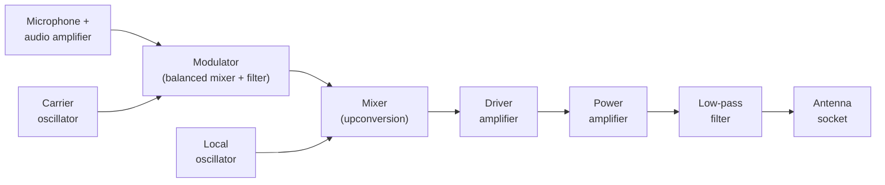
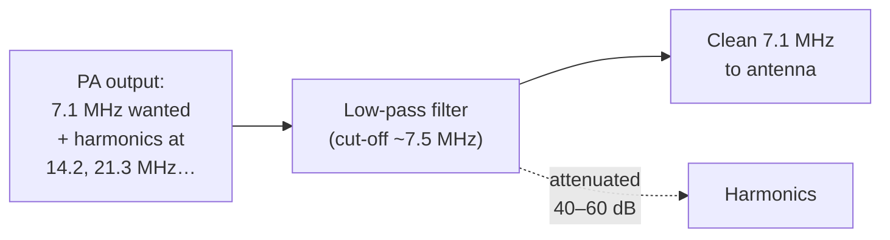
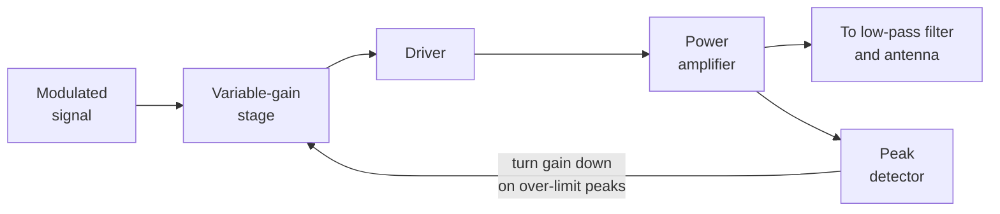

# Transmitters

In [Modulation](outpost:entry/logbook73.handbook/modulation) you learned how information gets imprinted onto a carrier. A transmitter is the machine that actually does it: a chain of stages that takes the millivolts wobbling out of your microphone and turns them into watts of clean, on-frequency radio energy at the antenna socket. Understanding that chain — even at block-diagram level — changes you from someone who _owns_ a radio into someone who knows what each knob is asking the hardware to do, and why the licence conditions about "clean" signals exist at all.

## The chain at a glance

Every transmitter, from a ~$25/€25-class handheld to a broadcast station, is a variation on one pipeline. Here it is for a typical HF SSB rig:



Each block has one job, and each hands a slightly transformed signal to the next. We will walk the chain left to right, then spend proper time on the two ideas beginners most often miss: why the low-pass filter is not optional, and why "more mic gain" usually makes your signal _worse_.

## Audio and modulator: making the signal

The journey starts small. A microphone produces a few millivolts of audio, which an **audio amplifier** raises to a workable level while filtering it to the 300 Hz–3 kHz range that speech actually needs — transmitting your voice's deep chest resonance would waste bandwidth on frequencies that add little intelligibility.

Next comes the **modulator**. For SSB this is the balanced modulator and sideband filter you met in [Modulation](outpost:entry/logbook73.handbook/modulation): audio in, a single 2.7 kHz-wide sideband out, carrier suppressed. For FM, the audio instead nudges the frequency of an oscillator back and forth. For CW there is no audio at all — the "modulator" is your key, switching the carrier on and off (more on doing that gracefully below).

A practical detail: the modulator usually does its work at one convenient _fixed_ frequency — often somewhere around 9 MHz in classic designs — because building one excellent, razor-edged sideband filter at a single frequency is far easier than building a tunable one. The signal at this stage is fully formed but at the wrong frequency and far too weak: microwatts, when we need watts.

## Mixing up to the operating frequency

To move the modulated signal to wherever you have tuned — say `14.250 MHz` on the 20 m band — the transmitter uses a **mixer** fed by a **local oscillator (LO)**. A mixer takes two signals in and produces their sum and difference frequencies out; by tuning the LO, the fixed-frequency modulated signal can be shifted to any operating frequency you like. When you spin the dial on your rig, the thing you are actually adjusting is this LO — everything upstream never changes frequency at all.

Mixers deserve (and get) their own chapter — [Mixers](outpost:entry/logbook73.handbook/mixers) — and the oscillators that feed them get [Oscillators](outpost:entry/logbook73.handbook/oscillators). For now, hold two facts. First, a mixer's output contains more than the product you want: the sum _and_ the difference appear, along with leakage of the inputs, so a band-pass filter follows the mixer to keep only the wanted one. Second, the LO's quality matters enormously — if it drifts, your signal drifts; if it is noisy, your signal is noisy. Modern rigs use synthesised oscillators locked to a crystal reference, which is why today's radios sit rock-solid on frequency for hours.

## Driver and power amplifier: making it loud

The signal is now on frequency but still tiny. The **driver** amplifier raises it to roughly a watt — enough muscle to push the final stage — and then the **power amplifier (PA)** does the heavy lifting up to your licensed output. Entry-level licences typically allow a few tens of watts (see [Getting Licensed](outpost:entry/logbook73.handbook/getting-licensed) for how licence classes and their power limits work); a typical HF transceiver's PA is built for 100 W.

One word matters more than any other here: **linear**. A linear amplifier makes an exact, scaled-up copy of its input — output faithfully proportional to input, like a good hi-fi. SSB _requires_ this, because the information rides on the signal's amplitude: if the PA compresses or flattens the peaks, it distorts the very shape carrying your voice and, as we will see, sprays interference over your neighbours on the band. FM and CW are more forgiving, since their information lives in frequency and on/off timing rather than amplitude; their PAs can run in harder-switching, more efficient modes. This is one honest engineering reason FM handhelds are cheap and cool-running while SSB rigs are neither. [Amplifiers](outpost:entry/logbook73.handbook/amplifiers) digs into the whole family.

The PA is also where most of your electricity goes. A linear amplifier producing 100 W of RF typically draws well over 200 W from the supply; the difference becomes heat in the PA transistors, which is why transceivers have heatsinks and fans, and why long transmissions warm the shack. [RF Power](outpost:entry/logbook73.handbook/rf-power) covers what those watts buy you; here, just note that duty cycle matters — a rig rated 100 W for speech may need turning down to half power or less for FT8 or RTTY, where the transmitter runs flat-out continuously rather than in the peaks-and-gaps rhythm of a voice.

## The low-pass filter: manners at the output

Here is the uncomfortable truth about every amplifier: none is perfectly linear, and imperfect amplification _creates new frequencies that were never in the input_. The most predictable of these are **harmonics** — energy at exact whole-number multiples of your operating frequency. Transmit on 7.1 MHz and your PA also generates weaker outputs at 14.2 MHz, 21.3 MHz, 28.4 MHz and beyond. Look at those numbers: they land squarely in the 20 m, 15 m and 10 m amateur bands — and harmonics of other frequencies can land on aviation, marine or broadcast services. Unwanted outputs like these are called **spurious emissions**, and your licence obliges you to keep them to a tiny fraction of your output power.

This is the **low-pass filter's** job. A low-pass filter passes everything _below_ a chosen cut-off frequency and increasingly blocks everything above it (the family portrait is in [Filters](outpost:entry/logbook73.handbook/filters)). Placed between PA and antenna with its cut-off just above your operating band, it lets the 7.1 MHz signal through essentially untouched while attenuating the 14.2 MHz harmonic by 40–60 dB — from [Decibels](outpost:entry/logbook73.handbook/decibels), that means reducing it to between one ten-thousandth and one millionth of its power.

```viz
{
  "type": "spectrum",
  "title": "Harmonics meeting the low-pass filter",
  "caption": "The PA's output on 7.1 MHz comes with weaker echoes at exact multiples, each landing in someone else's band; the shaded low-pass region, cut off just above 7.1, passes the wanted signal and crushes everything to the right.",
  "components": [
    { "f": 20, "amp": 0.95, "label": "7.1 wanted", "tone": "primary" },
    { "f": 40, "amp": 0.28, "label": "14.2 (2nd)", "tone": "danger" },
    { "f": 60, "amp": 0.14, "label": "21.3 (3rd)", "tone": "danger" },
    { "f": 80, "amp": 0.07, "label": "28.4 (4th)", "tone": "danger" }
  ],
  "mask": { "kind": "lowpass", "from": 0, "to": 30 },
  "noiseFloor": 0.04,
  "xLabel": "frequency, MHz →"
}
```



Multiband rigs carry a bank of these filters and switch the right one in as you change bands. This is also the block that home-built and kit transmitters most often skimp on — and the first thing to suspect if a cheap transmitter causes interference. A pocket spectrum analyser lets you _see_ your own harmonics directly; [TinySA](outpost:entry/logbook73.handbook/tinysa) shows you how.

There is a second kind of mess worth naming: **splatter**. Overdrive an SSB transmitter and the distortion products land not at distant harmonics but _immediately either side_ of your signal, turning a tidy 2.7 kHz voice into 6–10 kHz of hash that buries the QSOs on adjacent frequencies. No output filter can remove splatter, because it appears right next to your own signal, inside the range the filter must pass — the only cure is not overdriving in the first place. Which brings us to ALC.

## ALC: the automatic guardian

**ALC (automatic level control)** is a feedback loop that watches the PA and, whenever a voice peak threatens to push the amplifier beyond its clean limit, momentarily turns down the gain of an earlier stage. It is a governor: its whole purpose is preventing the flattened peaks that cause splatter.



Your rig has an ALC meter, and here is the counterintuitive part: heavy, constant ALC action is a _warning_, not a compliment. If the needle is pinned, you are shovelling in far more audio than the transmitter can amplify cleanly, and ALC is fighting a continuous rearguard action — with the ragged, splattery edges of that fight going out over the air. The traditional setup is to speak normally and adjust the microphone gain until the ALC meter just flickers on voice peaks. Newcomers often crank the mic gain hoping to sound "louder"; in reality, output power barely rises, distortion soars, and the operators three kilohertz away learn your callsign for the wrong reasons.

## Keying CW without clicks

For CW, "modulation" is switching the carrier on and off — but _how fast_ the carrier rises and falls turns out to matter enormously. A sudden edge is, mathematically, a burst of many frequencies at once: switch a transmitter on instantaneously and a click of energy splashes hundreds of hertz up and down the band, heard by every nearby receiver. These are the notorious **key clicks**.

```viz
{
  "type": "wave",
  "title": "CW keying: the letter K on the air",
  "caption": "Dah, dit, dah — the carrier is simply switched on and off by the key. Every edge in this picture must be eased over a few milliseconds, or it splashes key clicks far beyond CW's tidy ~100 Hz.",
  "traces": [
    { "kind": "cw", "freq": 30, "pattern": [3, 1, 1, 1, 3, 1], "label": "keyed carrier", "tone": "primary" }
  ],
  "xLabel": "time →"
}
```

Good transmitters therefore _shape_ each dit and dah, easing the carrier up and down over roughly 3–5 milliseconds instead of instantly. Shaped that way, a CW signal occupies the ~100 Hz claimed in [Modulation](outpost:entry/logbook73.handbook/modulation); unshaped, it can be many times wider. There is a genuine trade lurking here — the same "sharp edges cost bandwidth" idea from digital modes: soften too much and high-speed Morse smears into mush, so designers choose a rise time that keeps clicks down without blunting the keying. It is also a preview of a lovely theme: sharp edges in _time_ always cost width in _frequency_, an idea that returns wearing different clothes in [FFTs & Waterfalls](outpost:entry/logbook73.handbook/ffts-and-waterfalls).

## Why clean transmissions matter

It is tempting to file harmonics, splatter and clicks under "other people's problems". Three reasons to care, in ascending order of self-interest.

First, it is a licence condition: every licence's terms require your emissions to stay within your allocated band and your spurious outputs to be strongly suppressed. Interference complaints are investigated, and "the rig came like that" is not a defence — the licensee is responsible for the station.

Second, spectrum is a commons. The 40 m band is a few hundred kilohertz shared across an entire continent on a busy evening; one splattering station can spoil 10 kHz of it for hundreds of operators. The amateur bands stay pleasant because clean operation is the culture.

Third — the selfish one — a transmitter that generates spurious junk usually mistreats _itself_ too. And every dirty transmitter makes life harder for receivers, which have their own struggles with strong signals creating phantoms; when you read [Overload & Ghost Signals](outpost:entry/logbook73.handbook/overload-and-ghost-signals) you will see the receive-side mirror of this chapter, where the mixing that creates spurious products happens _inside the receiver_. Cleanliness, it turns out, is a property of the whole path from their microphone to your ear — and you control one end of it.

## A short note on heat and RF safety

Two practical cautions, neither alarming. First, **heat**: a PA and its heatsink can get genuinely hot during long transmissions — hot enough to be painful to touch. Give a transceiver free airflow, never stack things on its vents, and let the fan run after long FT8 or RTTY sessions. Second, **RF**: the transmitter's output is real energy, and touching an antenna or an exposed connector while transmitting can cause a small, deep RF burn — RF is sneaky in that it can burn tissue below the skin with little immediate pain. The rules of thumb are easy: never transmit into an antenna someone could be touching, keep antennas out of reach of passers-by, and never transmit with no antenna (or a badly mismatched one) connected, which can damage the PA itself — a story [SWR](outpost:entry/logbook73.handbook/swr) finishes. At entry-level power levels sensible station layout keeps you comfortably within RF exposure guidance, and national societies (the RSGB and ARRL among them) publish straightforward calculators for checking your own station against your regulator's requirements.

## Try it yourself

You can trace this chapter's chain on hardware you may already have.

1. **Find the blocks in your rig's manual.** Every transceiver manual has a block diagram, usually near the back. Find the modulator, mixer, driver, PA and the low-pass filter bank, and count how many band filters your radio carries. It is genuinely satisfying to recognise every block.
2. **Watch ALC do its work.** If you hold a transmit licence, put the rig into SSB with the meter set to ALC, speak normally into a dummy load, and slowly raise the mic gain from zero. Watch the meter start to flicker, then pin. Set the gain where peaks just flicker — you have now adjusted your transmitter the way the designers intended.
3. **Hear the difference on receive.** Tune across a busy SSB band on a contest weekend and listen just above and below the strongest signals. Most are clean; occasionally you will hear one whose splatter you can follow 5 kHz away. Now you know exactly which stage of their chain is being pushed too hard — and which meter they are ignoring.

If you have a [TinySA](outpost:entry/logbook73.handbook/tinysa), the follow-up experiment — actually measuring a transmitter's harmonics through an attenuator — is in that chapter.

## Key takeaways

- Every transmitter is the same pipeline: audio → modulator → mixer/upconversion → driver → PA → low-pass filter → antenna. Learn the chain once and every rig makes sense.
- The modulator builds the signal at a fixed frequency; a mixer and tunable local oscillator move it to the frequency on your dial.
- SSB demands a _linear_ PA because its information rides on amplitude; FM and CW tolerate more efficient non-linear amplification.
- All real amplifiers create harmonics; the output low-pass filter knocks them down by 40–60 dB and is what keeps your signal legal and neighbourly.
- Splatter comes from overdriving and cannot be filtered out — set the mic gain so ALC just flickers on peaks, and treat constant ALC action as a warning.
- CW edges must be shaped over a few milliseconds, or key clicks splash far beyond the ~100 Hz a clean CW signal needs.
- PAs run hot and RF can burn: keep vents clear, keep people away from transmitting antennas, and never transmit without a proper load.

That is the launch side of the story; next we turn around and face the far harder problem — plucking a signal of a few microvolts out of the air and making it audible — in [Receivers](outpost:entry/logbook73.handbook/receivers).
