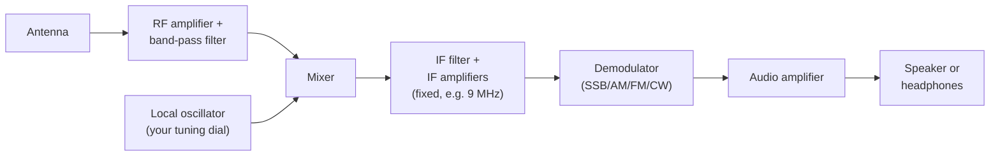
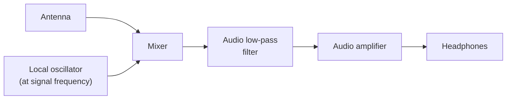

# Receivers

A transmitter's job is loud but honest work: make one signal big. A receiver's job borders on the miraculous: from the chaos arriving at your antenna — every broadcaster, taxi, radar, phone mast and distant amateur on Earth, all superimposed — select exactly one signal, perhaps a few millionths of a volt strong, amplify it about a million million times without adding much noise, and turn it back into a voice. This chapter is the story of how radio engineers learned to do that, told through the three great receiver architectures — because once you understand the superheterodyne, you understand what is inside almost every radio made in the last ninety years.

## The problem, stated honestly

Put numbers on it. A comfortably readable SSB signal might deliver `1 µV` — one millionth of a volt — at your antenna socket. Headphone-level audio is around a volt. The receiver must therefore provide a voltage gain of about a million, which is 120 dB of power gain in the language of [Decibels](outpost:entry/logbook73.handbook/decibels) — a million million times.

But raw gain is the _easy_ part. The same antenna is simultaneously delivering a local broadcast station at perhaps 50 mV — fifty thousand times stronger than the signal you want — and thousands of other signals in between. So the receiver has three jobs, and the tension between them defines everything that follows:

- **Sensitivity** — hear very weak signals without drowning them in the receiver's own noise. (How weak is "very weak" gets careful treatment in [Sensitivity](outpost:entry/logbook73.handbook/sensitivity); the ultimate limit is the subject of [Noise](outpost:entry/logbook73.handbook/noise).)
- **Selectivity** — pass the one signal you want and reject everything else, including a signal a thousand times stronger sitting 5 kHz away.
- **Tunability** — do both of the above at _any_ frequency you dial up, from 1.8 to 440 MHz and beyond.

Any one of these is straightforward. All three at once took decades.

## The crystal set: receiving with nothing

The earliest practical receiver had no amplification at all. A **crystal set** is four parts: an antenna, a tuned circuit (a coil and capacitor that resonate at one frequency, giving a crude ability to select a station), a **detector** — historically a mineral crystal touched by a fine wire, later a diode — and headphones. The diode performs the demodulation trick you met in [Modulation](outpost:entry/logbook73.handbook/modulation): it rectifies the AM signal so the headphones can follow its envelope. Every scrap of energy in the headphones came from the transmitter, possibly hundreds of kilometres away; the set itself needs no battery.

Crystal sets are a lovely afternoon project and genuinely work on strong AM broadcast stations. But they fail all three jobs for amateur use: no gain (deaf to weak signals), one broad tuned circuit (a strong station bleeds all over the dial), and only AM detection. The obvious next step was to add amplifiers — and the obvious way turned out to be a dead end worth understanding.

## TRF: the brute-force decade

The **tuned radio frequency (TRF)** receiver of the 1920s did the obvious: several stages of amplification at the signal's own frequency, each with its own tuned circuit, then a detector. More stages meant more gain and, stacking up the tuned circuits, more selectivity.

The trouble was the word _tuned_. Every stage's resonant circuit had to move together as you changed station, so a TRF set had a row of knobs (later ganged capacitors) that all needed adjusting in step — and the alignment that gave sharp selectivity at one end of the dial went soft at the other. Worse, many stages of high gain all at one frequency love to feed back into each other and burst into oscillation, turning the receiver into a small transmitter. TRF sets worked, filled living rooms for a decade, and were fundamentally a cul-de-sac: selectivity that must _travel with the tuning_ is selectivity you can never make truly sharp. The fix, when it came, was one of the best ideas in all of radio.

## The superheterodyne: move the signal, not the filter

Edwin Armstrong's insight — the **superheterodyne**, "superhet" for short — inverts the problem. Instead of dragging your filters and amplifiers to whatever frequency the signal is on, _move the signal_ to one fixed, convenient frequency where a single, lovingly engineered filter and amplifier chain lives permanently. That fixed frequency is the **intermediate frequency (IF)**.

An analogy makes the shape of the idea clear. A TRF receiver is like a workshop on wheels, packed up and driven to wherever each job happens to be — every tool must work at every location, and none works brilliantly anywhere. The superhet builds one permanent, beautifully equipped workshop and hires a courier to _fetch each job to the bench_. The courier — the mixer and its tunable oscillator — is cheap and does one trivial thing: shift a signal from any frequency to the workshop's frequency. All the expensive, difficult craftsmanship — the sharp filtering, the mountains of stable gain — happens in one place, at one frequency, permanently optimised.

The moving is done by a **mixer** driven by a tunable **local oscillator (LO)** — the exact machinery a transmitter uses to shift frequencies up, here run in the receiving direction. A mixer's output includes the _difference_ between its two input frequencies, so choose the LO right and any station lands on the IF. Say your receiver's IF is `9 MHz` and you want a station on `14.250 MHz`: tune the LO to `14.250 − 9 = 5.250 MHz`... or rather, more conventionally, to `14.250 + 9 = 23.250 MHz`; either way the difference is exactly 9 MHz, and the dial on the front is really just a control for the LO. Want 14.300 MHz instead? Nudge the LO 50 kHz; the new station lands on the same IF, into the same filters. The signal comes to the workshop; the workshop never moves.



Everything hard now becomes tractable. Selectivity? Build one superb **crystal filter** at 9 MHz — 2.7 kHz wide for SSB, 500 Hz for CW, switchable — and it serves every band identically. Gain? Pile it up at the IF, where fixed-frequency amplifiers are stable and well-behaved. Tunability? That is just the LO, and modern synthesised LOs (see [Oscillators](outpost:entry/logbook73.handbook/oscillators)) tune in 1 Hz steps without drifting. The superhet solved receiving so thoroughly that it has been the default architecture in virtually every radio, television and mobile phone since the 1930s.

Here is the whole chain, stage by stage, with what happens to the spectrum at each step:

![The superheterodyne receiver signal chain: antenna → RF amplifier (boosts weak signals) → mixer (combines the RF with a local oscillator to produce a fixed intermediate frequency) → IF filter and amplifier (selects the channel and provides most of the gain and selectivity) → detector (recovers the audio) → audio amplifier → speaker. The mixer produces the difference frequency f_IF = |f_RF − f_LO|, which is kept, and the sum, which is filtered out. Frequency-domain panels show the incoming crowd of stations, the shift to IF, channel selection by the IF filter, and the recovered audio, plus the image-frequency problem f_image = f_LO ± f_IF.](/handbook-figures/superheterodyne.png 'The superhet in full: shift the wanted signal to one fixed IF, then do all the sharp filtering and gain there — and watch the image frequency the RF filter exists to reject.')

One honest debt must be recorded. The mixer cannot tell which _side_ of the LO a signal is on: with the LO at 23.250 MHz and a 9 MHz IF, a station at 14.250 MHz lands on the IF — and so does one at 32.250 MHz, equally spaced on the other side. That unwanted twin is called the **image**, and the RF filter at the front of the diagram exists mostly to keep image-frequency signals out before they reach the mixer. Images, and the other phantoms a receiver can conjure, get a whole chapter: [Overload & Ghost Signals](outpost:entry/logbook73.handbook/overload-and-ghost-signals). Many designs also convert twice (two IFs — a high first IF to push images far away, then a low second IF for cheap sharp filtering), which is why you will meet "dual-conversion superhet" on spec sheets.

```viz
{
  "type": "spectrum",
  "title": "The image: two input frequencies, one IF",
  "caption": "The wanted station and its unwanted twin sit exactly IF away on either side of the LO — both land on 9 MHz, and only the front-end filter keeps the image out of the mixer.",
  "components": [
    { "f": 30, "amp": 0.6, "label": "wanted 14.25 MHz" },
    { "f": 50, "amp": 0.9, "label": "LO 23.25 MHz", "tone": "ink" },
    { "f": 70, "amp": 0.6, "label": "image 32.25 MHz", "tone": "danger" }
  ],
  "xLabel": "frequency →"
}
```

## Selectivity, AGC and the S-meter

Three superhet features you will use every day at the dial deserve a closer look.

**Selectivity** lives in the IF filter, and matching its width to the mode is one of the operator's real skills: ~2.7 kHz for SSB, ~500 Hz or narrower for CW, ~12 kHz for FM. Too wide and you admit needless noise and neighbours; too narrow and the signal itself is clipped. On a modern rig the filter-width control is doing exactly what this chapter describes — reshaping the IF passband. It is worth pausing on how good these filters are: a decent crystal filter passes its 2.7 kHz slice while knocking a signal just 2 kHz outside it down by 60 dB or more — to a millionth of its power. _That_ is the selectivity the TRF designers could never reach, and it is possible only because the filter never has to move.

```viz
{
  "type": "spectrum",
  "title": "Selectivity: the IF filter picks one signal from a crowded band",
  "caption": "The dashed outline is the IF filter's passband — the wanted signal fits inside while the far stronger neighbours either side are knocked down by 60 dB or more.",
  "components": [
    { "f": 16, "amp": 0.5, "tone": "muted" },
    { "f": 32, "amp": 0.85, "label": "strong neighbour", "tone": "muted" },
    { "f": 50, "amp": 0.6, "label": "wanted signal" },
    { "f": 68, "amp": 0.95, "label": "S9+ local", "tone": "muted" },
    { "f": 86, "amp": 0.4, "tone": "muted" }
  ],
  "mask": { "kind": "bandpass", "from": 46, "to": 54 },
  "noiseFloor": 0.07,
  "xLabel": "frequency →"
}
```

**AGC (automatic gain control)** deals with the outrageous range of signal strengths. Between a whisper of 0.5 µV and a local at 50 mV lies a factor of 100,000 in voltage — 100 dB in power. Without help, tuning across the band would swing between silence and speaker-destroying blasts. AGC measures the signal's strength late in the IF chain and feeds it back to _reduce_ the gain of earlier stages when signals are strong — the receive-side sibling of the ALC loop you met in [Transmitters](outpost:entry/logbook73.handbook/transmitters). The result: weak and strong stations emerge at roughly similar volume. The `AGC fast/slow` control sets how quickly the gain recovers — fast suits CW's staccato; slow suits SSB, riding smoothly over syllables.

**The S-meter** is a happy by-product: since the AGC voltage already measures how strong the signal is, display it on a meter and call it signal strength. The scale runs S1 to S9, each S-unit nominally 6 dB (a factor of four in power), with strong signals reported as "decibels over S9". Treat S-meters as honest guides rather than instruments — calibration varies between rigs — but a report of `S9+20 dB` in your log means a genuinely commanding signal.

## Direct conversion: the elegant shortcut

There is a second architecture, almost cheekily minimal. If the mixer converts the signal down to the IF, why not choose an IF of... zero? Mix the incoming signal with an LO at (almost) _the signal's own frequency_, and the difference frequency that falls out is audio itself. Filter, amplify, listen. This is **direct conversion**.



A direct-conversion receiver can be a dozen components, and for CW and SSB it works beautifully — which is why it powers so many beloved QRP kits you can solder in a weekend. It has a famous quirk: the mixer cannot tell whether a signal is 700 Hz _above_ the LO or 700 Hz _below_ — both produce an identical 700 Hz audio tone, so every station appears twice as you tune, and an unwanted "audio image" of nearby stations folds onto the one you want. Curing that requires splitting the signal into two channels 90° apart — and that trick, the key to everything modern, is exactly the subject of [IQ Signals](outpost:entry/logbook73.handbook/iq-signals). Hold the thought; it becomes the heart of the next two chapters, because a direct-conversion front end feeding a computer is precisely what most software-defined radios are.

## Modern rigs: hybrids of everything

Open a current transceiver and you find the whole family tree cooperating. Many flagship and mid-range rigs are now **direct-sampling**: the antenna feeds filters and then an analogue-to-digital converter, with all mixing, filtering, demodulation, AGC and even the S-meter computed in software — the architecture of [Software Defined Radio](outpost:entry/logbook73.handbook/software-defined-radio). Others keep a superhet front end for its ruggedness against very strong signals and go digital at the IF, doing the fine filtering in software. That is why modern radios offer continuously adjustable filter widths, noise reduction and a live waterfall: those "IF filters" are now mathematics, changed by turning a knob. The concepts have not changed at all — every block in this chapter still exists — some blocks have just become code.

## Try it yourself

- **Tour a block diagram.** Find the block diagram in any transceiver manual (they are freely downloadable) and trace the receive path: RF amplifier, mixer, IF filter, demodulator, audio. Find the AGC line running backwards — the one arrow pointing right-to-left. You now read radio schematics at the level that matters.
- **Hear selectivity happen.** On your rig or a free WebSDR (which puts real receiver controls in your browser), tune to a CW signal on 40 m and narrow the filter from 2.7 kHz down to 500 Hz or less. Listen to neighbouring signals and background hiss vanish while your signal stays. That is the IF filter — physical or mathematical — doing the superhet's signature trick.
- **Watch AGC and the S-meter agree.** Tune across a band and watch the S-meter while listening to loudness. Notice strong and weak stations arriving at similar volume even as the meter swings — the AGC absorbing a 100 dB range on your behalf. Then switch AGC off, if your rig allows, and gingerly discover what life without it is like.
- **Log the difference.** Next time you log a QSO in LogBook73, record the real S-meter reading rather than a reflexive `59`. Watching reports vary with band and time is your first propagation dataset.

## Key takeaways

- A receiver must find microvolts sitting beside signals tens of thousands of times stronger: sensitivity, selectivity and tunability, all at once.
- Crystal sets prove reception can cost nothing but can do nothing hard; TRF receivers showed that selectivity which must travel with the tuning stays forever mediocre.
- The superheterodyne wins by moving every signal to one fixed intermediate frequency, where one superb filter and stable gain serve all bands — it is inside almost everything with an antenna.
- The dial is really the local oscillator; mixer arithmetic (`signal − LO = IF`) brings the station to the workshop. The price is image responses, held off by front-end filtering.
- Selectivity is the IF filter matched to the mode; AGC tames a 100 dB range of signal strengths, and the S-meter is AGC's measurement made visible (S-unit ≈ 6 dB).
- Direct conversion mixes straight to audio — minimal and lovely for kits, and, once given the IQ two-channel treatment, the foundation of the SDR age.

Next: what happens when most of those blocks dissolve into software — and a ~$30/€30 dongle becomes a spectrum-spanning receiver — in [Software Defined Radio](outpost:entry/logbook73.handbook/software-defined-radio).
