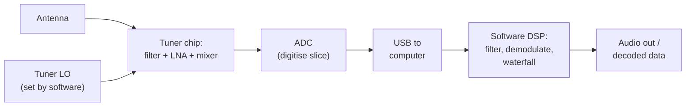
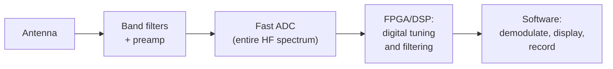

# Software Defined Radio

Every block you met in [Receivers](outpost:entry/logbook73.handbook/receivers) — mixers, filters, demodulators, AGC — was once a physical thing you could point at: a coil, a crystal, a circuit board that did one job forever. **Software defined radio (SDR)** is what happens when most of those blocks become mathematics running on a computer. The hardware shrinks to "capture the radio spectrum accurately"; everything else — what to tune, how wide a filter, which mode to demodulate — becomes code, changeable with a mouse click. It is the biggest shift in radio since the superheterodyne, and thanks to one accidental hero, joining in costs about $30/€30.

## What actually moves into software

A radio signal is an analogue thing — a continuously varying voltage. A computer can only handle numbers. The bridge between the two worlds is the **analogue-to-digital converter (ADC)**: a chip that measures the incoming voltage extremely often — millions of times per second — and outputs each measurement as a number. Do that fast enough and accurately enough, and the resulting stream of numbers contains _everything_ about the signal; nothing is lost. (How fast is fast enough, and why the samples come in curious pairs, is the story of [IQ Signals](outpost:entry/logbook73.handbook/iq-signals).)

Once the signal is numbers, every remaining receiver job becomes arithmetic. Mixing is multiplication. Filtering is a running weighted average. Demodulating FM is measuring how fast the numbers rotate. This arithmetic is called **DSP — digital signal processing** — and it comes with a startling property: it is _perfect_, or as near as makes no difference. A hardware crystal filter is a compromise of physical components that drift with temperature and cost real money per filter width you want. A software filter is free, exactly as wide as you ask, reshapeable while you listen, and identical on the millionth radio as on the first.

So the honest definition: an SDR is a radio in which the ADC (and its transmit twin, the **DAC**, digital-to-analogue converter) sits as close to the antenna as the designers can afford, with software doing everything on the far side of it.

The idea is older than you might guess. The term "software radio" was coined in the early 1990s, and the first serious systems were military — a single reprogrammable box that could impersonate any of a dozen incompatible radios was worth almost any price to an army. What changed since is not the concept but the economics: ADCs got fast and cheap, ordinary computers became absurdly powerful, and the DSP that once needed a rack of custom boards now runs comfortably on a laptop — or a phone. Amateur radio, as usual, caught the technology on its way down the price curve and put it to work.

## Why this changed everything

Four consequences, each of which would have sounded like fantasy in 1990.

**You see the whole band at once.** A hardware receiver tells you about one frequency — wherever it is tuned. An SDR captures a broad slice of spectrum (often 2 MHz or more) continuously, so software can show _all_ of it as a live spectrum display and waterfall. Instead of trawling the band hoping to stumble on activity, you see every signal at a glance and click the ones that look interesting. [FFTs & Waterfalls](outpost:entry/logbook73.handbook/ffts-and-waterfalls) teaches you to read that display like an operator.

```viz
{
  "type": "waterfall",
  "title": "What SDR software shows you: a whole band at once",
  "caption": "One capture, every signal visible together — a steady carrier, an SSB conversation, CW, an FT8 colony and a wide FM block. You look first, then click.",
  "signals": [
    { "f": 12, "kind": "carrier" },
    { "f": 28, "width": 5, "kind": "ssb" },
    { "f": 48, "kind": "cw" },
    { "f": 66, "width": 4, "kind": "ft8" },
    { "f": 85, "width": 8, "kind": "fm" }
  ],
  "xLabel": "frequency →",
  "yLabel": "time ↓"
}
```

**The radio improves after you buy it.** New demodulators, better noise reduction, entirely new modes — delivered as software updates. When FT8 appeared in 2017, no SDR owner needed new hardware to receive it.

**One device, every mode.** The same dongle demodulates broadcast FM, airband AM, 2 m amateur FM, weather-satellite images and FT8, because "mode" is now a menu, not a circuit.

**Experimentation stopped needing a soldering iron.** Want to try an idea — decode a new digital signal, build a custom receiver? In hardware that is weeks at a bench. In software it is an evening in [GNU Radio](outpost:entry/logbook73.handbook/gnu-radio), wiring DSP blocks together on screen.

## The $30 accident: RTL-SDR

SDR hardware used to be expensive laboratory kit. Then, around 2012, experimenters noticed something wonderful about a cheap USB dongle sold for watching digital TV (DVB-T) on a laptop. Inside sat a Realtek **RTL2832U** chip that, in one obscure mode, would stop decoding television and instead stream its _raw samples_ — the untouched numbers from its ADC — straight down the USB cable. A television accessory was, secretly, a general-purpose SDR receiver covering roughly 24 MHz to 1.7 GHz.

The community pounced, wrote free software around it, and the **RTL-SDR** was born. Purpose-improved versions (better frequency stability, metal cases, and a mode that reaches down into the HF bands) now sell for around $30/€30. The consequences are hard to overstate: for less than the cost of a decent textbook, anyone can see the radio spectrum. In most countries you need no licence to _receive_ (broadcast, amateur, aeronautical and similar signals — with the usual proviso that you must not act on communications not intended for you; check your local rules), so an RTL-SDR is the single best value first step in this entire hobby: it converts every remaining chapter of this handbook from theory into things you can watch happening.

Its limits are real but honest: it is an 8-bit receiver, meaning its ADC measures relatively coarsely, so very strong signals overload it easily and very weak ones vanish into its quantisation — themes that get proper treatment in [Dynamic Range](outpost:entry/logbook73.handbook/dynamic-range). It also cannot transmit. For the price, these are magnificent problems to have. And an RTL-SDR keeps earning its place long after you upgrade: strapped to a traditional transceiver's IF or antenna port it becomes a **panadapter** — a waterfall display for a radio that never had one — and pointed at the sky with free software it will decode weather-satellite pictures. Few purchases in this hobby are so hard to waste.

## Two ways to build an SDR receiver

Where exactly the ADC sits divides SDRs into two families — and pleasingly, they are the two receiver architectures you already know, with software grafted on at different points.

**Tuner-based (superhet-style) SDRs** keep an analogue front end: a tuner chip filters, amplifies and mixes the wanted slice of spectrum down to a low frequency, and only _then_ does the ADC digitise it. The RTL-SDR works this way. The analogue tuner is doing the superhet's job — bring the signal to a manageable frequency — and the ADC can therefore be modest and cheap.



**Direct-sampling SDRs** delete the mixer entirely: after essential filtering and amplification, a fast, high-resolution ADC digitises the _whole_ spectrum from nearly 0 Hz up to tens of MHz — every HF band at once — and software does all the tuning. A quick sum shows what that demands: to capture everything up to 30 MHz, the sampling theorem says you must measure the voltage more than 60 million times per second, and each measurement wants 14–16 bits of precision to keep kilowatt broadcasters and microvolt amateurs in the same set of numbers. That torrent — hundreds of megabytes per second — is why direct sampling started in premium equipment and has marched steadily down in price as chips caught up; many current amateur transceivers are direct-sampling radios wearing a traditional front panel.



Neither is "better" full stop. Tuner-based designs are cheap and reach into the GHz range; direct-sampling designs give pristine HF performance and can show enormous swathes of spectrum simultaneously. Both still obey every rule from [Receivers](outpost:entry/logbook73.handbook/receivers) — strong-signal handling, filtering, images — the physics did not resign when the software arrived.

## SDRs that transmit

Receiving is half the story. **Transmit-capable SDRs** add the mirror path — software generates the sample stream, a DAC turns it into analogue, and amplifiers and filters send it to the antenna. The famous example class is the **HackRF** and its relatives (the ADALM-Pluto is another popular one): wide-coverage transceivers designed for experimentation, able to generate almost any signal, almost anywhere from ~1 MHz to 6 GHz.

That breadth demands a clear-eyed warning. **A licence to receive is not a licence to transmit.** These devices will cheerfully generate signals on frequencies where transmitting is illegal — aviation, emergency services, broadcast — and their raw outputs are low-power but _dirty_ by amateur standards, with significant harmonics unless followed by proper filtering ([Transmitters](outpost:entry/logbook73.handbook/transmitters) explains why that filtering matters). Before keying up any SDR: hold the appropriate amateur licence, stay strictly inside the amateur bands and your licence's power limits, and put a suitable low-pass filter between the SDR and the antenna. Regulators take unlicensed transmission seriously, and so should you — check your national regulator's current rules if in any doubt, and see [Getting Licensed](outpost:entry/logbook73.handbook/getting-licensed) for the path to transmitting legitimately. Inside those boundaries, a TX-capable SDR is a wonderful sandbox: an entire transmitter design lab in a pocket-sized box.

## Choosing a first SDR

Match the device to what you actually want to do, not to the biggest specification sheet:

| You mainly want to…                                   | Sensible first choice                                                                                | Why                                                                           |
| ----------------------------------------------------- | ---------------------------------------------------------------------------------------------------- | ----------------------------------------------------------------------------- |
| Explore: broadcast FM, airband, 2 m/70 cm, satellites | RTL-SDR (~$30/€30)                                                                                   | Covers VHF/UHF well; unbeatable value; vast community support                 |
| Listen seriously to HF amateurs (SSB, CW, FT8)        | An HF-capable receiver SDR (e.g. SDRplay RSP or Airspy HF+ class), or an RTL-SDR in HF mode to start | Better filtering and dynamic range where big broadcast signals live           |
| Experiment with transmitting and protocol tinkering   | HackRF/PlutoSDR class — once licensed                                                                | TX capable, wide coverage; add filtering, mind the licence                    |
| Operate on-air as your main station                   | A direct-sampling amateur transceiver                                                                | Legal, filtered, PA included, waterfall built in — an SDR in a rig's clothing |

Two practical notes that outrank any spec. First, **the antenna matters more than the SDR** — a $30/€30-class dongle on a decent outdoor antenna will humiliate a $200-class receiver on the whip supplied in the box ([Antennas](outpost:entry/logbook73.handbook/antennas) is where that money should go). Second, start cheap: the RTL-SDR you outgrow becomes a permanent second receiver, a satellite-tracking dongle, or a panadapter display for a traditional rig. Nobody regrets owning one.

## Try it yourself

This chapter has the easiest and most rewarding homework in the handbook.

1. **Get an RTL-SDR** (from a reputable source — counterfeits exist) and plug it in with whatever antenna it came with, indoors is fine to start.
2. **Install a free SDR receiver app** — setup and first-signals guidance lives in [SDR++](outpost:entry/logbook73.handbook/sdr-plus-plus).
3. **Tune to broadcast FM (88–108 MHz).** You cannot miss it: the strongest, widest stripes on the waterfall. Click one; hear music. You have just performed mixing, filtering and FM demodulation in software.
4. **Find the amateurs.** Try your region's 2 m FM calling frequency (145.500 MHz in ITU Region 1; 146.520 MHz across much of Region 2) and your local repeater's output; at the weekend try a national society news broadcast — the RSGB and others run them. Watch signals appear on the waterfall _before_ you hear them.
5. **Log what you hear** in LogBook73's receive log — SWL (shortwave listening) reports are a proud tradition, and your first logbook entries do not need a licence at all.

## Key takeaways

- An SDR digitises the signal as close to the antenna as affordable; mixing, filtering, demodulation and display then become software — flexible, updateable and essentially perfect.
- Seeing a whole band on a waterfall, instead of one frequency at a time, changes how you operate: you look, then click.
- The RTL-SDR — a repurposed ~$30/€30 TV dongle streaming raw ADC samples — made spectrum exploration nearly free, covering roughly 24 MHz–1.7 GHz (plus HF in newer versions).
- Tuner-based SDRs digitise after an analogue mixer (cheap, wide-ranging); direct-sampling SDRs digitise the whole HF spectrum at once (superb, increasingly affordable, inside many modern rigs).
- TX-capable SDRs (HackRF class) can transmit almost anywhere — which is precisely why you must hold a licence, stay in-band, and filter the output before ever doing so.
- Receiving needs no licence in most countries: an RTL-SDR turns the rest of this handbook into live demonstrations.
- Spend spare money on the antenna, not a fancier dongle.

The software in an SDR receives one curious gift from the hardware: not one stream of samples but two, taken a quarter-cycle apart. Why two — and how that pair captures everything a radio wave can do — is the gentle surprise of [IQ Signals](outpost:entry/logbook73.handbook/iq-signals).
