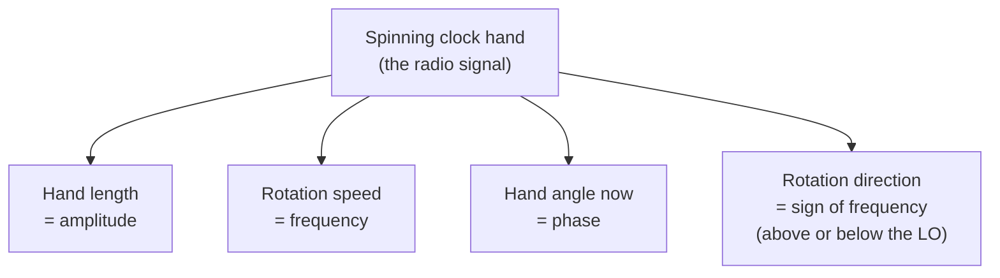
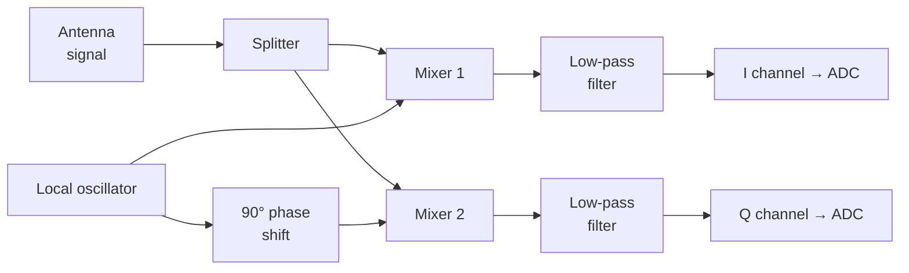
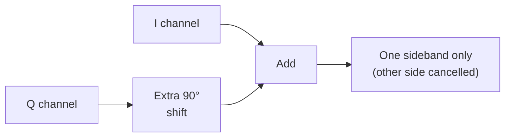

# IQ Signals

Open any SDR programme's settings and you will find the letters **I** and **Q** everywhere: IQ sample rate, IQ recording, IQ balance. Every software defined radio — and the digital heart of every modern transceiver — runs on IQ signals, yet most explanations reach for trigonometry in the second sentence and lose everyone. This chapter takes the slow road. The whole idea fits in one sentence — _an IQ receiver measures the same signal twice, a quarter of a cycle apart, and that second measurement is what lets software know not just how strong a wave is but exactly where it is in its cycle_ — and everything below is just making that sentence feel obvious.

## The problem with measuring once

Start with the puzzle that forces the invention. In [Receivers](outpost:entry/logbook73.handbook/receivers) you met the direct-conversion receiver and its famous quirk: mix the antenna signal with a local oscillator (LO), and a station 700 Hz _above_ the LO produces exactly the same 700 Hz audio tone as a station 700 Hz _below_ it. The receiver cannot tell the two apart, and every signal near the LO folds on top of its mirror twin.

Why? Because a single output channel only records _how big_ the combined wobble is from moment to moment — one number per instant. "Above the LO" and "below the LO" differ in something that one number per instant is blind to. To see what that something is, we need a better mental picture of a sine wave than the usual wiggly line.

## A sine wave is a spinning clock hand

Here is the picture that makes the whole chapter work. Imagine a clock hand spinning steadily anticlockwise. Everything a sine wave _is_ lives in that hand:

- The **length** of the hand is the wave's amplitude — how strong the signal is.
- The **speed** of rotation is its frequency — 7,100,000 turns per second for a 7.1 MHz carrier.
- The **angle** of the hand right now is its phase — where the wave is in its cycle.

The wiggly line you normally draw is just this hand watched edge-on: track only the hand's _height_ (how far its tip is above or below the centre) as it spins, and you trace out a perfect sine wave. Radio engineers call the spinning hand a _phasor_, but "clock hand" will serve us fine.

Now the crucial observation. Watching only the height is like watching a spinning bicycle wheel through a tall, narrow slit: you see a point going up and down, up and down — but you _cannot tell which way the wheel is turning_. Clockwise and anticlockwise look identical through the slit. Nor, at any single glance, can you tell a hand pointing up-and-left from one pointing up-and-right: same height, different positions. One measurement per instant collapses a two-dimensional fact — where the tip of the hand is — into one dimension, and information genuinely vanishes. _That_ is what the direct-conversion receiver lost, and why its images fold together.

## Measure twice: the quarter-cycle trick

The fix is almost embarrassingly direct: if one view of the wheel is ambiguous, take two views from different angles. Watch the spinning hand's **height** and, at the same time, its **sideways position**. Height plus sideways position pins down exactly where the tip is — the full two-dimensional truth. Two numbers per instant, nothing lost.

Those two measurements have names. The sideways (horizontal) component is **I**, for _in-phase_; the vertical component is **Q**, for _quadrature_ — an old word meaning "a quarter turn apart". And here is the lovely part: you do not need new hardware to see "sideways". For a steadily spinning hand, the sideways view is just the height view _a quarter of a cycle later_ — the same waveform, shifted 90°. Measuring I and Q means sampling the same signal twice, 90° apart. Hence the sentence this chapter opened with. Here is what that pair looks like side by side:

```viz
{
  "type": "wave",
  "title": "I and Q: the same wave, measured 90° apart",
  "caption": "Q is the identical waveform a quarter of a cycle later — the \"height\" and \"sideways\" views together pin down exactly where the spinning hand is at every instant.",
  "traces": [
    { "kind": "sine", "freq": 6, "phase": 90, "label": "I (in-phase)" },
    { "kind": "sine", "freq": 6, "phase": 0, "label": "Q (quadrature)", "tone": "ink" }
  ],
  "xLabel": "time →"
}
```



With both I and Q in hand, software can compute at every instant the hand's length (`amplitude = √(I² + Q²)` — just Pythagoras, since I and Q are the two sides of a right triangle) and its angle (from the ratio of Q to I). Amplitude _and_ phase, continuously. AM lives in the length, FM and PM live in how the angle moves, SSB lives in both — so one IQ stream lets software demodulate _anything_. This is the entire reason [Software Defined Radio](outpost:entry/logbook73.handbook/software-defined-radio) works.

## Negative frequencies, without tears

Now the mysterious direction-of-rotation question pays off. Once you can see both dimensions, you _can_ tell which way the wheel turns — and the two directions finally get to mean different things.

In an SDR everything is measured relative to the LO — the centre of your waterfall. A station 1 kHz above the LO makes the IQ clock hand rotate anticlockwise once per millisecond; a station 1 kHz _below_ makes it rotate clockwise at the same speed. Engineers call the clockwise one **negative frequency**: not some exotic physics, just "rotating the other way", meaning "below the tuning centre". This is why an SDR waterfall shows spectrum on _both sides_ of its centre — the left half is literally the negative frequencies — and why an SDR sampling at 2 million IQ pairs per second displays a full 2 MHz of spectrum: 1 MHz of positive frequencies and 1 MHz of negative ones. A single-channel receiver, blind to direction, folds the two halves together; the IQ receiver keeps a full megahertz on each side, distinct and clean. The "image problem" of the simple direct-conversion set was never anything deeper than throwing away the rotation direction.

## Quadrature mixing: how hardware makes I and Q

So how does a circuit actually capture the two views? With two copies of the mixer you already know from [Receivers](outpost:entry/logbook73.handbook/receivers), fed by two copies of the LO — one shifted a quarter cycle. The arrangement is called a **quadrature mixer**:



Mixer 1 compares the incoming signal against the LO and outputs the "height" view; mixer 2 compares it against the quarter-turned LO and outputs the "sideways" view. Each is low-pass filtered and digitised, and the pair of number streams — I and Q, in step — flows to the computer. Every SDR from a ~$30/€30 dongle to a direct-sampling flagship delivers exactly this pair (the flagship does the 90° business in mathematics rather than copper, but the result is identical). When an SDR app asks for a file format or a sample rate, the samples in question are these pairs: each one a snapshot of where the clock hand was.

## How SSB demodulation falls out for free

Here is a payoff that historically took racks of equipment. Recall from [Modulation](outpost:entry/logbook73.handbook/modulation) that an SSB receiver must pick out one sideband — one side of the carrier — and reject the other. But we have just seen that "above" and "below" are nothing more than anticlockwise and clockwise rotation. So demodulating SSB reduces to: _keep the hands spinning one way, cancel the ones spinning the other way_.

The trick, called the **phasing method**, is a two-step dance. Take the Q channel and delay it by a further quarter cycle, then add it to I. For an anticlockwise hand, the shifted Q lines up exactly _in step_ with I and the two reinforce; for a clockwise hand it lines up exactly _in opposition_ and the two cancel to nothing. One addition, and an entire sideband vanishes:



Swap which channel gets the shift and you get the other sideband — USB or LSB at the flip of a software switch. In DSP the 90° shift is done with near-perfect accuracy across all audio frequencies, so software SSB rejection of the unwanted sideband is superb — far better than the analogue phasing rigs of the 1950s that pioneered the idea and struggled to hold that quarter-turn accurately with resistors and capacitors. When you click "USB" in an SDR app, this little dance — or its mathematical twin — is what runs.

## Reading the constellation

One more place you will meet I and Q face to face: many SDR and digital-mode programmes offer a **constellation display** — a square plot with I across and Q up. It is nothing other than a map of the clock hand's tip, with the display gently derotating the carrier's spin so that what remains visible is the _modulation_: each plotted dot is "where the hand was at one measurement".

Once you know that, the patterns speak:

- A clean, unmodulated carrier sits as a **single steady dot** — constant length, constant (derotated) angle.
- **PSK31**, which signals by flipping phase half a turn, shows **two dots on opposite sides** of centre; the flicker between them is the data.
- **QPSK** (four phase states) shows four dots in a square; **16-QAM** shows a 4 × 4 grid — amplitude _and_ phase both carrying bits, as promised in [Modulation](outpost:entry/logbook73.handbook/modulation).
- **Noise smears each dot into a fuzzy cloud.** When the clouds swell until they touch, the receiver starts mistaking one state for its neighbour — bit errors, live on screen. A constellation is honestly the most direct picture of "signal quality" in all of radio: crisp dots, clean copy; merging blobs, trouble. ([Noise](outpost:entry/logbook73.handbook/noise) takes up that fight properly.)

```viz
{
  "type": "constellation",
  "preset": "qpsk",
  "title": "A QPSK constellation: four phase states, two bits each",
  "caption": "Each dot is one allowed position of the clock hand's tip. Noise smears the dots into clouds — and when the clouds touch, bit errors begin."
}
```

FM has a pretty signature too: constant amplitude but ever-advancing phase, so its constellation is a thin, steady **ring** — the clock hand's tip sweeping a circle of fixed length.

## Try it yourself

- **See negative frequencies.** Open an SDR app with an RTL-SDR ([SDR++](outpost:entry/logbook73.handbook/sdr-plus-plus) walks through setup) and find a strong broadcast FM station. Now retune so the station sits _left_ of the waterfall's centre line, then _right_. Both sides work identically — you are watching clockwise and anticlockwise rotation being kept honestly apart, the very thing a one-channel receiver cannot do.
- **Flip a sideband switch.** Tune an amateur SSB signal (40 m in the evening) and toggle between USB and LSB while watching the passband indicator jump to the other side of your tuning point. Intelligible speech on one setting, garble on the other: you are choosing which rotation direction survives the phasing dance.
- **Watch a constellation.** If your digital-mode software shows a constellation or vector display, feed it a PSK31 signal (try around 14.070 MHz) and watch the two-dot pattern breathe with the data — then find a weaker signal and watch the dots blur toward the middle.
- **Record 30 seconds of IQ.** Most SDR apps have an IQ record button. Note the file size — tens of megabytes — and replay it later: you can retune, change mode, and demodulate stations you were not listening to at the time. Nothing shows "the IQ pair contains everything" like re-receiving the past.

## Key takeaways

- A sine wave is best pictured as a spinning clock hand: length = amplitude, speed = frequency, angle = phase, direction = which side of the tuning centre.
- Measuring only one channel is watching the wheel through a slit — amplitude survives, but phase and rotation direction are lost, which is why simple direct-conversion receivers see mirror-image signals.
- I and Q are the same signal measured twice, 90° apart — the "height" and "sideways" views — and together they pin down the hand completely: amplitude and phase at every instant.
- Negative frequencies are just clockwise rotation: signals below the LO. That is why an SDR's waterfall extends both sides of centre and why _N_ IQ samples per second show a full _N_ Hz of spectrum.
- A quadrature mixer (two mixers, one LO shifted 90°) is how hardware produces the I/Q pair; SSB demodulation then falls out of a single shift-and-add that cancels one rotation direction.
- A constellation display plots I against Q: steady dots mean clean digital states; fuzzy, merging clouds mean noise is winning.

You now know what the pairs of numbers _are_; next comes the machine that turns millions of them per second into the living picture on your screen — [FFTs & Waterfalls](outpost:entry/logbook73.handbook/ffts-and-waterfalls).
