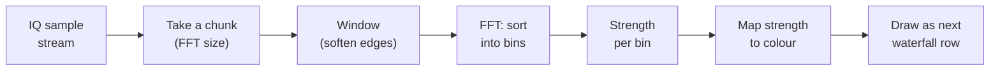
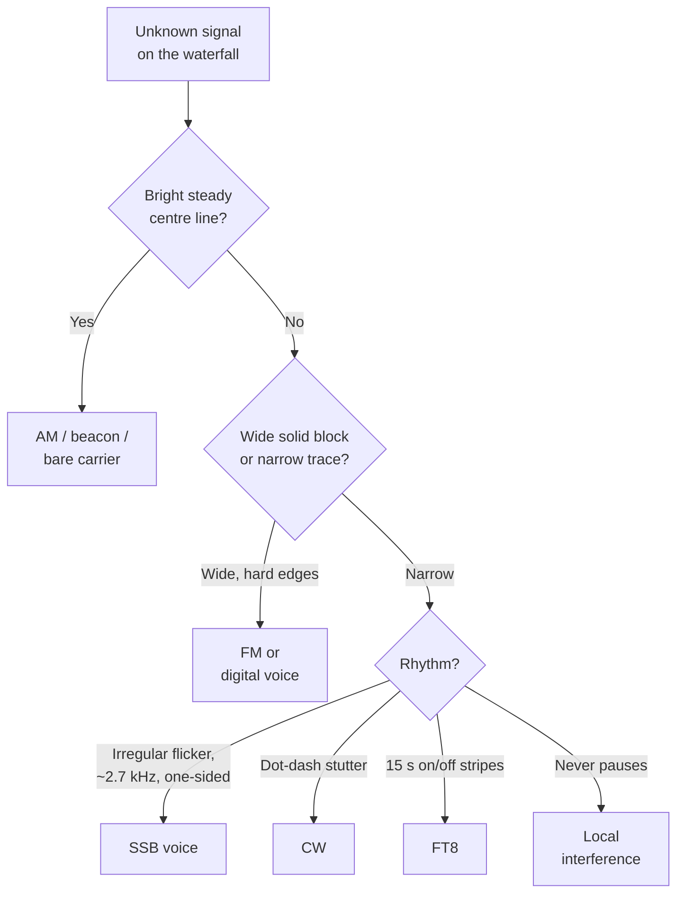

# FFTs & Waterfalls

The waterfall display is the single biggest change in how operators experience radio since the loudspeaker. Where a traditional dial shows one frequency at a time, a waterfall shows an entire band — every signal, every squeak and crash, painted live as a scrolling picture you learn to read at a glance. The machinery behind it is the **FFT**, one of the most useful algorithms ever devised, and the good news is that you can understand what it does — and how to trade its settings intelligently — without a line of mathematics. By the end of this chapter you will identify SSB, CW, FT8 and FM on sight, the way an experienced operator does.

## Two ways of looking at the same signal

Everything in this chapter rests on one idea: a signal has two equally truthful portraits.

The **time view** is what an oscilloscope shows — voltage wiggling as the microseconds pass. It is the signal as it actually arrives, the raw stream of [IQ samples](outpost:entry/logbook73.handbook/iq-signals) your SDR delivers. It is truthful and nearly unreadable: a busy band's time view is thousands of signals summed into one indistinguishable squiggle.

The **frequency view** asks a different question: not "what is the voltage now?" but "_which frequencies are present, and how strong is each?_" Think of hearing a piano chord. Your ear receives one combined pressure wiggle — the time view — yet what you _perceive_ is "C, E and G, with the E a bit loud": the frequency view. Your inner ear performs this sorting mechanically, with thousands of tiny hairs each resonating at its own pitch. A spectrum display is that same act performed on radio: signals laid out left-to-right by frequency, height showing strength, exactly as chapters from [Modulation](outpost:entry/logbook73.handbook/modulation) onwards have encouraged you to imagine bands.

Neither view is more true; they carry identical information. But almost every question an operator asks — _is anyone on this band? what mode is that? is that carrier drifting?_ — is a frequency-view question.

## What an FFT does (intuition only)

The **Fourier transform** is the mathematical bridge between the two views, and the **FFT — fast Fourier transform** — is a famously efficient recipe for computing it, quick enough that a laptop does millions per minute without effort. Here is the honest intuition, no equations required.

Take a chunk of the incoming samples — say a tenth of a second's worth. The FFT sorts that chunk into **bins**: narrow, adjacent frequency slots covering the whole captured range, like a long row of pigeonholes. For each bin it answers one question — _how much of this chunk wobbles at this bin's frequency?_ — by, in effect, comparing the chunk against a reference tone at that frequency and scoring the resemblance. Out comes one number per bin: the strength of that slice of spectrum. Plot the bins left to right and you have the spectrum display.

A prism does the same job to sunlight — splitting one combined beam into the strengths of its component colours — and your ear does it to chords. The FFT is a prism for radio, made of arithmetic. (The one extra wrinkle: chunks are gently faded in and out at their edges — _windowed_ — rather than chopped, for exactly the reason [Transmitters](outpost:entry/logbook73.handbook/transmitters) shaped CW keying: sharp edges manufacture spurious spread. The same idea keeps returning.)

## The trade-off you actually control

One FFT setting matters above all others, and it is a genuine law of nature rather than a software limitation. The width of each bin is set by how long a chunk you analyse:

`bin width (Hz) = sample rate ÷ FFT size (number of samples per chunk)`

Longer chunks give narrower bins — finer frequency detail — but each picture takes longer to gather, so the display updates more slowly and fast events smear. Shorter chunks update briskly but sort the spectrum into coarse bins. You cannot have razor-fine frequency resolution and razor-fine time resolution at once; the product is fixed. Sharp in frequency costs blur in time, and vice versa.

Worked example, with numbers from a real dongle. An RTL-SDR sampling at `2.4 Msps` (2,400,000 IQ samples per second):

| FFT size | Bin width | Fresh spectrum every | Character                                    |
| -------- | --------- | -------------------- | -------------------------------------------- |
| 1,024    | ~2.3 kHz  | ~0.4 ms              | Snappy; a whole SSB signal fits in one bin   |
| 16,384   | ~146 Hz   | ~7 ms                | General watching; CW signals one bin wide    |
| 262,144  | ~9 Hz     | ~0.1 s               | Separates FT8 tones; display visibly strolls |

For browsing a band, medium settings win. For inspecting a single weak carrier — or the eight closely spaced tones of an FT8 signal — go long and narrow and accept the stately update. Knowing _why_ the control behaves this way puts you ahead of most owners of the software.

```viz
{
  "type": "spectrum",
  "title": "Why bin width matters: a narrow and a wide signal",
  "caption": "With coarse 2.3 kHz bins the whole SSB signal falls into a single bin and CW is one anonymous spike; resolving detail inside either needs bins far narrower than the signal.",
  "components": [
    { "f": 28, "amp": 0.8, "label": "CW (~100 Hz)" },
    { "f": 62, "amp": 0.65, "width": 8, "label": "SSB (~2.7 kHz)" }
  ],
  "noiseFloor": 0.06,
  "xLabel": "frequency →"
}
```

## From spectrum to waterfall

A spectrum plot is one instant's frequency view. The **waterfall** adds memory: each freshly computed spectrum becomes a single row of pixels — frequency left to right, strength painted as colour or brightness — and the rows stack, scrolling steadily so that new sits at one edge and history trails away. Frequency across, time down (or up), energy as colour: three dimensions on a flat screen.



The waterfall's genius is that _time patterns become shapes_. A signal that merely blinks on a spectrum plot draws a persistent, characteristic streak on the waterfall — and every mode's rhythm gives it a visual fingerprint you can learn like birdsong.

One practical note on that colour mapping. The strengths being painted span an enormous range — recall from [Decibels](outpost:entry/logbook73.handbook/decibels) that band noise to strong local signal can be 100 dB, a factor of ten billion — so waterfalls always work in dB, and every SDR app gives you two controls over the palette: a **reference level** (what strength counts as "hottest colour") and a **range** or contrast (how many dB separate hottest from coldest). Beginners often leave these on defaults and conclude a band is dead when the interesting signals are merely painted in colours indistinguishable from the noise. Thirty seconds spent bringing the noise floor up to a just-visible simmer, with headroom above it for signals, transforms what you can see. If a waterfall looks blank or blindingly saturated, adjust the palette before blaming the band.

## Reading the waterfall like an operator

Here is the field guide. Widths below assume a reasonably narrow bin setting; the _shapes and rhythms_ are what to memorise.

| Signal                         | Width       | Waterfall signature                                                                 |
| ------------------------------ | ----------- | ----------------------------------------------------------------------------------- |
| CW                             | ~100 Hz     | Pencil-thin vertical trace, broken into dot-dash stutter                            |
| SSB voice                      | ~2.7 kHz    | Ragged flickering smear, dense at one edge, **no carrier line**, gaps between overs |
| AM broadcast                   | ~6 kHz      | Bright constant centre line with mirrored flickering sidebands                      |
| FT8                            | ~50 Hz each | Neat parallel stripes exactly 15 s on, then off; many at once near e.g. `7.074 MHz` |
| RTTY                           | ~250 Hz     | Two thin parallel rails 170 Hz apart, twinkling alternately                         |
| Narrow FM voice                | ~12 kHz     | Wide, solid, constant-strength block while keyed; hard edges                        |
| Digital voice (DMR etc.)       | ~10 kHz     | FM-like block with a machine-regular ripple texture                                 |
| Lightning static               | Whole band  | Instantaneous horizontal streak across everything                                   |
| Local interference (PSU, VDSL) | Various     | Perfectly steady lines or combs that never pause for breath                         |

```viz
{
  "type": "waterfall",
  "title": "The field guide, drawn: five signatures on one waterfall",
  "caption": "Left to right: CW's dot-dash stutter, SSB's ragged one-sided smear, FT8's metronomic 15-second stripes, FM's hard-edged block, and a drifting carrier wandering across the band.",
  "signals": [
    { "f": 12, "kind": "cw" },
    { "f": 30, "width": 5, "kind": "ssb" },
    { "f": 55, "width": 4, "kind": "ft8" },
    { "f": 75, "width": 8, "kind": "fm" },
    { "f": 92, "kind": "drift" }
  ],
  "xLabel": "frequency →",
  "yLabel": "time ↓"
}
```

A few operator's habits worth copying. **Look for the carrier line first**: a bright constant line means AM, a beacon or a plain carrier; its absence amid speech-like flicker means SSB. **Check the rhythm**: FT8's metronomic 15-second turnover is unmistakable once seen; human conversation has irregular gaps; interference never rests. **Check symmetry**: AM is mirror-symmetric about its carrier; SSB leans entirely to one side — you can literally _see_ which sideband, USB leaning above the (absent) carrier, LSB below. And anything that stays painted 24 hours a day, immune to fading and propagation, is almost certainly being generated in your own house — the waterfall is also a first-class tool for hunting your own noise, a hunt that begins in earnest in [Noise](outpost:entry/logbook73.handbook/noise).



## Averaging and peak hold

Two display tools refine the picture, and both are simple statistics on the stream of spectra.

**Averaging** blends the last several spectra before drawing. Noise — random by nature, as [Noise](outpost:entry/logbook73.handbook/noise) will explain — partially cancels itself when averaged, while a steady signal reinforces, so weak carriers rise serenely out of a calmed background. The price is the usual one: sluggish response, with brief signals diluted toward invisibility. Averaging suits hunting weak, steady signals — beacons, drifting carriers, marginal DX.

**Peak hold** does the opposite: it keeps, for each frequency, the _strongest_ value seen, drawing a high-water mark across the band. Wait a few minutes and it accumulates evidence of everything that transmitted even once — perfect for "is anything ever active around here?", for catching an intermittent interference source in the act, or (with a [TinySA](outpost:entry/logbook73.handbook/tinysa)) for capturing the peaks of your own transmissions. Peak hold never forgets; averaging never gets excited. Knowing which mood you need is the skill.

## Try it yourself

Twenty minutes with an RTL-SDR (or any WebSDR — the University of Twente's shows you HF with full waterfall controls) turns this chapter into reflexes; [SDR++](outpost:entry/logbook73.handbook/sdr-plus-plus) covers setup.

1. **Play the trade-off.** Park on a busy band and step the FFT size from small to large. Watch the waterfall texture change from fast-and-chunky to slow-and-silky, and find the setting where FT8's individual tones become separable. You are steering the bin-width law directly.
2. **Collect the set.** In one evening on 40 m and 20 m, find and identify by shape alone: an SSB QSO, a CW QSO, the FT8 colony at `7.074`/`14.074 MHz`, an AM broadcaster, and RTTY's twin rails if you are lucky. Check yourself by demodulating each. Log the catches in LogBook73's receive log with mode and frequency.
3. **Map your local noise.** Enable averaging, then walk round the house switching suspects off and on — PSUs, LED lamps, the TV — watching for lines that die. Then leave peak hold running over dinner and see what visited while you were away.
4. **Watch a band open.** Leave the waterfall on 20 m FT8 through late afternoon into evening: stripes thicken, multiply and fade as propagation swings — [Propagation](outpost:entry/logbook73.handbook/propagation) live on screen, no licence required.

## Key takeaways

- Time view and frequency view are two truthful portraits of one signal; operators think almost entirely in the frequency view.
- An FFT sorts a chunk of samples into frequency bins — a prism made of arithmetic — and gentle windowing of each chunk avoids manufactured spectral spread.
- Bin width = sample rate ÷ FFT size: long chunks give fine frequency detail but slow, smeared updates. Sharpness in frequency and sharpness in time are bought with the same coin.
- A waterfall stacks successive spectra as coloured rows: frequency across, time scrolling, strength as colour — turning each mode's rhythm into a recognisable shape.
- Field marks: carrier line = AM/beacon; one-sided ragged smear = SSB; stuttering pencil line = CW; metronomic 15 s stripes = FT8; wide hard-edged block = FM; anything that never rests = your own house.
- Averaging calms noise to reveal steady weak signals; peak hold remembers everything that ever flared. Opposite tools, both worth a button.

You can now see every signal on the band — including the fog they all sit in. Where that fog comes from, and why it, not your radio, sets the real limit on what you can hear, is the subject of [Noise](outpost:entry/logbook73.handbook/noise).
