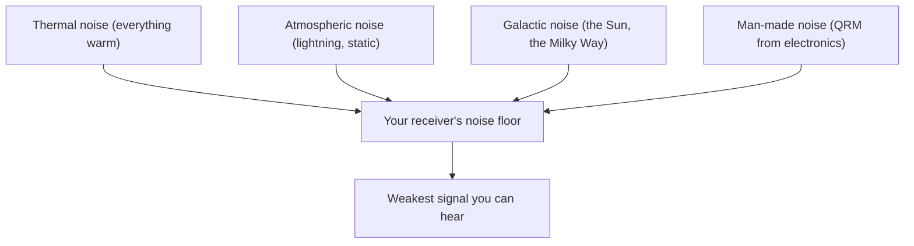
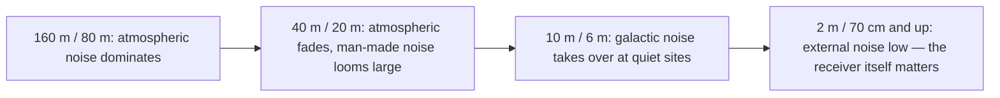
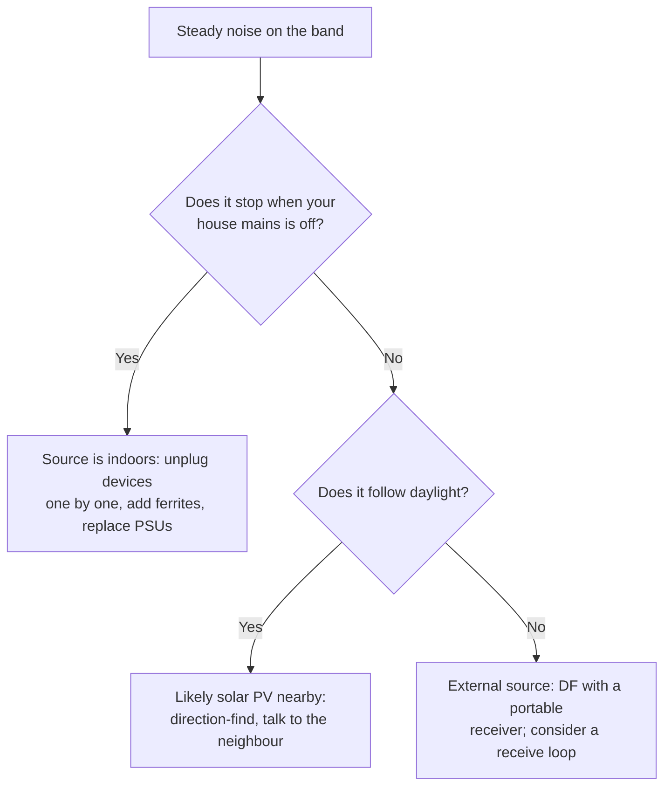

# Noise

Every receiver ever built has the same enemy, and it is not weak signals — it is noise. Noise decides which stations you can hear, how far your own signal reaches, and whether that faint CW note from the other side of the world — the thin whistle of a Morse signal, met in [Modulation](outpost:entry/logbook73.handbook/modulation) — is readable or lost. Before you spend a penny on a better radio, it pays to understand what noise is, where it comes from, and — the encouraging part — how much of it you can actually do something about.

## What noise actually is

Tune a receiver to an empty frequency, turn the volume up, and you hear it: a steady hiss, perhaps with crackles and buzzes riding on top. That is noise — every unwanted signal, natural or man-made, that arrives at your receiver alongside the station you want.

The steady background level is called the **noise floor**. Think of it as the water level in a harbour: any signal that stands above the water is visible; anything below it is submerged and gone. You cannot hear a signal that is weaker than the noise floor, no matter how good your radio is or how carefully you tune. A "weak signal" really means "a signal not far above the noise", and improving reception almost always means one of two things — raising the signal or lowering the floor.

```viz
{
  "type": "spectrum",
  "title": "The noise floor decides what exists",
  "caption": "Signals above the water level are stations; signals below it are simply gone — no amount of gain or careful tuning brings back the one on the right.",
  "noiseFloor": 0.25,
  "components": [
    { "f": 25, "amp": 0.8, "label": "easy copy" },
    { "f": 58, "amp": 0.36, "label": "barely above the floor" },
    { "f": 85, "amp": 0.13, "tone": "muted", "label": "submerged" }
  ],
  "xLabel": "frequency →"
}
```

Noise comes from three broad places, and it helps to keep them separate in your head:

- **The universe itself** — every warm object, including the components inside your radio, generates a faint hiss called thermal noise. This is the absolute floor beneath everything.
- **Nature** — lightning, the Sun and the Milky Way all radiate radio energy, and the [ionosphere](outpost:entry/logbook73.handbook/propagation) delivers it to your antenna from thousands of kilometres away.
- **People** — every switch-mode power supply, solar inverter, LED lamp and broadband line in your street leaks radio energy, and most of it lands squarely on the amateur bands.

Which of the three dominates depends almost entirely on frequency and on where you live, and that single fact explains a surprising amount of amateur radio.



## Thermal noise: the floor of the universe

Everything warmer than absolute zero hisses at radio frequencies. The electrons in every resistor, wire and antenna jiggle about randomly because of heat, and jiggling electrons radiate. This is **thermal noise** (you may also see it called Johnson noise), and it is utterly unavoidable — it is the price of living in a warm universe.

The physics compresses into one wonderfully simple number. At room temperature, thermal noise power is:

`-174 dBm in every 1 Hz of bandwidth`

That comes from the formula `P = kTB` — Boltzmann's constant `k`, temperature `T`, bandwidth `B` — but you never need the formula itself. Just remember **−174 dBm/Hz** and add `10 × log₁₀(bandwidth in Hz)` for wider bandwidths, exactly as you learned in [Decibels](outpost:entry/logbook73.handbook/decibels). (dBm is decibels relative to 1 milliwatt, so −174 dBm is a fantastically tiny power — about 0.000 000 000 000 000 004 mW.)

A worked example with real amateur numbers. An SSB voice signal needs about 2.4 kHz of bandwidth:

`10 × log₁₀(2400) ≈ 33.8 dB`

`-174 + 33.8 ≈ -140 dBm`

So a _perfect_ receiver — one that adds no noise of its own — listening through a 2.4 kHz SSB filter at room temperature has a noise floor of about −140 dBm. Nothing you can buy, at any price, does better than that. Real receivers add a few dB on top (that is the "noise figure", which gets a proper treatment in [Sensitivity](outpost:entry/logbook73.handbook/sensitivity)), but the point stands: thermal noise sets a hard floor, and it is the _quietest_ the world can possibly be.

Here is the twist that surprises most newcomers: on the HF bands, you will almost never get anywhere near that floor — because the other noise sources are far louder.

## Nature's noise: static from the sky

Connect an antenna and the noise floor jumps well above thermal, even in a quiet rural location, because the antenna is collecting noise from the whole planet and beyond.

### Atmospheric noise

At any moment, roughly two thousand thunderstorms are active around the world, and every lightning stroke is a broadband radio transmitter of colossal power. On the lower [HF](outpost:entry/logbook73.handbook/hf) bands, the ionosphere carries those crashes to you from thousands of kilometres away, just as it carries the DX you actually want. This **atmospheric noise** — amateurs call it _static_ or QRN — is strongest at low frequencies and fades steadily as you go up:

- On **160 m and 80 m**, atmospheric noise dominates almost everywhere. Summer evenings can be a wall of crashes, which is one reason these are thought of as winter bands.
- By **20 m**, it has dropped substantially; a quiet 20 m band genuinely is quiet.
- By **10 m and above**, atmospheric noise is essentially gone (barring a storm overhead).

You cannot do anything about atmospheric noise except choose your band and season — it arrives by the same propagation as the signals.

### Galactic and solar noise

Above about 15–20 MHz, a subtler hiss takes over: radio energy from the Milky Way and the Sun. **Galactic noise** (also called cosmic noise) matters on 10 m, 6 m and 2 m, where it can be the dominant natural noise at a quiet site — point a beam at the galactic centre with a low-noise system and you can literally hear our galaxy. By UHF it has fallen away too, which is why [UHF](outpost:entry/logbook73.handbook/uhf) and microwave receivers at quiet sites can get genuinely close to the thermal floor — and why receiver quality matters far more up there, a theme we pick up in [Sensitivity](outpost:entry/logbook73.handbook/sensitivity).

The overall pattern is worth fixing in your mind:



## People noise: the modern plague of QRM

Natural noise is the same as it was a century ago. What has changed — dramatically, and mostly for the worse — is **man-made noise**, which amateurs call QRM (from the old Q-code for interference). In a typical town or suburb, man-made noise on the HF bands is 20 to 40 dB above the thermal floor. Read that again: the local electronic din can be _ten thousand times_ stronger than the physics requires. This, far more than transmitter power or antenna size, is what limits most home stations today.

The usual suspects, all of them probably within 30 metres of your antenna:

- **Switch-mode power supplies (SMPS)**. Nearly every modern gadget — phone chargers, laptop bricks, routers, TVs, LED drivers — converts mains power by switching it on and off tens of thousands of times a second. Cheap ones radiate harmonics right across HF, typically heard as a buzzing carrier every few tens of kHz, or a broad raspy hash.
- **Solar PV inverters**. A rooftop solar installation contains a large, powerful switch-mode converter with metres of DC cabling acting as an antenna. Poor installations can wipe out HF for a whole street — and the noise follows the Sun, strongest at midday, gone at night. (Good, properly filtered installations are quiet; it is very installation-dependent.)
- **VDSL broadband**. VDSL delivers internet over telephone wires using frequencies up to 17 MHz or more — directly on top of the amateur HF bands. The phone line becomes an unintentional transmitting antenna. VDSL noise sounds like a broad rise in the floor across whole bands, sometimes with distinct band edges visible on a waterfall. (Notches are supposed to protect amateur allocations; reality varies. As full-fibre replaces VDSL this source is slowly fading.)
- **Everything else**: LED lamps and their dimmers, plasma TVs, ethernet-over-mains adaptors (PLT — notorious), induction hobs, treadmill motors, aquarium heaters, badly suppressed thermostats, electric fences clicking once a second.

The defining feature of man-made noise is that it is **local** — it reaches you by direct radiation or along the mains wiring, not by ionospheric propagation. That is bad news (it is always there, propagation or not) but also good news: because it is local, it is the one category of noise you can actually hunt down and fix.

## Noise floor and bandwidth: why CW hears deeper than SSB

Here is one of the most useful ideas in all of receiver engineering, and it costs nothing to use: **noise power depends on bandwidth**.

Noise is spread evenly across the spectrum, like drizzle falling evenly on a field. A receiver's filter is a bucket: a wide bucket catches more drizzle. Halve the bandwidth and you collect half the noise power — a 3 dB improvement — while a narrow signal like a CW tone loses nothing, because all of it still fits inside the filter.

```viz
{
  "type": "spectrum",
  "title": "A narrow filter collects less drizzle",
  "caption": "The noise is spread evenly, so a 500 Hz CW filter admits about a fifth of the noise power a 2.4 kHz SSB filter would — while the narrow CW signal loses nothing at all.",
  "noiseFloor": 0.22,
  "components": [
    { "f": 50, "amp": 0.75, "label": "CW signal" }
  ],
  "mask": { "kind": "bandpass", "from": 46, "to": 54 },
  "xLabel": "frequency →"
}
```

Worked example, same station copied two ways:

| Mode             | Bandwidth | Noise collected (perfect receiver) |
| ---------------- | --------- | ---------------------------------- |
| SSB voice        | 2,400 Hz  | −174 + 33.8 = **−140 dBm**         |
| CW               | 500 Hz    | −174 + 27.0 = **−147 dBm**         |
| FT8 (per decode) | ~50 Hz    | −174 + 17.0 = **−157 dBm**         |

Switching from a 2.4 kHz SSB filter to a 500 Hz CW filter lowers the noise floor by about 7 dB — the same as the other station multiplying their power by five. This is the honest engineering reason CW outperforms voice with the same equipment, and it is a large part of why [FT8](outpost:entry/logbook73.handbook/ft8), which effectively listens in slivers of a few hertz, decodes signals you cannot hear at all by ear. Narrow modes do not make signals stronger; they collect less noise.

The limit is the signal itself: you cannot make the filter narrower than the signal's own bandwidth without destroying it. Voice needs its 2.4 kHz. But never listen with a wider filter than the mode requires — that is free sensitivity thrown away.

## Band-by-band noise character

Every band has its own noise personality. Knowing them turns a confusing hiss into information:

| Band         | Dominant noise (typical suburban home)    | Character                                                                     |
| ------------ | ----------------------------------------- | ----------------------------------------------------------------------------- |
| 160 m / 80 m | Atmospheric + man-made                    | Static crashes, mains buzz; summer nights can be brutal, winter nights lovely |
| 40 m         | Man-made + atmospheric                    | The workhorse band, but often the noisiest for suburban QRM                   |
| 20 m         | Man-made (urban) / very quiet (rural)     | The gap between a noisy and quiet QTH is at its most dramatic here            |
| 15 m / 10 m  | Man-made fading out; galactic creeping in | Often surprisingly quiet — lovely when open                                   |
| 6 m          | Galactic + local VHF sources              | Quiet floor; ignition and LED noise show up                                   |
| 2 m / 70 cm  | Receiver's own noise                      | External noise low — antenna, feeder and preamp quality now dominate          |

A useful S-meter rule of thumb: a quiet rural HF site might idle at S1–S3; a typical suburban garden S5–S7 on 40 m; a bad urban location S9. Since each S-point is roughly 6 dB, the difference between a quiet and a noisy QTH can exceed 30 dB — vastly more than the difference between any two radios on the market.

## What you can actually do about local noise

Atmospheric and galactic noise are the weather: you work around them. Man-made noise is different — it has a source, the source has a location, and most sources can be silenced. A realistic campaign, in order of payoff:

### 1. Find it

- **The mains-breaker test.** On battery power (a portable radio or a laptop with an SDR), turn off your house's main breaker for a minute. If the noise drops, the source is in _your own home_ — the most common outcome, and the best one, because you control it. Restore power, then flip circuits one at a time to narrow it down.
- **Unplug hunting.** Suspect everything with a plug-top supply. Chargers left plugged in with nothing attached are classic offenders.
- **Direction finding.** A portable receiver (even a cheap SDR and a small loop) lets you walk towards the buzz. Noise gets louder near its source and often peaks near specific mains wiring, a neighbour's solar array, or a phone pole.
- **Time signature.** Note _when_ it appears. Sunrise-to-sunset points at solar PV; evenings at TVs and lighting; 24/7 at routers, chargers and VDSL.

### 2. Kill it at the source

- Replace the offending cheap power supply with a decent one — often the whole fix for pocket money.
- Clip-on **ferrite chokes** on the leads of noisy devices (both mains and output leads, several turns through the core where the cable allows) stop the leads acting as antennas.
- If the source is a neighbour's, diplomacy first — "your solar inverter may be faulty" lands better than "you're jamming me". Your national amateur radio society usually publishes excellent interference (EMC) guidance — the RSGB and ARRL both do — and genuinely severe cases can be reported to your national regulator (Ofcom in the UK, the FCC in the US, and their counterparts elsewhere).

### 3. Reduce what your station picks up

- **Antenna placement is the big lever.** Noise falls off quickly with distance from its source; getting the antenna higher and further from the house — even a few metres — routinely buys more than any filter. A garden-end dipole beats a loft antenna sitting a metre above your consumer unit.
- **Choke your feedline.** A common-mode choke (a ferrite-cored coil of coax) at the antenna feedpoint stops the coax braid delivering house noise straight up to the antenna. Cheap, effective, and covered more in [Transmission Lines](outpost:entry/logbook73.handbook/transmission-lines).
- **Receive loop antennas.** Small shielded magnetic loops respond mainly to the magnetic field and can be rotated to put a deep null on a noise source. Many operators in noisy locations transmit on their main antenna and _receive_ on a loop.
- **Noise blankers and noise reduction.** A noise blanker punches out sharp pulses (ignition, electric fences) and works well on exactly those. DSP noise reduction makes steady hiss less fatiguing to listen to; it improves comfort more than raw copy. Neither substitutes for fixing the source.

> **Safety note:** noise hunting means poking around mains-powered equipment. Never open power supplies or work inside consumer units — a plug-in/unplug and clip-on-ferrite approach finds and fixes almost everything without exposing you to mains voltage.



## Try it yourself

You can survey your own noise environment this evening with nothing more than a receiver — an RTL-SDR dongle running [SDR++](outpost:entry/logbook73.handbook/sdr-plus-plus) is ideal because the waterfall makes noise _visible_, as covered in [FFTs & Waterfalls](outpost:entry/logbook73.handbook/ffts-and-waterfalls).

1. **Map your floor.** With your antenna connected, note the S-meter (or waterfall level) on an empty frequency on each band you can reach: 80 m, 40 m, 20 m, 10 m, 2 m. Keep the same mode/bandwidth for a fair comparison. Jot the readings in a note — this is your baseline.
2. **Look for signatures.** On the waterfall, hunt for evenly spaced carriers marching across the band (switch-mode supply), a broad raised plateau with sharp edges (VDSL), or a raspy band that strengthens at midday (solar PV).
3. **Run the breaker test.** On battery power, kill the house mains for sixty seconds and watch the waterfall. Most people are startled by how much of "the band" was actually their own home.
4. **Do the bandwidth experiment.** Find a weak CW or FT8 signal and narrow your receive filter from 2.4 kHz down to 500 Hz or less. Hear the floor drop while the signal stays — that is the `10 × log₁₀(B)` rule working for you in real time.
5. Log a few reception reports in LogBook73 with a note of your noise level at the time; over weeks you will see exactly how your local noise, not your radio, shapes what you hear.

## Key takeaways

- Noise sets the real limit on reception: you cannot hear below the noise floor, whatever the radio costs.
- Thermal noise is the universal floor — remember **−174 dBm per Hz**, plus `10 × log₁₀(bandwidth)`; a perfect SSB receiver floors out near −140 dBm.
- Atmospheric noise rules the low HF bands, galactic noise matters around 10 m–2 m, and above that your receiver's own noise finally becomes the limit.
- In towns, man-made noise sits 20–40 dB above thermal on HF — switch-mode supplies, solar inverters and VDSL are the usual culprits, and they are findable and often fixable.
- Halving bandwidth halves the noise: a 500 Hz CW filter hears about 7 dB deeper than 2.4 kHz SSB, and FT8 deeper still.
- Antenna placement, ferrite chokes and source-hunting buy more real-world performance than any receiver upgrade at a noisy QTH.

With the enemy mapped, the obvious next question is how receivers are rated against it — and why a "more sensitive" radio often can't help you at all: that story is [Sensitivity](outpost:entry/logbook73.handbook/sensitivity).
