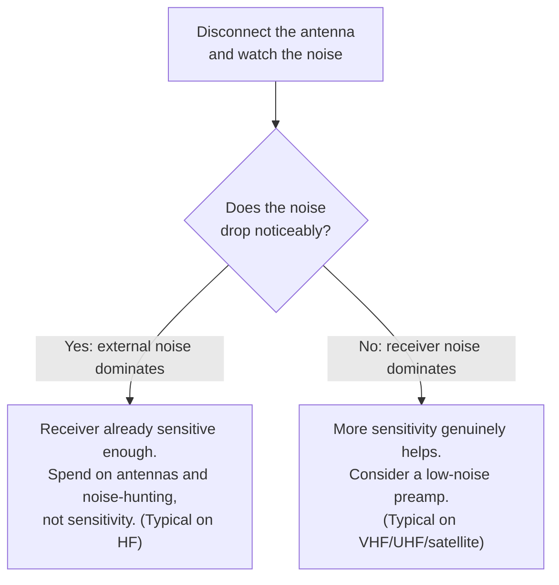
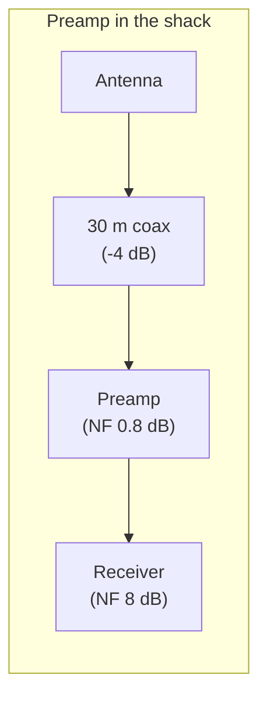
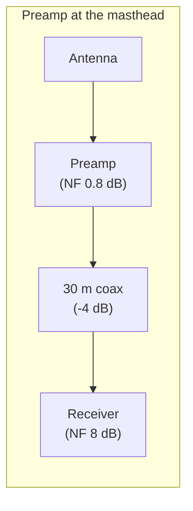

# Sensitivity

Open any radio review and the first number quoted is usually sensitivity — how weak a signal the receiver can detect. It sounds like the thing that matters most, and manufacturers certainly price it that way. The truth is more interesting: sensitivity is easy to define, easy to measure, and — on the HF bands — very often irrelevant. Understanding _why_ will save you money, and understanding _when it does matter_ will transform your results on VHF, UHF and satellites.

## What sensitivity really means

A receiver's job is to take a tiny wobble of voltage from the antenna and turn it into something you can hear or decode. Sensitivity asks: how tiny can that wobble be before the receiver loses it?

The limit is never "the signal gets too small to amplify" — amplification is cheap, and any receiver can add another gain stage. The limit is [noise](outpost:entry/logbook73.handbook/noise). Every receiver adds some noise of its own on top of what comes down the coax, and once the signal sinks below the combined noise, no amount of further amplification helps: you would just be turning up the hiss and the signal together, like enlarging a blurry photograph. Sensitivity is therefore really a statement about _how little noise the receiver adds_.

```viz
{
  "type": "spectrum",
  "title": "Sensitivity is set by noise, not by gain",
  "caption": "Turning up the gain lifts signal and floor together — the station on the left stays decodable, the one on the right stays lost, and no volume control changes which is which.",
  "noiseFloor": 0.22,
  "components": [
    { "f": 30, "amp": 0.6, "label": "decodable" },
    { "f": 72, "amp": 0.13, "tone": "muted", "label": "lost" }
  ],
  "xLabel": "frequency →"
}
```

That gives us the two standard ways to express it, which are two views of the same thing.

### MDS: the minimum discernible signal

**MDS (minimum discernible signal)** is the weakest signal the receiver can detect at all — formally, the input level at which the signal emerges just equal to the receiver's own noise floor (engineers say "0 dB SNR"). It is quoted in dBm, and more negative is better: an MDS of `-140 dBm` hears deeper than `-130 dBm`.

You can build the number from pieces you already know:

`MDS = -174 dBm + 10 × log₁₀(bandwidth in Hz) + noise figure`

The first two terms are the perfect-receiver thermal floor from [Noise](outpost:entry/logbook73.handbook/noise); the last term is what this receiver adds. Worked example with typical numbers — a decent HF transceiver with a noise figure of 8 dB, measured in a 500 Hz CW bandwidth:

`MDS = -174 + 10 × log₁₀(500) + 8 = -174 + 27 + 8 = -139 dBm`

That is a signal of about 0.025 microvolts at the antenna socket — a genuinely tiny whisper. Note the bandwidth term: MDS figures are meaningless unless you know the bandwidth they were measured in, which is why reviews always state it (usually 500 Hz).

### Noise figure: how much the receiver adds

**Noise figure (NF)** strips away the bandwidth and states the receiver's contribution directly: _how many dB of noise does this receiver add on top of the unavoidable thermal floor?_ A perfect receiver has NF = 0 dB. Real equipment:

| Equipment                          | Typical noise figure |
| ---------------------------------- | -------------------- |
| Perfect (theoretical) receiver     | 0 dB                 |
| Dedicated VHF/UHF low-noise preamp | 0.5–1 dB             |
| Good VHF/UHF transceiver           | 3–6 dB               |
| Good HF transceiver                | 8–15 dB              |
| RTL-SDR dongle (gain set well)     | ~6–8 dB              |

Notice something odd: HF transceivers have _worse_ noise figures than VHF ones, from the same manufacturers, at the same prices. That is not carelessness — it is engineers being honest about where sensitivity matters, as we are about to see.

## SNR and SINAD, in plain terms

Detecting a signal is not the same as enjoying it. What makes a signal _usable_ is its **signal-to-noise ratio (SNR)** — how far it stands above the noise, in dB. Rules of thumb for real operating:

| SNR                 | What it is like                                                 |
| ------------------- | --------------------------------------------------------------- |
| 0 dB                | You can tell something is there; CW just copyable by a good ear |
| ~6 dB               | Weak but workable SSB — strained "readability 3" copy           |
| ~10–12 dB           | Comfortable SSB conversation                                    |
| ~20 dB+             | Armchair copy                                                   |
| −20 dB (yes, minus) | FT8 still decodes — machines dig far below the audible floor    |

**SINAD** is a close cousin you will meet in specifications for FM equipment: "signal, noise and distortion". It measures the same idea from the output side — take the receiver's audio, compare the wanted tone against everything else (noise _and_ distortion), and quote the ratio. The classic FM spec "0.25 µV for 12 dB SINAD" simply means: with a quarter-microvolt signal at the socket, the audio is 12 dB cleaner than the junk — roughly the point where FM speech becomes comfortably readable. SNR and SINAD are near enough the same thing for a beginner: _how far above the mess is the wanted signal?_ SNR is quoted for the signal itself; SINAD is measured on the audio and also counts distortion.

## The key insight: external noise usually wins

Here is the paragraph that should save you the price of a new radio.

Your receiver hears the sum of two noises: what it adds itself (the noise figure) and what the antenna delivers from outside (atmospheric, galactic and man-made noise from [Noise](outpost:entry/logbook73.handbook/noise)). Whichever is bigger sets the floor — and they add as powers, so when one is even 10 dB bigger, the other has practically vanished from the total.

On HF, outside noise is enormous. At a typical suburban QTH, band noise on 40 m runs 30 dB or more above the thermal floor. Suppose your receiver's noise figure is a mediocre 15 dB and the band noise is 30 dB above thermal: the external noise is 15 dB stronger than the receiver's contribution, so the receiver's noise is invisible. Now replace the radio with one boasting a 5 dB noise figure — a tenfold "improvement" in added noise. Your noise floor changes by a fraction of a decibel. **Nothing audible improves at all.**

The quick test is beautifully simple, and worth doing on every band you use:

> **Disconnect the antenna.** If the background noise drops when the antenna comes off, external noise dominates and your receiver is _already sensitive enough on that band_ — more sensitivity is literally useless. If the noise barely changes, the receiver's own noise dominates, and better sensitivity (or a preamp) would genuinely help.

On HF below about 20 MHz, the noise drops dramatically at almost any location on Earth. That is why HF radios ship with relaxed noise figures, why HF reviews barely dwell on MDS, and why the money at an HF station belongs in [antennas](outpost:entry/logbook73.handbook/antennas) and noise reduction instead. On 2 m, 70 cm and above — especially pointing a beam at a quiet, cold sky for [satellites](outpost:entry/logbook73.handbook/satellites) or [EME](outpost:entry/logbook73.handbook/moonbounce-eme) — external noise is tiny, the test barely moves the S-meter, and every dB of noise figure is a dB of real performance.



## Preamps: when they help and when they hurt

A **preamplifier (preamp)** is a small low-noise amplifier placed ahead of the receiver — sometimes built into the rig behind a button labelled `PRE` or `AMP`, sometimes a separate box at the masthead. Since amplifying signal and noise together achieves nothing, what is it actually for?

A preamp helps in exactly one situation: **when the receiver's own noise is the limit**. A good preamp has a very low noise figure (under 1 dB) and enough gain that everything after it matters much less — in effect, the whole system inherits the preamp's excellent noise figure. Where the external noise already towers over the receiver noise, the preamp amplifies noise and signal alike and improves nothing — while making things actively worse in two ways:

- **Overload.** Extra gain ahead of the receiver means strong signals arrive bigger, eating into the headroom we will meet in [Dynamic Range](outpost:entry/logbook73.handbook/dynamic-range). Engage the preamp on 40 m in the evening and you may hear _more_ garbage, not more DX.
- **Its own distortion products.** A cheap wideband preamp fed a whole band of strong signals will generate phantom signals of its own — the subject of [Overload & Ghost Signals](outpost:entry/logbook73.handbook/overload-and-ghost-signals).

Hence the practical rules:

| Situation                                   | Preamp?                                                                |
| ------------------------------------------- | ---------------------------------------------------------------------- |
| HF, 160 m–20 m, any location                | Off — almost always. It cannot help and can hurt                       |
| HF, 15 m–10 m, quiet location, tiny antenna | Occasionally useful — try it and trust the S/N by ear, not the S-meter |
| 2 m / 70 cm weak-signal work (SSB/CW)       | Usually helps, especially with a modest antenna                        |
| Satellites, EME, quiet-sky VHF/UHF          | Essential — this is what preamps are _for_                             |
| Long coax run to a VHF/UHF antenna          | Masthead preamp transforms the station (next section)                  |

A note on that seductive S-meter: switching a preamp in always makes the meter rise, because everything got louder. The only question that matters is whether the _signal-to-noise ratio_ improved — judge with your ears or the decoder, never the meter.

## Cascade intuition: the first stage sets the tone

Why does a preamp belong at the _masthead_ rather than in the shack? The answer is one of the most useful intuitions in receiver design, formalised in something called the **Friis cascade formula**. You do not need the formula — you need its moral:

> **In a chain of stages, the first stage dominates the noise performance of the whole system.**

The intuition: whatever noise the first stage adds gets amplified by every stage after it, right alongside the signal. Noise added later joins a signal that has already been amplified, so proportionally it matters far less. A chain is like a relay race — a stumble by the first runner is carried the whole distance, while a stumble on the final leg costs almost nothing.

There is a sharp corollary about **loss before the first amplifier**: any attenuation ahead of the first gain stage adds to the system noise figure _decibel for decibel_. Lose 3 dB in coax before the preamp and your system noise figure just got 3 dB worse — full stop, no matter how heroic the electronics further down.

Worked example — a 70 cm satellite station with 30 m of ordinary coax losing 4 dB, a 0.8 dB-NF preamp, and a transceiver with an 8 dB noise figure:

- **Preamp in the shack** (coax first): the 4 dB loss comes first, so the system noise figure is at least `4 + 0.8 ≈ 4.8 dB` — the lovely preamp is largely wasted.
- **Preamp at the masthead** (preamp first): the system noise figure is essentially the preamp's own `~0.9 dB` — the coax loss and the rig's mediocre 8 dB now sit _after_ 20 dB of gain and barely register.

Same three boxes, roughly 4 dB difference — purely from the order in which the signal meets them. Four dB is the difference between working a satellite pass and hearing nothing.





The same logic explains the inside of every receiver: designers lavish care on the very first transistor the antenna meets (the **LNA**, low-noise amplifier), because its noise figure is, near enough, the receiver's noise figure. It also explains why attenuators, filters and long feedlines are cheap to place _after_ an amplifier and expensive to place before it — a trade-off we will keep meeting in [Filters](outpost:entry/logbook73.handbook/filters) and [Amplifiers](outpost:entry/logbook73.handbook/amplifiers).

> **Safety note:** masthead preamps mean working at height and running power up the coax. Plan mast work with a helper on the ground, never work aloft in wind or near overhead power lines, and use proper weatherproofing on connectors — a corroded joint ahead of the preamp is loss in the worst possible place.

## Reading a specification honestly

Armed with all this, a typical review line — "MDS −131 dBm (500 Hz, preamp off), −140 dBm (preamp on)" — now decodes cleanly. From `MDS = -174 + 27 + NF`, the noise figures are 16 dB and 7 dB. On 40 m under S7 suburban noise, both are equally fine and the preamp should stay off. On a quiet 10 m morning with a small antenna, the preamp might just earn its keep. On 2 m, you would want the preamp on — or better, one at the masthead. One number, three different verdicts, all depending on the noise arriving from outside. That is sensitivity in a nutshell: _a statement about the receiver that only means something once you know the noise around it._

## Try it yourself

1. **Run the disconnect test on every band.** Antenna in, note the noise level; antenna out, note it again (an SDR waterfall in [SDR++](outpost:entry/logbook73.handbook/sdr-plus-plus) shows this beautifully). Bands where the floor barely moves are where sensitivity and preamps would genuinely pay; bands where it plunges are where your receiver is already "good enough". Most people find the crossover sits somewhere around 21–50 MHz.
2. **Audit your preamp button.** On a weak SSB or CW signal on each band, toggle `PRE` and judge by ear whether the signal gets easier to copy — not louder, _easier_. On low HF you will usually find it makes the noise louder and nothing else.
3. **Work out your own rig's noise figure.** Find your radio's published MDS (the manual or an independent review), note the stated bandwidth, and rearrange: `NF = MDS + 174 − 10 × log₁₀(B)`. Compare it against the table earlier — and against your disconnect-test results — to see whether it is the limit at your QTH anywhere at all.
4. **Log the evidence.** Next time you copy a genuinely weak station, record in LogBook73 the band, your noise level and whether the preamp was in. A few weeks of notes builds a personal sensitivity map of your station that no review table can give you.

## Key takeaways

- Sensitivity is really about how little noise a receiver _adds_; amplification alone is free and unlimited.
- `MDS = -174 + 10 × log₁₀(bandwidth) + noise figure` — an MDS without a stated bandwidth means nothing.
- SNR is what makes signals usable (≈6 dB for strained SSB, 10–12 dB for comfort); SINAD is the FM-world flavour of the same idea.
- Once external noise dominates — as it almost always does on HF — extra sensitivity changes nothing audible. The antenna-disconnect test tells you in ten seconds which regime you are in.
- Preamps belong where receiver noise is the limit: VHF/UHF weak-signal and satellite work, ideally at the masthead. On low HF they mostly add overload risk.
- The first stage sets the tone: loss before the first amplifier costs a full dB of noise figure per dB of loss, which is why masthead preamps and good feedline matter so much at VHF and above.

Sensitivity is only half the receiving story — the other half is coping with _strong_ signals at the same time, and that is where cheap receivers really get found out: on to [Dynamic Range](outpost:entry/logbook73.handbook/dynamic-range).
