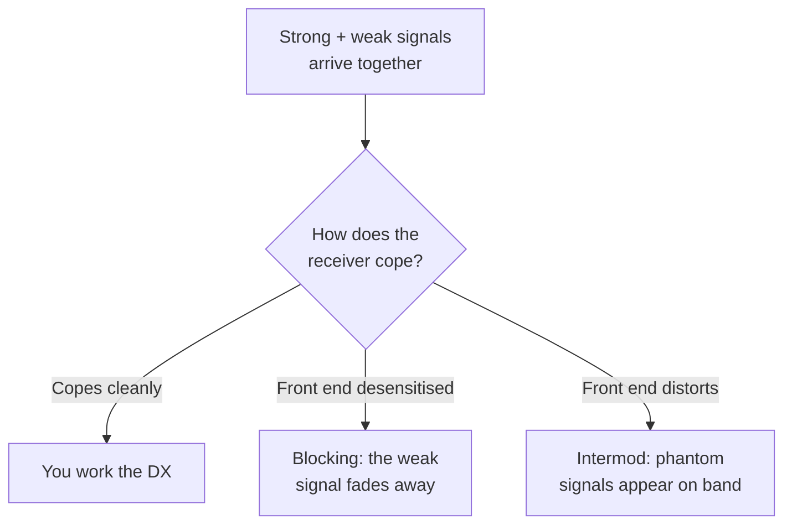
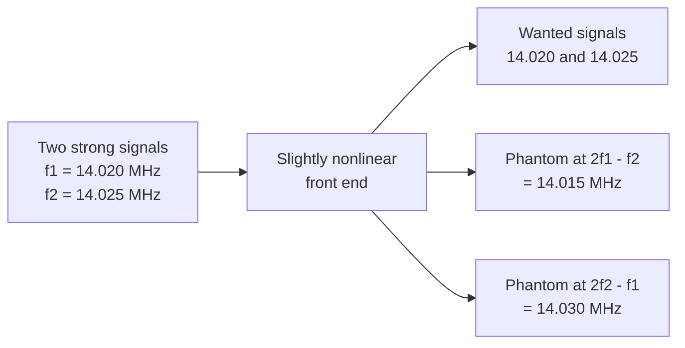
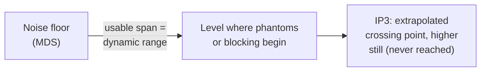

# Dynamic Range

It is a contest weekend. Forty metres is wall-to-wall signals, some of them from stations running a kilowatt a few miles away, and somewhere in among them is the weak DX you actually want. Whether you can pull that whisper out from beside the shouting is not decided by sensitivity — it is decided by **dynamic range**: a receiver's ability to handle the very strong and the very weak _at the same time_. It is the quality that separates a great receiver from a merely sensitive one, and it is exactly what the numbers in rig reviews are trying to tell you.

## The problem: weak next to strong

In [Sensitivity](outpost:entry/logbook73.handbook/sensitivity) we asked how weak a signal a receiver can hear on its own. Real bands are never that polite. On a busy evening your antenna delivers, all at once: the S3 DX station you want at perhaps `-110 dBm`, a dozen strong stations at S9 (`-73 dBm`), and the club station up the road at S9+40 (`-33 dBm`). The strongest is roughly _ten million times_ more powerful than the weakest, and every one of them arrives at the same first transistor.

```viz
{
  "type": "spectrum",
  "title": "The dynamic-range problem in one picture",
  "caption": "The whisper and the shout arrive at the same first transistor at the same time — coping with both at once, not hearing either alone, is what dynamic range measures.",
  "noiseFloor": 0.05,
  "components": [
    { "f": 30, "amp": 0.08, "label": "the DX you want" },
    { "f": 62, "amp": 1.0, "label": "S9+40 local", "tone": "danger" }
  ],
  "xLabel": "frequency →"
}
```

Dynamic range is the span between the quietest thing a receiver can hear and the loudest thing it can tolerate without misbehaving. Think of a conversation at a party: a good listener follows a murmur across the room even while someone bellows next to them; a poor one loses everything the moment the bellowing starts. Both listeners have the same ears (sensitivity) — what differs is composure under load.

The misbehaviour, when it comes, takes two main forms, and each has its own named measurement.



## Blocking: when strong signals turn the volume down

Every amplifier has a ceiling. Feed it a signal too big and it can no longer swing its output far enough to follow the peaks — it **saturates**, like a singer asked for a note beyond their range. When a receiver's early stages saturate on one huge signal, they lose the ability to amplify everything else properly: all the _other_ signals on the band get quieter. This is **blocking**, also called **desensitisation** (or just _desense_).

The experience is unmistakable once you know it: you are copying a weak station comfortably, a big local starts transmitting on a frequency 20 kHz away, and your station sinks into the noise — even though nothing is on your frequency. When the local stops, your station pops back. The strong signal never needed to be audible in your passband; it only needed to reach your front end.

**Blocking dynamic range (BDR)** measures resistance to this. Reviewers apply one strong off-channel signal, increase it until the wanted weak signal drops by 1 dB, and quote the span between that level and the noise floor. A superb receiver manages 130–140 dB or more with the offending signal only 2 kHz away; a poor one may manage under 100 dB. Those numbers span the difference between "unbothered by a kilowatt neighbour" and "deaf every contest weekend".

## Intermodulation: when strong signals invent new ones

Blocking is at least honest — signals just get weaker. The second failure mode is spookier: the receiver starts _creating signals that do not exist_.

No amplifier is perfectly linear — its output is never an exact scaled copy of its input, and the error grows as signals get bigger. When two strong signals, at frequencies `f1` and `f2`, pass through a slightly nonlinear stage together, the distortion mathematically manufactures energy at combination frequencies. The infamous ones are the **third-order intermodulation products**:

`2 × f1 − f2` and `2 × f2 − f1`

Their nasty property is location. Two strong CW stations at `14.020 MHz` and `14.025 MHz` generate products at `2 × 14.020 − 14.025 = 14.015 MHz` and `2 × 14.025 − 14.020 = 14.030 MHz` — spaced by the same 5 kHz, _right inside the same band_, exactly where you might be listening for DX. No filter ahead of the receiver can remove them, because the ingredients are legitimate in-band signals; the phantoms are cooked up inside your own front end. On a crowded band the effect multiplies across every strong pair, and a weak receiver hears a carpet of ghostly beeps and burbling that simply is not on the air. (The full field guide to these phantoms — and their cousins from images and aliasing — is the next chapter, [Overload & Ghost Signals](outpost:entry/logbook73.handbook/overload-and-ghost-signals).)

**Two-tone (IMD) dynamic range** measures this. Reviewers inject two equal test signals and raise them until the third-order products they generate poke just above the noise floor; the span from the noise floor to that level is the IMD dynamic range, quoted in dB for a stated tone spacing. Excellent modern receivers achieve 100–110 dB at 2 kHz spacing; older or cheaper designs may be down at 70–80 dB. It is usually the _smaller_ — and therefore the more telling — of the two dynamic ranges.

### IP3, gently

Reviews often quote a related figure: the **third-order intercept point (IP3)**, in dBm. Here is the intuition without the algebra. As you raise two input tones by 1 dB each, their third-order products rise by 3 dB — distortion grows three times faster than the signals causing it, which is why intermod appears so suddenly as a band fills up. Plot both lines on a graph of output versus input and, having different slopes, they must eventually cross. That crossing point is IP3.

It is a pure extrapolation — every receiver saturates long before actually reaching it — but it is a wonderfully compact score: **the higher the IP3, the harder the receiver is to drive into making phantoms.** An IP3 of `+30 dBm` is excellent; `0 dBm` is mediocre; a bare RTL-SDR dongle sits well below that, which is why it needs such gentle handling near strong transmitters. As a rule of thumb, every 1 dB of extra IP3 buys about 2/3 dB of extra IMD dynamic range, so a few dB between rivals is a real difference, not marketing.



## AGC: the unsung referee

Between the extremes, every receiver runs a quiet balancing act called **AGC — automatic gain control**. Signals at the antenna span 100 dB or more, yet your loudspeaker output stays comfortable whether the station is S2 or S9+40. AGC does that: it watches the signal level and continuously turns the receiver's internal gain down as signals get stronger, like a driver easing off the accelerator downhill.

AGC deserves a place in this chapter for two reasons. First, it is why _properly designed_ receivers do not distort on merely "loud" signals — gain is reduced before later stages overload. Second, it has failure modes that masquerade as poor dynamic range:

- **AGC pumping.** If a strong signal sits just outside your filter but inside the range the AGC watches, every burst of their speech yanks your gain down and the station you want _breathes_ — loud, quiet, loud, quiet. The strong neighbour is inaudible, yet controls your volume.
- **Wrong time constants.** AGC set too fast chops and distorts SSB; too slow, and a static crash deafens the receiver for a second afterwards. This is why better rigs offer `AGC FAST/MID/SLOW` — worth actually experimenting with rather than leaving on the default.

Modern SDR-based rigs apply AGC digitally after very narrow filtering, which largely tames pumping — one of the genuine everyday advantages of the [SDR architecture](outpost:entry/logbook73.handbook/software-defined-radio). But note what AGC cannot do: it acts _after_ the first stages. If the front end itself is already blocking or generating intermod, AGC just politely adjusts the volume of the resulting mess.

## Why contest weekends expose bad receivers

Put the pieces together and contest weekends stop being mysterious. On a quiet Tuesday, almost any receiver sounds superb: signals are moderate, spacing is generous, front ends loaf along well inside their linear region. Then CQ World Wide arrives and the same band presents fifty simultaneous strong signals, big guns every 2 kHz and, at 3 dB-per-dB, third-order products erupting from every strong pair.

On a receiver with 100+ dB of dynamic range, the band is merely _busy_ — crowded but clean, every signal real. On a weak one, the band turns to soup: phantom CW where no one is transmitting, splatter that is actually your own front end distorting (the transmitting station is often innocent!), desense whenever the nearest big gun keys up, and AGC pumping in sympathy. Same antenna, same band, wildly different experience. This is why serious contesters and DXers read dynamic range figures before anything else in a review — and why "it sounded fine in the shop" tells you almost nothing about a receiver.

It is also why the first-aid kit for a struggling receiver is _less_ signal: switching in the attenuator (`ATT`), switching off the preamp, or narrowing to a tighter roofing filter — of which more in [Filters](outpost:entry/logbook73.handbook/filters). Ten dB of attenuation costs a strong-signal band almost nothing you care about, but reduces third-order products by thirty. If the "signals" you were hearing vanish entirely, they were never real — a diagnostic trick the next chapter turns into a proper method.

## Reading a review table

Armed with all this, the measurement table in a serious review (the ARRL lab tests and Sherwood Engineering's league table are the ones amateurs quote most) decodes into plain English:

| Line in the table                   | What it means                                                                       | What to look for                                                                                      |
| ----------------------------------- | ----------------------------------------------------------------------------------- | ----------------------------------------------------------------------------------------------------- |
| MDS, 500 Hz                         | Weakest detectable signal — sensitivity ([previous chapter](outpost:entry/logbook73.handbook/sensitivity)) | Around −135 dBm or better; rarely the thing that matters on HF                                        |
| Blocking dynamic range (BDR), 2 kHz | How close a huge signal can sit before desensing you                                | 120 dB good, 140 dB superb                                                                            |
| IMD dynamic range (2-tone, 2 kHz)   | Headroom before phantom signals appear                                              | 90 dB decent, 100+ dB excellent — the single most telling number                                      |
| IP3                                 | Overload resistance as one figure                                                   | +20 dBm good, +30 dBm excellent                                                                       |
| Tone spacing                        | How far apart the test signals were                                                 | Insist on 2 kHz figures — 20 kHz spacing flatters a rig, because the roofing filter is doing the work |

Three habits when reading such tables. First, compare like with like: the same bandwidth, spacing and preamp setting — "preamp on" improves MDS but always worsens the dynamic range lines, exactly the trade-off from [Sensitivity](outpost:entry/logbook73.handbook/sensitivity). Second, weight the numbers by _your_ life: a rural operator with no strong neighbours can cheerfully ignore a middling BDR, while someone two streets from a contest station should prize it above all else. Third, remember diminishing returns — the difference between 95 and 105 dB IMD DR is audible on a contest weekend; the difference between 105 and 110 mostly is not.



## Try it yourself

An RTL-SDR dongle is a wonderfully _bad_ receiver for this purpose — its limited dynamic range lets you create and cure every effect in this chapter, safely and visibly, using what you learned in [FFTs & Waterfalls](outpost:entry/logbook73.handbook/ffts-and-waterfalls).

1. **Find your dongle's ceiling.** In [SDR++](outpost:entry/logbook73.handbook/sdr-plus-plus), tune to the FM broadcast band and slowly raise the RF gain slider. At first, signals grow out of the noise — sensitivity improving. Past a certain point, new "stations" bloom across the display, evenly related to the real ones: third-order intermod, live on screen. Note the gain setting where they appear; that is your front end's honest limit.
2. **Cure it with attenuation.** Back the gain down and watch the phantoms collapse far faster than the real stations shrink — the 3-dB-per-1-dB law running in reverse. This ten-second experiment is the whole chapter in miniature.
3. **Listen for AGC pumping.** On a crowded SSB band with your main rig, find a weak station with a strong neighbour 3–5 kHz away, and listen for your station breathing in time with the neighbour's speech. Try the AGC fast/slow settings and note what changes.
4. **On a contest weekend**, log a few crowded-band sessions in LogBook73 and note when you needed the attenuator or a narrow filter. If phantom signals or desense are routine at your QTH, dynamic range — not sensitivity — is what your next receiver upgrade should buy.

## Key takeaways

- Dynamic range is the span between the weakest signal a receiver can hear and the strongest it can tolerate — the real mark of receiver quality, and independent of sensitivity.
- Blocking (desense) is strong signals saturating the front end and muting everything else; BDR measures resistance to it.
- Nonlinearity turns pairs of strong signals into third-order phantoms at `2f1 − f2` and `2f2 − f1`, landing in-band where no external filter can help; two-tone IMD dynamic range measures the headroom before they appear.
- IP3 condenses overload resistance into one figure — higher is better, +30 dBm is excellent — and works because intermod grows 3 dB for every 1 dB of signal.
- AGC keeps ordinary strong signals comfortable but cannot fix a front end already in distress; pumping is its tell-tale failure.
- In review tables, the 2 kHz-spacing IMD dynamic range is the most honest single number; judge it against the strong-signal reality of your own location.
- When a band turns to soup, reach for the attenuator — losing 10 dB of signal removes 30 dB of phantom.

Next we go hunting the phantoms themselves — images, intermod, aliases and all the other signals that were never really there — in [Overload & Ghost Signals](outpost:entry/logbook73.handbook/overload-and-ghost-signals).
