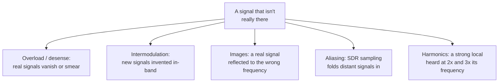
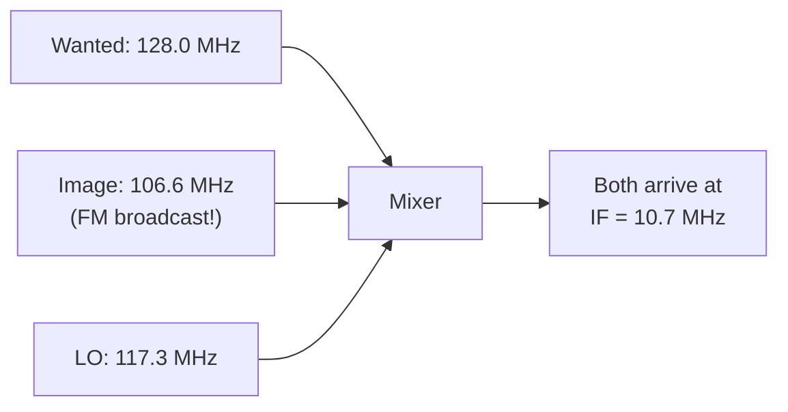
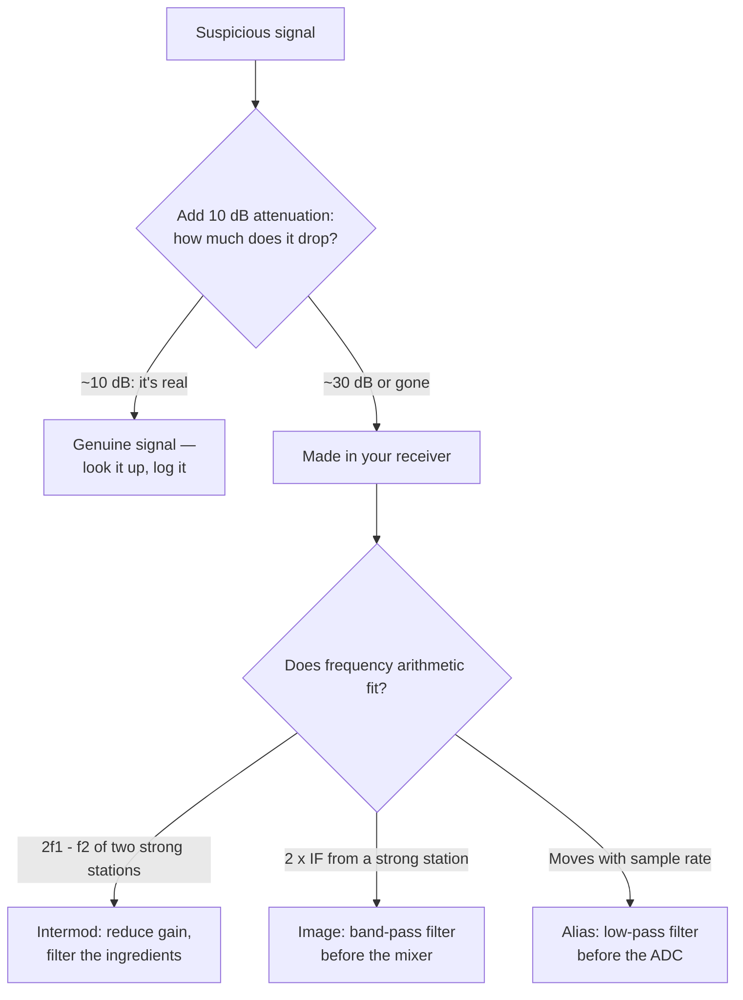

# Overload & Ghost Signals

Sooner or later every listener meets a ghost: a broadcast station sitting in the middle of the airband, a pager blasting across 2 m, a whole FM station apparently transmitting where no FM station could legally be. The signal is loud, clear — and not really there. Nothing is transmitting on that frequency at all; the ghost was manufactured inside your own receiver. This chapter is a field guide to the phantoms: how each kind is born, how to tell them apart, and how to banish them. Learning this saves you from chasing interference that does not exist — and from reporting a "pirate station" that is, embarrassingly, your own dongle.

## Where ghosts come from

Every ghost signal traces back to one root cause: some stage of the receiver being pushed beyond the polite, linear behaviour it was designed for — or being asked a question it cannot answer unambiguously. In [Dynamic Range](outpost:entry/logbook73.handbook/dynamic-range) we met the general problem of strong signals; here we meet each specific haunting. There are five classic species:



The good news running through this whole chapter: ghosts obey rules. Each species appears at _predictable_ frequencies, responds to attenuation in a _characteristic_ way, and has a _specific_ cure. A few minutes of arithmetic identifies almost any phantom.

## Overload and desense: the bluntest haunting

The simplest failure is sheer signal strength. When something very strong — a nearby broadcast transmitter, a pager mast, your neighbour's kilowatt — hits a receiver's front end, the early stages saturate. Two symptoms follow.

**Desense**: everything else on the band gets mysteriously weaker or vanishes, returning when the strong signal stops. You met the mechanism in [Dynamic Range](outpost:entry/logbook73.handbook/dynamic-range) — the amplifier's gain is being stolen.

**Splatter and smearing**: the strong signal seems to occupy hundreds of kHz, a broad rasping mess across the waterfall. Sometimes the transmitter really is dirty — but far more often the spreading is created inside _your_ receiver, and the transmitting station is innocent. The test is simple and universal: **add attenuation**. If 10 dB of attenuator makes the mess shrink dramatically — far more than 10 dB — the fault was yours. A genuinely dirty transmission shrinks by exactly the 10 dB you added, no more.

This test, in various forms, is the master key of the whole chapter, so it is worth stating as a rule:

> **The attenuator test:** switch in 10 dB of attenuation (or reduce SDR gain). Real signals drop by 10 dB. Ghosts born of overload drop much faster — intermod products by 30 dB — or vanish entirely.

## Intermodulation: signals that breed

The second species we also met in [Dynamic Range](outpost:entry/logbook73.handbook/dynamic-range): push two strong signals `f1` and `f2` through a nonlinear front end and it manufactures **third-order intermodulation products** at `2f1 − f2` and `2f2 − f1`.

The FM broadcast band (roughly 88–108 MHz in most of the world) is where nearly everyone meets this first, because broadcast stations are enormously strong and cheap wideband receivers hear the whole band at once. A worked example: suppose two strong locals sit at `98.0 MHz` and `100.2 MHz`. The front end brews:

`2 × 98.0 − 100.2 = 95.8 MHz`

`2 × 100.2 − 98.0 = 102.4 MHz`

Tune to 95.8 MHz and you hear a garbled mixture of _both_ stations — often recognisable programme audio, distorted and mushy, on a frequency where a check of a station list shows nothing broadcasting. That mushy two-stations-at-once quality is the intermod signature. With more strong stations the products multiply combinatorially, and a badly overloaded wideband SDR shows a picket fence of phantoms right across the band. The geometry is always the same:

```viz
{
  "type": "spectrum",
  "title": "Third-order intermod: two strong signals breed two phantoms",
  "caption": "The products appear at the pair's own spacing on either side — in-band, where no external filter can touch them, because they are manufactured inside your own front end.",
  "components": [
    { "f": 35, "amp": 0.25, "label": "2f₁−f₂", "tone": "danger" },
    { "f": 45, "amp": 0.85, "label": "f₁" },
    { "f": 55, "amp": 0.85, "label": "f₂" },
    { "f": 65, "amp": 0.25, "label": "2f₂−f₁", "tone": "danger" }
  ],
  "noiseFloor": 0.06,
  "xLabel": "frequency →"
}
```

The same arithmetic works anywhere: two big 2 m repeater outputs, a pager transmitter plus a broadcast station, or — inside your own band — the contest-weekend soup of the previous chapter. Note where the products land: for closely spaced signals they land _close by, in-band_, which is why no external filter can cure intermod between two stations inside the band you are listening to. The only cures are less gain, more attenuation, or a front end with a higher IP3.

When the mixing happens to strong out-of-band signals (broadcast FM products landing in the airband, say), a filter that rejects the _ingredients_ works beautifully — a broadcast-FM band-stop filter is the classic example, of which more below and in [Filters](outpost:entry/logbook73.handbook/filters).

## Images: the superhet's mirror

The third species is not caused by overload at all — it is an ambiguity built into the architecture of most receivers, and it afflicts weak front ends and strong ones alike.

A superheterodyne receiver (the design behind most rigs, fully unpacked in [Receivers](outpost:entry/logbook73.handbook/receivers)) shifts incoming signals to a fixed **intermediate frequency (IF)** by mixing them with a tunable **local oscillator (LO)**. The mixer, as [Mixers](outpost:entry/logbook73.handbook/mixers) explains, produces the _difference_ between the two frequencies — and here is the catch: two different input frequencies give the same difference. One sits above the LO, one below, both exactly IF away. The receiver wants one; the other is the **image frequency**, a mirror on the far side of the LO:

`image = wanted frequency ± 2 × IF`

Worked example with classic numbers. An airband or 2 m receiver with a `10.7 MHz` IF is tuned to `128.0 MHz`, using an LO at `117.3 MHz` (128.0 − 117.3 = 10.7 ✓). But a signal at `106.6 MHz` _also_ lands at the IF (117.3 − 106.6 = 10.7 ✓). And 106.6 MHz is inside the FM broadcast band — so a strong broadcast station appears, loud and clear, in the middle of the airband, precisely `2 × 10.7 = 21.4 MHz` below where the receiver claims to be tuned.



The image is a _real signal on a real frequency_ — it just is not on the frequency your dial shows. The proper cure is filtering **before the mixer**: a band-pass filter wide enough for the band you want but rejecting the image, `2 × IF` away. Good receivers include exactly that (and choose a high first IF, pushing the image far away where filtering is easy); very cheap scanners and simple kits skimp on it, which is why bargain airband radios are notorious for broadcast breakthrough. An external band-pass or band-stop filter fixes what the manufacturer omitted.

Identification is pure arithmetic: a ghost that sits exactly `2 × IF` from a plausible strong station, tunes normally, and sounds _clean_ (unlike mushy intermod) is an image. Cheap SDR dongles have a related affliction — imperfect [IQ balance](outpost:entry/logbook73.handbook/iq-signals) produces a mirror of strong signals reflected around the SDR's centre frequency; you will see a faint reversed copy of a strong signal on the opposite side of the display. Modern software largely corrects it, and simply moving the centre frequency shifts the mirror, which is how you unmask it.

## Aliasing: the direct-sampling fold

Direct-sampling SDRs — including an RTL-SDR switched into its HF "direct sampling" mode — replace the analogue mixer with an ADC that measures the antenna voltage millions of times a second. Sampling has its own strict rule (the Nyquist limit, met in [Software Defined Radio](outpost:entry/logbook73.handbook/software-defined-radio)): the converter can only represent frequencies up to _half_ its sample rate. Anything above that does not disappear — it **folds back**, reappearing as a phantom below the limit, like a wheel in an old film appearing to spin backwards because the camera's frame rate cannot keep up.

Worked example: an RTL-SDR direct-sampling at `28.8 MHz` can honestly represent 0–14.4 MHz. A strong broadcast station at `17.6 MHz` folds to `28.8 − 17.6 = 11.2 MHz`; an FM broadcast station at `95.0 MHz` can fold repeatedly and land somewhere on your HF display. The result: phantom shortwave and FM-derived signals scattered across the HF bands, moving in lockstep if you change the sample rate — which is also the diagnostic: **real signals stay put when the sample rate changes; aliases jump.**

The cure is the same in a ~$30/€30 dongle and a transceiver costing a hundred times more: a **low-pass anti-alias filter** in front of the ADC, passing everything below half the sample rate and killing everything above. Proper SDR receivers build in good ones; bare dongles in direct-sampling mode have little or none, so an external low-pass filter (cutting off around 14 MHz or 30 MHz as appropriate) transforms them.

## Harmonics: strong locals, multiplied

The final species: tune to exactly **twice or three times** the frequency of a strong local signal and you may hear it again. Harmonics at `2f`, `3f`, ... can be genuinely transmitted (every transmitter emits some, which is why the law requires the low-pass filtering covered in [Filters](outpost:entry/logbook73.handbook/filters) — and why a [TinySA](outpost:entry/logbook73.handbook/tinysa) is such a revealing toy), or they can be generated inside your overloaded receiver. The attenuator test separates the two, as ever: a transmitted harmonic drops dB-for-dB; a receiver-made one collapses. A strong FM broadcast at 100.1 MHz heard again around 200.2 MHz, or a 7 MHz broadcaster ghosting at 14 MHz on a cheap SDR, are everyday examples.

```viz
{
  "type": "spectrum",
  "title": "Harmonics: one station, heard again at 2× and 3×",
  "caption": "Harmonics sit at exact integer multiples of the fundamental — and the attenuator test tells you whether they were transmitted or brewed in your own receiver.",
  "components": [
    { "f": 25, "amp": 0.9, "label": "f" },
    { "f": 50, "amp": 0.35, "label": "2f", "tone": "danger" },
    { "f": 75, "amp": 0.18, "label": "3f", "tone": "danger" }
  ],
  "noiseFloor": 0.06,
  "xLabel": "frequency →"
}
```

## The field guide

| Symptom                                                           | Likely species              | Confirm by                                                          | Cure                                                                  |
| ----------------------------------------------------------------- | --------------------------- | ------------------------------------------------------------------- | --------------------------------------------------------------------- |
| Band goes quiet whenever a strong local transmits                 | Desense                     | Everything returns when they stop                                   | Attenuator; band-pass filter; better front end                        |
| Strong station smeared over hundreds of kHz                       | Receiver overload (usually) | 10 dB att. shrinks it far more than 10 dB                           | Reduce gain / attenuator; only then suspect the transmitter           |
| Garbled mix of two stations where none should be                  | Intermod (`2f1 − f2`)       | Arithmetic from two strong stations; collapses 3:1 with attenuation | Attenuator; filter out the ingredient signals; higher-IP3 front end   |
| Clean, normal-sounding station exactly `2 × IF` from a strong one | Superhet image              | Frequency arithmetic; station identifiable on its real frequency    | Band-pass filter before the mixer; better receiver                    |
| Faint mirror of a strong signal across an SDR's centre            | IQ image                    | Moves when you move the centre frequency                            | Enable IQ correction; retune centre                                   |
| HF phantoms that jump when sample rate changes                    | Aliasing (direct sampling)  | Change sample rate and watch them move                              | Low-pass anti-alias filter                                            |
| Station heard again at exactly 2× or 3× its frequency             | Harmonic                    | Attenuator test tells receiver-made from transmitted                | Attenuator / filter; if truly transmitted, that station has a problem |

And the general diagnostic flow, worth internalising:



## The classic beginner trap: RTL-SDR and broadcast FM

If you own an RTL-SDR — and per [Software Defined Radio](outpost:entry/logbook73.handbook/software-defined-radio), it is the best ~$30/€30 in radio — you own the perfect specimen cabinet for this chapter. The dongle's front end is wide open, its dynamic range modest, and FM broadcast transmitters almost everywhere are colossal. The almost universal beginner experience: tune the 2 m band or airband, find "stations" everywhere, get excited, then discover half of them are your strongest local broadcaster wearing disguises — intermod mush between broadcast pairs, images reflected into the airband, harmonics around 200 MHz, and (in direct-sampling HF mode) broadcast aliases scattered across the short waves. Meanwhile the gain slider tempts you upwards, breeding more ghosts with every notch, exactly as in the experiment from [Dynamic Range](outpost:entry/logbook73.handbook/dynamic-range).

Two cheap purchases fix nearly all of it. A **broadcast-FM band-stop filter** (a small inline box, sold precisely for this purpose) removes the ingredients before they reach the dongle — images, intermod and harmonics of broadcast stations all die together. For direct-sampling HF work, a **low-pass filter** handles the aliases. Add the habit of running the _lowest gain that still shows your target signal_, and a humble dongle becomes an honest little receiver.

> **A note on courtesy and legality:** before reporting interference or an apparent pirate to anyone (or logging it as real reception), run the attenuator test and the arithmetic. Genuine interference complaints matter and national regulators take them seriously — which is exactly why you want to be sure the "jammer" is not your own front end.

## Try it yourself

1. **Breed some ghosts on purpose.** With an RTL-SDR in [SDR++](outpost:entry/logbook73.handbook/sdr-plus-plus), tune the FM broadcast band and push the gain up until phantom stations bloom between the real ones. Pick one, note its frequency, and find the two strong stations for which `2f1 − f2` lands there. Arithmetic confirming a prediction is the moment this chapter clicks.
2. **Run the attenuator test.** Reduce the gain (or add an inline attenuator) and watch which "stations" collapse and which merely dim. Sort the survivors from the ghosts.
3. **Hunt an image.** If you have a superhet scanner or airband radio, find its IF in the manual (10.7 MHz is common), then check whether any strong broadcast station lies `2 × IF` from a frequency where you hear inexplicable music. Tune the dongle to the _real_ frequency and confirm it is the same programme.
4. **Fold some aliases.** Switch an RTL-SDR to direct-sampling mode, tune around HF, and change the sample rate: real signals hold still, aliases leap. Then, if you have one, insert a low-pass filter and watch the phantoms die.
5. Keep notes in LogBook73: when you log an odd reception, record gain settings and whether the attenuator test passed. Your log becomes evidence, not folklore.

## Key takeaways

- Ghost signals are manufactured in your receiver by overload, intermodulation, image response, aliasing, or harmonics — each appears at frequencies you can _predict with arithmetic_.
- The attenuator test is the master diagnostic: real signals drop dB-for-dB; receiver-made phantoms collapse (intermod at 3:1) or vanish.
- Third-order intermod lands at `2f1 − f2` and `2f2 − f1` — mushy mixtures of two strong stations, incurable by external filters when the ingredients are in-band.
- Superhet images sit exactly `2 × IF` from the wanted frequency and sound clean; the cure is band-pass filtering before the mixer.
- Direct-sampling SDRs fold signals above half the sample rate back into view; aliases move when the sample rate changes, and a low-pass filter prevents them.
- A broadcast-FM band-stop filter is the single best upgrade for an RTL-SDR at VHF, and modest gain settings prevent most hauntings for free.

Nearly every cure in this chapter turned out to be a filter of one kind or another — so next we learn how those actually work, in [Filters](outpost:entry/logbook73.handbook/filters).
