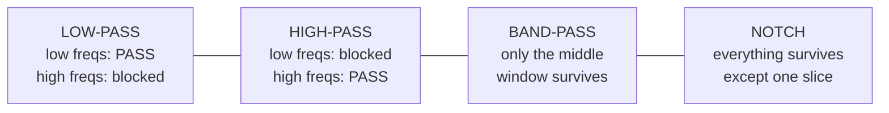
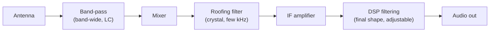

# Filters

Radio is mostly the art of ignoring things. At any moment your antenna delivers everything at once — broadcast giants, taxi radios, your neighbour's solar inverter, and somewhere in the pile, the one signal you want. A **filter** is a circuit that passes some frequencies and rejects others, and it is the tool that turns "everything at once" into "just the bit I asked for". Almost every cure in [Overload & Ghost Signals](outpost:entry/logbook73.handbook/overload-and-ghost-signals) was a filter; this chapter is about how they work, the four basic shapes, and which one to reach for when.

## The four shapes

Every filter, from a capacitor costing pennies to a ~$200/€200 crystal lattice, is described the same way: a graph of how much signal gets through (vertical, in dB) against frequency (horizontal). The region a filter lets through is its **passband**; the region it rejects is the **stopband**. Four shapes cover nearly everything:

| Shape                 | Passes                                | Rejects               | Everyday analogy                                                |
| --------------------- | ------------------------------------- | --------------------- | --------------------------------------------------------------- |
| **Low-pass**          | Everything _below_ a cutoff frequency | Everything above      | A doorway with a height bar — anyone short enough walks through |
| **High-pass**         | Everything _above_ a cutoff           | Everything below      | The same doorway inverted — a step only the tall can see over   |
| **Band-pass**         | A window between two frequencies      | Everything outside it | A letterbox: only envelopes of the right size fit               |
| **Notch (band-stop)** | Everything _except_ a narrow slice    | Just that slice       | Noise-cancelling aimed at one whining machine                   |

Sketched as spectrum (frequency running left to right, "what survives" in each box):



Two of these you have already used without noticing. The tone control on an amplifier is a gentle low-pass or high-pass on audio; the channel filter that lets your rig hear one SSB station and not its neighbour 3 kHz away is a band-pass. And the four shapes combine: a band-pass is essentially a low-pass and a high-pass back to back, and a notch is a band-pass turned inside out.

## Cutoff, rolloff and orders

Real filters do not have brick walls. The graph never drops from "pass" to "block" instantly — it slopes. Three plain-English terms describe the slope:

**Cutoff frequency.** The agreed edge of the passband — by convention, the frequency where the output has fallen 3 dB (to half power) below the passband level. A "7.3 MHz low-pass" is passing signals at full strength well below 7.3 MHz, is 3 dB down at 7.3 MHz, and falls away above.

**Rolloff.** How fast the response falls beyond cutoff, quoted in **dB per octave** (per doubling of frequency) or dB per decade (per tenfold). A simple one-component-pair filter rolls off at 6 dB/octave — gentle. Steeper filters chain more sections.

**Order.** Roughly, how many energy-storing elements (coils and capacitors) the filter contains — and therefore how steep it can be. Each order contributes about 6 dB/octave. The plain-terms summary:

| Order | Rolloff       | Character                                |
| ----- | ------------- | ---------------------------------------- |
| 1st   | 6 dB/octave   | A gentle hint — tone-control territory   |
| 3rd   | 18 dB/octave  | Useful — small QRP transmit filters      |
| 5th   | 30 dB/octave  | The standard amateur TX low-pass         |
| 7th+  | 42+ dB/octave | Serious rejection, more parts, more loss |

Worked example, the one nearly every amateur eventually builds or buys: a transmitter on 7.1 MHz (40 m) emits a second harmonic at 14.2 MHz — one octave up. A 5th-order low-pass with cutoff around 7.3 MHz knocks that harmonic down by roughly 30 dB, on top of the transmitter's own suppression. That is the difference between a clean signal and one audible in the 20 m band — and harmonic suppression is a licence condition, not a courtesy.

```viz
{
  "type": "response",
  "title": "The 40 m transmit low-pass, as a response curve",
  "caption": "Flat through the passband, rolling off steeply beyond the 7.3 MHz cutoff — by the second harmonic, one octave up, a 5th-order filter is deep into its stopband.",
  "curve": { "preset": "lowpass", "f0": 40, "order": 5 },
  "markers": [
    { "x": 40, "label": "7.3 MHz cutoff (−3 dB)" },
    { "x": 80, "label": "14.2 MHz — 2nd harmonic" }
  ],
  "xLabel": "frequency →"
}
```

Two costs rise with steepness, because filters give nothing for free. **Insertion loss**: even the passband loses a little (a fraction of a dB for a good LC filter, several dB for sharp crystal filters) — and remember from [Sensitivity](outpost:entry/logbook73.handbook/sensitivity) that loss _before_ the first amplifier costs a full dB of noise figure per dB. **Ringing**: very sharp filters smear signals in time; an extremely narrow CW filter can make dits sound like they are underwater. Engineering, as ever, is choosing your trade-off.

## Filter technologies: LC, crystal, SAW, DSP

The same four shapes get built four main ways, and each way has a natural habitat.

**LC filters** — coils (L) and capacitors (C). The classic, buildable-on-your-bench technology: cheap, power-handling, tunable, but only moderately sharp, because real coils have resistance. Habitat: transmit low-pass filters, antenna tuners, band-pass front ends, anywhere handling watts. This is the technology of the harmonic filter above, and of the traps in multi-band [antennas](outpost:entry/logbook73.handbook/antennas).

**Crystal filters** — quartz discs that vibrate at extremely precise frequencies, chained into a lattice. Startlingly sharp (a 2.4 kHz-wide passband at 9 MHz — a window 0.03% wide), but fixed-frequency and receive-level only. Habitat: the IF of every superhet [receiver](outpost:entry/logbook73.handbook/receivers); the "roofing filter" below. The ceramic filters in cheap radios are their budget cousins.

**SAW filters** — surface acoustic wave devices: the signal ripples across a piezoelectric chip as a mechanical wave and is filtered by the pattern of electrodes. Tiny, cheap in millions, good at VHF/UHF. Habitat: inside every mobile phone, GPS receiver and SDR dongle front end. You buy them ready-made; nobody winds one at a club night.

**DSP filters** — filtering as arithmetic on sampled signals, inside your rig's processor or your PC. Effectively perfect shape, adjustable in real time by turning a knob or dragging a passband edge on screen — the [FFT](outpost:entry/logbook73.handbook/ffts-and-waterfalls) view in an SDR is halfway to being one. Their one hard limit: **the signal must survive digitisation first**. A DSP filter cannot remove a signal that has already overloaded the analogue stages or the ADC in front of it — the lesson of [Dynamic Range](outpost:entry/logbook73.handbook/dynamic-range) again.

| Technology | Sharpness                | Frequency range       | Handles power?  | Lives in                       |
| ---------- | ------------------------ | --------------------- | --------------- | ------------------------------ |
| LC         | Moderate                 | Audio to VHF          | Yes — kilowatts | TX filters, tuners, front ends |
| Crystal    | Excellent                | ~1–100 MHz, fixed     | No              | Superhet IF, roofing filters   |
| SAW        | Good                     | VHF–GHz, fixed        | No              | Phones, GPS, SDR front ends    |
| DSP        | Near-perfect, adjustable | Anything once sampled | n/a             | Rig back ends, SDR software    |

## Roofing filters: the bouncer at the door

One filter earns a special name and a proud line in every rig review. In a modern receiver, the sharpest, cleverest filtering happens late, in DSP. But the vulnerable stages — mixers and amplifiers — come first, and per [Overload & Ghost Signals](outpost:entry/logbook73.handbook/overload-and-ghost-signals) they will happily brew intermod from strong signals _anywhere_ in their view. The **roofing filter** is a crystal band-pass placed at the first IF, as early as possible, whose job is simply to narrow that view: it puts a "roof" over the passband so that only signals within a few kHz of your tuning ever reach the delicate stages behind it.

The width matters. A 15 kHz roofing filter leaves a contest pile-up of big signals inside the roof, free to intermodulate; a 3 kHz roof excludes all but your immediate neighbours. This is why narrow optional roofing filters are prized by contesters, why review tables quote dynamic range _at 2 kHz spacing_ (inside anyone's roof — testing the raw front end), and why a good roofing filter is one of the few upgrades that genuinely changes what a receiver can do on a crowded band.

```viz
{
  "type": "response",
  "title": "A narrow roofing filter's band-pass response",
  "caption": "Only a few kilohertz around your tuning survive the roof — the contest pile-up further out never reaches the vulnerable stages behind it.",
  "curve": { "preset": "bandpass", "f0": 50, "bw": 14, "order": 6 },
  "markers": [
    { "x": 50, "label": "your signal" },
    { "x": 75, "label": "strong neighbours — excluded" }
  ],
  "xLabel": "frequency →"
}
```



Notice the pattern in that chain — it is the grammar of all filter design: **coarse, tough filters early; sharp, clever filters late.** Each stage narrows the world a little, so the next stage has an easier life.

## Practical filters around an amateur station

Where filters actually earn their keep at your station:

**Transmit low-pass.** Every transmitter emits harmonics at 2×, 3×, 4× the operating frequency; a low-pass filter after the final amplifier is what keeps them out of other people's bands. Commercial rigs build them in (one per band group, switched automatically); QRP kit builders solder their own five-component versions. If you ever build or buy a bare amplifier module, the low-pass filter is _not optional_ — spurious emission limits are part of your licence conditions, and a [TinySA](outpost:entry/logbook73.handbook/tinysa) will show you exactly what you are radiating.

```viz
{
  "type": "spectrum",
  "title": "Keep this, kill that: the low-pass over a transmitter's output",
  "caption": "The shaded region is the filter's passband: the 7.1 MHz fundamental sails through untouched while the harmonics land deep in the stopband.",
  "components": [
    { "f": 25, "amp": 1.0, "label": "7.1 MHz — keep" },
    { "f": 50, "amp": 0.35, "label": "2nd — kill", "tone": "danger" },
    { "f": 75, "amp": 0.2, "label": "3rd — kill", "tone": "danger" }
  ],
  "mask": { "kind": "lowpass", "from": 0, "to": 35 },
  "noiseFloor": 0.05,
  "xLabel": "frequency →"
}
```

**Receive band-pass.** A filter passing only the band you are on protects the front end from everything else — the broadcast giants especially. Multi-transmitter contest and field-day stations rely on per-band band-pass filters so that one station transmitting on 20 m does not obliterate the 40 m receiver beside it.

**Band-stop (the FM broadcast filter).** The RTL-SDR cure from [Overload & Ghost Signals](outpost:entry/logbook73.handbook/overload-and-ghost-signals): a notch covering 88–108 MHz that removes the strongest thing in most skies before it reaches a wide-open front end.

**High-pass.** The classic use is a receive filter cutting off around 2–3 MHz to remove monstrous medium-wave broadcast signals below the amateur HF bands — many HF SDRs include one.

**Audio and DSP notches.** A tunable notch removes a single whistling carrier from an SSB channel; modern auto-notch DSP hunts down and kills such tones automatically. Adjustable DSP passband width is the bandwidth lever from [Noise](outpost:entry/logbook73.handbook/noise) — narrowing from 2.4 kHz to 500 Hz on CW buys ~7 dB of floor, on demand, free.

### Which filter for which problem

| Problem                                        | Filter to reach for                                                                              |
| ---------------------------------------------- | ------------------------------------------------------------------------------------------------ |
| Your transmitter's harmonics (always)          | Low-pass after the PA, cutoff just above the band                                                |
| FM broadcast ghosts on an SDR / airband        | 88–108 MHz band-stop                                                                             |
| Medium-wave breakthrough on HF receive         | High-pass, ~2–3 MHz cutoff                                                                       |
| Strong out-of-band signals overloading receive | Band-pass for the band in use                                                                    |
| Contest neighbours a few kHz away              | Narrower roofing filter (if your rig accepts one)                                                |
| One whistling carrier on frequency             | Notch (auto or manual)                                                                           |
| General hiss on a narrow-mode signal           | Narrow the DSP passband to the mode's width                                                      |
| Aliases on a direct-sampling SDR               | Low-pass before the ADC (anti-alias)                                                             |
| Phantom mixes of _in-band_ strong signals      | No filter can help — attenuator / better front end ([why](outpost:entry/logbook73.handbook/overload-and-ghost-signals)) |

That last row matters: a filter can only reject what is _outside_ its passband. Diagnose first (the attenuator test), then buy the filter.

> **Safety note:** transmit filters carry your full RF power and must be rated for it — a receive-grade filter in a transmit line can overheat or arc. Insert filters transmit-side only if they are specified for the power and frequency, and never transmit into a band-stop filter tuned to your own transmit frequency.

## Try it yourself

1. **Play with a DSP filter tonight.** In [SDR++](outpost:entry/logbook73.handbook/sdr-plus-plus) (or your rig's passband controls), tune an SSB or CW signal and drag the filter edges. Watch the waterfall and listen: hiss falls as the passband narrows (the [Noise](outpost:entry/logbook73.handbook/noise) bandwidth rule, live), then the signal itself starts to suffer when you cut into it. Finding the sweet spot by ear is a genuine operating skill.
2. **Notch a whistle.** Find an SSB signal with an interfering carrier (or tune slightly off a broadcast carrier to create a tone) and use the notch to remove it. Note that the _signal_ survives — that selectivity is the whole magic of filtering.
3. **Sketch your rig's filter chain.** From your transceiver's block diagram (in the back of most manuals), list every filter the signal meets from antenna to loudspeaker — band-pass, roofing, IF, DSP, audio — and note how each is wider than the one after it. The "coarse early, sharp late" grammar will be right there.
4. **If you have a NanoVNA**, sweep any filter you own — a TX low-pass kit, an FM band-stop — and see the real curve: passband, cutoff, rolloff. Full instructions live in the [NanoVNA](outpost:entry/logbook73.handbook/nanovna) chapter; there is no better way to make this chapter concrete.

## Key takeaways

- Filters pass some frequencies and reject others; low-pass, high-pass, band-pass and notch cover nearly every job in radio.
- The cutoff is the −3 dB edge; rolloff steepness comes from filter order at roughly 6 dB/octave per order — and steeper costs insertion loss and ringing.
- LC filters handle power and live transmit-side; crystal filters give razor IF selectivity; SAW filters rule VHF+ front ends; DSP filters are near-perfect but can only fix what survives digitisation.
- The roofing filter is the early crystal band-pass that shields a receiver's vulnerable stages from strong neighbours — a key spec on crowded bands.
- Design grammar: coarse and tough early, sharp and clever late.
- Transmit low-pass filtering is a licence obligation; receive filtering is how you cure images, aliases and broadcast breakthrough — but no filter removes in-band intermod.

Filters shape frequencies that already exist; the next building block is stranger — it _moves_ signals from one frequency to another, and it is the beating heart of nearly every receiver: [Mixers](outpost:entry/logbook73.handbook/mixers).
