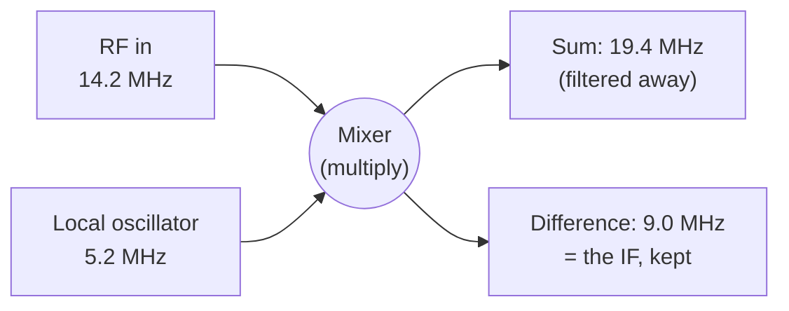
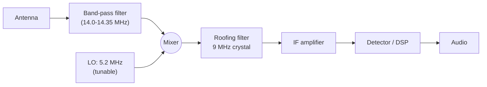

# Mixers

Here is a puzzle at the heart of every radio you own: signals arrive at 14 MHz, or 145 MHz, or 10 GHz — but the sharpest filters, the best amplifiers and every loudspeaker ever made each work well at only _one_ range of frequencies. How does a receiver take a signal from wherever it happens to be and deliver it to where the good tools are? The answer is the **mixer**: a circuit that moves signals from one frequency to another, on demand, without disturbing what they carry. It is arguably the most important three-port circuit in radio — and once you see how it works, both the classic superhet and the modern SDR snap into focus as the same idea wearing different clothes.

## Multiplication makes new frequencies

First, what a mixer is _not_: it is not an audio mixer. A studio mixing desk **adds** signals — two inputs in, both audible together, no new frequencies created. An RF mixer does something far stranger: it **multiplies** two signals together, instant by instant. One input is the signal you care about (call it **RF**); the other is a clean, strong sine wave you generate locally, called the **local oscillator (LO)** — the subject of the [next chapter](outpost:entry/logbook73.handbook/oscillators).

```viz
{
  "type": "wave",
  "title": "Two tones added — what a studio mixer does",
  "caption": "Adding two close frequencies just superimposes them: both originals are still there, throbbing in and out of step, and no new frequencies exist.",
  "traces": [
    { "kind": "beat", "freq": 21, "mod": 18, "label": "f₁ + f₂ (added)" }
  ],
  "xLabel": "time →"
}
```

Multiplying two sine waves has a beautiful consequence, and you can see it without any algebra by watching what multiplication _does_. When both waves are at their peaks together, the product is large and positive; when one is peaking while the other dips, the product swings negative; as the two waves slide in and out of step, the product throbs. That throbbing contains exactly two new rhythms — and trigonometry confirms what the picture suggests:

> Multiply a sine at `f1` by a sine at `f2`, and you get two new sines: one at the **sum** `f1 + f2` and one at the **difference** `f1 − f2`. Nothing else, and neither original survives.

```viz
{
  "type": "wave",
  "title": "The same two tones multiplied — what an RF mixer does",
  "caption": "Multiplication reshapes everything: the waveform now contains only a fast component (the sum) throbbing at a slow one (the difference) — neither original tone survives.",
  "traces": [
    { "kind": "product", "freq": 21, "mod": 18, "label": "f₁ × f₂ (multiplied)" }
  ],
  "xLabel": "time →"
}
```

That is the entire trick. Two frequencies in, two _different_ frequencies out, at precisely predictable places.

Worked example — the classic amateur numbers. Your antenna delivers a 20 m SSB signal at `14.2 MHz`. You wish it were at `9 MHz`, because you own a superb 9 MHz crystal filter (as featured in [Filters](outpost:entry/logbook73.handbook/filters)). So you multiply it by an LO at `5.2 MHz`:

`sum = 14.2 + 5.2 = 19.4 MHz`

`difference = 14.2 − 5.2 = 9.0 MHz`

Both appear at the mixer's output. A band-pass filter selects the 9.0 MHz version and discards the 19.4 MHz one — and now your 20 m signal _is_ a 9 MHz signal, sitting exactly where your best filter lives. This new home is called the **intermediate frequency (IF)**, and the chosen product here is the difference; designs that keep the sum instead are called up-converters, common when the IF is placed _above_ the signal.



The same story on a frequency axis, with the band-pass filter drawn in:

```viz
{
  "type": "spectrum",
  "title": "The mixer's output, and the filter that picks the IF",
  "caption": "Mixing 14.2 MHz with a 5.2 MHz LO produces sum and difference products; the band-pass (shaded) keeps the 9.0 MHz difference — the new IF — and discards the rest.",
  "components": [
    { "f": 21, "amp": 0.6, "label": "LO 5.2", "tone": "muted" },
    { "f": 36, "amp": 0.9, "label": "9.0 = IF, kept" },
    { "f": 57, "amp": 0.6, "label": "RF 14.2", "tone": "muted" },
    { "f": 78, "amp": 0.9, "label": "sum 19.4", "tone": "ink" }
  ],
  "mask": { "kind": "bandpass", "from": 30, "to": 42 },
  "noiseFloor": 0.05,
  "xLabel": "frequency (MHz, not to scale) →"
}
```

Two properties make this genuinely magical rather than merely clever:

**The modulation rides along intact.** Whatever the RF signal carries — SSB speech, a CW note, an FT8 tone — is preserved perfectly in the shifted copy. A signal 400 Hz wide at 14.2 MHz becomes the same signal, 400 Hz wide, at 9.0 MHz. Mixing relocates; it does not distort (when done properly).

**Tuning becomes turning one knob.** Change the LO and a _different_ input frequency lands on the fixed IF. LO at 5.2 MHz brings in 14.2 MHz; nudge the LO to 5.25 MHz and now 14.25 MHz lands at 9 MHz instead. The expensive, razor-sharp filter never moves — the LO walks the band and delivers each station to the filter's door. This is the insight that made modern radio possible.

## The heart of superhets — and of SDRs

The **superheterodyne** receiver, unpacked properly in [Receivers](outpost:entry/logbook73.handbook/receivers), is precisely this trick made into an architecture: mix the incoming band down to a fixed IF, do the serious filtering and amplification there, then detect. Every conventional transceiver you will meet is a superhet, and its front-end story is: band-pass filter, mixer, roofing filter, IF strip — with the mixer as the hinge in the middle. Transmitters run the same hinge backwards: generate the signal at a convenient low frequency, then mix _up_ to the operating frequency (see [Transmitters](outpost:entry/logbook73.handbook/transmitters)).

Now the punchline for the SDR generation: a [software defined radio](outpost:entry/logbook73.handbook/software-defined-radio) of the common "zero-IF" type is _also_ a mixer at heart. It mixes the incoming signal with an LO placed at (or near) the signal frequency itself, so the difference frequency comes out near **zero** — the signal lands at audio-ish frequencies (baseband), where an ADC digitises it and software does everything a superhet's IF strip did in hardware. The famous **IQ trick** — mixing with two copies of the LO a quarter-cycle apart, as explained in [IQ Signals](outpost:entry/logbook73.handbook/iq-signals) — is what lets the SDR tell frequencies above the LO from frequencies below it (the very ambiguity that causes superhet image responses). Direct-sampling SDRs skip the analogue mixer, but only by moving the same multiplication into mathematics: the digital down-converter inside multiplies the sampled signal by a numerical LO. Eighty years of receiver evolution, one idea throughout: _multiply by an LO, take the difference, work at the frequency that suits you._



## How mixers are built: balanced versus unbalanced

Any component that _bends_ — behaves nonlinearly — will mix. That is both how mixers are built and, as [Overload & Ghost Signals](outpost:entry/logbook73.handbook/overload-and-ghost-signals) showed, why overloaded amplifiers mix when nobody asked them to. A single diode fed RF plus LO will produce sums and differences: the crudest possible mixer, and exactly how the earliest crystal sets' descendants did it. But a single-device (**unbalanced**) mixer is a messy citizen: alongside the products you want, the original RF and LO both **leak through** to the output, and every harmonic of each joins the party.

The classic fix is symmetry. A **balanced mixer** uses matched pairs of devices arranged so the unwanted signals cancel: intuitively, the LO is fed to two identical halves in _opposite_ phase, so its direct feed-through arrives at the output twice, equal and opposite — and vanishes — while the wanted products from the two halves arrive _in_ phase and add. A **single-balanced** mixer cancels the LO this way; the ubiquitous **double-balanced mixer** (four diodes in a ring, transformers at each port — the workhorse of amateur equipment) cancels _both_ LO and RF feed-through, leaving the sum and difference products standing nearly alone. The same idea in amplifier form is push-pull symmetry: matched halves, errors cancel, wanted signal adds. Symmetry is free performance, which is why virtually every serious radio uses balanced mixers throughout.

The practical scoreboard:

| Type                              | Feed-through        | Spurs  | Where you meet it                         |
| --------------------------------- | ------------------- | ------ | ----------------------------------------- |
| Unbalanced (one diode/transistor) | RF and LO both leak | Many   | Simple kits, microwave experiments        |
| Single-balanced                   | LO cancelled        | Fewer  | Budget designs                            |
| Double-balanced (diode ring)      | RF and LO cancelled | Fewest | Nearly every decent rig and SDR front end |

## Spurs, products and the mixer's dark side

Time for honesty: real mixers produce more than the two clean products. Because practical mixers are driven hard (the diode ring is really being switched on and off by the LO rather than gently multiplied), the output contains a whole family of **mixer products** at every combination:

`m × f(LO) ± n × f(RF)` for whole numbers m and n

The wanted difference is the `1×, 1×` member. The rest — the `2×3`, `3×2` and friends — are **spurious responses** ("spurs"): weak, but real, and for particular combinations of tuning and signal they land inside the IF and become audible ghosts. Add the mixer's own image response (the mirror frequency `2 × IF` away, worked through in [Overload & Ghost Signals](outpost:entry/logbook73.handbook/overload-and-ghost-signals)) and its third-order intermod when two strong signals arrive together ([Dynamic Range](outpost:entry/logbook73.handbook/dynamic-range)), and you can see why the mixer is where most of a receiver's misbehaviour is born. Designers fight back on three fronts: **balance** (cancel whole families of products), **filtering** before and after (starve the mixer of signals it could mangle, then admit only the wanted product — the "coarse early, sharp late" grammar from [Filters](outpost:entry/logbook73.handbook/filters)), and **strong, clean LO drive** (a diode-ring mixer fed a feeble LO distorts everything; feeding it the specified LO power, typically +7 dBm or more, is what keeps it linear for the _signal_). Frequency planning does the rest — choosing IF and LO so the worst spurs land where they do no harm. It is chess, and it is half the craft of receiver design.

One more number completes the picture: **conversion loss**. A passive diode mixer gives out less than it takes in — the input power is split between sum, difference and the spur family, and the diodes waste some — so the wanted product typically emerges 6–7 dB weaker than the RF went in. That matters because of the cascade lesson from [Sensitivity](outpost:entry/logbook73.handbook/sensitivity): loss early in the chain adds straight to the noise figure, which is why a low-noise amplifier usually sits _before_ the first mixer, and why "conversion loss 6.5 dB" is a line worth noticing in a mixer's datasheet. **Active mixers** (built from transistors, like the venerable Gilbert cell inside most SDR chips) provide conversion _gain_ instead, at some cost in overload headroom — the eternal trade-off between hearing deeply and standing up to the strong, which you now know how to read.

## Try it yourself

You can hear multiplication make new frequencies with nothing but a free audio editor — no RF involved, same mathematics.

1. **Mix two tones in Audacity** (free, any platform). Generate a `1,000 Hz` sine tone on one track and a `1,200 Hz` tone on a second track. Play them together: that is _addition_ — two tones, plus a 200 Hz throb in loudness as they beat. Now use the tools to **multiply** the two tracks sample-by-sample (via _Nyquist Prompt_, the one-line expression `(mult (aref *tracks* 0) (aref *tracks* 1))` on a stereo pairing, or any "ring modulator" plug-in). Play the result and look at its spectrum (_Analyze → Plot Spectrum_): the 1,000 and 1,200 Hz tones are **gone**, replaced by exactly `200 Hz` and `2,200 Hz` — difference and sum. You have just built a perfect mixer and proved the central claim of this chapter.
2. **Watch a real conversion.** If you have an RTL-SDR, tune [SDR++](outpost:entry/logbook73.handbook/sdr-plus-plus) around and reflect that every station you see has already been through the dongle's mixer (an LO inside the tuner chip moved it down to a low IF before sampling). Retune, and you are turning that LO.
3. **Predict a spur.** From the arithmetic above, work out where a strong local FM broadcast station at, say, `98.0 MHz` could appear via the image response of a `10.7 MHz`-IF scanner (answer: tune `98.0 + 21.4 = 119.4 MHz` — airband!). If you have such a receiver, check. The ghost obeys the maths every time.
4. Note in LogBook73 which receptions came via which receiver architecture — after this chapter, "superhet" and "SDR" in your notes both mean "mixer", and you know exactly what happened to the signal on its way to your ears.

## Key takeaways

- An RF mixer **multiplies** a signal by a local oscillator, producing copies at the **sum** and **difference** frequencies — `14.2 MHz` RF with a `5.2 MHz` LO yields `19.4` and `9.0 MHz`, and a filter keeps the one you want.
- The modulation survives the move intact, and tuning the LO brings any frequency to a fixed IF — the idea that underlies every superhet.
- SDRs are the same idea: zero-IF radios mix down to baseband (with the IQ quarter-cycle trick), and direct-sampling radios do the multiplication in software.
- Balanced (especially double-balanced) mixers use symmetry to cancel LO and RF feed-through; symmetry is free cleanliness.
- Real mixers also emit spurs at `m×LO ± n×RF`, image responses and intermod — the birthplace of most [ghost signals](outpost:entry/logbook73.handbook/overload-and-ghost-signals) — tamed by balance, filtering and proper LO drive.
- Passive mixers lose ~6–7 dB in conversion; that loss lands on the noise figure, which is why an LNA usually comes first.

Every mixer is only as good as the clean, stable sine wave driving it — so next we ask where those come from: [Oscillators](outpost:entry/logbook73.handbook/oscillators).
