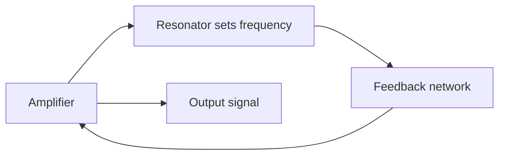
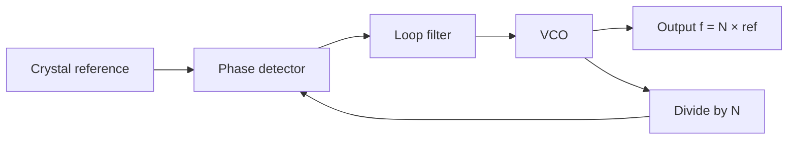

# Oscillators

Every radio you will ever own — from a ~$20/€20 handheld to a rack-mounted contest station — is built around one quiet, unglamorous question: _where does the frequency come from?_ When you dial up `145.500 MHz`, something inside the radio has to generate exactly that frequency, hold it steady while the room warms up, and keep it clean enough that it doesn't smear your neighbours' signals. That something is an oscillator, and this chapter is about how radios make frequencies — and why some do it so much better than others.

## Why every radio needs a frequency source

Think back to [Mixers](outpost:entry/logbook73.handbook/mixers) for a moment. A superhet receiver tunes by mixing the incoming signal with a locally generated frequency — the _local oscillator_, or LO — to shift it to a fixed intermediate frequency where the [filters](outpost:entry/logbook73.handbook/filters) live. Change the LO frequency and you change what you're listening to. In other words: the tuning knob on your radio doesn't move any part of the antenna or the filters. It moves the LO.

The same is true on transmit. A [transmitter](outpost:entry/logbook73.handbook/transmitters) starts with an oscillator that sets the carrier frequency, and everything else — modulation, amplification, filtering — is built on top of it. If the oscillator wanders, your transmitted signal wanders with it.

And it goes deeper than tuning. In a modern radio, one _reference oscillator_ — often a single small crystal — is the heartbeat for everything: the LO, the sampling clock of the analogue-to-digital converter in an SDR, the microprocessor, the timing of digital modes. Every frequency in the radio is derived, by multiplication and division, from that one reference. Its quality sets a ceiling on the quality of the whole radio.

So an oscillator has two jobs, and it's worth keeping them separate in your head:

1. **Accuracy and stability** — is the frequency _right_, and does it _stay_ right as temperature and time change?
2. **Purity** — is the output a single clean frequency, or a slightly wobbly, fuzzy one?

We'll take them in turn.

## The LC oscillator: an amplifier chasing its own tail

At its heart, an oscillator is an amplifier that listens to itself. Take an amplifier, feed a little of its output back to its input through a circuit that only passes one frequency, and — provided the amplifier makes up for the losses in the loop — the circuit will ring at that frequency forever, like a bell that never stops being struck.



The classic frequency-setting circuit is a coil and a capacitor — an _LC resonator_ (L for inductance, C for capacitance). Energy sloshes back and forth between the coil's magnetic field and the capacitor's electric field at a natural rate set by their values, exactly like a pendulum swinging at a rate set by its length — the LC resonance calculator turns any coil-and-capacitor pair into its frequency. Early radios, and the analogue VFOs (variable frequency oscillators) in valve and vintage transistor rigs, tuned by physically varying the capacitor with the front-panel knob.

LC oscillators work, and they tune smoothly, but they have a famous weakness: **drift**. The coil expands slightly as it warms up. The capacitor's value shifts with temperature. Humidity creeps in; components age; the chassis flexes when you lean on it. Each effect nudges the resonant frequency, and at radio frequencies even a tiny nudge matters. Operators of older gear know the ritual well: switch on, wait twenty minutes for everything to reach temperature, and expect to touch up the tuning during a long chat. On SSB, drift of a couple of hundred hertz turns a pleasant voice into Donald Duck; the other station has to keep re-tuning to follow you.

```viz
{
  "type": "waterfall",
  "title": "Drift, as a zoomed-in waterfall sees it",
  "caption": "Ten minutes from a cold switch-on: a free-running LC oscillator wanders as it warms up (left), while a crystal-controlled signal draws a dead-straight line (right).",
  "signals": [
    { "f": 32, "kind": "drift", "width": 2 },
    { "f": 72, "kind": "carrier" }
  ],
  "xLabel": "frequency →",
  "yLabel": "time ↓"
}
```

Drift isn't a flaw in the _idea_ of an oscillator — it's a flaw in using ordinary coils and capacitors as the timekeeper. What we need is a resonator that barely notices temperature and rings far more precisely. Nature, helpfully, provides one.

## Crystals: why quartz is special

Quartz is _piezoelectric_: squeeze a sliver of it and a voltage appears across its faces; apply a voltage and it physically flexes. That two-way link between electricity and mechanical movement means a precisely cut quartz plate can be used as a resonator — an electrically driven tuning fork, vibrating millions of times per second at a frequency set by its physical dimensions.

What makes quartz remarkable is the _quality_ of that vibration. Engineers describe a resonator by its **Q factor** — loosely, how many times it rings before the ringing dies away, or how fiercely it insists on one exact frequency. A decent LC circuit might manage a Q of 100–200. A quartz crystal manages **10,000 to over 100,000**. It is an extraordinarily fussy, stubborn resonator — and for a frequency reference, stubborn is exactly what you want:

- **Stability**: quartz is hard, chemically stable and barely affected by temperature compared with coils and capacitors. Cut at the right angle (the common "AT cut"), its frequency-versus-temperature curve is nearly flat around room temperature.
- **Precision**: crystals can be manufactured and trimmed to a specific frequency with astonishing repeatability.
- **Cheapness**: the crystal in a basic radio costs pennies. It is one of the great bargains in electronics.

Every modern radio, computer, phone and quartz watch contains at least one. The catch is that a crystal is essentially a _fixed-frequency_ device — you can pull it a little, but you can't tune it across a band. Hold that thought; the PLL will solve it shortly.

## Better crystals: TCXO and OCXO

An ordinary crystal oscillator (often marked "XO" on datasheets) still drifts a little with temperature — typically around ±10 to ±20 **ppm** over its working range (we'll unpack ppm properly in a moment). For casual FM use that's fine. For narrow digital modes, microwave work or [satellites](outpost:entry/logbook73.handbook/satellites), it isn't. Two classic upgrades exist:

- **TCXO — temperature-compensated crystal oscillator.** A small circuit measures the temperature and applies an equal-and-opposite correction to the crystal, cancelling most of the drift. Typical stability: **±0.5 to ±2 ppm**. TCXOs are cheap, tiny and low-power, which is why "has a TCXO" appears proudly in the specifications of better handhelds and SDR dongles — and why the classic RTL-SDR upgrade was swapping the drifty stock crystal for a 1 ppm TCXO.
- **OCXO — oven-controlled crystal oscillator.** Rather than compensating for temperature changes, an OCXO _prevents_ them: the crystal sits in a tiny thermostatically controlled oven, held a few degrees above the hottest expected ambient, so it always runs at one constant temperature. Stability: **±0.01 to ±0.1 ppm** or better. The costs are money, warm-up time (minutes) and continuous power for the heater — which is why OCXOs live in base stations and test gear, not handhelds.


Each step in that chain costs roughly ten times more and buys roughly ten to a hundred times better stability. Where you stop depends on what you operate.

## What "1 ppm" actually means

Frequency stability is quoted in **parts per million (ppm)** because the _absolute_ error scales with the frequency you're generating. One ppm means the frequency may be wrong by one millionth of its value:

`error (Hz) = frequency × ppm ÷ 1,000,000`

Worked example, at `145.500 MHz` on the 2 m band:

`error = 145,500,000 Hz × 1 ÷ 1,000,000 = 145.5 Hz`

So a "1 ppm" radio on 2 m might be up to about **±146 Hz** off the dial reading. Is that a lot? It depends entirely on the mode:

- **FM voice** (about 12 kHz wide): 146 Hz is a rounding error. Nobody will ever notice.
- **SSB** (about 2.4 kHz wide): 146 Hz is audible — voices sound slightly high or low — but easily corrected by ear.
- **FT8** (each signal only 50 Hz wide, in a 3 kHz window): 146 Hz means you appear in the wrong place on the waterfall, possibly on top of someone else. Still workable, because the software tolerates offsets, but sloppy.
- **A 10 GHz microwave transverter multiplying that same reference up**: the error multiplies too. 1 ppm at 10 GHz is **10 kHz** — you may not even _find_ the other station. This is why microwave operators are obsessive about references.

Run the same sum for a ±20 ppm bare crystal at 145.5 MHz and you get ±2.9 kHz — enough to miss an FM channel's centre and to make SSB contacts genuinely awkward. Now the spec-sheet line "0.5 ppm TCXO" means something real.

## Phase noise: the wobble that smears

Accuracy is about the _average_ frequency being right. **Phase noise** is about the short-term twitchiness around that average. No oscillator produces a mathematically perfect single frequency; zoom in closely and the output jitters — a few hertz this way, a few hertz that way, thousands of times a second. On a spectrum display, instead of an infinitely thin spike, you see a spike wearing a skirt: a pedestal of noise spreading out on both sides.

```viz
{
  "type": "spectrum",
  "title": "Clean LO, noisy LO",
  "caption": "Same average frequency, very different company: the noisy oscillator wears a skirt of phase noise, and the mixer stamps that skirt onto every signal you receive.",
  "components": [
    { "f": 26, "amp": 0.92, "label": "clean LO" },
    { "f": 66, "amp": 0.12, "tone": "muted" },
    { "f": 68, "amp": 0.26, "tone": "muted" },
    { "f": 70, "amp": 0.5, "tone": "muted" },
    { "f": 72, "amp": 0.92, "label": "noisy LO" },
    { "f": 74, "amp": 0.5, "tone": "muted" },
    { "f": 76, "amp": 0.26, "tone": "muted" },
    { "f": 78, "amp": 0.12, "tone": "muted" }
  ],
  "noiseFloor": 0.05,
  "xLabel": "frequency (zoomed right in) →"
}
```

Why should you care? Because of what happens in the mixer. The mixer faithfully combines _everything_ the LO does with _everything_ arriving from the antenna. A wobbly LO means every received signal gets a copy of that wobble — every station in the passband acquires the same noisy skirt. Now imagine a weak station 5 kHz away from a very strong one. The strong signal's LO-imposed skirt spreads sideways and lands right on top of the weak one, raising the noise floor exactly where you're trying to listen. The strong station isn't splattering — _your own oscillator_ is smearing it across the dial. Engineers call this **reciprocal mixing**, and it is one of the effects that limits real-world [Dynamic Range](outpost:entry/logbook73.handbook/dynamic-range): a receiver with superb filters but a noisy LO still can't hear the weak next to the strong.

The intuition to keep: **a wobbly LO smears nearby signals**. On transmit, the same wobble means _you_ transmit the skirt, raising the noise floor for people near your frequency. Low phase noise is a mark of a well-designed radio on both sides of the QSO, and it's a headline figure in serious transceiver reviews.

## PLLs and synthesizers: a crystal's stability at any frequency

We now have a dilemma. Crystals are stable but stuck near one frequency; LC oscillators tune freely but drift. The circuit that marries them — arguably one of the most important inventions in radio — is the **phase-locked loop (PLL)**.

The idea is a feedback loop, and a thermostat is the right mental model. A voltage-controlled oscillator (VCO — an LC-style oscillator whose frequency is set by a control voltage) does the actual work of generating the output. A **divider** chops the VCO's output frequency down by a programmable number _N_. A **phase detector** compares that divided-down signal against the rock-steady crystal reference and asks one question, continuously: _are these two in step?_ If the VCO has crept high, the detector nudges the control voltage down; if low, up. The loop never stops correcting, so the VCO is _dragged into lock_ with the crystal.



The magic is in the divider. If the loop holds _divided VCO = reference_, then the VCO itself must be running at exactly **N × reference**. Change N from the radio's microprocessor and the output hops to a new frequency — still carrying the crystal's stability, because the loop keeps enforcing it. Your tuning knob no longer turns a capacitor; it changes a number.

This is a **frequency synthesizer**: one cheap crystal plus one clever loop, giving thousands of programmable, crystal-stable frequencies. Every modern transceiver, handheld, SDR dongle and mobile phone tunes this way. Refinements like _fractional-N_ division allow effectively any frequency, not just whole multiples, which is how your radio manages 1 Hz tuning steps.

Chip-scale synthesizers have made this almost absurdly accessible. Parts in the Si5351 class — pocket-change cheap, smaller than a fingernail — take one crystal and generate several independent programmable outputs from kilohertz to hundreds of megahertz. They are the beating heart of many QRP kits, homebrew SDRs and antenna analysers. The design trade-off is honest, though: synthesizers, especially cheap ones, tend to have _more phase noise_ than a single beautiful crystal oscillator, because the VCO's wobble is only suppressed as well as the loop can manage. Radio design is always a negotiation between agility, purity and price.

## GPS-disciplined references: borrowing an atomic clock

There's one more rung on the ladder. Every GPS satellite carries atomic clocks, and the timing signals it broadcasts are, in effect, a free worldwide frequency standard. A **GPS-disciplined oscillator (GPSDO)** exploits this: it's a good OCXO steered — _disciplined_ — by a slow feedback loop that compares it against GPS timing. The OCXO provides the clean, low-phase-noise short-term signal; GPS provides the long-term truth, trimming out ageing and residual drift. It's a PLL again, just with a satellite constellation as the reference and a time constant of minutes rather than microseconds.

The result, for a ~$100–200/€100–200 outlay, is a 10 MHz reference accurate to about a part per _billion_ — effectively "never wrong, never drifts". Amateurs use GPSDOs to lock microwave transverters (remember the 10 kHz problem at 10 GHz), for [Moonbounce](outpost:entry/logbook73.handbook/moonbounce-eme) and weak-signal work where signals are a few hertz wide, and to calibrate everything else on the bench. For most HF and VHF operating a GPSDO is luxury rather than necessity — but it's a lovely example of the whole chapter in one box: a crystal, an oven, and a phase-locked loop, stacked into something a physics lab would have envied fifty years ago.

## Try it yourself

You can _watch_ everything in this chapter with an RTL-SDR dongle (or a free online WebSDR receiver if you don't have one yet) and a spectrum display such as [SDR++](outpost:entry/logbook73.handbook/sdr-plus-plus):

1. **Watch drift happen.** From cold, tune your SDR to a steady local carrier — a broadcast station or any strong, constant local signal — and zoom the waterfall right in. For the first ten minutes you'll see the signal trace _curve_ slowly across the display. Most of that movement is your dongle's own oscillator warming up, not the transmitter. If your dongle has a TCXO, the trace will be noticeably straighter.
2. **Measure your error in ppm.** Tune to a transmitter of accurately known frequency (broadcast stations are good; standard-frequency time stations such as WWV are ideal where receivable). Note how far off it appears in hertz, divide by the frequency in MHz, and you have your dongle's error in ppm directly. Many SDR apps have a "PPM correction" box — enter your number and watch everything land on frequency.
3. **See a synthesizer's fingerprint.** Compare a strong FM broadcast carrier and your handheld transmitting into a dummy load, zoomed right in. Look at the "skirts" either side of each — that's phase noise made visible.
4. **Log the payoff.** Digital modes like [FT8](outpost:entry/logbook73.handbook/ft8) report frequency to the hertz. As you log QSOs in LogBook73, accurate frequencies are what make your band and mode statistics trustworthy — a drifting radio literally pollutes your logbook.

## Key takeaways

- Every frequency in a radio — tuning, transmitting, sampling — is derived from one reference oscillator, so its quality caps the whole radio's.
- LC oscillators tune smoothly but drift with temperature; quartz crystals, with Q in the tens of thousands, are the cheap, stubborn timekeepers that fixed drift.
- TCXOs (±0.5–2 ppm) compensate for temperature; OCXOs (±0.01–0.1 ppm) sit in a tiny oven and avoid it; GPSDOs discipline an OCXO with atomic-clock timing from GPS.
- `error (Hz) = frequency × ppm ÷ 1,000,000` — so 1 ppm is ±145 Hz at 145 MHz: irrelevant on FM, audible on SSB, sloppy on FT8, disastrous at 10 GHz.
- Phase noise is short-term wobble: a wobbly LO smears strong nearby signals over weak ones (reciprocal mixing) and limits real [Dynamic Range](outpost:entry/logbook73.handbook/dynamic-range).
- A PLL locks a tunable VCO to a crystal through a divide-by-N feedback loop — one crystal, thousands of stable frequencies — and Si5351-class chips put a whole synthesizer on pocket change worth of silicon.

A stable, clean frequency is only the beginning: to be heard, that whisper of a signal has to be made thousands of times bigger without being ruined. That's the craft of [Amplifiers](outpost:entry/logbook73.handbook/amplifiers).
