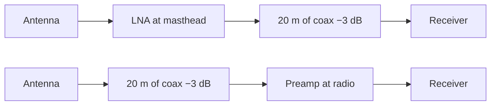
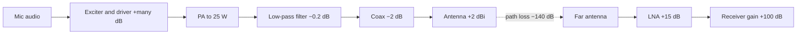

# Amplifiers

Radio lives at ridiculous extremes of size. The signal arriving at your antenna from a distant station might be a few _femtowatts_ — a millionth of a billionth of a watt — while the signal leaving your transmitter might be tens or hundreds of watts. Between those extremes, every radio is essentially a chain of amplifiers: circuits whose one job is to make a signal bigger. It sounds like the easiest job in electronics. This chapter is about why it isn't — and why _how_ you amplify matters as much as _how much_.

## What gain really is

An amplifier takes a small signal in and delivers a larger copy of it out, using energy drawn from a power supply. The ratio of output to input is its **gain**, and as everywhere in radio, we express it in [decibels](outpost:entry/logbook73.handbook/decibels): a gain of 10 dB means ten times the power, 20 dB means a hundred times, 3 dB means double.

```viz
{
  "type": "wave",
  "title": "Gain: a bigger copy of the same shape",
  "caption": "The output is the input scaled up — here twice the voltage, which is +6 dB — and a perfect amplifier would change nothing else about it.",
  "traces": [
    { "kind": "sine", "freq": 8, "amp": 0.45, "label": "in", "tone": "muted" },
    { "kind": "sine", "freq": 8, "amp": 0.9, "label": "out: ×2 voltage (+6 dB)", "tone": "primary" }
  ],
  "xLabel": "time →"
}
```

The word _copy_ is the crux of this entire chapter. A perfect amplifier would output an exact, scaled replica of its input — same shape, just bigger. Real amplifiers never quite manage it. They add noise of their own. They distort the shape a little (or a lot). They can only swing so far before they run out of supply voltage and _clip_ the tops off the signal. And they turn a good fraction of their supply power into heat rather than signal. Amplifier design is the art of choosing which imperfections you can live with.

One more useful mental note: gain in dB just _adds_ along a chain. A 20 dB stage followed by a 10 dB stage gives 30 dB overall; a filter that loses 2 dB subtracts 2. This is why engineers sketch radios as chains of blocks with dB labels — you can budget an entire station with primary-school arithmetic.

## Small-signal amplifiers vs power amplifiers

Although the principle is the same, two jobs sit at opposite ends of the radio and get very different designs:

- **Small-signal amplifiers** handle tiny signals — microvolts from the antenna, or the modest levels flowing between [mixers](outpost:entry/logbook73.handbook/mixers) and [filters](outpost:entry/logbook73.handbook/filters) inside the radio. Output power might be microwatts to milliwatts. Their priorities are _low noise_ and _not distorting_, and their power consumption is trivial.
- **Power amplifiers (PAs)** are the final stage of a [transmitter](outpost:entry/logbook73.handbook/transmitters), turning a small, perfectly formed signal into watts — 5 W in a handheld, a few tens of watts in a typical entry-level station, hundreds or thousands of watts in big stations. Their priorities are _efficiency_ (watts of RF out per watt of supply in) and _surviving_ — heat, voltage stress and whatever the antenna does to them.

A small-signal transistor costs pennies and could hide under a grain of rice. A PA transistor for a 100 W transceiver is a substantial slab bolted to a heatsink, and replacing a blown one is a rite of passage nobody enjoys.

## The LNA: first in line, and why that matters

One small-signal amplifier deserves its own section: the **low-noise amplifier (LNA)**, the very first stage a received signal meets. Its position isn't an accident — it's the most important seat in the receiver.

Here's the intuition. Every stage in a receive chain adds a little of its own noise. But noise added _early_ gets amplified by every stage that follows, right along with the signal — while noise added _late_ arrives after the signal is already big, and matters far less. So the first amplifier effectively sets the noise performance of the whole receiver. Give the front seat to a quiet amplifier with reasonable gain, and the grubbier stages behind it hardly matter. Put a noisy stage first — or worse, put _loss_ first, like a long run of cheap coax — and no amount of quality downstream can recover what was lost. (Chapter [Sensitivity](outpost:entry/logbook73.handbook/sensitivity) makes this precise with noise figure; here the intuition is enough.)



The diagram shows the classic practical lesson: for weak-signal VHF/UHF and [satellite](outpost:entry/logbook73.handbook/satellites) work, a _masthead preamp_ — an LNA in a weatherproof box right at the antenna — beats an identical preamp at the radio end, because it amplifies the signal _before_ the coax loss, not after. The top chain hears noticeably weaker signals than the bottom one using exactly the same parts.

One caution: gain is not free. Too much front-end gain makes strong signals even stronger and pushes later stages into overload — the intermod and ghost-signal problems of [Overload & Ghost Signals](outpost:entry/logbook73.handbook/overload-and-ghost-signals). On a noisy HF band, where atmospheric noise already towers over the receiver's own, a preamp adds nothing but trouble; that's why HF rigs have a preamp _off_ button and an attenuator next to it. LNAs earn their keep at VHF and above, where the bands are quiet and every fraction of a dB counts.

## Linearity vs efficiency: the fundamental trade

Now to the deepest idea in the chapter. An amplifying transistor can be operated in different ways — _classes_ — and the choice is a straight trade between two virtues you cannot fully have at once:

- **Linearity**: how faithfully the output copies the input's _shape_, including its variations in amplitude.
- **Efficiency**: how much of the DC supply power becomes RF signal rather than heat.

A Class A amplifier conducts all the time, idling at high current even with no signal — like an engine held at high revs so it can respond instantly and smoothly. Beautifully linear, shockingly inefficient. At the other extreme, switching amplifiers don't try to copy the waveform at all: they snap fully on and fully off, and a filter reconstructs a clean sine wave afterwards. Brutally efficient, utterly indifferent to amplitude — any variation in the input's loudness is bulldozed flat.

| Class     | How it conducts                                               | Linearity                  | Typical efficiency | Where you'll meet it                                   |
| --------- | ------------------------------------------------------------- | -------------------------- | ------------------ | ------------------------------------------------------ |
| **A**     | All the time                                                  | Excellent                  | 10–25 %            | Small-signal stages, LNAs, hi-fi                       |
| **AB**    | Slightly more than half the time (two devices share the wave) | Good                       | 40–60 %            | SSB power amplifiers — the amateur workhorse           |
| **C**     | Short pulses at the wave's peaks                              | Poor (amplitude destroyed) | 60–80 %            | FM and CW transmitters, frequency multipliers          |
| **D / E** | Fully on / fully off switching                                | None (it's a switch)       | 80–95 %+           | FM handhelds, digital transmitters, modern compact PAs |

Class AB is the classic compromise for amateur SSB rigs: two devices each handle half of the waveform, idling gently so their handover is smooth. Nearly Class B efficiency with nearly Class A manners.

## Why SSB needs linear — and FM and CW don't

Here's where [Modulation](outpost:entry/logbook73.handbook/modulation) and amplifier class connect, and it's a genuinely satisfying click when it lands.

An **SSB** signal carries the speech _in its amplitude and phase together_ — the envelope of the RF waveform rises and falls exactly with your voice. Amplify it non-linearly and you literally reshape the voice: the amplifier squashes the peaks, generating harsh new frequency products. Some fall inside your channel as distorted audio; others fall _just outside_ it, spraying interference across the neighbouring kilohertz. That spray is **splatter** — the signature of an overdriven or non-linear amplifier, covered from the transmitter's side in [Transmitters](outpost:entry/logbook73.handbook/transmitters). It's why SSB rigs have ALC metering, why "turn your mic gain down" is the most common on-air advice ever given, and why SSB PAs are Class AB and driven with headroom to spare.

```viz
{
  "type": "spectrum",
  "title": "Splatter: an overdriven SSB signal on the band",
  "caption": "A clean SSB signal occupies its own ~2.4 kHz; squash its peaks in a non-linear PA and new products spray into the neighbouring kilohertz on both sides.",
  "components": [
    { "f": 47, "amp": 0.85, "width": 6, "label": "your SSB (~2.4 kHz)" },
    { "f": 41, "amp": 0.3, "tone": "danger" },
    { "f": 43, "amp": 0.4, "tone": "danger" },
    { "f": 45, "amp": 0.5, "tone": "danger", "label": "splatter" },
    { "f": 55, "amp": 0.5, "tone": "danger", "label": "splatter" },
    { "f": 57, "amp": 0.4, "tone": "danger" },
    { "f": 59, "amp": 0.3, "tone": "danger" }
  ],
  "noiseFloor": 0.06,
  "xLabel": "frequency →"
}
```

An **FM** signal, by contrast, carries all its information in _frequency_. Its amplitude is constant — a full-power carrier from the first syllable to the last. Squash its amplitude and you've destroyed... nothing; the information was never in the amplitude. The same goes for **CW** (the carrier is either on or off) and for constant-envelope digital modes. These signals can be fed through crude, efficient Class C or switching amplifiers without harm.

This single fact explains a surprising amount of the radio market: why FM handhelds get away with tiny, cool-running, cheap PAs and long battery life; why an SSB transceiver of the same power is bigger, hotter and pricier; and why you must _never_ put an FM-only power amplifier ("for radio-controlled models" or cheap VHF "bricks") behind an SSB radio — it will work, in the sense that RF comes out, and everyone within 50 kHz will know your callsign for the wrong reasons.

## Heat: the tax on every watt

Efficiency isn't an abstract virtue — the shortfall becomes heat, in one small component, and heat kills transistors. A 100 W Class AB amplifier at 50 % efficiency draws 200 W from the supply and must shed **100 W of heat** from a slab of silicon the size of a postage stamp. That's a bright old-fashioned light bulb's worth of heat, continuously, from something you could cover with your thumb.

Hence the metalwork. A **heatsink** — the finned aluminium mass on the back of every transceiver — gives that heat a low-resistance path away from the transistor and a large surface area to hand it to the air. Fans force air through the fins when radiators alone aren't enough. Between transistor and heatsink sits a smear of thermal compound filling microscopic air gaps, because trapped air is an excellent insulator and the enemy of the whole exercise.

For operators, heat is where **duty cycle** (met in [RF Power](outpost:entry/logbook73.handbook/rf-power)) becomes practical. SSB is bursty — the PA rests between words and overs. FM and digital modes like [FT8](outpost:entry/logbook73.handbook/ft8) are _key-down at full power for the whole transmission_, which is why many rigs' manuals quietly advise reducing power for digital modes, and why the fan roars during a long FM chat. If your radio smells warm and the fan never stops, believe it: turn the power down or lengthen the gaps. Transistor lifetimes fall steeply with junction temperature, and a PA is the most expensive single part of your radio.

## Gain through a station: the big picture

Step back and look at a whole station as one signal chain, with gains and losses in dB adding along the way:



Notice the shape of it. On the transmit side, gain is spread across several modest stages rather than one heroic leap — each stage stays comfortable, linear and stable. In the middle sits the sobering number: a typical long path eats _140 dB or more_, dwarfing everything either station can add. And on the receive side, the LNA quietly leads a chain totalling around 100 dB — a factor of ten billion — turning femtowatts back into headphone-filling audio.

Two practical lessons hide in this picture. First, since path loss dominates, the cheapest dB are rarely bought at the PA: doubling transmit power buys 3 dB, while a better [antenna](outpost:entry/logbook73.handbook/antennas) can buy more than that _on both transmit and receive_. Second, distributed gain must be _stable_ gain — an amplifier whose output sneaks back to its input becomes an [oscillator](outpost:entry/logbook73.handbook/oscillators), which is delightful in Chapter 18 and a disaster in a PA. That's why RF construction obsesses over shielding, screening cans and short ground paths.

## A short word on safety

Power amplifiers are the one place in a modern station where electricity can genuinely hurt you. Solid-state PAs run from relatively safe 13.8 V (though at tens of amps — a dropped spanner across a big supply becomes a welder), but **valve amplifiers contain lethal voltages** — one to three _thousand_ volts — and their capacitors can hold that charge after switch-off. Never open one unless you know the discharge procedure; treat "it's unplugged" as the beginning of caution, not the end.

RF itself burns. Tens of watts at an antenna connector, a loose PL-259, or a wire antenna end can cause deep, slow-healing **RF burns** on contact — you won't feel a warning tingle first. Don't touch antennas or exposed feedpoints while transmitting, keep amplifiers in their cases, and follow your national regulator's RF exposure (EMF) assessment requirements for your transmit power — national societies such as the RSGB and ARRL provide straightforward calculators. None of this is a reason for fear; it's a reason for habits.

## Try it yourself

- **Hear the LNA argument.** If you have an RTL-SDR and a cheap wideband LNA (or just your SDR's software gain control), tune to a weak signal and raise the gain slowly. Watch the signal _and_ the noise floor rise together on the waterfall — then find the point where more gain stops helping. You've just discovered why gain placement beats gain quantity.
- **See splatter safely.** Tune an SSB signal on a busy band with a waterfall display. A clean station occupies a neat ~2.4 kHz stripe; an overdriven one grows fuzzy wings several kilohertz wide on each side. Once you can spot it, you'll never overdrive your own rig.
- **Feel the duty-cycle difference.** After a few overs of SSB, touch your radio's heatsink; then after one 15-second FT8 transmission at the same power setting, touch it again. Your fingertips will explain duty cycle better than any paragraph.
- **Budget your own station.** In LogBook73, look at your logged QSOs and pick your best DX. Sketch its chain like the diagram above — your power, your coax loss, your antenna — and marvel at the path-loss number in the middle.

## Key takeaways

- Amplifiers make signals bigger using supply power; gain is measured in dB and adds along a chain.
- Small-signal amps prize low noise and fidelity; power amps prize efficiency and survival — same principle, opposite priorities.
- The first stage sets the receiver's noise performance: put a low-noise amplifier before the loss, which is why masthead preamps work.
- Linearity and efficiency trade against each other — Class A (linear, wasteful) through AB (the SSB workhorse) to C/D/E (efficient, amplitude-destroying).
- SSB carries information in its envelope and needs linear amplification; FM and CW are constant-envelope and don't — non-linear amplification of SSB causes splatter.
- Every watt not radiated becomes heat in the PA: heatsinks, fans and duty-cycle sense keep transistors alive.
- Respect PA voltages (especially in valve amplifiers) and RF burns; keep covers on and check EMF guidance.

You now have signals that are stable, clean and big — but a transmitter's watts are worthless until something launches them into space, and that something is the best-value component in all of radio: the [antenna](outpost:entry/logbook73.handbook/antennas).
