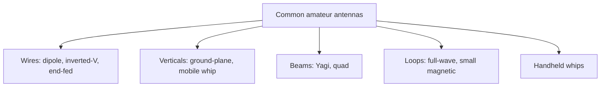
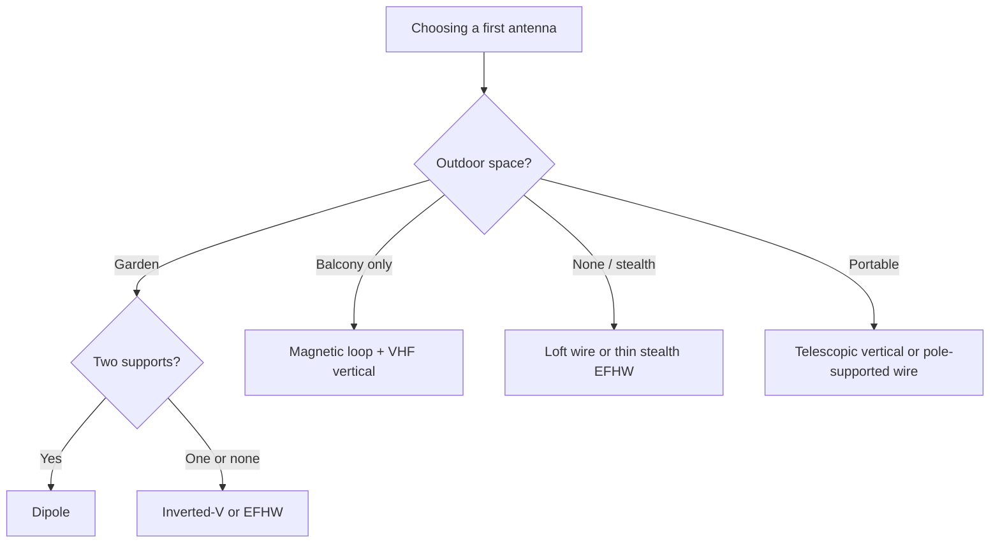

# Antennas

Here is the most valuable sentence in this handbook: **money spent on the antenna beats money spent on almost anything else**. A ~$1,000/€1,000 transceiver into a poor antenna will be outperformed, day after day, by a radio a tenth of the price into a good one — because the antenna works on _both_ transmit and receive, needs no licence-limited power to do it, and is the one component you can meaningfully build yourself from wire and hope. This chapter is about how antennas work, which one to put up first, and why "higher and outside" beats "expensive" nearly every time.

## The honest truth about where performance lives

Recall the station chain from [Amplifiers](outpost:entry/logbook73.handbook/amplifiers): between two stations sits a path loss of 140 dB or more, and everything you control adds or subtracts a few dB around that monster. Doubling your transmit power buys exactly 3 dB — one barely perceptible step in the other station's S-meter — and does _nothing_ for what you can hear. Improving your antenna by 3 dB gives you that same step on transmit **and** 3 dB more signal on receive, where it may be the difference between "readable" and "nothing there at all". And unlike an amplifier, an antenna improvement is silent, consumes no electricity, and can cost less than a takeaway.

That's the economics. The physics is even kinder: the difference between a compromised indoor antenna and a decent outdoor wire is routinely 10–20 dB. No purchase inside the shack comes close.

## How a dipole works

The half-wave **dipole** is the reference antenna — the one all others are compared against, and very likely the first one you'll build. It couldn't be simpler: two equal lengths of wire in a line, fed in the middle, each side connected to one conductor of the feedline. Total length: about half a wavelength (use the 300 rule from [Frequency & Wavelength](outpost:entry/logbook73.handbook/frequency-and-wavelength) — for 7.1 MHz, λ = 300/7.1 ≈ 42 m, so a dipole is about 20 m tip to tip; in practice a few per cent shorter, near `143/f(MHz)` metres per whole dipole).

Why does a piece of wire radiate? Because accelerating charges create [electromagnetic waves](outpost:entry/logbook73.handbook/electromagnetic-waves). The transmitter pushes current up and down the wire millions of times a second; the wire is, quite literally, a device for waving electrons at the universe.

The half-wave length isn't arbitrary — it lets the antenna _resonate_, and it gives the dipole its characteristic personality along its length:

- **Current** is greatest at the **centre** (the feed point) and falls to zero at the tips — it has to be zero at the ends, because the electrons have nowhere further to go. Think of a skipping rope: maximum swing in the middle, fixed at the ends. Since it's current that does the radiating, the middle of a dipole does most of the work.
- **Voltage** is the mirror image: smallest at the centre, largest at the tips, where charge piles up twice every cycle. This is why antenna ends can bite — even at modest power, the wire tips carry surprisingly high RF voltage (one reason for the safety note later).

Feeding at the centre — the low-voltage, high-current point — happens to present a feed-point impedance of about 70 Ω, conveniently close to 50 Ω coax. That happy near-match is a large part of why the dipole is so beloved: wire, insulators, coax, done. What impedance means, and how close is close enough, are the subjects of [Impedance](outpost:entry/logbook73.handbook/impedance) and [SWR](outpost:entry/logbook73.handbook/swr) — for now, "a centre-fed half-wave dipole and coax get along" is all you need.

## The complete circuit, found

[What Is Radio](outpost:entry/logbook73.handbook/what-is-radio) posed the newcomer's best question — a circuit needs a loop, so how can one wire transmit into nothing? — and promised this chapter would close it. Here is the closing.

A dipole _is_ a complete circuit. At one instant the transmitter pushes electrons out into one arm and pulls them in from the other: one tip momentarily crowded with charge, the other momentarily starved. Half a cycle later — a few billionths of a second on the 2 m band — it all rushes back through the feed point the other way.

```viz
{
  "type": "wave",
  "title": "The two arms of a dipole, seen over time",
  "caption": "The arms take turns: when one tip is crowded with electrons the other is starved, swapping millions of times a second. Current flows continuously between them — a complete, endlessly reversing circuit.",
  "traces": [
    { "kind": "sine", "freq": 5, "label": "charge on one arm" },
    { "kind": "sine", "freq": 5, "phase": 180, "tone": "ink", "label": "charge on the other arm" }
  ],
  "xLabel": "time →"
}
```

Current flows out of one transmitter terminal, along one arm, and — by way of the electric field bridging the gap — back along the other arm into the other terminal. The two arms behave like the plates of a very stretched-out capacitor, and alternating current passes through a capacitor happily: charge sloshes onto one plate as it drains off the other, with the changing field in the gap carrying the circuit across the space. Physicists call that field-borne portion **displacement current**, and it is every bit as real to the circuit as electrons in copper. The torch intuition was never wrong; it just assumed the loop had to be made entirely of wire.

### The hidden other half

A vertical looks like the exception — one lonely element — but it is a dipole in disguise. The second half is the **counterpoise**: whatever conductive thing the whip works against. The car roof under a mag-mount. The radials fanned out beneath a ground-mounted vertical. The elevated spokes of a ground-plane antenna. The chassis and coax screen of the radio itself. And for a handheld — this is the part people refuse to believe until they test it — **you**: your hand, arm and conductive, salty-water body form a large part of the counterpoise, which is why a handheld's performance changes with how you hold it, and why it fades when clipped to a belt with the antenna pressed against a lossy human torso. Dangling a quarter-wavelength of wire from a handheld's antenna connector (a "tiger tail") often improves it noticeably: you have gifted the radio a proper second half instead of forcing it to improvise one out of you and the furniture. Skimp on the hidden half — token radials, no ground plane — and the visible half cannot do its job; that is the whole story behind the radial advice later in this chapter.

## Resonance

An antenna is **resonant** when its length matches the wavelength such that the currents and voltages settle into the natural standing pattern above — for a dipole, when it's close to an electrical half-wave. At resonance the antenna accepts power gracefully; away from resonance it pushes back, and less of your power makes it into the air (the rest reflects back down the coax — again, [SWR](outpost:entry/logbook73.handbook/swr)'s story).

Two beginner-friendly facts about resonance:

1. **It's adjustable.** A dipole cut slightly long can be trimmed to resonance a few centimetres at a time — "cut long and trim" is the traditional method, and watching the match improve on a [NanoVNA](outpost:entry/logbook73.handbook/nanovna) as you trim is deeply satisfying.
2. **It's not sacred.** A non-resonant antenna with a matching unit (an "ATU") can work well; resonance is a convenience, not a law. But a resonant antenna needs no extra boxes, no fiddling, and no losses in the matching — which is exactly what a beginner wants.

Nearby objects — ground, roofs, gutters, trees — all tug the resonant frequency around, which is why every antenna needs a final trim _in its actual position_, not on the lawn.

## Polarisation

The orientation of the wire sets the orientation of the wave's electric field — its **polarisation**. A horizontal dipole radiates horizontally polarised waves; a vertical whip radiates vertically polarised ones. Why care? Because a receiving antenna cross-polarised to the incoming wave can lose 20 dB or more — far more than any amplifier can recover.

The working rules are simple nearly everywhere:

- **VHF/UHF FM** (repeaters, handhelds, mobile): everyone uses **vertical**, so use vertical.
- **VHF/UHF SSB and weak-signal work**: convention is **horizontal**.
- **HF via the ionosphere**: [propagation](outpost:entry/logbook73.handbook/propagation) scrambles polarisation en route, so it matters far less — put up whatever fits your garden.

## Gain, dBi and radiation patterns

Antennas cannot amplify — they have no power source. **Antenna gain** means something subtler: _focus_. An isotropic antenna (an imaginary point radiating equally in all directions) is the reference; a real antenna with gain takes the same total power and concentrates it in preferred directions, at the expense of others. Gain is quoted in **dBi** — dB relative to that isotropic reference. A dipole, just by being a wire with a broadside preference, has 2.15 dBi; a modest beam might have 10 dBi; a big EME array 20+ dBi.

The full picture of where an antenna sends its energy is its **radiation pattern** — typically a plot with petal-shaped **lobes**. The big one is the _main lobe_ (where your signal goes), the small ones are _side lobes_ (leakage in other directions), and the gaps between are _nulls_ (directions where the antenna is nearly deaf — sometimes a feature, for nulling out interference). A dipole's pattern is a doughnut around the wire: strongest broadside to it, weak off its ends. So even your first wire antenna is mildly directional — worth remembering when you orient it.

```viz
{
  "type": "polar",
  "pattern": "dipole",
  "title": "Dipole radiation pattern, seen from above",
  "caption": "The classic figure-of-eight: strongest broadside to the wire, nearly deaf off its ends — even the simplest wire antenna has favourite directions."
}
```

The conservation law behind all of this: focus is never free. A high-gain antenna is a narrow torch beam — brilliant where it points, dark elsewhere, and it must be _aimed_. An omnidirectional antenna is a bare bulb — modest everywhere, but never pointing the wrong way.

```viz
{
  "type": "polar",
  "pattern": "yagi",
  "title": "Yagi radiation pattern, seen from above",
  "caption": "Gain is focus: the Yagi squeezes the same total power into one main lobe towards 0° — brilliant where it points, dark nearly everywhere else, and it must be aimed."
}
```

## A tour of the classics



Six of the most common antennas, side by side — how each is built, where it is fed, how it radiates, and what it is best for:

![Six common amateur antennas compared: half-wave dipole, quarter-wave vertical with radials, end-fed wire, Yagi-Uda beam, full-wave loop, and quarter-wave monopole. For each: what it is, a feedpoint diagram, the ideal size relative to wavelength, 2D and 3D radiation patterns, key points, and best use. The dipole is a simple balanced all-rounder; the vertical is omnidirectional with low-angle radiation for DX; the end-fed is easy to deploy but needs a balun; the Yagi has high gain and directivity; the loop is compact and discreet; the monopole is the handheld standard. Key takeaway: there is no best antenna, only the best one for your situation.](/handbook-figures/antenna-types.png "There is no 'best' antenna — only the best one for your space, bands, direction and goals. Six classics compared: build, feed, pattern and use.")

- **Dipole** — the benchmark. Cheap, predictable, quietly effective. Needs two supports and a stretch of space; on 40 m that's ~20 m of wire.
- **Inverted-V** — a dipole with only its _centre_ held high (one mast, or a tree) and the ends sloping down towards anchors. Needs one support instead of two and less horizontal span, at almost no performance cost. Probably the most-erected HF antenna in the world.
- **Vertical with radials** — a quarter-wave element standing upright, with the "missing half" of the dipole supplied by radial wires along or under the ground. Small footprint, omnidirectional, and its low-angle radiation is genuinely good for DX. The catch: the ground connection matters — verticals reward laying more radials, and a vertical over poor ground with two token radials is a disappointment. (Element and radial lengths for any band come from the ground plane calculator.)
- **End-fed half-wave (EFHW)** — a half-wave wire fed at one _end_ through a small matching transformer. Enormously popular because one end can be at the house and the wire slopes up to a single far support; with the transformer, one wire can work several bands. Trade-offs: the transformer loses a little power, and end-fed designs are more prone to RF finding its way back along the coax (see common-mode chokes in [Transmission Lines](outpost:entry/logbook73.handbook/transmission-lines)).
- **Yagi** — the classic TV-style beam: a driven dipole plus parasitic elements (a _reflector_ behind, _directors_ in front) that focus the pattern forward. Real gain (6–15 dBi typical) and a helpful deaf side, at the cost of size, a mast and usually a rotator. On 2 m and 70 cm a Yagi is small and cheap — a 3-element hand-held Yagi is the classic [satellite](outpost:entry/logbook73.handbook/satellites) tool.

How a Yagi turns one fed element and a couple of passive rods into a one-way beam is worth seeing in detail — it is all in the phasing:

![How a Yagi works. A three-element Yagi has a driven element (about half a wavelength), a slightly longer reflector behind it, and slightly shorter directors in front. RF applied to the driven element creates a field; the reflector, being longer, re-radiates with a phase that pushes energy forward; the directors, being shorter, pull energy forward. The re-radiated waves add up in front and mostly cancel behind, producing a strong forward beam and weak back radiation. Rule of thumb: reflector about 0.53λ, driven element about 0.50λ, directors about 0.45–0.48λ, spacing 0.1–0.25λ. More directors give a narrower beam and higher gain.](/handbook-figures/yagi.png 'A Yagi is phasing made physical: the reflector pushes energy forward and the directors pull it forward, so the waves add in front and cancel behind — a strong, aimed beam.')

- **Loops** — a full wavelength of wire in a big circle, triangle or square ("delta" or "quad" loops): quiet, efficient, slightly more gain than a dipole. Small _magnetic_ loops — a metre-ish of tubing with a tuning capacitor — are the flat-dweller's HF antenna: astonishing performance for their size, though they tune sharply (retune every band change) and their capacitors carry high voltage on transmit.
- **Handheld whips** — the "rubber duck" is a heavily shortened, compromised antenna; convenience is its only virtue, and it can be _minus_ several dB compared with a dipole. The best first upgrade in all of amateur radio: replace it with a longer aftermarket whip, or better, a roll-up ladder-line J-pole hung by a window, either of which can transform a handheld's range for a ~$20/€20 outlay.

## Height matters (usually more than the antenna)

For VHF and UHF, which travel essentially by line of sight ([VHF](outpost:entry/logbook73.handbook/vhf)), height is almost everything: each extra metre pushes your radio horizon further and clears local clutter. A mediocre antenna on the roof will beat an excellent one at windowsill height, reliably and by a wide margin.

On HF, height plays a different but equally important role: it shapes the _vertical_ angle of your radiation. A horizontal wire lower than about a quarter-wavelength above ground (that's 10 m on the 40 m band — i.e. nearly everyone's) sends most of its energy steeply upward. That's actually splendid for reliable contacts out to several hundred kilometres — the near-vertical path bounces almost straight down again, a technique called NVIS — but it's poor for long DX, which wants low-angle radiation. Raise the same wire higher and the pattern flattens toward the horizon. The moral for a beginner: put your antenna as high as you reasonably and _safely_ can, and don't be disheartened that a low wire "only" works your own region — that's the physics, not your soldering, and your own continent is a fine place to start filling a logbook.

## Your first antenna, by situation

| Your situation                            | Strong first choice                                                                  | Why                                                          | Watch out for                                                                       |
| ----------------------------------------- | ------------------------------------------------------------------------------------ | ------------------------------------------------------------ | ----------------------------------------------------------------------------------- |
| **House with garden**                     | Inverted-V dipole or EFHW for 40/20 m                                                | Cheap, quiet, proven; one support needed                     | Trim to resonance in situ; keep ends above reach                                    |
| **Flat / apartment**                      | Small magnetic loop indoors or on balcony; VHF/UHF vertical clamped outside a window | Best HF performance per square metre; VHF needs little space | Sharp tuning on loops; RF exposure — keep distance at higher power                  |
| **Stealth needed** (rented, strict rules) | Thin-wire EFHW along a fence or into a tree; loft dipole; flagpole vertical          | Nearly invisible; lofts work acceptably on HF                | Loft antennas near wiring pick up house noise; keep power modest indoors            |
| **Portable / no home options**            | Telescopic vertical with clip-on radials, or wire dipole and a fishing pole          | Packs small, sets up in minutes; hilltops beat any garden    | Take the [NanoVNA](outpost:entry/logbook73.handbook/nanovna); guy the pole; check for overhead lines first |



Whatever you choose, remember the theme: **outside beats inside, high beats low, and wire you actually erect beats the perfect antenna you keep planning.**

## Safety: the serious paragraphs

Antenna work is where amateur radio physically meets the real world, and two hazards deserve genuine respect.

**Power lines kill.** Never erect an antenna where it — or the pole, or the falling wire, or _you_ — could touch overhead power lines, and that includes "if it collapses" and "if the wind takes it while I'm hoisting". Contact with an 11 kV line is routinely fatal, and a wire doesn't have to touch to arc. Survey overhead before anything goes up; if a line is anywhere near your planned span, choose a different plan. No contact is worth it.

**Masts and ladders.** Most antenna injuries are falls, not electricity. Work with a helper, don't climb alone, guy telescopic masts properly, and never stand under a mast while it's being raised or lowered. On the RF side: keep wire ends (remember, the high-voltage points) out of reach of children and passers-by, don't transmit while anyone could touch the antenna, and complete whatever RF exposure (EMF) assessment your national regulator requires — at entry-level power with an antenna a few metres away, it's usually a formality, but do check, and the calculators from national societies such as the RSGB and ARRL make it painless.

## Try it yourself

- **Build the benchmark.** A 20 m-band dipole is an afternoon: ~10.1 m of wire (2 × 5.05 m), a centre insulator (a scrap of plastic works), coax, and string. The dipole calculator gives cutting lengths for any frequency. Cut each leg 5 % long, hang it up, and trim to resonance while watching a [NanoVNA](outpost:entry/logbook73.handbook/nanovna) or your rig's SWR meter. There is no better single lesson in radio.
- **Feel the hidden half.** With a handheld on a steady distant signal, watch the S-meter while you change _your_ half of the antenna: held high, flat against your chest, set on a metal surface. The distant signal never changed — your counterpoise did.
- **Hear polarisation.** With a handheld on a local repeater, slowly tilt the radio from vertical to horizontal while listening to the signal (or watching the S-meter). That fade — often dramatic — is cross-polarisation loss, live.
- **Map your doughnut.** Listening to a steady distant signal on a wire antenna, note its bearing, and compare signals broadside to the wire versus off its ends. Even a humble dipole shows its nulls.
- **Let the log judge.** After changing or raising an antenna, compare the weeks before and after in LogBook73 — the Reports page's per-band counts, or better, beacon SNR reports you tapped in on the Beacons page, which can graph one antenna against another. Antenna claims are cheap; your own logbook is evidence.

## Key takeaways

- The antenna is the highest-value purchase (or build) in your station: its dB work on transmit _and_ receive, and wire is nearly free.
- An antenna is a complete circuit after all: the two arms (or the whip and its counterpoise) swap charge millions of times a second, with the changing field closing the loop across the gap.
- A dipole is two quarter-wave wires fed in the middle — maximum current (and radiation) at the centre, maximum voltage at the tips — and its ~70 Ω feed point suits coax nicely.
- Resonance means the antenna's length matches the wavelength so it accepts power gracefully; trim it in its final position.
- Match polarisation on VHF/UHF (vertical for FM, horizontal for SSB); HF skywave scrambles it anyway.
- Antenna gain (dBi) is focus, not amplification — more gain means a narrower beam that must be aimed.
- Height is a component: it buys line-of-sight range on VHF and lower, DX-friendly radiation angles on HF.
- Survey for power lines before any antenna goes up, treat masts and ladders as the real hazard, and check RF exposure guidance.

Your antenna is only as good as its connection to the radio — and the cable between them has anatomy, personality and failure modes of its own. Next: [Transmission Lines](outpost:entry/logbook73.handbook/transmission-lines).
