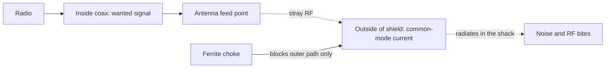

# Transmission Lines

Between your radio and your antenna runs the most underestimated component in the station: the feedline. It looks like a passive bit of plumbing — and then it quietly eats half your transmit power, lets rain wick into its heart, or turns your shack into part of the antenna and puts RF on your microphone. Choose and care for it well, and it disappears into the background, which is exactly what good plumbing should do. This chapter is about coaxial cable and friends: what's inside, why "50 Ω" is printed on everything, where the dB go, and which connector belongs where.

## The feedline's one job

A transmission line's job is to move RF energy from one place to another **without radiating it and without losing it**. That's genuinely different from ordinary wiring. At mains frequency (50 or 60 Hz, depending on your country) or DC, any two wires will do; at radio frequencies, a plain pair of wires a few metres long becomes an accidental [antenna](outpost:entry/logbook73.handbook/antennas) — radiating your power on the way to the real antenna, and picking up every noise source it passes on receive.

A transmission line avoids this by careful geometry. In **coaxial cable** ("coax"), one conductor sits precisely inside the other, and the fields carrying your signal are trapped in the space between them: the outside world sees no signal, and the signal sees no outside world. That self-shielding is why coax is the default feedline — you can tape it to a mast, run it along a gutter, coil the excess, bury it in a wall cavity, and it keeps working. The price of that convenience, as we'll see, is loss.

## Inside a coaxial cable

Cut a piece of coax cleanly and you'll find four layers, each with a job:

![Coax anatomy, a cutaway. Four layers from the centre out: (1) the centre conductor carries the RF signal — solid copper for lower loss, stranded for flexibility; (2) the dielectric insulator supports the centre conductor and sets the spacing, which fixes the impedance; (3) the braid or shield is the outer conductor that keeps RF in and interference out; (4) the outer jacket protects against moisture, UV and abrasion. Equal and opposite currents on the inner and outer conductors confine the RF energy inside the cable. Common types: RG-58 and RG-8X (50 Ω, general/HF-VHF), RG-213 (50 Ω, low-loss), RG-6 (75 Ω, TV), LMR-400 (50 Ω, very low loss). Impedance Z₀ = (60/√εr)·ln(b/a) depends on the conductor-to-shield ratio. Connectors: PL-259, N-type, BNC, SMA, RP-SMA. Loss rises with frequency, poor cable, longer runs and moisture.](/handbook-figures/coax-anatomy.png 'Inside coax: centre conductor, dielectric, braid shield and jacket — the geometry sets the impedance, and the shield confines the field. Good coax means low loss, good shielding, stable impedance.')


- **Centre conductor** — solid or stranded copper (sometimes copper-clad). At RF, current famously flows only in a thin skin on a conductor's surface (the _skin effect_), which is why fatter cables lose less: more surface, less resistance.
- **Dielectric** — the plastic (solid polyethylene, or foam versions) holding the centre conductor exactly centred. Its thickness and material set the cable's characteristic impedance and part of its loss. Foam dielectrics lose less but crush and kink more easily.
- **Shield** — a woven copper braid, often over an aluminium foil layer. It's both the second conductor (the return path) and the barrier keeping your signal in and the world's noise out. Cheap cable skimps here: a sparse braid ("low coverage") leaks.
- **Jacket** — the outer plastic. Not electrically active, but the most important layer for _lifespan_: its job is keeping out water and ultraviolet light, coax's two mortal enemies.

## Characteristic impedance: the 50 Ω story

Every cable design has a **characteristic impedance** (written `Z₀`), set purely by its geometry — the ratio of conductor diameters and the dielectric between them. It is _not_ a resistance you can measure with a multimeter (a good cable reads as a short from end to end on the shield, open between conductors); it's the ratio of voltage to current that a wave travelling along the cable naturally adopts. Think of it as the cable's "personality": what the wave experiences as it propagates.

Why does it matter? Because RF is happiest when the _source_, the _cable_ and the _load_ all share the same impedance. When they do, power flows smoothly from radio to antenna like water through uniform pipe. When they don't — say the antenna presents something very different from the cable's Z₀ — part of the wave reflects back toward the radio. The full story of matching belongs to [Impedance](outpost:entry/logbook73.handbook/impedance), and what those reflections do (and what that meter on your radio measures) belongs to [SWR](outpost:entry/logbook73.handbook/swr); for this chapter, it's enough that _cables have a number, and your system works best when everything agrees on it_.

So why 50 Ω? It's a classic engineering compromise, dating to wartime radar work: for an air-dielectric coax, the geometry that carries maximum _power_ comes out near 30 Ω, and the geometry with minimum _loss_ comes out near 77 Ω. Split the difference sensibly and you land around 50 Ω — decent at both jobs — and once test gear, transmitters and antennas standardised on it, it became self-reinforcing. Television and satellite distribution, which care only about receiving (minimum loss, no power handling), settled on **75 Ω** — which is why TV coax and satellite cable look similar but aren't interchangeable with amateur kit. Use 75 Ω cable in a 50 Ω station and the world won't end — the mismatch is mild — but connectors won't fit properly and your SWR readings will mislead you. Buy 50 Ω and life stays simple.

## Loss: where your decibels go

Coax is not free transport; every metre taxes the signal, in both directions. Loss comes mainly from resistance in the conductors (skin effect) plus some heating of the dielectric, and it has one behaviour you must internalise: **loss in dB rises with frequency** — roughly with the _square root_ of frequency for the conductor part, so quadrupling the frequency roughly doubles the dB loss, and dielectric losses pile on extra at UHF and above. A cable that's perfectly fine on 40 m can be a disaster on 70 cm.

Approximate matched loss, in **dB per 10 m** (real cables vary — check the datasheet for anything critical):

| Cable   | Diameter | 7 MHz (40 m) | 145 MHz (2 m) | 435 MHz (70 cm) |
| ------- | -------- | ------------ | ------------- | --------------- |
| RG-58   | ~5 mm    | 0.3          | 2.0           | 3.7             |
| RG-8X   | ~6 mm    | 0.25         | 1.5           | 2.8             |
| RG-213  | ~10 mm   | 0.2          | 0.9           | 1.7             |
| LMR-400 | ~10 mm   | 0.1          | 0.5           | 0.9             |

Read the table with your [decibels](outpost:entry/logbook73.handbook/decibels) hat on, remembering that 3 dB is half your power:

- On **40 m**, 10 m of even humble RG-58 loses 0.3 dB — about 7 % of your power. Nobody on the air can tell. For short HF runs, thin cable is honestly fine.
- On **2 m**, that same RG-58 run loses 2 dB; stretch it to a realistic 20 m from shack to rooftop and you're at 4 dB — over 60 % of your power warming the cable, and the same again stolen from every received signal.
- On **70 cm**, 20 m of RG-58 loses about 7.4 dB. Of your 25 W, roughly 4.5 W reaches the antenna. You have bought an expensive dummy load with a hole in it.

Hence the rule of thumb: **the higher the frequency and the longer the run, the fatter (and better) the cable must be.** For a few metres of HF patch lead, RG-58 is fine; for a 20 m run to a 2 m/70 cm colinear, LMR-400-class cable repays its cost in pure performance — often more cheaply per dB than any other purchase except antenna height. And remember from [Amplifiers](outpost:entry/logbook73.handbook/amplifiers) that loss _before_ the first amplifier directly poisons receive sensitivity, which is why serious VHF/UHF stations put the preamp at the masthead rather than buying magic coax.

```viz
{
  "type": "wave",
  "title": "What 20 m of RG-58 does to a 70 cm signal",
  "caption": "Same signal, both ends of the cable: at 435 MHz the run loses about 7.4 dB, so of 25 W in, only ~4.5 W of the wave comes out the far end.",
  "traces": [
    { "kind": "sine", "freq": 9, "amp": 1.0, "label": "in: 25 W" },
    { "kind": "sine", "freq": 9, "amp": 0.43, "style": "dashed", "tone": "muted", "label": "out: ~4.5 W (−7.4 dB)" }
  ],
  "xLabel": "time →"
}
```

## Connectors

Every connector is a small engineering compromise between size, cost, weatherproofing and how gracefully it behaves as frequency rises:

| Connector                   | Size   | Happy up to                  | Where it belongs                                                                            | Notes                                                                                           |
| --------------------------- | ------ | ---------------------------- | ------------------------------------------------------------------------------------------- | ----------------------------------------------------------------------------------------------- |
| **PL-259 / SO-239** ("UHF") | Large  | ~150 MHz well, usable to 450 | HF/VHF transceivers, amplifiers, mobile rigs                                                | The amateur standard; ironically _not_ great at UHF; not waterproof — wrap outdoor joints       |
| **BNC**                     | Medium | ~4 GHz                       | Handhelds (older/quality ones), test gear, QRP kits                                         | Quick bayonet twist-lock; brilliant for kit you connect often                                   |
| **SMA**                     | Small  | ~18 GHz                      | Modern handhelds, SDR dongles, GPS, [NanoVNA](outpost:entry/logbook73.handbook/nanovna)/[TinySA](outpost:entry/logbook73.handbook/tinysa) | Delicate threads — finger-tight only, and check male/female and RP-SMA variants before ordering |
| **N-type**                  | Large  | ~11 GHz+                     | Masthead joints, UHF/microwave, base antennas, LMR-400 runs                                 | Properly weather-resistant and low-loss; the right answer outdoors                              |

Practical wisdom that saves real money: buy decent connectors (counterfeit "bargain" plugs have caused more mysterious faults than sunspots); every connector pair adds a small loss and a possible failure point, so use the fewest adapters you can; and at UHF and up, prefer N or BNC over PL-259. The most common single fault in any amateur station is a badly soldered or water-logged connector — when things go strange, suspect the plugs first.

## Ladder line, in brief

Coax's older sibling is **ladder line** (open-wire or "window" line): two parallel wires held apart by plastic spacers, with characteristic impedance around 300–450 Ω. With no dielectric to speak of between the conductors — mostly air — its loss is _dramatically_ lower than any affordable coax, and it stays low even when badly mismatched. That makes it the classic feed for a single multi-band wire ("doublet") used with a matching unit.

The price is fussiness: ladder line must be kept clear of metal, gutters and walls (a hand's-breadth or more), can't be coiled or buried, misbehaves when wet or iced, and needs a balanced tuner or balun at the radio end. Coax is a Labrador; ladder line is a cat — superb on its own terms, entirely uninterested in yours. As a beginner, feed your first antennas with coax, and file ladder line under "later, and worth it".

## Common-mode current: when the feedline joins the antenna

Here's the subtle problem that catches nearly everyone eventually. Coax works because equal and opposite currents flow on the centre conductor and on the _inside_ of the shield, their fields cancelling perfectly. But the _outside_ surface of the shield is, thanks to the skin effect, effectively a separate third conductor — and nothing you've done so far forbids current from flowing on it. When some of your RF finds that outer path — because the antenna is unbalanced, the coax runs asymmetrically under one leg of a dipole, or an end-fed's "counterpoise" turns out to be the feedline itself — you get **common-mode current**: the whole outside of your coax radiating and receiving like a rogue antenna wire.



The symptoms are classics of the hobby: RF "bites" from the microphone, the SWR reading changing when you move the cable or touch the radio, computer speakers reciting your SSB audio, a suddenly noisy receiver (the feedline is now collecting all the domestic hash it passes), and interference to your own household electronics.

The cure is a **common-mode choke** (also sold as a "1:1 choke balun" or "line isolator"): a device that blocks current on the _outside_ of the shield while leaving the _inside_ signal completely untouched. The usual form is beautifully simple — the coax wound several turns through or around a ferrite ring or clamp-on core near the antenna feed point. To the wanted signal inside the shielded cable, the ferrite is invisible; to current on the outer surface, those turns look like a large impedance — a closed door. A choke at the feed point (and sometimes another where coax enters the shack) is cheap insurance; many operators fit one to every antenna as a matter of habit, especially end-feds.

## Caring for coax

Coax fails slowly, invisibly, and almost always for one of two reasons:

- **Water ingress.** Water wicking into the braid is coax's death sentence: it corrodes the copper, soaks the dielectric, and can add several dB of loss along a whole run while looking perfect from outside. Seal every outdoor joint properly — self-amalgamating tape over the connector (over a base wrap of electrical tape so it can be removed), and a **drip loop** (a gentle U-bend below the connector) so rain drips off the cable rather than following it into the plug. Never let an unterminated cable end point at the sky.
- **Mechanical abuse.** Every cable has a minimum **bend radius** — roughly five to ten times its diameter (so a gentle 10 cm curve for LMR-400, never a sharp corner). Kink a foam-dielectric cable once and the centre conductor may sit off-centre forever afterwards, quietly wrecking its impedance at that point. Don't crush it under window frames (use a thin purpose-made window feed-through instead), don't hang long unsupported vertical runs off a connector, and don't repeatedly flex the same spot.

An annual five-minute inspection — connectors, tape, jacket nicks, and an SWR or [NanoVNA](outpost:entry/logbook73.handbook/nanovna) check compared against last year's numbers — catches almost everything before it costs you contacts. Logging those check-ups (LogBook73's notes are a fine place) turns "the coax is probably fine" into data.

## Try it yourself

- **Measure a real cable's loss.** With a [NanoVNA](outpost:entry/logbook73.handbook/nanovna), connect both ends of a cable and measure its through-loss (|S21|) at 7, 145 and 435 MHz. Watch the loss climb with frequency exactly as the table promised — and keep the numbers; re-measuring the same cable next year is the best water-damage detector there is.
- **Autopsy an offcut.** Take 10 cm of scrap coax and dissect it with a knife: jacket, braid (count how sparse or dense it is), foil if present, dielectric, centre. Cheap and quality cable look identical until this moment.
- **Do your own loss budget.** Measure your actual feedline run with a tape measure, look up your cable in the table, and work out the dB and the watts reaching your antenna on each band you use. Many operators discover their "25 W" station is a 12 W station at the antenna on 70 cm.
- **Hunt common-mode.** If you have RF-in-the-shack symptoms, clip a ferrite clamp-on core over the coax near the radio with a few turns through it and see whether the symptoms ease. It's diagnostic and cure in one ~$3/€3 part.

## Key takeaways

- A feedline's job is moving RF without radiating or losing it; coax achieves this by trapping the fields between centre conductor and shield.
- Characteristic impedance is set by geometry; amateur radio standardised on 50 Ω (the power-vs-loss compromise), TV on 75 Ω — buy 50 Ω and everything agrees.
- Loss in dB grows with frequency (roughly with √f) and with length: thin RG-58 is fine for short HF runs and dreadful for long UHF ones; LMR-400-class cable is cheap performance for VHF/UHF.
- Match the connector to the job: PL-259 for HF/VHF radios, BNC for frequently connected kit, SMA (gently!) for handhelds and SDRs, N-type outdoors and at UHF.
- Ladder line offers superbly low loss for multi-band wire antennas but demands careful routing and a balanced match — one for later.
- Common-mode current turns your coax's outer shield into a rogue antenna; a ferrite choke at the feed point blocks it without touching the wanted signal.
- Water and kinks are coax's killers: seal joints, add drip loops, respect bend radius, and re-measure yearly.

You now know what the cable _is_ — the next question is what happens where cable meets antenna, and why everything in radio keeps insisting on that magic number. On to [Impedance](outpost:entry/logbook73.handbook/impedance).
