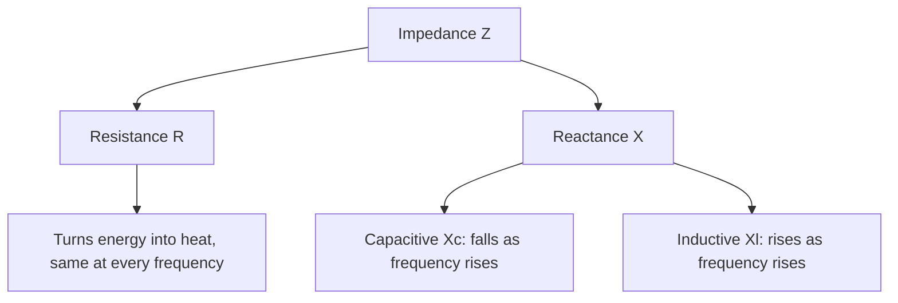
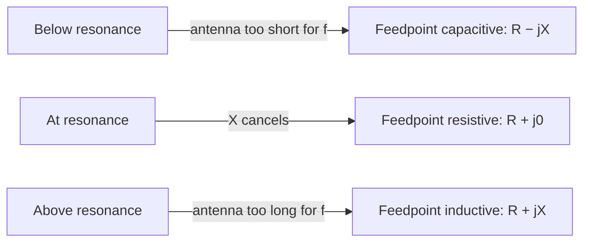
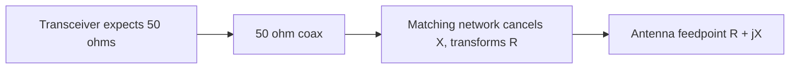

# Impedance

Every radio conversation between your transceiver, your coax and your antenna happens in a shared language, and that language is impedance. Get it roughly right and your precious watts flow smoothly from the rig to the sky; get it badly wrong and they slosh back down the cable, heating your coax instead of reaching the ionosphere. The good news is that impedance is far friendlier than its reputation suggests — it is really just "opposition to current, with a sense of timing". This chapter builds the idea gently, explains where the famous 50 Ω figure came from, and sets up the two chapters that follow it.

## Resistance: opposition that doesn't care

Start with something familiar. A resistor opposes the flow of electric current, and it does so in the most straightforward way imaginable: push twice the voltage through it and you get twice the current, every time, at every frequency. That relationship is Ohm's law:

`V = I × R`

where `V` is voltage in volts, `I` is current in amps, and `R` is resistance in ohms (Ω) — the Ohm's law calculator turns any two of V, I, R and P into the others. A `50 Ω` resistor is `50 Ω` at DC, at `7 MHz`, and at `435 MHz`. It has no memory and no preferences. Whatever energy it takes from the circuit it converts immediately into heat — which is exactly what a dummy load does, and why a dummy load gets warm when you transmit into it.

A water analogy helps here, and we will lean on water throughout this chapter. Think of current as water flowing through a pipe and voltage as the pressure pushing it. A resistor is a narrow section of pipe: it restricts the flow, and the restriction is the same whether the water flows steadily or surges back and forth. Steady or sloshing, the narrow pipe doesn't care.

Resistance is the simple half of impedance. If the world contained only resistors, this chapter would already be over. But radio circuits are full of two other characters — capacitors and inductors — and they behave very differently.

## Reactance: opposition with timing

Capacitors and inductors also oppose current, but their opposition **depends on frequency**, and — crucially — they don't turn energy into heat. They _store_ it briefly and hand it back a moment later. This frequency-dependent, energy-storing opposition is called **reactance**, written `X` and also measured in ohms.

### The capacitor: a stretchy membrane

Imagine a rubber membrane stretched across the inside of a water pipe. Steady flow is completely blocked — the membrane stretches so far and then stops. But _sloshing_ flow passes surprisingly well: push water one way, the membrane bulges; pull it back, the membrane springs back and returns the water. The faster the sloshing, the less the membrane ever needs to stretch, and the easier the flow appears.

That is a capacitor. It blocks DC entirely, resists low frequencies strongly, and waves high frequencies through almost unopposed. Its reactance is:

`Xc = 1 / (2 × π × f × C)`

Worked example with real amateur numbers: a `100 pF` capacitor at `7.1 MHz` (the middle of the 40 m band) has a reactance of `1 / (2 × π × 7.1 × 10⁶ × 100 × 10⁻¹²) ≈ 224 Ω`. Take the same capacitor up to `145 MHz` on the 2 m band and its reactance drops to about `11 Ω` — barely an obstacle at all. Same component, twenty times less opposition, purely because the frequency rose.

### The inductor: a heavy waterwheel

Now imagine a heavy waterwheel sitting in the pipe. Steady flow spins it up once and then passes freely — the wheel just turns along with the water. But sloshing flow has a terrible time: every reversal has to fight the wheel's momentum. The faster the sloshing, the worse it gets.

That is an inductor (a coil of wire). It passes DC easily but opposes high frequencies more and more strongly:

`Xʟ = 2 × π × f × L`

Worked example: a `1 µH` coil — a dozen turns on a pencil-sized former — has a reactance of about `45 Ω` at `7.1 MHz`, but around `911 Ω` at `145 MHz`. Same coil, twenty times _more_ opposition as the frequency rose. Notice the beautiful symmetry: capacitors and inductors are mirror images of each other, and radio design exploits that mirror constantly, as you saw in the chapter on [Filters](outpost:entry/logbook73.handbook/filters).

### Timing, not heat

Here is the deeper difference. In a resistor, voltage and current rise and fall together, perfectly in step. In a capacitor or inductor they slip out of step: the current in a capacitor _leads_ the voltage (the membrane must move before pressure builds), while the current in an inductor _lags_ it (the wheel takes time to respond). Energy flows into the component during one part of the cycle and back out during another. Nothing is lost — it is merely delayed. Reactance is opposition with timing.

```viz
{
  "type": "wave",
  "title": "Voltage and current out of step in a reactive load",
  "caption": "In a pure inductance the current runs a quarter-cycle behind the voltage: energy is borrowed and handed back twice per cycle, never turned into heat.",
  "traces": [
    { "kind": "sine", "freq": 6, "amp": 0.95, "label": "voltage" },
    { "kind": "sine", "freq": 6, "amp": 0.7, "phase": -90, "tone": "muted", "label": "current — lags by ¼ cycle" }
  ],
  "xLabel": "time →"
}
```



## Complex impedance: resistance plus timing

Real circuits — and, above all, real antennas — contain resistance _and_ reactance at the same time. Impedance, written `Z`, is the combination of both, and engineers write it like this:

`Z = R + jX`

Do not let the `j` alarm you. It is not asking you to do complex-number arithmetic; it is simply a bookkeeping mark that says "this part is the timing part". Read `Z = 50 + j25 Ω` as a short sentence: "this load opposes current like `50 Ω` of honest, heat-making resistance, plus `25 Ω` of inductive timing-slip." A negative number after the `j`, such as `Z = 50 − j25 Ω`, means the timing-slip is capacitive instead.

Two rules of thumb carry you a long way:

- **The `R` part does the work.** Only resistance absorbs power — either usefully (an antenna's _radiation resistance_ turns it into radio waves) or wastefully (loss resistance turns it into heat).
- **The `X` part causes the trouble.** Reactance stores energy and pushes it back, upsetting the smooth flow between rig and antenna. Matching, which we meet below, is largely the art of cancelling `X`.

When `X = 0` — no timing-slip at all — a load is called **resonant**. Resonance does not mean "perfectly matched"; it just means the capacitive and inductive tendencies have cancelled and the load looks purely resistive. A resonant antenna might still be `25 Ω` or `100 Ω` resistive, which is resonant but not matched to `50 Ω`. Keeping those two ideas separate will save you a great deal of confusion later.

## Why 50 Ω?

Every modern transceiver, every SWR meter, every length of RG-58 and every antenna analyser assumes a **characteristic impedance** of `50 Ω`. (What characteristic impedance means for a cable — the ratio of voltage to current in a travelling wave — was covered in [Transmission Lines](outpost:entry/logbook73.handbook/transmission-lines).) But why fifty, of all numbers?

The answer is a compromise struck in the 1930s, when engineers were designing air-insulated coaxial cable for high-power transmitters. For a coaxial geometry:

- The impedance that carries **maximum power** before the insulation breaks down works out at roughly `30 Ω`.
- The impedance with the **lowest loss** works out at roughly `77 Ω`.

No single cable could win both contests, so the industry settled near the middle: `50 Ω` handles power well and loses little, and it stuck. Meanwhile the television world, caring only about weak received signals and not about power handling, standardised on `75 Ω` — close to that low-loss optimum, and conveniently near the natural feedpoint impedance of a dipole. That is why TV coax and satellite cable are `75 Ω` while amateur gear is `50 Ω`. Neither number is magic; both are sensible compromises that became universal because standardisation itself is valuable. When everything in the chain agrees on `50 Ω`, everything works with everything.

| Standard          | Typical use                                  | Why                                                            |
| ----------------- | -------------------------------------------- | -------------------------------------------------------------- |
| `50 Ω`            | Amateur radio, commercial two-way, test gear | Compromise between power handling (~30 Ω) and low loss (~77 Ω) |
| `75 Ω`            | TV, satellite, hi-fi aerials                 | Lowest loss; matches a dipole nicely; power irrelevant         |
| `300 Ω` / `450 Ω` | Ribbon feeder, ladder line                   | Very low loss for balanced open-wire lines                     |

## What an antenna's feedpoint impedance means

Stand at the point where your coax bolts onto your antenna — the **feedpoint** — and ask: what does the antenna look like, electrically, from here? The answer is its feedpoint impedance, and it is a full `R + jX` story that changes with frequency.

Take the most famous example: a half-wave dipole in free space, fed at the centre, presents about `73 + j0 Ω` at its resonant frequency. The `73 Ω` is almost entirely radiation resistance — the "useful" resistance representing power leaving as radio waves — which is why a dipole is such a comfortable, efficient load. In real life, height above ground, nearby trees and bent ends nudge that figure around, commonly anywhere from `50 Ω` to `90 Ω`, which is why a real dipole often matches `50 Ω` coax rather well despite the textbook figure.

Now tune away from resonance and watch the `X` term wake up:

- **Below resonance** (the antenna is electrically _short_ for this frequency), the feedpoint looks **capacitive**: `X` is negative, e.g. `60 − j80 Ω`.
- **Above resonance** (electrically _long_), it looks **inductive**: `X` is positive, e.g. `85 + j95 Ω`.

This single fact explains half of practical antenna adjustment. It is also why some antennas are famously awkward: a `40 m` dipole pressed into service on `15 m` might present several thousand ohms with wild reactance, and an electrically short mobile whip on `80 m` might show `15 − j400 Ω` — a tiny useful resistance buried under a mountain of capacitive reactance, which is exactly why short antennas need loading coils (an inductor whose `+jX` cancels the whip's `−jX`).



## Matching: making the whole chain agree

Maximum power flows from a source to a load when their impedances agree — for our purposes, when the antenna system presents close to `50 + j0 Ω` to a rig designed for `50 Ω`. When it doesn't, part of the wave arriving at the mismatch reflects and travels back down the line, and the interference between the outgoing and returning waves sets up the standing waves you will meet properly in the next chapter on [SWR](outpost:entry/logbook73.handbook/swr).

**Matching** is any deliberate step that transforms the impedance the rig actually sees towards `50 + j0 Ω`. The toolkit is wonderfully small:

- **Adjust the antenna itself** — lengthen or shorten it until `X` disappears at your favourite frequency. Always the best fix, because it improves things at the source.
- **Add cancelling reactance** — a loading coil to cancel capacitive reactance, or a capacitor to cancel inductive reactance.
- **Transform the resistance** — with an L-network, a transformer, or a matching section of transmission line, to shift `R` towards `50 Ω`.
- **Use an ATU (antenna tuner)** — an adjustable network in the shack that makes the rig see `50 Ω` whatever lurks at the far end of the coax. It has real uses and real limits, and the next chapter gives it an honest appraisal.



How do you _see_ all this — the `R`, the `X`, and how they swing as you sweep across a band? Two beautiful tools await: the [Smith Chart](outpost:entry/logbook73.handbook/smith-charts), a circular map on which every possible impedance has an address, and the [NanoVNA](outpost:entry/logbook73.handbook/nanovna), a pocket instrument that measures your antenna and draws that map for you in real time. Both are two chapters away; SWR comes first, because it is the number everyone quotes.

## A short safety note

Impedance experiments are among the safest in radio — a multimeter, a coil of wire and a capacitor pose no hazard. Just remember that large capacitors in mains-powered equipment (especially valve amplifiers) can hold a dangerous charge long after switch-off. Measure impedances in antenna systems, not inside power supplies.

## Try it yourself

You can feel the difference between resistance and characteristic impedance with nothing but a multimeter:

1. Set your multimeter to ohms and measure a `47 Ω` or `56 Ω` resistor (pennies from any electronics supplier). You will read roughly its marked value — resistance is visible at DC.
2. Now take a patch lead of `50 Ω` coax with nothing connected at the far end and measure between the centre pin and the shell of one connector. You will read **open circuit**, not `50 Ω`.
3. Short the far end with a scrap of wire and measure again: now you read close to **zero ohms**.

So where did the "50 Ω" go? Nowhere — it was never a DC resistance. It is the impedance a _travelling radio-frequency wave_ experiences as it propagates along the cable, a ratio of wave voltage to wave current that only exists at RF. A multimeter, working at DC, simply cannot see it. Once that distinction clicks, half the mystery of impedance evaporates.

If you have a receiver or SDR, try a second experiment: attach a random length of wire as an antenna and tune across the HF bands. Notice how some frequencies seem lively and others dead on the same wire. Part of what you are hearing is the wire's feedpoint impedance swinging between friendly and hostile values as the frequency changes — impedance made audible.

## Key takeaways

- **Resistance** opposes current identically at all frequencies and converts energy to heat. **Reactance** opposes current in a frequency-dependent way and stores energy rather than dissipating it.
- Capacitive reactance **falls** as frequency rises; inductive reactance **rises**. The two are mirror images and can cancel each other.
- Impedance combines both: `Z = R + jX`, best read as "resistance plus timing". The `R` does the work; the `X` causes the reflections.
- **Resonance** means `X = 0` (purely resistive) — it does _not_ automatically mean matched to `50 Ω`.
- `50 Ω` is a historical compromise between the best power-handling (~30 Ω) and lowest-loss (~77 Ω) coaxial designs — valuable mainly because _everything_ agrees on it.
- An antenna's feedpoint impedance changes with frequency: capacitive below resonance, resistive at resonance, inductive above it.
- Matching means transforming what the rig sees towards `50 + j0 Ω` — by trimming the antenna, cancelling reactance, or using a matching network.

Next, we follow what happens when the impedances _don't_ agree — the reflections, the standing waves, and the most argued-about number in amateur radio — in [SWR](outpost:entry/logbook73.handbook/swr).
