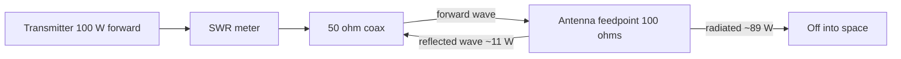
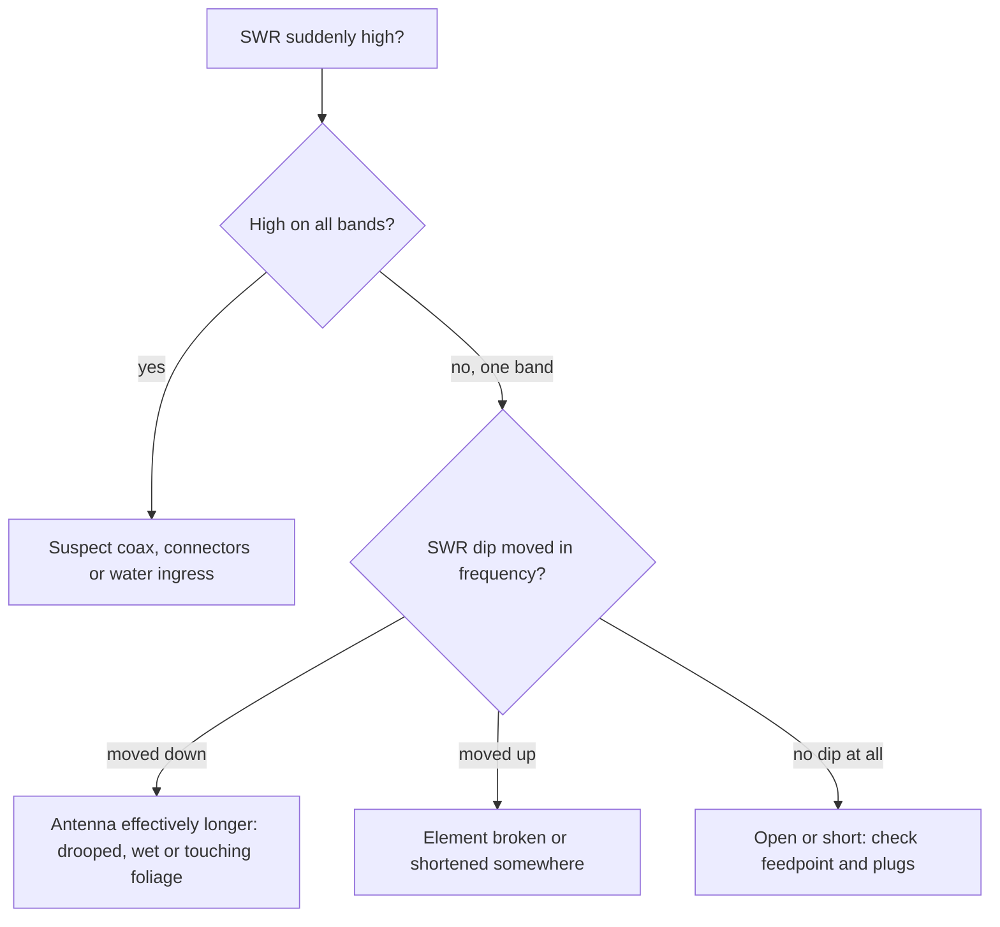

# SWR

Ask ten amateurs what number matters most in their station and eight will say SWR — usually while adjusting something. The standing wave ratio is the most-quoted, most-worried-over and most-misunderstood figure in the hobby. It genuinely matters: a bad mismatch wastes power and can make your transceiver protect itself by winding the power down. But it is also routinely over-worshipped, and a perfect reading can hide a dreadful antenna. This chapter explains where SWR comes from, what the numbers mean, what your meter is really telling you — and, just as importantly, what it is not.

## Where reflections come from

In the last chapter on [Impedance](outpost:entry/logbook73.handbook/impedance) we saw that power flows smoothly from source to load when their impedances agree. Your coax has a characteristic impedance of `50 Ω` — the ratio of voltage to current that a travelling wave naturally adopts on that cable, as covered in [Transmission Lines](outpost:entry/logbook73.handbook/transmission-lines). While the wave is rolling along the coax, all is well. The moment it arrives at the antenna, the antenna's feedpoint impedance takes over, and there are two possibilities:

- **The antenna is `50 Ω` too.** The wave's voltage-to-current ratio already suits the load perfectly. All the power is absorbed (and, we hope, radiated). Nothing comes back.
- **The antenna is anything else** — `25 Ω`, `100 Ω`, `60 − j80 Ω`. The wave arrives with a voltage-to-current ratio the load cannot accept. The only way the electrical bookkeeping can balance is for part of the wave to turn round and travel back towards the transmitter as a **reflected wave**.

The bigger the disagreement, the larger the fraction reflected. A dead short and an open circuit are the extreme cases: both reflect _everything_, just with opposite polarity. This is not a flaw in the cable; it is simply what waves do at any boundary where the medium changes. Light does the same at a window — most goes through, a little reflects, which is why you see a faint ghost of yourself in the glass.

## Standing waves: the rope and the wall

Now for the "standing wave" part of the name. Tie a rope to a wall, pull it fairly taut, and flick your end up and down rhythmically. Waves travel along the rope, hit the wall, and reflect back. The outgoing and returning waves pass through each other, and something curious appears: certain points on the rope barely move at all (**nodes**), while points midway between them swing wildly (**antinodes**). The pattern of big-and-small doesn't travel anywhere — it stands still. Hence _standing wave_.

Exactly the same happens on your coax when a reflected wave travels back through the forward one. At some points along the cable the two voltages add (a voltage maximum); a quarter-wavelength away they subtract (a minimum). The **standing wave ratio** is just the ratio of the biggest voltage to the smallest:

`SWR = V(max) / V(min)`

If nothing reflects, the voltage is the same everywhere along the line: `V(max) = V(min)` and SWR = 1.0, written **1:1** — the perfect score. If _everything_ reflects, the minima are complete cancellations, `V(min) = 0`, and the SWR is infinite. Every real antenna sits somewhere between. You will also see the term **VSWR** (voltage standing wave ratio); it is the same thing, measured on voltage rather than current, and in casual use SWR and VSWR are interchangeable.

```viz
{
  "type": "wave",
  "title": "A standing wave on the line, SWR 2:1",
  "caption": "Forward and reflected waves interfere: the RF swings hard at the antinodes and gently at the nodes, the pattern itself stands still — and SWR is simply V(max) ÷ V(min), here 2:1.",
  "traces": [
    { "kind": "am", "freq": 24, "mod": 2, "depth": 0.333, "label": "RF voltage on the line" },
    { "kind": "envelope", "mod": 2, "depth": 0.333, "label": "V(max) / V(min) envelope" }
  ],
  "xLabel": "position along the coax →"
}
```

For a purely resistive load there is a wonderfully simple shortcut: SWR is just the impedance ratio, arranged to be ≥ 1. A `100 Ω` antenna on `50 Ω` coax gives `100/50 = 2:1`. So does a `25 Ω` antenna: `50/25 = 2:1`. Two very different antennas, the same SWR — your first hint that SWR compresses a lot of information into one rather ambiguous number.



## Putting numbers on it

Three equivalent vocabularies describe the same mismatch, and it is worth being able to move between them — the VSWR calculator converts any one into the other two:

- **SWR** — the amateur's favourite, e.g. `1.5:1`.
- **Reflected power** — what percentage of your forward power turns back.
- **Return loss** — how many [decibels](outpost:entry/logbook73.handbook/decibels) weaker the reflected wave is than the forward one. Bigger is better: a huge return loss means almost nothing returned. (Engineers and NanoVNA screens love this one.)

| SWR            | Reflected power | Power reaching load | Return loss |
| -------------- | --------------- | ------------------- | ----------- |
| 1.0:1          | 0 %             | 100 %               | ∞ dB        |
| 1.5:1          | 4 %             | 96 %                | 14.0 dB     |
| 2.0:1          | 11 %            | 89 %                | 9.5 dB      |
| 3.0:1          | 25 %            | 75 %                | 6.0 dB      |
| ∞ (open/short) | 100 %           | 0 %                 | 0 dB        |

Now the worked example that defuses most SWR anxiety. Suppose you transmit `25 W` — a typical entry-level power limit in a number of countries, as discussed in [Getting Licensed](outpost:entry/logbook73.handbook/getting-licensed) — into an antenna with an SWR of `2:1`. The table says 11 % reflects: about `2.8 W` comes back and roughly `22 W` reaches the antenna. In decibels that is a loss of about `0.5 dB` — one _twelfth_ of an S-unit at the far end. No human ear on the planet will notice. Even `3:1`, with a quarter of the power reflected, costs only `1.25 dB`, still well under a quarter of an S-unit.

One subtlety worth knowing: the reflected power is not necessarily _lost_. When it arrives back at the transmitter (or a tuner), most of it is re-reflected and sent towards the antenna again. On low-loss coax the power largely just bounces until it is radiated. The genuine penalty is that each extra trip along the cable pays the cable's loss again — so high SWR hurts most on _long, lossy_ lines and barely at all on short, good ones. On `10 m` of decent coax at HF, even a `3:1` SWR adds only a fraction of a dB of extra loss. On `30 m` of thin coax at `435 MHz`, the same SWR can be genuinely expensive.

## What SWR does not tell you

Here is the classic lesson, and it is worth savouring. Connect your transmitter to a **dummy load** — a `50 Ω` resistor in a can, built to soak up power as heat. Measure the SWR: a flawless `1.0:1`. Perfect match! And how much of your signal does it radiate? Essentially none. The best SWR you will ever measure belongs to the worst antenna you own.

The moral: **SWR measures agreement, not performance.** It tells you how closely the load resembles `50 Ω`; it says nothing about whether the power that gets there is radiated towards the horizon or quietly cooked away. Three things a beautiful SWR reading can hide:

- **A lossy antenna.** A short, badly-loaded whip or a rain-soaked, corroded trap can present a lovely `50 Ω` — with much of that resistance being loss, not radiation.
- **Lossy coax flattering the reading.** Your SWR meter sits in the shack, and the reflected wave must travel the whole cable back to reach it — paying the cable loss both ways. Long or poor coax eats the reflection and the meter shows a rosy number. An antenna with a true `5:1` mismatch at the feedpoint can read under `2:1` in the shack through enough lossy cable. The meter is not lying; it is honestly reporting the view _from where it stands_.
- **The wrong antenna for the job.** A perfectly matched antenna pointing its energy straight up, or hung a metre off the ground, still won't work DX.

Equally, a _mediocre_ SWR does not mean a bad antenna. Plenty of superb antennas present `1.8:1` on parts of a band. Chasing the last tenth from `1.4:1` to `1.1:1` gains you `0.1 dB` — time far better spent getting the antenna higher.

## How much does SWR actually matter?

So if the direct power loss is small, why does anyone care? Two honest reasons:

**Your transmitter protects itself.** Modern solid-state finals dislike the voltage and current peaks that reflected waves create at the transmitter end. Rather than risk the output transistors, virtually every modern rig monitors reflected power and **folds back** — automatically reduces output — as SWR climbs, typically starting somewhere beyond `1.5:1` and cutting hard by `3:1`. So a `3:1` antenna may lose you far more through fold-back (perhaps half your power or more) than the mismatch itself ever would. This, not the 1.25 dB, is the practical reason to care. (Valve amplifiers are more tolerant but have their own limits.)

**It is a superb health monitor.** The most valuable SWR measurement is not today's — it is the _change_ since last month. An antenna whose SWR curve suddenly shifts is telling you something: water in the coax, a corroded joint, a broken element, a connector working loose. Log your SWR across each band when the antenna is new, and you own a fingerprint against which every future problem shows up instantly.



## ATUs: what a tuner really does

An **ATU** (antenna tuning unit, or just "tuner") is an adjustable matching network — usually variable capacitors and an inductor — placed between the rig and the feedline. Turn its knobs (or press _TUNE_ on an automatic one) and it transforms whatever impedance the feedline presents into the `50 Ω` your transmitter craves.

Here is the sentence to memorise: **a tuner makes the rig happy, not the antenna better.** It does not touch the antenna, the coax, or the mismatch at the feedpoint. The SWR _on the coax between tuner and antenna_ stays exactly as bad as it was; the reflected wave still bounces up and down that cable paying loss on every trip. What changes is that the transmitter now sees `1:1`, stops folding back, and delivers its full power into the system.

Is that worthwhile? Very often, yes:

- **With coax-fed antennas and modest mismatch** (say up to `3:1`), a tuner recovers the power lost to fold-back at the cost of a small tuner loss. On HF with short, decent coax this is an excellent bargain — it is exactly what the auto-tuner built into many rigs is for.
- **With severe mismatch on long coax** (a random wire fed as an afterthought, `10:1` or worse), the tuner in the shack still makes the rig happy, but the coax between tuner and antenna may quietly devour much of your power. The classic fix is either a **remote tuner at the feedpoint** — so the coax runs matched — or low-loss balanced feeder (ladder line), which shrugs off high SWR.

A tuner, in other words, is a legitimate and useful tool — as long as you remember which problem it solves. It solves the _transmitter's_ problem.

## Measuring SWR

The everyday instrument is the **SWR meter** (or the rig's built-in one). Inside is a **directional coupler**: a clever sampling arrangement that can distinguish the forward-travelling wave from the reflected one — the electrical equivalent of standing on a beach and separately gauging the waves rolling in and the backwash rolling out. Read forward power, read reflected power, and the SWR follows. Cross-needle meters show both at once, with SWR where the needles cross. To use one: insert it in the coax close to the rig, transmit a steady low-power carrier (FM, or a gentle whistle on the mic — and always check the frequency is clear and identify with your callsign first), and read.

An SWR meter answers one question at one frequency: _how bad is the match right now?_ It cannot tell you **why**, nor show you the whole band at a glance, nor reveal whether the antenna is too long or too short. For that you want a sweep of SWR versus frequency — and better yet the full impedance story, `R + jX`, at every point. That is precisely what a **vector network analyser** does, and since about 2019 one has cost less than a night out: the [NanoVNA](outpost:entry/logbook73.handbook/nanovna), two chapters from now. Between here and there sits the elegant round map it draws its results on: the [Smith Chart](outpost:entry/logbook73.handbook/smith-charts).

This is the classic picture such a sweep produces — the analyser's dip:

```viz
{
  "type": "response",
  "title": "An SWR sweep across a band",
  "caption": "One glance replaces a table of spot readings: the dip marks the frequency where the antenna is happiest, and where that dip sits tells you which way to trim.",
  "curve": { "preset": "swr", "f0": 50, "bw": 30 },
  "markers": [
    { "x": 50, "label": "resonance — about 1.2:1" }
  ],
  "xLabel": "frequency across the band →"
}
```

A brief safety note: never measure SWR by transmitting into an unknown or disconnected feedline at full power — an open circuit reflects everything straight back at your finals. Test at the lowest power that gives a reading, and if you are adjusting a wire antenna, make all physical changes with the transmitter off.

## Try it yourself

- **Fingerprint your antenna.** Using your rig's built-in meter or an inline SWR meter at low power, measure SWR at the bottom, middle and top of each band you use, and record the numbers (the notes field of LogBook73 works nicely). This ten-minute job becomes your antenna's health record — next time something seems off, re-measure and compare.
- **Find the dip.** Step across one band in `25 kHz` hops and note the SWR at each step. Sketch the curve. The frequency of minimum SWR tells you where your antenna is happiest; if that dip sits below the band, your antenna is a touch long, and if above, a touch short — the logic we will formalise in the NanoVNA chapter.
- **Prove the dummy-load lesson.** If you have a dummy load, measure its SWR: `1.0:1`, textbook perfect — on a device that radiates nothing. Keep that thought beside every SWR reading you ever take.

## Key takeaways

- Reflections happen wherever a wave meets an impedance different from the line's `50 Ω`; the reflected wave interferes with the forward wave to create a stationary pattern — the standing wave.
- SWR = `V(max)/V(min)` along the line; `1:1` is perfect, and for resistive loads it is just the impedance ratio (`100 Ω` on `50 Ω` coax → `2:1`).
- The direct loss is smaller than folklore says: `2:1` costs about `0.5 dB`, `3:1` about `1.25 dB` — the bigger real-world penalty is your rig's protective power fold-back.
- Reflected power mostly bounces and gets re-radiated; high SWR is expensive mainly on **long or lossy** feedlines, which also flatter the reading at the shack end.
- SWR measures _agreement with 50 Ω_, not antenna quality — a dummy load scores a perfect `1:1` while radiating nothing.
- An ATU transforms the impedance the **rig** sees; it makes the rig happy but changes nothing on the far side of itself. For severe mismatches, match at the feedpoint or use low-loss balanced line.
- The most useful SWR number is the change since last time — log a baseline sweep for every antenna you own.

Next we meet the beautiful circular map on which every impedance in this chapter has a precise address — the [Smith Chart](outpost:entry/logbook73.handbook/smith-charts).
