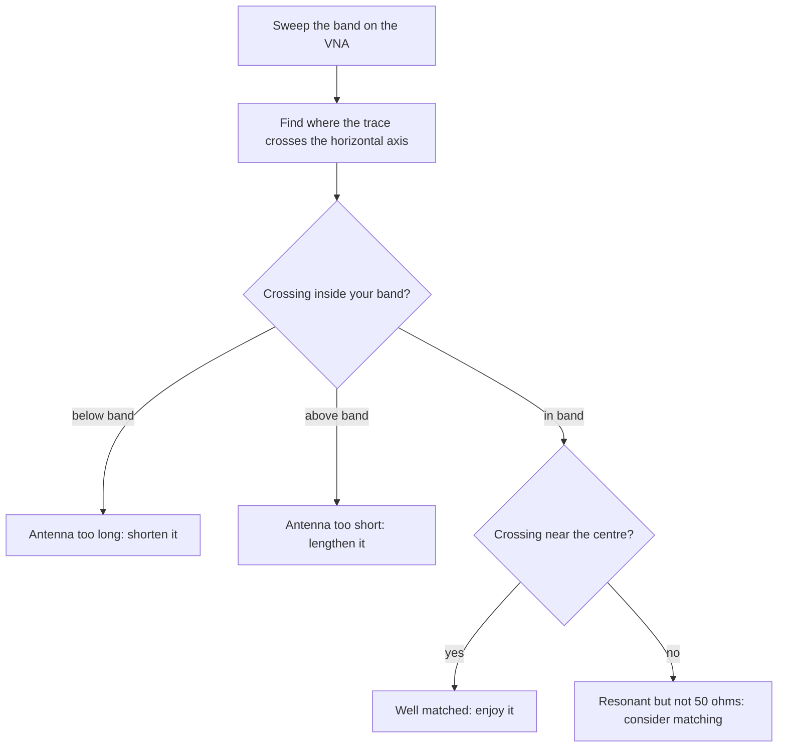
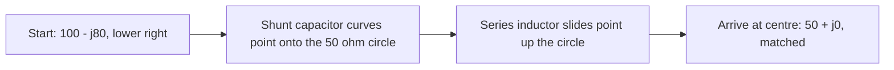

# Smith Charts

Switch a NanoVNA on for the first time and there it is: a circle full of curved gridlines with a wobbly trace snaking across it. Most newcomers' eyes slide straight past it to the friendly SWR graph — the round chart looks like something from a 1950s engineering exam, which, to be fair, it is. But the Smith chart is the single most information-dense picture in radio, and _reading_ one (as opposed to calculating on one, which nobody does any more) takes about twenty minutes to learn. By the end of this chapter you will glance at that circle and see, at once, whether your antenna is too long or too short, how far from matched it is, and which way to fix it.

## What the chart actually is

Recall from [Impedance](outpost:entry/logbook73.handbook/impedance) that every load is described by two numbers: `Z = R + jX` — resistance plus reactance. You could plot those on ordinary graph paper, with `R` across and `X` up. The trouble is that antennas roam from a few ohms to many thousands, and reactance runs from minus-huge to plus-huge; most of your graph paper would be empty and the interesting region near `50 Ω` would be a speck.

Keep this reference beside you for the rest of the chapter — it names every part of the chart we are about to read:

![The Smith chart, annotated. A polar plot of normalised impedance z = r + jx (or reflection coefficient Γ). Constant-resistance circles (red) pass through the rightmost point; constant-reactance arcs (blue) curve from the top and bottom. The centre is 50 Ω, matched, Γ = 0, SWR 1:1. The rightmost point is open circuit (Γ = +1), the leftmost is short circuit (Γ = −1); the top half is inductive (+jX), the bottom capacitive (−jX). Outer scales read SWR and reflection-coefficient magnitude; moving clockwise goes toward the generator (shorter electrical length). Worked example: for a 75 + j25 Ω load in a 50 Ω system, normalise to 1.5 + j0.5, plot it, and read Γ ≈ 0.28 and SWR ≈ 1.78:1.](/handbook-figures/smith-chart.png 'The Smith chart map: constant-resistance circles, constant-reactance arcs, centre = 50 Ω matched, edges = short/open, top inductive / bottom capacitive, with SWR and Γ on the outer scales.')

In 1939 Phillip Smith, an engineer at Bell Labs, found a transformation that folds that entire infinite plane into a single circle — squeezing the wild extremes into the rim and giving the sensible middle plenty of room. Every possible impedance, from a dead short to an open circuit to `3,000 + j5,000 Ω`, has exactly one address inside (or on) the circle. Three landmarks anchor the whole map:

- **The centre** is `50 + j0 Ω` — a perfect match. (Strictly, the chart is _normalised_: the centre is whatever reference you choose, and radio people choose `50 Ω`.)
- **The far left edge** is `0 Ω` — a short circuit.
- **The far right edge** is `∞ Ω` — an open circuit.

And one more, the key that makes the chart useful rather than merely clever: **distance from the centre is the amount of reflection.** A point at the exact centre reflects nothing (SWR `1:1`). A point on the outer rim reflects _everything_ (SWR ∞) — which is why the short and the open both live on the edge. In between, every circle you could draw around the centre is a ring of constant SWR. The chart is simultaneously a map of impedance _and_ a map of match quality, and that double life is its genius. It even connects directly to the previous chapter: the distance from centre, as a fraction of the radius, is the reflection coefficient behind every [SWR](outpost:entry/logbook73.handbook/swr) and return-loss figure in that conversion table.

## The gridlines: circles of R, arcs of X

The curved gridlines are just the `R` and `X` axes after Smith's folding.

**Constant-resistance circles.** Every point with `R = 50 Ω` — whatever its reactance — lies on one particular circle that passes through the centre. Every point with `R = 25 Ω` lies on a larger circle bulging towards the left; `R = 100 Ω` on a smaller one nested towards the right. All these circles kiss at the far-right (open-circuit) point, like ripples shrinking towards it. Moving to a bigger-R circle means the load is more resistive.

**Constant-reactance arcs.** Every point with `X = +50 Ω` (inductive) lies on one arc curling through the _upper_ half of the chart; `X = −50 Ω` (capacitive) on its mirror image in the _lower_ half. The straight horizontal line across the middle is the special case `X = 0`: **every purely resistive impedance lives on the horizontal axis**, and therefore so does every _resonant_ load.

That gives you the sight-reading rules, which are worth committing to memory:

| Where the point is         | What it means                                                                    |
| -------------------------- | -------------------------------------------------------------------------------- |
| Exact centre               | `50 + j0 Ω` — matched, SWR 1:1                                                   |
| On the horizontal line     | Purely resistive (resonant): left of centre < 50 Ω, right of centre > 50 Ω       |
| Upper half                 | Inductive (`+jX`) — for an antenna: electrically **too long** for this frequency |
| Lower half                 | Capacitive (`−jX`) — electrically **too short** for this frequency               |
| Near the rim               | Nearly total reflection — terrible match (open, short, or wildly reactive)       |
| Far left / far right point | Short circuit / open circuit                                                     |

A few worked addresses, to make it concrete. `50 + j0 Ω`: dead centre. `100 + j0 Ω`: on the horizontal line, right of centre (SWR `2:1`). `25 + j0 Ω`: horizontal line, left of centre (also SWR `2:1` — and notice both sit on the _same_ circle around the centre, the 2:1 SWR ring). `50 + j50 Ω`: upper half, on the 50 Ω resistance circle where it crosses the `+50` reactance arc. `15 − j400 Ω` — the short mobile whip from two chapters ago: hard down near the lower rim, honestly advertising what a difficult load it is.

## Reading a real antenna sweep

Now the part you will actually do. A [NanoVNA](outpost:entry/logbook73.handbook/nanovna) sweeps a range of frequencies and plots the antenna's impedance at each one, joining the dots into a **trace** — a curved line across the chart. Each point on the trace is "the antenna at one frequency"; the line is the story of how it changes across the sweep.

Take a `40 m` dipole, cut slightly long, swept from `6.9` to `7.3 MHz`. A typical trace and how to read it:

- **At `7.0 MHz`** the marker sits on (or very near) the horizontal axis, a little left of centre — say `48 + j2 Ω`. The reactance has cancelled: this is the antenna's **resonant frequency**, and the resistance happens to be close to `50 Ω`. Lovely.
- **At `7.2 MHz`** the marker has climbed into the **upper half** — perhaps `65 + j45 Ω`. Above its resonance the antenna is electrically long, so it looks inductive, exactly as the impedance chapter promised.
- **At `6.9 MHz`**, below resonance, the marker hangs in the **lower half** — maybe `42 − j30 Ω` — capacitive, electrically short for that frequency.

So the trace crosses the horizontal axis travelling from the capacitive half to the inductive half as frequency rises, and **the crossing point is resonance**. If that crossing sits at `7.0 MHz` but you wanted `7.1 MHz`, the whole story is on the screen: resonance is _below_ target, the antenna is too long, trim a little off. How much to trim, and the full adjustment ritual, is the next chapter's business.



One habit to build early: check the marker's frequency readout, not just the picture. A Smith-chart trace has no frequency axis — frequency is _along_ the trace, revealed only by moving a marker — and that is the one way the round chart is genuinely less beginner-friendly than a plain SWR-versus-frequency graph. Use both: the SWR graph tells you _where_ in frequency things happen; the Smith chart tells you _why_.

```viz
{
  "type": "response",
  "title": "The same 40 m sweep, as the plain SWR graph",
  "caption": "The SWR view says where: the dip sits at 7.0 MHz, below the 7.1 MHz target. The Smith chart says why: the trace crosses the axis there and turns inductive above it — the antenna is a touch long.",
  "curve": { "preset": "swr", "f0": 25, "bw": 30 },
  "markers": [
    { "x": 25, "label": "dip: 7.0 MHz (resonance)" },
    { "x": 50, "label": "target: 7.1 MHz" }
  ],
  "xLabel": "6.9 MHz → 7.3 MHz"
}
```

## The twist: coax rotates the picture

There is one famous behaviour to be aware of, even though we will keep it brief (the physics belongs to [Transmission Lines](outpost:entry/logbook73.handbook/transmission-lines)). You rarely measure an antenna at its feedpoint; you measure it through a length of coax. And a transmission line doesn't just deliver an impedance unchanged — it _transforms_ it, in a way that traces a circle on the Smith chart.

The rule: **adding line length rotates the measured point clockwise around the centre of the chart**, one full revolution for every _half wavelength_ of line (in the cable — remember coax's velocity factor makes wavelengths inside it about two-thirds of their free-space size). Ten metres of coax on `40 m` might rotate your antenna's point a third of a turn; the same ten metres on `70 cm` spins it round many times.

Two practical consequences:

- The `R + jX` you measure in the shack is generally **not** the feedpoint impedance — it is the feedpoint value rotated by the cable. An antenna that is genuinely inductive can _look_ capacitive from the shack end.
- What rotation cannot do (on a lossless line) is change the **distance from the centre**. The point spins around the same SWR ring. This is the deeper reason the previous chapter could say that coax length doesn't fix a mismatch: rotation moves you around the ring, never inward. (Real cable loss does spiral the point slowly inward — the same flattery of shack-end SWR readings we exposed last chapter, now visible as geometry.)

So when precision matters, measure at the feedpoint, or use the NanoVNA's ability to "subtract" the cable — coming in the next chapter.

## Matching moves, at picture level

Here is where the chart turns from a display into a _navigation aid_. Suppose your measured point is not at the centre. Every matching component you could add moves the point along a specific, predictable path — and matching becomes a two-move journey back to the centre. At picture level:

| Move                       | Path on the chart                                                                                         |
| -------------------------- | --------------------------------------------------------------------------------------------------------- |
| Series inductor            | Slides the point **up** along its constant-resistance circle                                              |
| Series capacitor           | Slides the point **down** along its constant-resistance circle                                            |
| Shunt (parallel) capacitor | Curves the point along a different family of circles, generally **downward/inward** from the right region |
| Shunt (parallel) inductor  | The mirror move, generally **upward/inward**                                                              |
| Length of series coax      | **Rotates** the point clockwise around the centre                                                         |

(The "different family of circles" for shunt parts belongs to the chart's mirror twin, the admittance grid — many charts print both grids at once, which is why some look doubly busy. You never need to name it to use it.)

The classic recipe, the **L-network**, uses just two moves: one shunt element to curve the point onto the `50 Ω` resistance circle, then one series element to slide along that circle into the centre. Watching an L-network walk a point home in two graceful arcs is the moment the Smith chart stops being intimidating and starts being beautiful.



Reading these paths is also how you _diagnose_: if your antenna's point sits low in the chart (capacitive — too short) you can predict, before touching anything, that a series loading coil will lift it towards the axis. The chart turns matching from trial-and-error into looking at a map.

## Nobody calculates on it any more — and that's fine

For fifty years, engineers matched circuits by printing Smith charts on paper and walking compass-and-ruler constructions across them — the chart was a graphical calculator in an era without electronic ones. That era is over. Your NanoVNA draws the chart live; free tools like SimSmith let you drag components and watch the point move; every RF design package has it built in.

What survives — and why this chapter exists — is the chart as a _language_. When you can glance at a trace and say "capacitive, about 30 ohms resistive, resonance just below the band — it's a bit short and a bit low-impedance", you are reading impedance the way musicians read a score. The machine does the arithmetic; you do the understanding.

## Try it yourself

- **No hardware needed:** sketch the circle, mark the three landmarks (short at far left, open at far right, `50 Ω` at centre) and the horizontal resonance line. Now place from memory: `100 + j0`, `25 + j0`, `50 + j50`, `50 − j50`, `10 − j200`. Check yourself against the table above. Ten minutes of this and the geography is yours for life.
- **With a NanoVNA** (or the next chapter first, then return): sweep your antenna across its band, switch the display to the Smith chart, and slide the marker slowly from the low end to the high end. Watch the point travel from the lower (capacitive) half, across the axis, into the upper (inductive) half. Note the axis-crossing frequency — that is your resonance — and compare it with the dip on the SWR graph. They should agree closely, and seeing _why_ they agree is the whole lesson.
- **Spot the rotation:** measure the same antenna through two different lengths of patch lead and watch the trace swivel around the centre while staying roughly the same distance from it.

## Key takeaways

- The Smith chart folds every possible impedance `R + jX` into one circle: centre = `50 + j0 Ω` (matched), far left = short, far right = open.
- **Distance from the centre = amount of reflection.** Rings around the centre are constant-SWR circles; the rim is total reflection.
- Gridlines are constant-resistance **circles** and constant-reactance **arcs**: upper half inductive (`+jX`, antenna too long), lower half capacitive (`−jX`, too short), horizontal axis purely resistive — resonance.
- An antenna sweep is a trace; where it **crosses the horizontal axis** is the resonant frequency, and which half it occupies tells you whether to trim or lengthen.
- Coax **rotates** the point around the centre (one full turn per electrical half wavelength) but cannot move it inward — cable length never fixes a mismatch.
- Matching components move the point along predictable paths — series L up, series C down along a resistance circle; an L-network reaches the centre in two moves.
- Nobody computes on paper charts any more: your instrument draws it, you interpret it.

Time to meet the ~$50/€50-class instrument that draws all of this for you and turns antenna adjustment from guesswork into a five-minute job — the [NanoVNA](outpost:entry/logbook73.handbook/nanovna).
