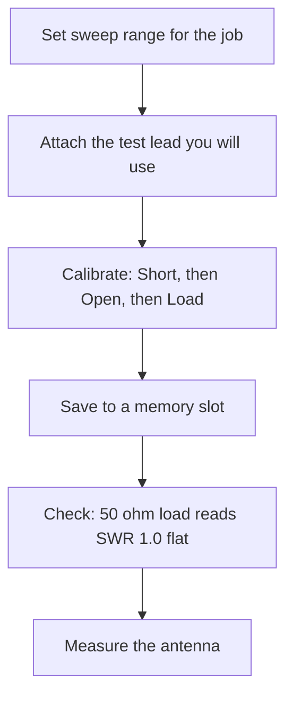
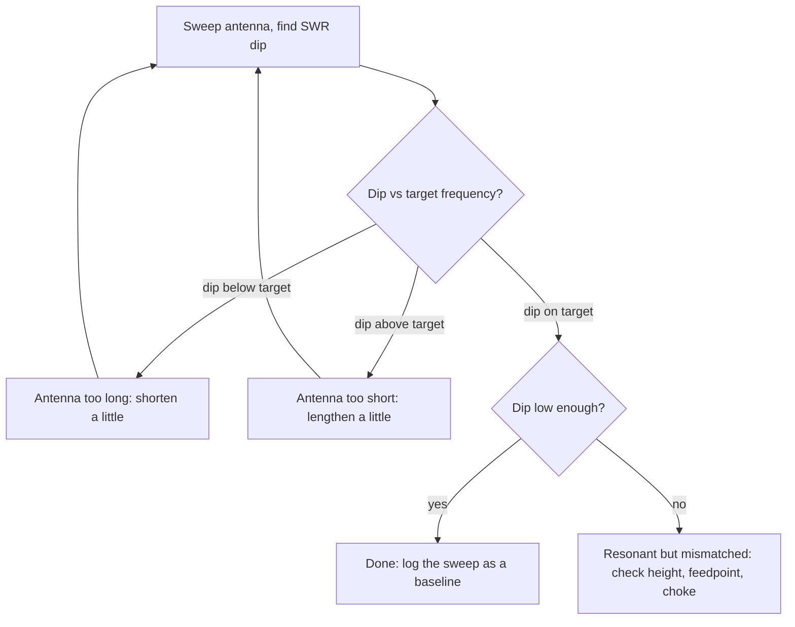

# NanoVNA

For most of amateur radio's history, adjusting an antenna meant transmitting, glancing at an SWR meter, climbing down, trimming a centimetre, climbing back up, and repeating until dark. The instrument that could have replaced all that — a vector network analyser — sat in professional labs costing as much as a car. Then, around 2019, an open-source design called the NanoVNA appeared from China for roughly the price of a takeaway for four, and the hobby quietly changed. Today a device that fits in a shirt pocket will sweep your antenna, draw its [SWR](outpost:entry/logbook73.handbook/swr) curve and [Smith chart](outpost:entry/logbook73.handbook/smith-charts), measure your coax, and find cable faults — all without transmitting a single watt from your rig.

## What a VNA measures

The name unpacks gently. A **network**, in this context, is not the internet — it is any electrical thing with connectors: an antenna, a length of coax, a filter. An **analyser** characterises it. And **vector** means the instrument measures not just _how much_ signal but also its _timing_ (phase) — which, as the [Impedance](outpost:entry/logbook73.handbook/impedance) chapter showed, is exactly the extra ingredient that separates full impedance `R + jX` from mere resistance. A scalar meter could tell you 30 % of your signal reflected; only a vector instrument can tell you the reflection's timing, and from that work out whether the load is inductive or capacitive, and by how much.

The core measurement has an unlovely name: **S11** ("S-one-one"). In plain words: _the instrument sends a tiny, known signal out of its port into your antenna or cable, and measures exactly what comes back — how big the returning echo is, and how it is shifted in time._ That is all. (If you want a picture: shout into a long open tunnel and almost nothing comes back — the energy left and was accepted. Shout at a bricked-up one and your voice bounces straight back. S11 is that echo test, performed at every frequency in the sweep.) From that one echo, at each frequency in a sweep, the NanoVNA computes everything you care about:

- **Return loss** — how many dB weaker the echo is than the outgoing signal;
- **SWR** — the same information in the amateur's favourite units;
- **Complex impedance** — the full `R + jX` at every frequency;
- **The Smith chart trace** — all of the above drawn on the round map.

Two-port models also measure **S21** — what passes _through_ a device from port to port — which turns the NanoVNA into a filter- and amplifier-tester too. For antenna work, S11 on a single port is the whole game.

One reassuring practical point: the test signal is minuscule — well under a milliwatt. You are not transmitting in any meaningful sense, you will not interfere with anyone, and you can sweep an antenna all afternoon without a licence question arising. (You may hear the sweep as a faint tick-tick on a nearby receiver, which is rather satisfying.)

## Why a ~$50/€50 instrument changed the hobby

A proper bench VNA was, and is, a five-figure instrument. What the NanoVNA project did was accept modest specifications — a few GHz at most, a small touchscreen, limited dynamic range — in exchange for a price that rounds to nothing. For antenna work those "modest" specifications are overwhelming overkill: an antenna adjustment needs perhaps 40 dB of measurement range, and even the cheapest unit delivers that with room to spare.

The consequence is cultural as much as technical. Antenna building used to involve formulas, faith and folklore, because _seeing_ what an antenna was actually doing cost too much. Now every builder can watch resonance move in real time as they trim a wire. Arguments that once ran for years on air ("my magic length of coax fixed the SWR!") dissolve in thirty seconds of measurement. If you buy one instrument beyond your rig, make it this one. Several variants exist — the classic NanoVNA-H covering up to about 1.5 GHz, and larger-screened, wider-range successors — but everything in this chapter applies to all of them. Check current models and reviews rather than trusting any specific claim frozen here.

## The calibration ritual: SOL

Here is the single most important habit in VNA ownership, and the one beginners skip to their sorrow. Out of the box — and after _every_ change of frequency range — a NanoVNA does not know where "zero" is. The signal must travel through its own circuitry, its connector, and any adaptor or cable you have attached, all of which add their own reflections and delays. Uncalibrated, the instrument faithfully measures _all of that mixed together with your antenna_, and the result can be complete fiction.

Calibration teaches it what "nothing", "everything" and "perfect" look like, so it can subtract itself from the measurement. The ritual is called **SOL**, after the three reference standards supplied in the box:

- **S — Short:** a connector cap whose centre pin is shorted to the shell. Total reflection, inverted.
- **O — Open:** a cap connected to nothing. Total reflection, upright.
- **L — Load:** a precision `50 Ω` termination. No reflection at all — the perfect match.

By measuring these three known extremes, the instrument learns the exact fingerprint of everything between its electronics and the point where the standards were attached — and cancels it. Step by step:

1. **Set your sweep first.** Choose start and stop frequencies for the job (say `7.0–7.3 MHz` for a 40 m dipole, or `140–150 MHz` for a 2 m antenna). Calibration is only valid for the span it was performed over — set the span, _then_ calibrate.
2. **Attach any adaptor or test lead you will actually use**, because it must be included in the calibration.
3. Open the calibration menu and **reset** any old calibration.
4. Screw on the **Short**, wait for the trace to settle, press _SHORT_.
5. Replace it with the **Open**, press _OPEN_.
6. Replace it with the **Load**, press _LOAD_.
7. Press _DONE_ and **save** to one of the memory slots. Most units let you store several calibrations (slot 0 for HF, slot 1 for 2 m/70 cm, and so on) and recall them instantly.

Sanity check, every time: with the load still attached, the SWR trace should read essentially `1.0` flat across the sweep, and the Smith-chart point should sit glued to the centre. If it doesn't, recalibrate. The whole ritual takes ninety seconds and is the difference between an instrument and a random-number generator.



The point where the standards were screwed on is called the **reference plane** — the exact spot the instrument now treats as "here". Everything beyond it is measured; everything behind it is invisible. Calibrate at the end of a test lead and the lead vanishes from your measurements, which is exactly what you want.

## Measuring an antenna

Now the payoff. Connect the antenna's feedline to the calibrated port, and read.

**The SWR sweep.** Display SWR versus frequency and you get the curve you laboriously dot-plotted in the SWR chapter, drawn instantly and continuously. Somewhere it dips: that minimum is where your antenna system is best matched. Put a marker on it and note two numbers — the frequency of the dip, and how low it goes.

**Finding resonance and deciding what to do.** The rule you already know from the Smith-chart chapter, now in its most practical clothing:

- **Dip below your target frequency → the antenna is too long → shorten it.**
- **Dip above your target frequency → the antenna is too short → lengthen it.**

The mnemonic: frequency and length see-saw. Lower resonant frequency means longer wavelength means the wire is long for your target; snip. (This is the [300 rule](outpost:entry/logbook73.handbook/frequency-and-wavelength) at work.)

A worked example with honest numbers. You build a 40 m inverted-V for `7.1 MHz`, cutting each leg to the classic starting length (the dipole calculator supplies it) with a little spare. The NanoVNA shows the dip at `6.95 MHz` — the antenna is too long. How much to trim? Scale by proportion: length is roughly proportional to `1/f`, so the fractional error is about `(7.10 − 6.95) / 7.0 ≈ 2 %`. Each leg is around `10.2 m`, so trim roughly `2 %` of that — about `20 cm` per leg. Fold the wire back rather than cutting, sweep again, and creep up on the target in two or three iterations. What used to be an afternoon of climb-transmit-trim becomes ten minutes — and because the VNA transmits almost nothing, you can legally and safely do all of it before the antenna ever meets a transmitter.

```viz
{
  "type": "response",
  "title": "First sweep of the new inverted-V",
  "caption": "Dip below target means too long: the ~2 % frequency error translates to about 20 cm off each leg — fold it back, sweep again, creep up on 7.1 MHz.",
  "curve": { "preset": "swr", "f0": 25, "bw": 25 },
  "markers": [
    { "x": 25, "label": "dip: 6.95 MHz" },
    { "x": 50, "label": "target: 7.10 MHz" }
  ],
  "xLabel": "6.8 MHz → 7.4 MHz"
}
```

**Reading more than the dip.** Switch to the Smith chart or the `R + jX` readout for the diagnosis behind the number. A dip that only reaches SWR `2:1` with the trace crossing the axis left of centre means your antenna is resonant but low-impedance (common for low-hung inverted-Vs — raising the apex usually helps). A trace that never approaches the axis at all suggests something more wrong than length.



Remember the previous chapter's caveat: measured through a run of coax, the impedance detail is rotated and the SWR slightly flattered. For trimming to a frequency this rarely matters (the dip frequency barely moves), but for serious feedpoint diagnosis, measure at the antenna or calibrate at the far end of the coax.

## Measuring coax

The same S11 echo makes the NanoVNA a fine cable tester.

**Length and fault-finding.** Leave the far end of a cable open (or shorted) and the echo returns after a round trip; the instrument can convert timing into distance. Most firmware includes a **TDR-style** (time-domain) display: a spike marks the far end — or the fault. A cable crushed under a window sash or corroded at a mid-run join shows a reflection _before_ the end, at the fault's distance. Set the cable's **velocity factor** first (about `0.66` for solid-dielectric coax like RG-58, about `0.80`–`0.85` for foam types — it is printed in the cable's datasheet) or all distances will be scaled wrong.

**Loss.** Two easy methods. With one port: leave the far end open — the echo has travelled down and back, so the measured return loss is _twice_ the cable loss; halve it. A `10 m` reel of RG-58 showing `4 dB` of return loss at `145 MHz` has about `2 dB` of one-way loss — a third of your power gone before the antenna, worth knowing before you buy thin cable for VHF. With two ports: connect the cable from port 1 to port 2 and read S21 directly.

**The magic-coax myth, retired.** Because you can now measure a cable's loss and electrical length in a minute, a whole genre of folklore — mystery lengths of coax that "fix" SWR — becomes checkable. (They rotate the Smith-chart point; they don't move it inward. You knew that.)

## Common beginner mistakes

- **Forgetting to calibrate — or calibrating on the wrong span.** The classic. Symptoms: impossible readings, SWR below 1.0, traces that change when you wiggle the lead. Set span, calibrate, save, sanity-check with the load. Every time.
- **Measuring through an ATU.** A tuner's whole job is to make everything downstream look like `50 Ω` — so that is what you will measure, learning nothing about the antenna. Bypass the tuner (and be wary of rig-internal ones) when measuring.
- **Touching the connector or standards during calibration and measurement.** Your hand is a bag of salty water — a decent capacitor at RF. Fingers on or near the reference plane skew everything, especially at VHF and above. Hold the device by its body, let traces settle before pressing buttons.
- **Trusting a shack-end measurement for feedpoint detail.** Fine for finding the dip frequency; misleading for exact `R + jX`. Measure at the feedpoint when the diagnosis matters.
- **Sweeping ludicrously wide.** A `1–900 MHz` sweep spends its limited measurement points sparsely; your 300 kHz-wide band gets three of them and the dip hides between points. Sweep the band you care about, a little either side.
- **Leaving the battery flat.** Trivial but universal. These devices sip charge in a drawer for months, then die at the top of the ladder.

## Safe use — for you and for it

The NanoVNA's input circuitry is built to measure microwatt echoes; it is easily destroyed by real power.

- **Never connect it to an antenna while any nearby transmitter could use it — and never, ever to a rig's output.** Even a strong _received_ signal from your own or a neighbour's transmitter on a shared mast can exceed the safe input. Disconnect antennas from rigs before measuring them.
- **Discharge static first.** A large outdoor antenna, especially in dry wind or before a storm, accumulates real static charge. Brush the coax centre pin against the connector shell (or use a DC-shorted path) before plugging into the instrument. A crackle you can hear is a spark that could have gone through the VNA's front end. Never work on antennas at all when a storm is anywhere near — that is a _you_ hazard, not just an instrument one.
- Antennas that are grounded through their design (many verticals, loops) are gentler on instruments; end-fed wires on dry days are the crackliest.

## Try it yourself

A first-evening curriculum, in order:

1. **Calibrate on `1–30 MHz`**, save to slot 0, and verify the load reads flat `1.0` SWR. Do it twice until the ritual is muscle memory.
2. **Measure the supplied `50 Ω` load, the open and the short** on the Smith chart, and watch them land at centre, right edge, left edge — the three landmarks of the previous chapter, live.
3. **Sweep any antenna you own** across its band. Find the dip, read the resonant frequency, and decide — without touching anything — whether it is long or short, and by roughly what percentage.
4. **Characterise a patch lead:** velocity factor set, far end open, find its length on the TDR display, then estimate its loss at `145 MHz`. Label the cable with the results — future-you will be grateful.
5. **Log a baseline sweep** of each antenna — photograph the screen, and write the key numbers (resonant frequency, minimum SWR) into your LogBook73 notes. Next time conditions seem oddly quiet, re-sweep and compare before blaming [propagation](outpost:entry/logbook73.handbook/propagation).

## Key takeaways

- A VNA sends a tiny known signal into a device and measures the echo — size _and_ timing. That one measurement (S11) yields return loss, SWR, full `R + jX` and the Smith chart at every frequency in a sweep.
- The NanoVNA put lab-grade antenna measurement into every amateur's pocket for a ~$50/€50 outlay; it measures without meaningfully transmitting.
- **Calibrate — Short, Open, Load — on the span you will use, with the lead you will use, and sanity-check against the load.** An uncalibrated VNA is a fiction generator.
- Antenna trimming rule: dip **below** target = too **long** = shorten; dip **above** = too **short** = lengthen. Scale trims by proportion and creep up in small steps.
- The same instrument measures coax length, loss and fault location — set the velocity factor first, and halve open-end return loss to get one-way cable loss.
- Never measure through a tuner, keep fingers off the reference plane, and protect the input: no live antennas, no transmitters, discharge static before connecting.

The NanoVNA looks _into_ your antenna system; its sibling looks _at the signals themselves_ — including what your transmitter is really putting on the air — in [TinySA](outpost:entry/logbook73.handbook/tinysa).
