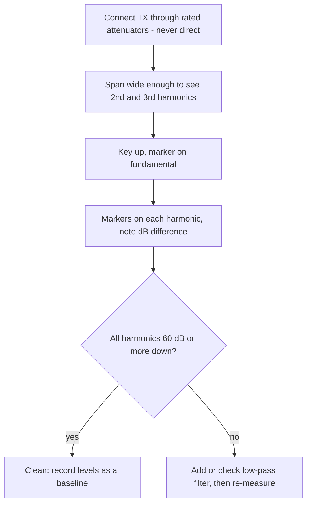

# TinySA

Your licence comes with a quiet obligation: what your transmitter puts on the air must be clean. Not just the signal you intend, but everything else it emits — harmonics, spurs, splatter — must stay within limits, and until recently an amateur simply had to trust the manufacturer, because _seeing_ your own spectrum required a laboratory spectrum analyser costing thousands. The TinySA changed that the way its sibling the [NanoVNA](outpost:entry/logbook73.handbook/nanovna) changed antenna work: a pocket-sized spectrum analyser in the ~$50/€50 class. This chapter explains what it is, what it is emphatically not, and — in bold, because it matters — how to connect it without destroying it in the first five minutes.

## Spectrum analyser vs VNA: two different questions

Beginners often buy the TinySA and NanoVNA together, and just as often muddle their jobs. The distinction is clean:

- A **VNA** _asks_ a question. It generates its own known signal, injects it into your antenna or cable, and measures what comes back. It characterises **networks** — things with connectors. It tells you about impedance, [SWR](outpost:entry/logbook73.handbook/swr) and resonance.
- A **spectrum analyser** _listens_. It generates nothing towards the device under test; it receives whatever arrives at its input and draws a graph of **how much energy is present at each frequency**. It characterises **signals** — things that are actually on the air (or in a cable).

Put another way: the NanoVNA tells you whether your antenna is a good load; the TinySA tells you what your transmitter is actually sending into it. One measures the road, the other watches the traffic.

|                          | NanoVNA                              | TinySA                                            |
| ------------------------ | ------------------------------------ | ------------------------------------------------- |
| Sends a test signal?     | Yes — that's the whole method        | No — it only listens                              |
| Measures                 | Networks: antennas, coax, filters    | Signals: carriers, harmonics, noise, interference |
| Typical question         | "Is my antenna resonant at 7.1 MHz?" | "Is my harmonic 60 dB down?"                      |
| Vertical axis            | SWR, return loss, impedance          | Power in dBm                                      |
| Danger to the instrument | Static, accidental transmit          | **Overload — connecting too much power**          |

If a spectrum display sounds familiar, it should: the waterfall in your SDR software is a close cousin, and the reading skills from [FFTs & Waterfalls](outpost:entry/logbook73.handbook/ffts-and-waterfalls) transfer directly. The differences are calibration and range — a TinySA reads absolute power in dBm across a huge frequency span, which a hobby SDR cannot honestly do. (The TinySA actually works _as_ a radio inside: a swept superheterodyne, scanning its tuned frequency across the span many times a second — the [Receivers](outpost:entry/logbook73.handbook/receivers) chapter in miniature.)

Two models matter as of writing: the original **TinySA** (up to 960 MHz) and the **TinySA Ultra** (larger screen, usefully into the GHz region, better dynamic range). Everything below applies to both; check current specifications rather than relying on figures frozen here.

## Reading the display

The screen is a graph, nothing more:

- **Horizontal axis: frequency**, from your chosen start to stop. This is the "span".
- **Vertical axis: power in dBm** — absolute power, thanks to factory calibration, on the logarithmic scale from the [decibels](outpost:entry/logbook73.handbook/decibels) chapter. `0 dBm` is one milliwatt; each 10 dB down is a tenth of the power. The top line of the screen is the "reference level".
- **The trace**: at each frequency, how much power the instrument currently hears. A pure carrier is a single narrow spike; FM voice is a spike that fattens as you speak; noise is the grass along the bottom (the **noise floor**).
- **Markers**: movable readouts that snap to peaks and report exact frequency and level — you will live on these.
- **RBW (resolution bandwidth)**: how fine the frequency comb is. Narrow RBW separates close-together signals and lowers the visible noise floor, but sweeps slower. The automatic setting is fine to start.

The habit to build: think in **dBc** — dB relative to the carrier. If your main signal peaks at `−20 dBm` on screen and a harmonic shows `−80 dBm`, that harmonic is `60 dB` down, or `−60 dBc`. Almost every cleanliness question in radio is answered in dBc, and the attenuator between your transmitter and the TinySA (see below) cancels out of the comparison, since it lowers both peaks equally.

## Input protection: read this twice

A spectrum analyser's front end is built to measure signals of a **millionth of a watt**. Your transmitter produces **tens of watts**. Connect the two directly and the TinySA dies instantly — this is the single most common way these instruments are killed, usually on day one.

**Never connect a transmitter, or anything that might carry transmitter power, directly to a TinySA. No exceptions, not even "just QRP", not even "just for a second".**

**Know the absolute maximum input — around `+10 dBm` (10 milliwatts) for these devices — and keep everyday inputs far below it, ideally under `−25 dBm` for accurate readings. Check the figure printed in your own unit's documentation and treat it as a cliff edge, not a target.**

Run the arithmetic once and the danger becomes vivid. A modest `25 W` transmitter is `+44 dBm`. The safe measurement level is around `−30 dBm`. The gap is over **70 dB** — a factor of ten million. Bridging it takes serious attenuation, and the first stage must be a **power attenuator** rated to survive your transmitter:

1. **First stage: a high-power attenuator** — e.g. `30 dB` or `40 dB` rated at `50 W` or more — which absorbs the bulk of the power as heat, exactly like the dummy load it partly is.
2. **Second stage: small SMA attenuators** (`10–30 dB`, rated for milliwatts) to bring the level down to the healthy zone.

Worked chain: `25 W` transmitter → `40 dB / 50 W` power attenuator → `30 dB` SMA attenuator → TinySA. Arriving level: `+44 − 40 − 30 = −26 dBm`. Safe, accurate, and the instrument reads the _shape_ of your spectrum perfectly — every peak is simply 70 dB below its true level, and dBc comparisons are unaffected.


Two further habits: **enable some internal attenuation** when hunting unknown signals off-air near transmitters (a strong local paging or broadcast transmitter can overload the front end even through the antenna), and remember that an overloaded analyser lies before it dies — it invents phantom spurs of its own, the same intermod mathematics you met in [Overload & Ghost Signals](outpost:entry/logbook73.handbook/overload-and-ghost-signals). If reducing input level by 10 dB makes a mystery spur drop by _more_ than 10 dB, the spur was born inside the instrument, not your transmitter.

## Checking your transmitter's harmonics

Now the flagship use — the measurement that turns "I assume my rig is clean" into "I know it is."

Every transmitter generates **harmonics**: unwanted copies of your signal at integer multiples of the carrier. Transmit on `7.1 MHz` and weak ghosts appear at `14.2`, `21.3`, `28.4 MHz`… Transmit on `145.5 MHz` and the third harmonic lands at `436.5 MHz` — inside the 70 cm band at best, and near other services at worst. Your licence requires these to be suppressed below limits; the exact figures live in your licence conditions and international recommendations, so **check your regulator's and national society's current guidance** — but a common engineering benchmark for modern HF/VHF equipment is harmonics at least `50–60 dB` below the carrier, and a well-designed rig into a decent [low-pass filter](outpost:entry/logbook73.handbook/filters) sails past that.

This is the picture a healthy transmitter paints on the TinySA's screen:

```viz
{
  "type": "spectrum",
  "title": "The harmonic check: one wanted signal, two weak ghosts",
  "caption": "The log scale keeps 60-dB-down harmonics visible: markers on each peak turn the picture into dBc, and here both harmonics sit comfortably beyond the benchmark.",
  "components": [
    { "f": 25, "amp": 1.0, "label": "145.5 MHz — wanted" },
    { "f": 50, "amp": 0.32, "label": "2nd: −63 dBc", "tone": "danger" },
    { "f": 75, "amp": 0.22, "label": "3rd: −67 dBc", "tone": "danger" }
  ],
  "noiseFloor": 0.06,
  "xLabel": "100 MHz → 500 MHz"
}
```

A worked example, end to end. You want to verify your `25 W`, `145.5 MHz` handheld-plus-mobile setup:

1. Build the attenuation chain above (`70 dB` total), transmitter → attenuators → TinySA. The antenna is out of the circuit entirely; the power attenuator is your dummy load.
2. Set the TinySA to span roughly `100–500 MHz`, so the fundamental and its second and third harmonics are all on screen.
3. Key up (identify with your callsign — you are transmitting into an attenuator, but be correct anyway) and place markers on the peaks.
4. Read: fundamental at `145.5 MHz`, marker says `−26 dBm`. Second harmonic at `291 MHz`: `−89 dBm`. Third at `436.5 MHz`: `−93 dBm`.
5. Convert to dBc: second harmonic `−89 − (−26) = −63 dBc`; third `−67 dBc`. Both comfortably beyond 60 dB down. Your transmitter is clean; log the numbers and sleep well.

If instead the second harmonic had shown `−40 dBc`, you would have found a real problem — commonly a missing or failed low-pass filter, or a cheap handheld being a cheap handheld (independent tests have repeatedly caught budget radios with harmonics barely `30 dB` down). The fix is usually an external low-pass filter, and the TinySA will show you, before and after, exactly what it bought you.



## Hunting QRM

The second great use is pointing the TinySA at the world. Amateur bands are plagued by local electrical noise — QRM from switch-mode power supplies, solar-panel optimisers, LED drivers, Ethernet-over-mains adaptors — and finding the culprit is detective work. A battery-powered spectrum analyser with a small whip antenna is the detective's torch:

- **Walk the house.** Watch the noise floor and characteristic combs of spikes rise as you approach a suspect device; the mains-adaptor comb that peaks next to the router has told you everything. Flip circuit breakers one by one with the TinySA watching your problem frequency — the spike that vanishes names the circuit.
- **Direction-find outdoors.** With a small directional antenna, signal strength versus bearing walks you towards a noisy street lamp or a neighbour's failing power supply (approach neighbours with diplomacy and chocolate biscuits, not accusations).
- **Identify by fingerprint.** Noise sources have shapes: switch-mode supplies draw combs of spikes tens of kHz apart that drift as the device warms; VDSL fills tidy defined blocks; a faulty thermostat clicks broadband hash. Comparing what you see against what you hear on the rig connects the picture to the problem. (For the receiver-side version of this story — and why strong local signals can manufacture _fake_ interference inside your own receiver — see [Overload & Ghost Signals](outpost:entry/logbook73.handbook/overload-and-ghost-signals).)

You can also simply _watch the bands_: park the span across 2 m during a contest evening, or across the broadcast bands, and enjoy the view. Repeater outputs, pager bursts and airband carriers become visible fauna.

## TinySA or SDR waterfall?

For signal-hunting, a fair question: your [SDR](outpost:entry/logbook73.handbook/software-defined-radio) already draws spectrum, so why the extra box? They overlap, but each wins somewhere:

- **The SDR wins at listening.** It demodulates — you can _hear_ the mystery signal, which identifies it faster than any trace. Its waterfall has fine time resolution for burst signals, and it is unbeatable within its tuned slice.
- **The TinySA wins at measuring.** It reads **absolute power in dBm** with factory calibration; a hobby SDR's vertical axis is honest only in "more" and "less". It sweeps its entire range in one view, needs no computer, runs on its battery for hours, and its input tolerates (with attenuation and care) environments that would flatten a bare RTL-SDR dongle.
- **In practice:** hunt and identify with the SDR's ears; quantify, compare and document with the TinySA's calibrated eyes. The pair together cost less than one tank of fuel.

## Try it yourself

- **First light, no risk:** screw on the supplied whip, set the span to `88–108 MHz`, and look at your local FM broadcast stations — big confident spikes with fattened modulation. Put a marker on the strongest and read its level in dBm. Congratulations: you have made a calibrated spectrum measurement.
- **Map your noise.** Set the span across `7 MHz` or wherever your noise is worst, walk the house, and note which rooms and devices raise the grass. Then flip breakers with the trace running and catch the culprit circuit red-handed.
- **Harmonic check — only if properly equipped.** If (and only if) you have a power attenuator rated well above your transmit power, run the worked harmonic measurement above at your lowest power setting and log the dBc figures for your rig. No power attenuator yet? Do the off-air version: transmit into your dummy load and let the TinySA listen on its own whip from across the room — uncalibrated, but harmonics grossly out of line will still show.
- **Compare instruments:** view the same local FM station on your SDR waterfall and the TinySA side by side, and notice what each shows you that the other cannot.

## Key takeaways

- A spectrum analyser **listens** and plots power versus frequency; a VNA **probes** networks with its own signal. TinySA answers "what is being emitted?", NanoVNA answers "what does this load look like?".
- The display is frequency across, **dBm** up; think in **dBc** (dB below carrier) for cleanliness questions, and attenuation in the path cancels out of dBc comparisons.
- **Input protection is everything: never connect a transmitter directly; know your unit's absolute maximum (~`+10 dBm`) and stay far below it with a rated power attenuator first in the chain.**
- Harmonic checking is a fifteen-minute job: ~70 dB of attenuation from a 25 W rig, wide span, markers on fundamental and harmonics, verify ≥ 60 dB down (and check your licence's current limits).
- An overloaded analyser invents signals — if 10 dB less input drops a spur more than 10 dB, the spur is internal.
- Battery power and calibrated readings make the TinySA a superb QRM-hunting tool; use an SDR's ears to identify and the TinySA's numbers to measure.

That completes your pocket laboratory — next we leave the bench and follow your now-verified signal out into the sky, where the Sun and the ionosphere decide how far it travels, in [Propagation](outpost:entry/logbook73.handbook/propagation).
