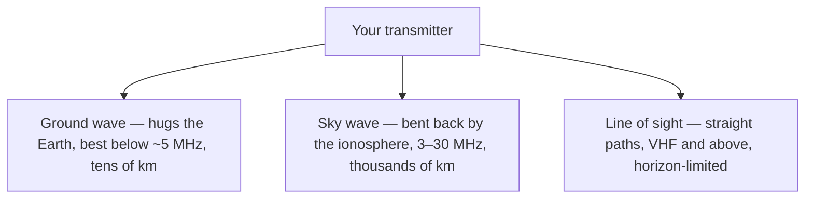
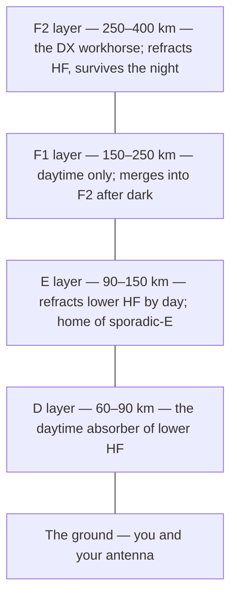
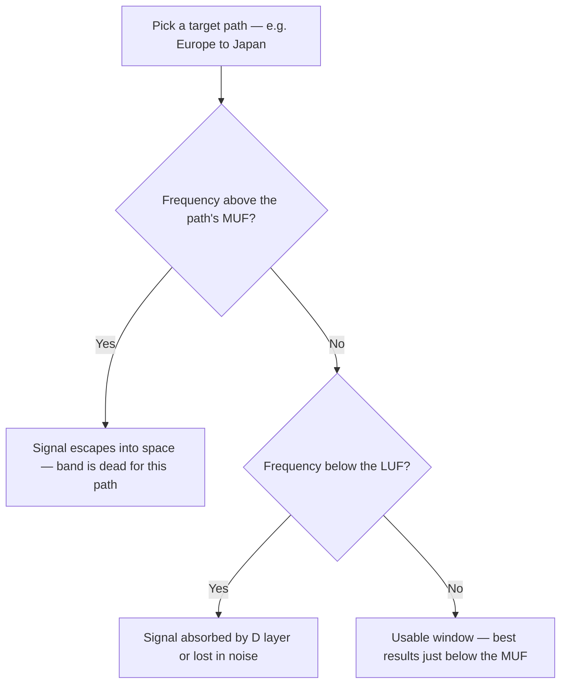

# Propagation

Tune across the 20 m band at teatime and you might hear Japan, the east coast of the United States and a portable station in the Alps, all in the space of a few kilohertz. Come back at 2 a.m. and the same band can be utterly silent, while 40 m — dead quiet at lunchtime — is suddenly wall-to-wall with signals. Nothing about your radio changed. What changed is the invisible, ever-shifting mirror in the sky that carries your signal, and understanding it is the difference between calling into the void and calling at exactly the right time, on exactly the right band. This chapter explains why bands open and close — and it is the key that unlocks the next four.

## Three ways a signal travels

Every radio signal leaving your antenna spreads out in all directions it can, but only three routes matter for reaching another station. Which route dominates depends almost entirely on frequency — which is why the [HF](outpost:entry/logbook73.handbook/hf), [VHF](outpost:entry/logbook73.handbook/vhf) and [UHF](outpost:entry/logbook73.handbook/uhf) bands feel like different hobbies.

**Ground wave** hugs the surface of the Earth. Low-frequency signals induce currents in the ground as they travel, and this interaction bends them to follow the curvature of the planet. It works beautifully at low frequencies — it is how long-wave broadcasters cover whole countries — but the losses climb steeply with frequency. On 80 m an amateur ground wave might reach 100 km or so; by 20 m it is down to a few tens of kilometres; at VHF it is barely worth mentioning.

**Sky wave** is the star of this chapter. Between roughly 3 and 30 MHz, signals radiated upwards can be bent back down to Earth by an electrified region of the upper atmosphere called the ionosphere. One "hop" can span 3,000 km or more, and signals can bounce between the ionosphere and the ground several times. This is how a 10 W transmitter in a Yorkshire back garden reaches New Zealand, and it is the reason HF is often called _short wave_ with a straight face: the waves are short compared with long wave, but the distances are anything but.

**Line of sight** (often called _space wave_) is the straight-line path from one antenna to another, with a modest bonus because the atmosphere bends signals slightly beyond the visible horizon. Above about 30 MHz — VHF and up — signals normally punch straight through the ionosphere and out into space rather than bouncing back, so line of sight is what you are left with. Height becomes everything, which is why repeaters live on hilltops; we will do the friendly maths for this in the [VHF](outpost:entry/logbook73.handbook/vhf) chapter.

## The ionosphere: a mirror made by sunlight

The ionosphere is not a solid layer, and it is not really a mirror — but "mirror in the sky" is close enough to start with. Between about 60 km and 400 km up, the air is so thin that when ultraviolet light and X-rays from the Sun strike it, electrons get knocked clean off their atoms. The result is a region of free electrons and ions — a _plasma_ — and free electrons interact strongly with passing radio waves. When a wave enters a region where electron density increases with height, it is bent — _refracted_ — progressively, and if the bending is strong enough the wave curves right back down to Earth. To the operator on the ground it behaves like a reflection, so hams talk about signals "bouncing" off the ionosphere, and that is a perfectly good working picture.

The ionosphere is stacked into layers, each behaving differently:

**The D layer (60–90 km)** is the villain of the piece. The air here is still relatively dense, so a radio wave's energy gets soaked up by collisions rather than usefully bent. The D layer _absorbs_ signals rather than refracting them, and the lower the frequency, the worse the absorption. It exists only in daylight — the electrons recombine with ions within minutes of sunset — which is the single most important fact in HF propagation: it is why 80 m and 40 m are short-range bands by day and long-range bands by night.

**The E layer (90–150 km)** can refract lower HF frequencies during the day, giving single hops of up to around 2,000 km. It also hosts a mischievous phenomenon called _sporadic-E_, which we will meet shortly.

**The F layer** is the top of the stack and the one that matters most for working the world. In daylight it splits into **F1 (150–250 km)** and **F2 (250–400 km)**; after dark they merge into a single F layer. The F2 layer is the DX layer — _DX_ being ham shorthand for long distance. The air up there is so thin that electrons take hours to recombine, so the F layer survives the night, weakening slowly until sunrise recharges it. One F2 hop can cover 3,000–4,000 km.

So the daytime picture on the lower bands is a tug-of-war: the D layer absorbs your signal on the way up, and only what survives reaches the F layer to be bent back down. On 80 m by day, almost nothing survives. On 20 m, the D layer barely notices you and the F layer does the work. This is why every HF band has its own personality — the subject of the [next chapter](outpost:entry/logbook73.handbook/hf).

The whole reality of it — a wave leaving in many directions, bending gradually rather than mirror-bouncing, and landing across a broad footprint — is worth seeing in one picture:

, a broad footprint of possible reception, and a skip zone in between.')

## Day, night and the grayline

Because sunlight makes the ionosphere, the whole system breathes on a 24-hour cycle.

**By day**, all layers are active. The D layer smothers the low bands (80 m, 40 m below a few hundred kilometres of range), while the higher bands (20 m up to 10 m) come alive, because the F2 layer is at its strongest and can bend those higher frequencies back down. High bands by day.

**By night**, the D layer vanishes and the low bands open up: 80 m and 40 m signals now sail through where the absorber used to be, and can hop off the F layer to cross continents. Meanwhile the F2 layer weakens, and one by one the high bands stop supporting refraction — 10 m goes first, then 15 m, often 20 m in the small hours. Low bands by night.

**The grayline** is the twilight strip between day and night that sweeps around the planet — you can see it drawn on LogBook73's Map page, and the Propagation page lists your own grayline times. It is a magic few minutes twice a day: the D layer has already collapsed (it dies within minutes of losing sunlight) but the F layer, which fades over hours, is still strong. Signals travelling _along_ the terminator — say, from your local sunset to a sunrise on the far side of the world — enjoy low absorption and a still-energetic mirror at both ends. Low-band DXers plan their entire operating day around it: 40 m and 80 m contacts spanning half the globe happen in these windows that would be impossible three hours later.

![The grayline sweeping the globe. The grayline is the day/night terminator — the moving boundary between daylight and darkness. Around local sunrise and sunset the lower ionosphere is in transition, so D-layer absorption is low and low-band (160–80 m) signals can follow the terminator for thousands of kilometres, bending with the ionosphere. A station at sunset can work a station at sunrise on the far side of the world along this path. The grayline moves around the planet through the day, shown at 0000, 0600, 1200 and 1800 UTC. Tips: check sunrise and sunset for your target, be on frequency early, use low power to start, and be patient as the line moves.](/handbook-figures/grayline.png 'The grayline is a moving highway around the Earth: be where day meets night and the low bands come alive for long-distance DX.')

## The Sun runs the show

If the ionosphere is a mirror, the Sun is the electricity that powers it — and the Sun is not a steady star. Its activity rises and falls on a roughly **11-year solar cycle**, tracked by counting **sunspots**: dark, magnetically violent blotches on the solar surface. More sunspots means more ultraviolet and X-ray output, a more strongly ionised F2 layer, and higher frequencies bent back to Earth. At the peak of a cycle, 10 m opens to the whole world on a few watts. At the trough, 10 m can stay shut for months and the DX action retreats to 20 m and below. Solar Cycle 25 peaked in the mid-2020s, so as this handbook is written, the high bands are in their happiest state — enjoy them.

Three numbers summarise "space weather", and you will find all of them, updated live, on LogBook73's Propagation page:

| Index                      | What it measures                                                                            | Rough guide                                                                          |
| -------------------------- | ------------------------------------------------------------------------------------------- | ------------------------------------------------------------------------------------ |
| **SFI** (Solar Flux Index) | The Sun's radio output at 10.7 cm wavelength — a proxy for the UV that ionises the F2 layer | ~70 = quiet Sun, high bands struggle; 100+ = decent; 150–200+ = high bands wide open |
| **A index**                | Yesterday's average geomagnetic disturbance (0 upwards)                                     | Below ~10 = calm; 20+ = disturbed; 50+ = storm                                       |
| **K index**                | Geomagnetic disturbance right now, updated every 3 hours (0–9)                              | 0–2 = calm; 3–4 = unsettled; 5+ = geomagnetic storm                                  |

The pattern to remember: **you want SFI high and A/K low**. High solar flux builds a strong mirror; a low K index means the Earth's magnetic field is calm, so the mirror is smooth and settled. When the Sun throws a tantrum — a flare or a coronal mass ejection — the K index climbs, HF paths through high latitudes (from Europe, for example, that is most paths to North America and Japan) degrade or vanish, and occasionally a _radio blackout_ wipes out the daylight side of the planet for an hour. The consolation prize is aurora, which VHF operators actually look forward to — more below.

## MUF, LUF and the usable window

At any moment, for any given path across the Earth, two frequencies bracket what is possible.

The **Maximum Usable Frequency (MUF)** is the highest frequency the ionosphere will bend back down along that path. Go above it and your signal punches through into space. The MUF depends on how strongly the F2 layer is ionised (time of day, season, solar cycle) and on the geometry of the path. On a good winter day at solar maximum the MUF over a long path can exceed 30 MHz — every HF band open at once. On a summer night at solar minimum it might sag below 10 MHz.

The **Lowest Usable Frequency (LUF)** is the floor, set by D-layer absorption and the [noise](outpost:entry/logbook73.handbook/noise) level: below it, your signal is absorbed or buried before it arrives. The LUF rises during the day (strong D layer) and falls at night.

Between the two lies the usable window, and the craft of HF operating is choosing a band inside it. A rule of thumb passed down by generations of operators: **work as close below the MUF as you can**. Near the MUF, signals take fewer hops, spend less time in the absorbing lower layers, and arrive noticeably stronger.

You do not have to guess where that window sits. Online propagation predictors — the best-known being [VOACAP Online](https://www.voacap.com/hf/), which wraps the same US-government propagation model professional broadcasters use — take a path, a date and the current solar numbers and draw an hour-by-hour picture of which bands should open, in which direction, and how reliably. Treat it as an educated forecast rather than a promise (the real ionosphere is lumpier than any model), but as a sanity-check before you call CQ, and as a way to watch the physics of this chapter play out, it is hard to beat.

## The skip zone: near is the new far

Sky wave has a famous quirk. Your ground wave peters out within, say, 50 km. Your sky wave leaves the antenna, soars to the F layer, and lands 1,500 km away. Between the two lies the **skip zone** — a ring of territory where your signal simply does not land. A station in the next city, 150 km away, might be inaudible to you on 20 m while you both chat easily to a country 1,500 km distant. Distance on HF is not a smooth dial; it comes in hops.

The skip zone shrinks on lower frequencies (which can be refracted even from steep, high-angle takeoffs) and grows on higher ones. Antennas matter too: a low-slung dipole fires a lot of energy nearly straight up, which on 80 m or 40 m comes almost straight back down. This is called **NVIS** — Near Vertical Incidence Skywave — and far from being a fault, it is the standard technique for reliable coverage out to a few hundred kilometres, beloved of emergency communicators. There is more on antenna height and takeoff angle in the [Antennas](outpost:entry/logbook73.handbook/antennas) chapter. [Reading the Ionosphere](outpost:entry/logbook73.handbook/reading-the-ionosphere) takes NVIS further: how an ionosonde's foF2 tells you whether 40 m will come straight back down today, and why the MUF climbs with path length.

## A tasting menu of exotic propagation

The steady F-layer machinery above is the bread and butter. But radio keeps a few delicacies on the menu — most of them starring at VHF, where "impossible" DX is the whole sport. The [VHF](outpost:entry/logbook73.handbook/vhf) chapter goes deeper on each.

**Sporadic-E (Es)** — dense, patchy clouds of ionisation that form unpredictably in the E layer, around 100 km up, mostly in each hemisphere's early summer (late May to early August in the north), with a smaller mid-winter echo. They reflect frequencies far higher than the regular E layer can manage — 28 MHz routinely, 50 MHz frequently, sometimes 144 MHz — turning quiet summer lunchtimes into 1,000–2,000 km pile-ups. Nobody fully knows why they form; that is half the charm.

**Tropospheric propagation (tropo)** — not the ionosphere at all, but weather. Under a settled high-pressure system, a layer of warm air can sit on top of cool air (a _temperature inversion_), forming a duct that guides VHF and UHF signals hundreds — occasionally over a thousand — kilometres beyond the horizon. Sea paths — across the North Sea, the Mediterranean or the Gulf of Mexico — are especially good.

**Meteor scatter** — every day, grains of dust hit the atmosphere and each leaves a briefly ionised trail about 100 km up that reflects VHF for anything from a fraction of a second to a minute. Digital modes fire rapid bursts and reassemble contacts from the fragments. During a good shower like the Perseids, 6 m and 2 m contacts over 1,500 km are routine.

**Aurora** — during geomagnetic storms (that K index again), the auroral curtains themselves reflect VHF signals. Everyone points north, and voices come back eerily distorted — CW turns into a hiss, SSB into a ghostly rasp — because the reflector is moving and turbulent. Working "au" is a rite of passage for northern-latitude VHF operators.

## Try it yourself

You can watch all of this happening tonight, without transmitting anything.

1. **Open LogBook73's Propagation page.** Find the SFI, A and K indices. Is the Sun busy or quiet today? Is the geomagnetic field calm? Note the numbers, then look at which bands the page suggests are open — and check back after dark to watch the high bands close and the low bands wake up.
2. **Watch the grayline.** On LogBook73's Map page, find the day/night terminator. Where is it sunset right now? If it is passing over you, this is the moment the low bands stretch their legs.
3. **Open pskreporter.info.** Filter the map to 20 m and see where the world is being heard right now; then filter to 40 m or 80 m. By day the low bands show short hops; by night the map stretches. You are watching the D layer switch on and off.
4. **Listen to a beacon.** The Beacons page lists the NCDXF international beacon network on 14.100, 18.110, 21.150, 24.930 and 28.200 MHz — 18 transmitters around the world taking turns, each sending its callsign and stepped power levels. If you can hear the beacon from a continent, the band is open to that continent. Ten minutes of beacon listening beats any prediction chart.
5. **Then compare with a prediction.** Run the same path and date through [VOACAP Online](https://www.voacap.com/hf/) and see how its forecast lines up with what the beacons and pskreporter.info actually show — where they agree, trust the model; where they differ, you have just found the gap between theory and a lumpy real ionosphere.
6. **No HF radio yet?** A web SDR or an inexpensive RTL-SDR dongle with an upconverter (see [Software Defined Radio](outpost:entry/logbook73.handbook/software-defined-radio)) lets you hear all of it for very little money.

## Key takeaways

- Signals travel by ground wave (low HF, short range), sky wave (HF, worldwide) or line of sight (VHF and up, horizon-limited).
- The ionosphere is layered: the **D layer absorbs** lower HF by day and vanishes at night; the **E and F layers refract** signals back to Earth, with the F2 layer doing the long-distance work.
- **High bands by day, low bands by night** — and the grayline at dawn and dusk is a brief best-of-both window.
- The Sun powers everything on an 11-year cycle. On LogBook73's Propagation page, look for **high SFI and low A/K** for good HF conditions.
- Every path has a usable window between the **LUF** (absorption floor) and the **MUF** (escape ceiling); operate just below the MUF for the strongest signals.
- Sky wave lands in hops, leaving a **skip zone** where nearby stations can be unreachable while distant ones are loud.
- Sporadic-E, tropo ducting, meteor scatter and aurora are the wildcard modes that make VHF DX possible.

Armed with the why, you are ready for the where: the [HF](outpost:entry/logbook73.handbook/hf) chapter tours the bands from 80 m to 10 m and introduces the distinct personality of each.
