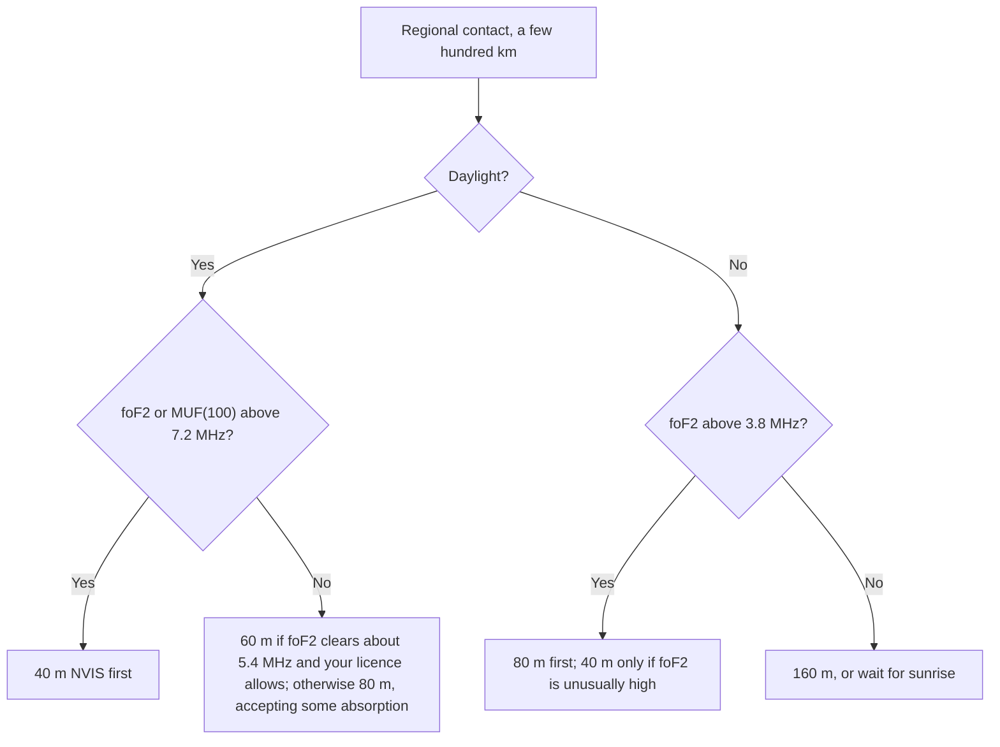

# Reading the Ionosphere

Saturday, half past ten, and you are on 40 m talking to a friend in Reading — about 70 km from your shack in east London, and so loud you could almost hear him without the radio. That evening you go back to the same frequency to carry on. He is nowhere. In his place are a station in northern Italy and another in Poland, both booming in, and when you finally reach your friend by phone he says he can hear them too — just not you. Nothing broke. The ionosphere over southern England simply stopped returning 7 MHz signals that went straight up, while still returning ones that went off at a slant.

The [Propagation](outpost:entry/logbook73.handbook/propagation) chapter explained the layers, the D-layer absorber, and the window between the MUF and the LUF. This chapter picks up where it left off and asks a sharper question: _for this frequency, this distance and this hour, will the sky bring my signal back down?_ Answering it needs four measurements that look alike and mean quite different things, one piece of geometry, and the habit of reading an ionosonde the way you read a weather chart. By the end you will know why 40 m can be perfect for Reading at lunchtime and useless for it at teatime, and why a "40 m Fair" badge cannot tell you which.

## Near and far: NVIS and DX

Every antenna launches energy at a spread of elevation angles at once. What the ionosphere does with each depends on how steeply it arrives.

**NVIS** — near vertical incidence skywave — is the steep end. Energy goes up at high elevation, meets the F2 layer almost head-on and, if the layer can return that frequency, comes down again nearby: typically anywhere from your own doorstep out to a few hundred kilometres. That makes NVIS the natural way to cover a region with no repeater and no line of sight — over the Pennines, out of a Welsh valley, across a county during a RAYNET exercise. A low horizontal dipole or inverted-V is the classic NVIS antenna, because a wire well under a quarter-wavelength up throws much of its energy skywards (the [Antennas](outpost:entry/logbook73.handbook/antennas#height-matters-usually-more-than-the-antenna) chapter covers why). A vertical does the opposite and is a poor NVIS radiator.

**DX** is the shallow end. A ray leaving at a few degrees above the horizon travels a long way sideways before it reaches the layer, meets it at a glancing angle, and lands perhaps 2,000–3,500 km away. Longer paths are strung together from several hops, and each hop has to work: the ionosphere at every reflection point, and the absorption at every pass through the D layer, all count. A good DX path depends on conditions along the whole route, not just over your house.

```
 NVIS: a steep ray, which comes back only if f is below about foF2

   F2 ~~~~~~~~~~~~~/\~~~~~~~~~~~~~~~~~~~~~~~
                  /  \
                 /    \
                /      \
   ground ====[TX]====[RX]==================    0 to a few hundred km


 DX: a shallow ray, which can come back at frequencies well above foF2

   F2 ~~~~~~~~~~~~~~~~~~~~~~~~~~~~~~~~__..--""--..__~~~~~~~~~~~~~~~~~~~~~~~~~~~~
                          __..--""""                ""--..__
               __..--"""""                                  """"--..__
   ground ==[TX]===================================================[RX]=======
              |<- ground ->|<------------ skip zone ------------>|
                  wave        (nothing lands here on this band)
```

The diagram is a schematic: real refraction is a gradual bend through a thick layer, not a bounce off a surface, and real signals land over a broad footprint rather than at a point. But it shows the central fact. **A frequency that cannot come back vertically may still come back obliquely.** That is why 20 m can be alive with DX at noon while being useless for a contact down the road.

It is also why a skip zone is not a dead band. When the ionosphere supports 7 MHz at low angles but not high ones, your 40 m signal skips over the station 100 km away and lands 800 km away — the [skip zone](outpost:entry/logbook73.handbook/propagation#the-skip-zone-near-is-the-new-far) is real, but only the short path has closed. Ground wave may still cover the first few tens of kilometres, and sporadic-E can drop a signal in the middle of the gap when it feels like it.

## Four numbers that look alike

Propagation tools quote four frequencies that are easy to muddle, partly because they are all in MHz and partly because people use them loosely. Each one answers a different question.

**foF2** is the _critical frequency_ of the F2 layer: the highest frequency, sent straight up, that the layer returns. An **ionosonde** — a vertical-incidence radar that sweeps from about 1 MHz to 20 MHz or more and times the echoes — measures it directly, and the UK's long-running sounder at Chilton in Oxfordshire is the natural first choice for British operators. foF2 is the electron density at the peak of the F2 layer, expressed as a frequency. If foF2 is 8 MHz, a 7 MHz signal going straight up comes back; if it is 4 MHz, it does not. Strictly, foF2 is read from the _ordinary_ echo; the Earth's magnetic field splits each echo in two, and the _extraordinary_ trace sits roughly 0.7 MHz higher over the UK, so do not mistake one for the other. foF2 describes the sky above the sounder, not above you or your far station.

**MUF** — maximum usable frequency — is the highest frequency that the ionosphere is expected to return _on a stated path_. It always needs a distance or a destination after it: MUF(100 km), MUF(500 km), MUF(London–Rome). Without one it is meaningless. Ionosondes publish one standard value, **MUF(3000)F2**, the F2 MUF for a conventional 3,000 km single hop. It is a useful proxy for long-haul conditions, but it is not "the UK's MUF", and it is not the MUF to New York, which is 5,600 km away and two hops long.

**LUF** — lowest usable frequency — is the lowest frequency that meets a chosen standard of performance on a stated path: a usable signal-to-noise ratio for _your_ mode, with _your_ power and antennas, for a chosen fraction of the time. Below it, D-layer absorption and [noise](outpost:entry/logbook73.handbook/noise) win. That makes the LUF a property of the whole station and circuit, not of the ionosphere alone. An [FT8](outpost:entry/logbook73.handbook/ft8) signal that decodes 20 dB below the noise has a lower LUF than an SSB contact on the same path, and 400 W has a lower LUF than 10 W. Nothing on an ionogram measures it; it comes from a link-budget model or from experience, and anything labelled "LUF" should tell you the path, mode and power it assumed.

**fmin** is the lowest frequency at which a particular ionosonde detected any echo in a particular sounding. It tends to rise when the D layer absorbs more — by day, and sharply during a solar flare — so its trend over a few hours is a handy absorption indicator. But it also depends on the sounder's power, its receiver, local interference and how the software processed the trace. It is not the LUF of your 20 W station, it is not a minimum transmitting frequency, and sometimes it is simply missing.

| Number    | Where it comes from                  | Scope                             | What it tells you                        |
| --------- | ------------------------------------ | --------------------------------- | ---------------------------------------- |
| foF2      | Measured on an ionogram              | The sky above one sounder         | Vertical F2 ceiling — the NVIS question  |
| MUF(100)  | Calculated from a sounding or model  | A 100 km path                     | Near-NVIS ceiling                        |
| MUF(3000) | Scaled from the ionogram or modelled | A 3,000 km single hop             | Long-hop ceiling, a rough DX proxy       |
| LUF(path) | Link-budget model or experience      | One path, mode, power and antenna | The floor below which the signal is lost |
| fmin      | Measured on an ionogram              | One sounder, one sounding         | Lowest echo detected; absorption hint    |

The MUF has a fairly direct link to physics — electron density and geometry. The LUF depends as much on your equipment as on the sky. Treat them accordingly, and never let a modelled LUF masquerade as a measurement.

## Why the MUF depends on distance

Why should a longer path support a higher frequency? Because what matters to the layer is not the frequency itself but how hard the wave is pushing _into_ it. A wave arriving at a slant has only a fraction of its motion directed upwards, and needs much less bending to be turned round.

That idea is captured by the **secant law**:

> **MUF = foF2 × sec θ**

Here θ is the _angle of incidence_ — the angle between the ray and the vertical where it meets the layer. It is not the take-off angle above the horizon that antenna plots show; a 5° take-off angle becomes an incidence angle of about 72° at the F2 layer. Straight up, θ is 0, sec θ is 1, and the MUF equals foF2. As the ray tilts, sec θ grows and so does the MUF.

To turn that into distance, picture the Earth as flat and the layer as a thin mirror at an effective height _h_. A single hop of ground distance _d_ then gives:

> **MUF(d) ≈ foF2 × √(1 + (d ÷ 2h)²)**

With foF2 = 6 MHz and h = 300 km:

| Path length | Factor √(1 + (d ÷ 2h)²) | Flat-Earth MUF |
| ----------- | ----------------------- | -------------- |
| 0 km        | 1.00                    | 6.0 MHz        |
| 100 km      | 1.01                    | 6.1 MHz        |
| 300 km      | 1.12                    | 6.7 MHz        |
| 500 km      | 1.30                    | 7.8 MHz        |
| 1,000 km    | 1.94                    | 11.7 MHz       |
| 2,000 km    | 3.48                    | 20.9 MHz       |
| 3,000 km    | 5.10                    | 30.6 MHz       |

The first rows tell the story of the opening scene. On a 6 MHz day, 40 m fails at 100 km (6.1 MHz is below 7) but works comfortably at 1,000 km (11.7 MHz is above it). Even 20 m, hopeless locally, has a ceiling above 14 MHz once the path is long enough.

**Both formulas are teaching approximations, and the last rows show where they break.** The flat-Earth form ignores the curvature of the Earth, the real shape of the electron-density profile, the Earth's magnetic field, tilts in the layer, and the fact that the ionosphere at the far reflection point is not the ionosphere over the sounder. Curvature alone stops the incidence angle from ever getting very oblique: from a layer 300 km up, even a ray that leaves exactly along the horizon meets it at about 72.7°, so sec θ cannot exceed about 3.4 for a single hop. Redo the 3,000 km row on a round Earth and the factor drops from 5.1 to about 3.3; real soundings, with real profiles, usually give a factor nearer 3. That factor has a name, M(3000)F2, and it is how an ionosonde turns foF2 into MUF(3000)F2. The flat-Earth sum is within a few per cent out to about 1,000 km and badly wrong beyond it, so never use it for a real London–New York MUF; use a model built for the job.

Distance is one input among several. Even with the MUF comfortably above your frequency, a contact can still fail through the antenna's vertical pattern, D-layer absorption, a poor signal-to-noise ratio or a noisy neighbour. The MUF is permission, not a promise.

## Day and night on 80, 40 and 20 m

Put foF2 and absorption together and the daily rhythm of the three most-used bands falls out of the physics. The numbers below are typical of a UK winter around the middle of the solar cycle; your mileage will vary.

**40 m (7 MHz) by day.** Say foF2 is 9 MHz at midday. A 7 MHz ray going straight up is below the critical frequency and returns: NVIS across the region is on, with some D-layer absorption trimming signals at noon. After dark, foF2 sinks to perhaps 4 MHz. Now the vertical ray goes straight through, and the friend in Reading drops out — but shallow rays still return, and with the D layer gone they arrive strong. **40 m DX often improves at exactly the moment 40 m NVIS fails.**

**20 m (14 MHz).** Even a lively 9 MHz foF2 is nowhere near 14 MHz, so 20 m never comes straight back down on an ordinary day. At low elevation the path MUF can easily exceed 14 MHz, which is why 20 m is the daytime DX band. At night the F2 density falls, path MUFs fall with it, and many 20 m paths close — though around solar maximum, and on paths that stay sunlit, 20 m can stay open long into the evening. There is no universal sundown switch.

**80 m (3.5 MHz).** 3.5 MHz is below foF2 for most of the day and much of the night, so 80 m almost always _can_ come straight back. The problem by day is the D layer, which absorbs it heavily. After dark the absorber fades, the round trip becomes efficient, and 80 m becomes the evening's regional band and, later, a long-haul one. The exception is a deep-winter night near solar minimum, when foF2 can slide below 3.5 MHz in the small hours: then even 80 m NVIS closes, and 160 m (or simply patience until dawn) is the answer.



## Band by band

These are typical tendencies for UK operators, not predictions. The [HF](outpost:entry/logbook73.handbook/hf) chapter gives each band's personality; this table adds the NVIS-versus-DX view.

| Band    | MHz   | Regional (NVIS)                                | Longer paths                                  | Main limits                                |
| ------- | ----- | ---------------------------------------------- | --------------------------------------------- | ------------------------------------------ |
| 160 m   | 1.8   | Good at night                                  | Night DX, challenging but rewarding           | Daytime absorption, noise, antenna size    |
| 80 m    | 3.5   | Strong at night; variable by day               | Night DX                                      | Daytime absorption, noise                  |
| 60 m    | 5     | Often the best compromise between 80 and 40 m  | Regional and UK-wide, some longer paths       | UK Full licence only (see below)           |
| 40 m    | 7     | Often the daytime choice when foF2 supports it | Excellent after dark                          | Short skip closes as foF2 falls            |
| 30 m    | 10    | Rarely: foF2 is usually below 10 MHz           | Excellent all-rounder, day and night          | CW and data only                           |
| 20 m    | 14    | Effectively never via F2                       | The major daytime DX band, sometimes at night | Needs a favourable oblique MUF             |
| 17–10 m | 18–28 | No (bar sporadic-E)                            | Superb when solar activity is high            | Solar-cycle dependence; 10 m has summer Es |

Rules this tidy have exceptions: sporadic-E can put 10 m or even 6 m into the next county, scatter modes fill in skip zones, and on rare days foF2 climbs high enough to break the pattern. Practical starting points:

- **UK regional by day:** 40 m first if foF2 or MUF(100) supports it; 60 m if you hold a Full licence; 80 m if absorption is not too severe.
- **UK regional at night:** 80 m first; 160 m; occasionally 40 m when the short-path MUF stays unusually high.
- **Into Europe in the evening:** 40 m.
- **Intercontinental by day:** 20 m and up, as far as the path MUFs allow.

**60 m in the UK, at the time of writing.** The 5 MHz band is available only to Full licence holders, as eleven separate sub-bands on a secondary, non-interference basis, with its own power and antenna-height limits. Foundation and Intermediate licensees must not transmit there. A propagation display may happily show 60 m as open without implying you may use it; check the current licence terms from [Ofcom](https://www.ofcom.org.uk/) and the [RSGB](https://rsgb.org/)'s 5 MHz guidance before you transmit, because these details do change. [Getting Licensed](outpost:entry/logbook73.handbook/getting-licensed) explains the UK licence ladder.

## The Sun, storms and flares

The [Propagation](outpost:entry/logbook73.handbook/propagation#the-sun-runs-the-show) chapter introduced the solar cycle and the SFI, A and K indices. Three refinements matter once you start reading the ionosphere directly.

**Solar flux is a cause, not a reading.** The SFI is the **F10.7** index: the Sun's radio output at 10.7 cm (2,800 MHz), measured daily in Canada and quoted in solar flux units (sfu) — not MHz. It tracks the ultraviolet that builds the F2 layer and feeds every propagation model, as does the sunspot number. But neither tells you today's foF2 over Chilton, or whether 40 m NVIS is open right now. The ionosonde does, directly.

**The solar cycle moves the NVIS bands too.** At solar maximum, daytime foF2 is high and so are the MUFs: 15, 12 and 10 m wake up and 20 m is strong. At solar minimum the high bands close more often — and, less obviously, daytime 40 m NVIS becomes unreliable, because a winter foF2 that peaks around 5 or 6 MHz never reaches 7 MHz at all. That is where 80 m earns its keep, with 60 m on the days foF2 clears it. Solar minimum is not the death of HF; it changes which bands work, and when.

**Kp is a disturbance gauge, not a MUF.** The planetary K index runs from 0 to 9 every three hours and measures how disturbed the Earth's magnetic field is worldwide; Kp 5 is a NOAA G1 storm. During a storm foF2 often falls, absorption rises and auroral effects appear, worst on high-latitude paths — though how it plays out depends on latitude, season and the phase of the storm.

**Flares strike from below.** A solar flare's burst of X-rays arrives in eight minutes and ionises the D layer on the sunlit side of the Earth, sometimes within minutes. The lower frequencies suffer most, and the effect can last from minutes to a couple of hours. The cruel twist is that the F2 layer may be perfectly able to return your frequency while the signal is being absorbed on the way up and down — **a healthy foF2 can coexist with a dead band.** Two products help:

- **GOES X-ray flux**, measured by satellite and graded A, B, C, M, X, each class ten times stronger than the last. NOAA's radio-blackout scale starts at R1 for an M1 flare and reaches R3 at X1.
- **D-RAP**, NOAA's D-Region Absorption Prediction, a modelled map of the highest frequency that loses at least 1 dB to D-layer absorption. Below that frequency, expect losses. It also covers polar-cap absorption after solar proton events.

Look at those beside foF2: one says whether the layer can return the signal, the others say whether the signal survives the trip.

## Reading an ionogram

An ionosonde sweeps upwards in frequency, times each echo, and plots the result: frequency along the bottom, _virtual height_ up the side. "Virtual" because the height assumes the pulse travelled at the speed of light all the way, which it does not — it slows down as it nears the reflection level — so the traces bend sharply upwards as each layer's critical frequency approaches. A simplified daytime ionogram looks something like this:

```
 virtual height (km)
   700 |                                    |   F2 trace turns vertical
   600 |                                    |   as f nears foF2
   500 |                                    /
   400 |                         F2     ..--'
   300 |                 /____....----"""
   250 |       F1 \___...
   200 |          |
   150 |         /
   110 |   ______     E
       +---+------+---+---------+---------+-+---> frequency (MHz)
          1.8    3.1  4         6        8  8.4
         fmin    foE                        foF2
```

When you open one — the Lowell GIRO network's DIDBase and the UK Solar System Data Centre publish Chilton's — work through it in this order:

1. **Station, date and time in UTC.** An ionogram from three hours ago is history; around sunrise and sunset foF2 can move by a megahertz in less than that.
2. **foF2**, in MHz, read from the ordinary trace: your rough ceiling for straight-up returns.
3. **fmin**, compared with this sounder's own recent values — a rising fmin at midday hints at stronger absorption.
4. **MUF(3000)F2**, or a table of MUF against distance. These describe oblique paths, not local NVIS.
5. **Quality.** Autoscaling software reads the traces automatically and sometimes gets it wrong; look for a confidence score and for gaps. Strong sporadic-E can blanket the F2 trace so no foF2 is printed — that does not mean the F2 layer has gone. And a blank stays a blank: a missing reading is not zero.
6. **The 24-hour series.** One sounding is a snapshot; the day's plot shows the sunrise climb, the evening fall, sudden spikes and instrument outages.

A worked reading, with illustrative numbers. A UK ionosonde at 12:00 UTC reports foF2 8.4 MHz, fmin 1.8 MHz, MUF(100 km) 8.7 MHz, MUF(500 km) 11.2 MHz and MUF(3000 km) 22.0 MHz.

- **40 m at 100 km:** 7.0–7.2 MHz is under the 8.7 MHz short-path MUF, so F2 return is plausible, subject to absorption and a suitable antenna.
- **20 m at 100 km:** 14 MHz is far above both foF2 and the short-path MUF. Unlikely.
- **20 m on a long hop:** 14 MHz is under the 22 MHz MUF(3000), so possible — not guaranteed for any particular direction, because the ionosphere at the far reflection point may differ.
- **fmin 1.8 MHz** does not mean the LUF is 1.8 MHz. It means the sounder heard an echo there.

## Four worked UK examples

The figures are hypothetical but realistic. Each shows one way of thinking, not a rule.

### A — London to a town 100 km away, midday

foF2 8.5 MHz, MUF(100) 8.8 MHz, ordinary daytime absorption.

- **40 m:** 7 MHz is under the short-path MUF, so high-angle return is plausible. A low horizontal wire will do better than a vertical.
- **20 m:** far too high for NVIS; it will skip clean over the target.
- **80 m:** can certainly return, but daytime absorption and noise will cost it.

Try 40 m and confirm with on-air reports from nearby. A blank reception map does not prove the band is closed; it may just mean nobody local is reporting.

### B — The same path, late evening

foF2 3.9 MHz, MUF(100) 4.1 MHz, little absorption.

- **40 m:** well above the short-path MUF; near-vertical return is unlikely. Stations farther away may still hear you at low angles.
- **80 m:** under the MUF with the absorber gone — the first band to try.

This is the opening scene in numbers.

### C — London to continental Europe

A path prediction gives a MUF of 16 MHz and, for one mode and power, a LUF of 5 MHz.

- **40 m and 20 m** are both inside the window. 20 m may well be stronger, being closer to the MUF with less absorption — the "work just below the MUF" rule from the [Propagation](outpost:entry/logbook73.handbook/propagation#muf-luf-and-the-usable-window) chapter — though local noise, antenna gain and the reliability you need all have a say.
- **10 m (28 MHz)** is above the MUF: unlikely, sporadic-E aside.

Run the same prediction for FT8 instead of SSB and the LUF drops. There is no such thing as a mode-independent station LUF.

### D — Solar minimum, deep winter

Daytime foF2 peaks around 5 MHz. Even at lunchtime a 100 km MUF stays below 7 MHz, so 40 m NVIS is not available — and with foF2 barely reaching 5 MHz, 60 m is marginal too. 80 m carries the regional traffic, despite the daytime absorption. Meanwhile a generic band-conditions badge may still say "40 m: Fair" — and be right, because it describes longer skywave paths, not your neighbour.

## Try it in LogBook73

The Propagation page puts most of this chapter on one screen.

1. **Find your ionosonde.** In the _MUF and ionosphere_ section, the Ionosphere view picks the nearest station with a fresh foF2 (Chilton is preferred for UK operators while its data is fresh) and shows foF2, MUF(3000), hmF2 and the MUF at 500 km, each tagged Measured, Calculated or Modelled, with its age. Stale readings say so; missing ones stay blank.
2. **Read the verdicts and ask "Why?".** Band cards judge each band at NVIS (0 km), 300 km and 3,000 km, and _What it means now_ spells out rules such as "40 m NVIS closed: foF2 3.9 MHz is below 40 m … Paths beyond about 900 km are still supported." The _Why?_ panel shows the readings and the secant-law sum behind each one.
3. **Watch the MUF climb with distance.** _MUF vs distance_ draws the curve from 0 to 4,000 km from the latest sounding; shade 40 m and 20 m and the skip zone appears as the gap before each band slips under the curve. Note how the curve restarts lower where a path needs two hops. _Bands by distance_ turns the same thing into a grid of Likely, Marginal and Unlikely, and marks bands that are not on your licence.
4. **See the day's rhythm.** _foF2 over time_, _MUF over time_ and, in History, _foF2 day by day_ and _40 m NVIS threshold crossings_ show exactly when 40 m stopped coming straight back down this week.
5. **Get a LUF honestly.** _Usable frequency window_ draws MUF and LUF hour by hour from a P.533 prediction — but only once you have picked a destination, because a LUF without a path, mode and power means nothing. The same section's _Absorption (D-RAP)_ graph shows NOAA's modelled absorption at the ionosonde's position.
6. **Check for flares.** _Space weather_ carries the GOES X-ray flux, Kp, NOAA's R/S/G scales and a D-RAP map. Compare _Bands now_ — hamqsl's broad Good/Fair/Poor ratings — with the ionosonde's NVIS verdict, and you will see example D for yourself.
7. **Put it on the wall.** The Shack display has an Ionosphere pane (foF2 and its trend, 40 m NVIS and 20 m DX verdicts, the 500 km and 3,000 km MUFs) and a compact MUF vs distance pane; press either to jump to the full graphs.

## Key takeaways

- **NVIS** uses steep rays for regional contacts and needs the frequency below roughly foF2; **DX** uses shallow rays, which return frequencies well above foF2. A skip zone means the short path is closed, not the band.
- **foF2** is the vertical ceiling over one sounder; **MUF** must always name its path; **LUF** depends on mode, power, antennas and noise as much as on the sky; **fmin** is the lowest echo a sounder heard, an absorption hint and not a LUF.
- The **secant law**, MUF = foF2 × sec θ, explains why longer paths carry higher frequencies. The flat-Earth version is a teaching aid that is fair to about 1,000 km and wrong beyond; real soundings put MUF(3000) at roughly three times foF2.
- **40 m** is the daytime regional band when foF2 is above 7 MHz and a DX band after dark; **80 m** takes over regionally at night; **20 m** almost never works locally.
- **F10.7** and sunspots drive the models, **Kp** gauges disturbance, and **flares** absorb from below — check GOES X-rays and **D-RAP** alongside foF2.
- On an ionogram, check the time, read foF2 from the ordinary trace, treat autoscaling with suspicion, and never turn a blank into a zero.

With the measurements in hand, the [HF](outpost:entry/logbook73.handbook/hf) chapter's tour of the bands will make even more sense — you will know not just when each band tends to open, but how to check.
