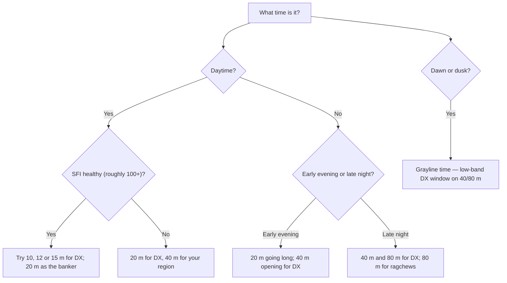

# HF

HF — high frequency, 3 to 30 MHz — is where amateur radio earns its oldest boast: talking to the world with no infrastructure between you and the other station except the Sun and the sky. The [previous chapter](outpost:entry/logbook73.handbook/propagation) explained the machinery; this one is a guided tour of the neighbourhoods. Each HF band has a personality as distinct as a person's — a time of day it wakes up, a season it loves, a crowd it attracts — and learning those personalities is how you stop asking "why can't I hear anything?" and start asking "who shall I work tonight?"

## How to read this tour

Amateurs name bands by approximate wavelength, not frequency — the 40 m band sits near 7 MHz because `λ = 300 / f(MHz)` gives 300 / 7 ≈ 43 m (the [Frequency & Wavelength](outpost:entry/logbook73.handbook/frequency-and-wavelength) chapter explains the 300 rule). Two practical notes before we set off:

- **Frequencies here are IARU Region 1** (Europe, Africa, the Middle East) — band edges differ elsewhere in the world.
- **Access depends on your licence.** Band access varies by licence class and country — entry-level licences in many countries include generous HF access at modest power — and the exact bands, segments and limits are the sort of detail that changes; always check your national band plan and licence terms rather than trusting a book, even this one. [Getting Licensed](outpost:entry/logbook73.handbook/getting-licensed) explains how the licence ladder works.

One more character note that runs through everything: the lower bands (80–40 m) need physically large [antennas](outpost:entry/logbook73.handbook/antennas) and carry more atmospheric [noise](outpost:entry/logbook73.handbook/noise); the higher bands (15–10 m) manage with small antennas and quiet backgrounds but depend on the Sun being in a good mood.

Before the tour, one picture worth keeping in mind — the whole HF-distance story in four panels: how a single signal bends continuously through the ionosphere, how one antenna launches many angles that return at many distances, how ground wave, sky wave and line-of-sight compare, and why signals arrive in hops that leave [skip zones](outpost:entry/logbook73.handbook/propagation) in between:

![Four views of HF propagation. Panel 1: a single HF signal bends by continuous refraction through the ionosphere, not a mirror reflection, and returns to Earth hundreds to thousands of kilometres away. Panel 2: an antenna radiates a fan of launch angles at once, each returning at a different distance. Panel 3: ground wave, line-of-sight space wave and skywave shown together with the skip zone between the radio horizon and the first skywave landing. Panel 4: single, double and triple hops explain why you can hear a station 2,000 km away but not one 300 km away sitting in a skip zone.](/handbook-figures/skip-zones.png 'The HF picture in four panels: continuous refraction (not a mirror bounce), a fan of launch angles reaching different distances, ground vs sky vs line-of-sight, and multi-hop paths that leave skip zones between the return points.')

## The low bands: 80, 60 and 40 m

### 80 m (3.5–3.8 MHz) — the local pub

80 m is the sound of amateur radio as a community: morning nets, club natter, old friends who have talked every day for thirty years. By day, D-layer absorption keeps signals within 50–100 km — which is precisely what makes it perfect for reliable regional chat. By night the absorber vanishes and the band stretches across a continent; on winter nights, when atmospheric static is low and darkness is long, serious operators dig transatlantic contacts out of the noise. Summer is harder work: thunderstorm static crashes across the continent make it the noisiest band in the book. The catch is size — a half-wave dipole for 80 m is about 40 m end to end, so this is the band that teaches creative antenna compromise.

### 60 m (5 MHz region) — the specialist shelf

An unusual band: in many countries it is not one continuous allocation but a set of small segments or channels shared with primary (often government) users, available on a non-interference basis, and access rules vary widely by country and licence class. It behaves like a bridge between 80 m and 40 m — excellent for near-vertical-incidence sky wave (NVIS), meaning dependable coverage out to a few hundred kilometres at times when 80 m is too noisy and 40 m has skipped over your target. File it under "worth exploring later" and check your national band plan carefully before transmitting.

### 40 m (7.0–7.2 MHz) — the reliable workhorse

If you could keep only one HF band, most operators would keep 40 m. By day it covers your own country and its neighbours; by night it opens to real DX — and unlike the high bands, it works even at the bottom of the solar cycle. It is busy at almost any hour, which cuts both ways: there is always someone to work, and in contests and evenings the band is elbow-to-elbow. Antennas are manageable (a dipole is about 20 m long), and the band rewards the [grayline](outpost:entry/logbook73.handbook/propagation) beautifully at dawn and dusk.

## The middle: 30 and 20 m

### 30 m (10.100–10.150 MHz) — the quiet craftsman's bench

The first of the three _WARC bands_ — slices of spectrum gained at the 1979 World Administrative Radio Conference. By long-standing gentlemen's agreement there is **no phone (voice) and no contesting** here: it is CW (Morse) and narrow data modes only, including a thriving [FT8](outpost:entry/logbook73.handbook/ft8) presence around 10.136 MHz. Propagation is a lovely hybrid — open somewhere nearly 24 hours a day, less solar-dependent than 20 m — and the calm, contest-free atmosphere makes it a favourite of unhurried operators.

### 20 m (14.000–14.350 MHz) — the king of DX

The most famous DX band in radio. The D layer barely touches it, the F2 layer loves it, and it is open through daylight nearly every day of every year, whatever the solar cycle is doing — at solar maximum it can stay open around the clock. Whenever a rare station appears anywhere on Earth, the pile-up forms on 20 m first. The price of royalty is crowds: during major contests, finding a clear frequency takes patience. For a beginner, 20 m during the day is the closest HF has to a guaranteed result.

## The high bands: 17, 15, 12 and 10 m

### 17 m (18.068–18.168 MHz) — 20 m without the crowds

A WARC band (so no contests) with propagation nearly identical to 20 m — daytime worldwide DX, closing in the evening. The atmosphere is noticeably gentler: fewer pile-ups, more conversations, more operators with time to work a newcomer patiently. Many amateurs quietly rate it the most pleasant band on HF.

### 15 m (21.000–21.450 MHz) — the sunshine band

Now the solar cycle starts to matter. When the Sun is active, 15 m is glorious: long, strong daylight paths to Africa, Asia and the Americas with modest power and simple antennas. At solar minimum it opens fitfully or not at all. A rough rule: if the SFI on LogBook73's Propagation page is comfortably above 100, give 15 m a look after breakfast.

### 12 m (24.890–24.990 MHz) — the connoisseur's 10 m

The third WARC band, a narrow strip that behaves like a slightly better-mannered 10 m. It shares 10 m's dependence on high solar flux and its summer sporadic-E surprises, with a fraction of the occupancy. When it is open, it is often astonishing; check it whenever 10 m is lively.

### 10 m (28.000–29.700 MHz) — the rollercoaster

The widest HF band by far — 1.7 MHz of room — and the moodiest. At solar maximum, 10 m is pure magic: worldwide contacts on a few watts and a wire, because signals arrive after fewer hops with less absorption than any other HF band. At solar minimum it can sit silent for months, save for summer **sporadic-E** openings that fling signals 1,000–2,000 km across a continent. Its antennas are delightfully small (a dipole is about 5 m), entry-level licensees in many countries enjoy access to it, and its top end even hosts FM simplex, FM repeaters and satellite downlinks — a little VHF culture embedded in HF. If you are reading this near a solar maximum: drop everything and get on 10 m.

## The bands at a glance

| Band | Frequency (MHz) | Character                                                            | Best times               | Solar-cycle dependence |
| ---- | --------------- | -------------------------------------------------------------------- | ------------------------ | ---------------------- |
| 80 m | 3.5–3.8         | Local nets and night-time regional chat; big antennas, summer static | Night, winter            | Low                    |
| 60 m | 5 MHz segments  | Channelised niche in many countries; dependable few-hundred-km NVIS  | Day and evening          | Low                    |
| 40 m | 7.0–7.2         | The all-rounder: regional by day, DX by night                        | Always; night for DX     | Low                    |
| 30 m | 10.100–10.150   | CW/data only, no contests; calm and steady                           | Most hours               | Modest                 |
| 20 m | 14.000–14.350   | The premier DX band; busy, dependable daylight worldwide             | Day, evening             | Modest                 |
| 17 m | 18.068–18.168   | 20 m propagation, relaxed WARC manners                               | Day                      | Moderate               |
| 15 m | 21.000–21.450   | Fine daylight DX when the Sun cooperates                             | Late morning–afternoon   | High                   |
| 12 m | 24.890–24.990   | Quiet, surprising; 10 m's polite sibling                             | Midday                   | High                   |
| 10 m | 28.000–29.700   | Boom or bust: worldwide on watts at solar max; summer Es             | Day at solar max; summer | Very high              |

(Edges vary by region — in the Americas, for example, 80 m runs to 4.0 MHz and 40 m to 7.3 MHz. Check your national band plan.)

## Band plan etiquette: who lives where

Within each band, activity is organised by a **band plan** — the IARU plan for your ITU region, published nationally by your society (the RSGB in the UK, the ARRL in the US, and so on); the Toolbox's band plan reference lays out each band's mode segments by ITU region. It is a voluntary agreement rather than law, but treating it as law is the mark of a good operator, because it is what lets a 100 Hz-wide Morse signal and a 2.7 kHz-wide voice signal share a band without trampling each other.

The pattern repeats on almost every band, ordered roughly by signal width:


- **CW at the bottom.** Morse occupies the lowest segment of every band. Even if you never learn it, keep voice out of its patch.
- **Data in the lower-middle.** Digital modes cluster at well-known spots — [FT8](outpost:entry/logbook73.handbook/ft8) on 14.074 or 7.074 MHz, for instance — and a data signal on a voice frequency (or vice versa) is the classic newcomer's foul.
- **Phone (SSB voice) in the upper portion.** By convention, HF voice uses **lower sideband (LSB) below 10 MHz and upper sideband (USB) above** — a historical accident everyone honours (see [Modulation](outpost:entry/logbook73.handbook/modulation)).
- **Mind the edges.** An SSB signal is about 2.7 kHz wide, and your dial shows the _carrier_ frequency, not the edge of the signal — on USB, transmit at least 3 kHz inside the top band edge.
- **Listen first, then ask.** Before calling, listen for long enough to be sure the frequency is genuinely clear — remember the [skip zone](outpost:entry/logbook73.handbook/propagation): you may not hear a QSO that both stations' neighbours hear perfectly. A quick "Is this frequency in use?" costs five seconds and much embarrassment.

On an SDR waterfall, this layout is something you can simply see — here is 40 m on a busy evening:

```viz
{
  "type": "waterfall",
  "title": "A busy 40 m evening, as an SDR waterfall shows it",
  "caption": "Crisp on–off CW dashes near the bottom edge of the band, the dense FT8 slot at 7.074 MHz, and wide SSB voice blocks filling the phone segment above.",
  "xLabel": "7.000 MHz → 7.200 MHz",
  "signals": [
    { "f": 3, "kind": "cw" },
    { "f": 6, "kind": "cw" },
    { "f": 10, "kind": "cw" },
    { "f": 37, "width": 3, "kind": "ft8" },
    { "f": 52, "width": 4, "kind": "ssb" },
    { "f": 61, "width": 4, "kind": "ssb" },
    { "f": 71, "width": 4, "kind": "ssb" },
    { "f": 82, "width": 4, "kind": "ssb" },
    { "f": 91, "width": 4, "kind": "ssb" }
  ]
}
```

## Choosing a band right now

All of this condenses into a simple habit: look at the clock, glance at the solar numbers, pick a band. Here is the decision most operators run in their heads:



It is a starting point, not a law — sporadic-E can light up 10 m on a summer evening at solar minimum, and a geomagnetic storm can flatten 20 m at noon. The bands reward the curious: the operators who find the freak openings are the ones who tuned "just to check". For contacts within a few hundred kilometres, [Reading the Ionosphere](outpost:entry/logbook73.handbook/reading-the-ionosphere) shows how to read the nearest ionosonde before choosing between 40 m and 80 m.

## Try it yourself

1. **Take the tour by ear.** With any HF receiver — a rig, a web SDR, or an RTL-SDR with an upconverter — visit 40 m and 20 m at three times in one day: mid-morning, teatime and late evening. Note what you hear on each. One day of this teaches the day/night rhythm better than any chart.
2. **Watch the bands on pskreporter.info.** Filter the reporting map by band and watch it through a day: 20 m's worldwide daytime spread, then the baton passing to 40 m after dark. During a summer lunchtime, check 10 m for a sudden splash of 1,500 km spots — that is sporadic-E happening live.
3. **Calibrate against beacons.** The NCDXF beacons (on LogBook73's Beacons page) transmit on 14.100, 18.110, 21.150, 24.930 and 28.200 MHz in rotation. Spend ten minutes checking which of the five you can hear, and from which continents — you have just measured today's MUF with your own ears.
4. **Find the band plan.** Download your national society's current band plan (from the RSGB, ARRL, DARC or your own society's site) and keep it within reach of the radio. Find where FT8, CW and SSB live on 40 m and 20 m. When you first transmit, knowing the map is what makes you sound like you have been here for years.

## Key takeaways

- Every HF band has a personality: **80 m** local and nocturnal, **40 m** the reliable all-rounder, **20 m** the daylight DX king, **15–10 m** brilliant but solar-dependent.
- The rhythm from the [Propagation](outpost:entry/logbook73.handbook/propagation) chapter applies band by band: **high bands by day, low bands by night**, grayline for the low-band magic.
- The three WARC bands — 30, 17 and 12 m — are contest-free and calmer, and 17 m is a wonderful place for a newcomer to be heard.
- The solar cycle decides how far "up" the useful spectrum reaches: at solar maximum add 15, 12 and 10 m to the menu; at minimum lean on 40, 30 and 20 m.
- Band plans put CW at the bottom, data in the middle, phone at the top — learn your current IARU regional plan and honour it, LSB below 10 MHz and USB above.
- Licence conditions change; check your regulator's and national society's current guidance for exactly what your licence permits on each band.

Above 30 MHz the ionospheric mirror fails, height replaces sunspots as the currency, and radio becomes a different — and very local — pleasure: welcome to [VHF](outpost:entry/logbook73.handbook/vhf).
