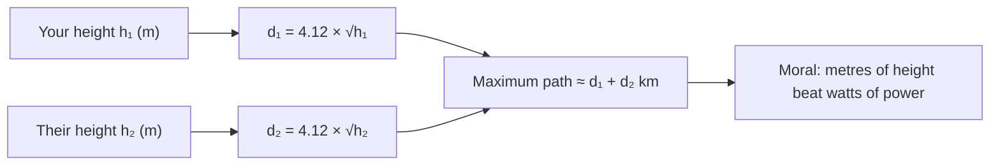

# VHF

Cross 30 MHz and the rules of the game change completely. VHF — very high frequency, 30 to 300 MHz — mostly ignores the ionospheric mirror that makes [HF](outpost:entry/logbook73.handbook/hf) magical, and in exchange offers something HF cannot: quiet, dependable, high-quality local communication, plus a wildcard streak of freak long-distance openings that VHF operators live for. This is the territory of your first handheld, your local repeater and the club net — and of the self-styled "magic band" where, a few summer lunchtimes a year, half a continent suddenly falls into your lap.

## Line of sight, and a little bit more

At VHF your signal normally punches straight through the ionosphere and off into space. What is left is the direct path — which is why VHF thinking starts not with sunspots but with a simple question: _how far can my antenna see?_

Slightly further than your eyes can, as it happens. The atmosphere gets thinner with height, which bends VHF signals gently downwards, stretching the radio horizon about a third beyond the visual one. The friendly formula:

`distance to radio horizon (km) ≈ 4.12 × √h`

where `h` is your antenna height in metres above the surrounding terrain. Let's put real numbers in:

- **Handheld at head height** (h = 2 m): 4.12 × √2 ≈ 4.12 × 1.41 ≈ **6 km**
- **Antenna on the chimney** (h = 10 m): 4.12 × √10 ≈ 4.12 × 3.16 ≈ **13 km**
- **Repeater on a 300 m hill**: 4.12 × √300 ≈ 4.12 × 17.3 ≈ **71 km**

And here is the part beginners miss: both ends count. The range between two stations is the _sum_ of their two horizons, because each only needs to reach the shared horizon point. Two chimney-height stations manage 13 + 13 = 26 km; your 2 m-high handheld talking to that hilltop repeater gets 6 + 71 = **77 km** — which is exactly why repeaters transform a 5 W handheld from a toy into a county-wide communicator ([Repeaters](outpost:entry/logbook73.handbook/repeaters) is devoted to them).

Notice the square root: doubling your power might buy you a whisker of range, but doubling your antenna height reliably buys about 40 % more horizon. On VHF, **height is the currency**. That is why VHF operators haunt hilltops, why a few metres of mast outperforms an amplifier, and why the terrain between you and the other station matters more than anything printed on your radio's box. In practice, diffraction over hills and reflections off buildings mean the formula is a guide rather than a wall — but as a mental model, "sum of the two horizons" will serve you for years.

This is the whole radio-horizon story on one page — the formula, worked examples by height, why smaller planets have closer horizons, and the modes that reach past the horizon when the atmosphere or ionosphere lends a hand:

 that reach beyond it.")

## The VHF bands at a glance

| Band | Frequencies (Region 1) | Character                                                                  |
| ---- | ---------------------- | -------------------------------------------------------------------------- |
| 6 m  | 50–52 MHz              | The "magic band": quiet local band that erupts with sporadic-E each summer |
| 4 m  | 70–70.5 MHz            | Allocated only in some countries (mostly Europe/Africa); quiet, friendly   |
| 2 m  | 144–146 MHz            | The centre of VHF life: FM, repeaters, SSB weak-signal work, satellites    |

(Edges vary by region: 6 m runs 50–54 MHz and 2 m 144–148 MHz in Regions 2/3, and 4 m does not exist in most of the world. Airband, marine and broadcast FM also live in the VHF range — worth knowing for listening, but the table above is the amateur territory. As ever, check your national band plan for the fine detail.)

## 6 m: the magic band

50 MHz sits on the fence between HF and VHF, and inherits the best gossip from both sides. Most of the year it behaves like a well-mannered VHF band: line of sight, low noise, local natter. Then — chiefly from late May to early August — **sporadic-E** arrives.

As the [Propagation](outpost:entry/logbook73.handbook/propagation) chapter described, sporadic-E is patchy, intense ionisation about 100 km up in the E layer, dense enough to reflect frequencies far above the normal MUF. When a cloud forms in the right place, 6 m opens across 1,000–2,000 km with astonishingly strong signals: whole countries booming in on a band that was silent an hour earlier — sometimes workable with a handful of watts and a simple dipole. Openings last minutes to hours and can vanish mid-sentence, which is precisely the drama that earns the nickname _magic band_. At the peak of the solar cycle, 6 m occasionally goes further still, with genuine F2-layer propagation bringing transatlantic and even trans-equatorial DX.

The practical habit: in June and July, check 6 m around late morning and early evening. Watch the FT8 sub-band (50.313 MHz) or the 6 m reports on pskreporter.info — sporadic-E announces itself there within seconds of appearing.

## 2 m: the centre of VHF life

2 m — 144–146 MHz in ITU Region 1, 144–148 MHz in Regions 2/3 — is where nearly every amateur spends time, and it is really three bands wearing one allocation.

### FM: the everyday band

The top half of 2 m is dominated by FM (see [Modulation](outpost:entry/logbook73.handbook/modulation)) — noise-free, easy, sociable. **145.500 MHz is the FM calling channel** in Region 1 (in North America, 146.520 MHz plays the same role): you call there, make contact, then move together to a free simplex channel (_simplex_ meaning both stations on one frequency, no repeater involved) to talk. FM channels are spaced 12.5 kHz apart. This is the natural habitat of the newly licensed amateur: club nets, chat on the drive home, and your first-ever contact.

### Repeaters: borrowed hilltops

Repeater outputs sit around 145.600–145.800 MHz, each machine listening 600 kHz lower and re-transmitting what it hears from its hilltop vantage point. They are the great equaliser for low-power stations, and they get their own chapter: [Repeaters](outpost:entry/logbook73.handbook/repeaters).

### The weak-signal end: SSB and CW

The bottom of the band, around **144.300 MHz for SSB**, is a different culture. Here operators use narrow modes, horizontal beam antennas and careful technique to work hundreds of kilometres _without_ any special propagation — and to pounce when tropo, meteor scatter or aurora appears. Beacons live near 144.400–144.490 MHz, and digital weak-signal modes like [FT8](outpost:entry/logbook73.handbook/ft8) (144.174 MHz) have made this end livelier than it has been in decades. If FM is the band's sitting room, this is its observatory.

(Simplified, and a Region 1 layout — your national band plan has the full detail, including the digital and all-mode segments, and in Regions 2/3 the band continues up to 148 MHz.)

The satellite segment at the top is worth a glance even now: 145.800 MHz is where you can hear astronauts on the ISS with nothing more than a handheld — see [Satellites](outpost:entry/logbook73.handbook/satellites) and the ISS chapter.

## Polarisation: which way up your waves are

An antenna launches its wave with an orientation — **vertical** (electric field up-and-down) or **horizontal** — and receiving with the wrong one on a direct VHF path can cost you around 20 dB, which is the difference between armchair copy and nothing at all ([Decibels](outpost:entry/logbook73.handbook/decibels) explains why 20 dB is so brutal: it is a hundredfold power loss).

Fortunately the conventions are firm:

- **FM and repeaters: vertical.** Handhelds and mobile whips are naturally vertical, so the whole FM world followed.
- **SSB/CW weak-signal work: horizontal.** Long Yagi beams mounted flat — slightly lower ground losses over long paths, and tradition since the 1950s.

So a keen 2 m operator often has two antennas: a vertical colinear for FM and repeaters, and a horizontal Yagi on a rotator for the weak-signal end. If you take nothing else from this section: match your polarisation to the activity, not the other way round. (On paths involving the ionosphere or scattering, polarisation gets scrambled anyway — this rule is for the normal direct paths.)

## Tropo: when the weather builds you a waveguide

VHF's most reliable "impossible" propagation comes not from the ionosphere but from the weather. Normally the atmosphere cools steadily with height. Under a settled **high-pressure system**, a layer of warm, dry air can sit on top of cooler, moister air — a _temperature inversion_. Radio-wise, that boundary bends VHF and UHF signals back downwards, and when the geometry is right the signal gets trapped between the inversion and the ground, guided along like light in an optical fibre. This is a **tropospheric duct**, and it can carry 2 m and [70 cm](outpost:entry/logbook73.handbook/uhf) signals 500, 800, sometimes over 1,500 km with modest power.

The signs are wonderfully low-tech: a big autumn anticyclone parked overhead, still misty mornings, fog in the valleys, and repeaters you have never heard before appearing on familiar channels — often the first clue anyone notices. Sea paths duct especially well: across the North Sea, along the Mediterranean, over the Gulf of Mexico, or down any long coastline. Unlike sporadic-E's minutes-long tantrums, a good tropo opening can last a day or more. When the weather map shows a fat, stationary HIGH, point the antenna along the sea path and listen.

## Meteors and aurora: the other wildcards

The remaining exotics from the [Propagation](outpost:entry/logbook73.handbook/propagation) tasting menu do their best work right here on 6 m and 2 m.

**Meteor scatter** turns cosmic dust into infrastructure. Each sand-grain meteor burning up around 100 km altitude leaves a column of ionisation that reflects VHF for anything from a tenth of a second to nearly a minute. Individually useless for a chat — but the digital mode `MSK144` (a cousin of [FT8](outpost:entry/logbook73.handbook/ft8)) transmits the same short message over and over in rapid bursts, and the software at each end stitches a complete contact together from whichever fragments happen to get through. Random meteors arrive all day every day (with a peak in the pre-dawn hours, when your side of the Earth faces into the oncoming dust), and during a major shower such as the Perseids in August or the Geminids in December, 1,000–2,000 km contacts on 6 m and 2 m become almost routine. There is something quietly wonderful about logging a contact carried by a shooting star.

**Aurora** is the geomagnetic storm's consolation prize. When the K index climbs past 5 or so, the same disturbance that flattens HF paths sets the auroral curtains glowing — and those curtains reflect VHF. Everyone turns their beams roughly north, regardless of where the other station actually is, and works each other off the aurora itself. Because the reflecting region is turbulent and moving at kilometres per second, signals come back Doppler-smeared: CW notes turn into a breathy hiss, SSB voices into a ghostly whisper — operators log it with a "tone A" report. It is the eeriest sound in amateur radio, and from mid-to-high latitudes a handful of auroral events a year are workable on 2 m with a modest horizontal beam.

Both modes live at the SSB/digital end of the band — one more reason that quiet bottom 300 kHz repays exploration.

## Try it yourself

1. **Do your own horizon audit.** Estimate your antenna's height above the surrounding terrain (be honest — it is height above average terrain that counts, not above your lawn). Apply `4.12 × √h` — or let the radio horizon calculator do the square roots. Then look up your nearest 2 m repeater in your national repeater directory (and add it to LogBook73's Repeaters page while you are there) and check the distance: with the repeater's hilltop horizon added to yours, does the maths say you should reach it?
2. **Listen to 145.500 MHz** on any scanner, handheld or SDR at commute time. Follow a contact as it moves off to a simplex channel. You are learning the local band culture for free.
3. **Set a summer sporadic-E trap.** In June or July, leave an SDR or rig monitoring 50.313 MHz (6 m FT8) over lunchtime, or keep the 6 m map on pskreporter.info open. The first time the waterfall fills with callsigns from 1,500 km away in the space of a minute, you will understand the nickname.
4. **Check the beacons after a still, misty morning.** During settled high pressure, tune the 2 m beacon segment (144.400–144.490 MHz) and try to hear beacons well beyond your normal range. Add the ones you find to LogBook73's Beacons page as your own entries and tap in an SNR each time — logged against the weather map, you are now doing tropospheric science with a ~$30/€30-class receiver.

## Key takeaways

- VHF is line-of-sight-plus: radio horizon ≈ `4.12 × √h(m)` km, and a path's reach is the **sum of both stations' horizons** — height beats power every time.
- VHF life centres on **2 m** (144–146 MHz in Region 1, 144–148 MHz in Regions 2/3): FM simplex calling on 145.500 in Region 1, repeaters near the top, and a horizontal-antenna SSB/CW weak-signal culture around 144.300.
- **6 m** (50–52 MHz in Region 1, 50–54 MHz elsewhere) is the magic band: sleepy and local until summer sporadic-E flings 1,000–2,000 km signals across a continent.
- Match **polarisation** to the activity: vertical for FM and repeaters, horizontal for SSB/CW — a mismatch can cost ~20 dB.
- **Tropo ducting** under high-pressure weather is VHF's dependable DX mode, especially over sea paths; distant repeaters appearing is the classic tell.
- The exotic modes — sporadic-E, tropo, meteors, aurora — are why VHF operators keep beams, band-watching habits and one eye on the weather.

One more step up the spectrum and the horizons shorten again, the antennas shrink to pocket size, and the repeater becomes king: next, [UHF](outpost:entry/logbook73.handbook/uhf).
