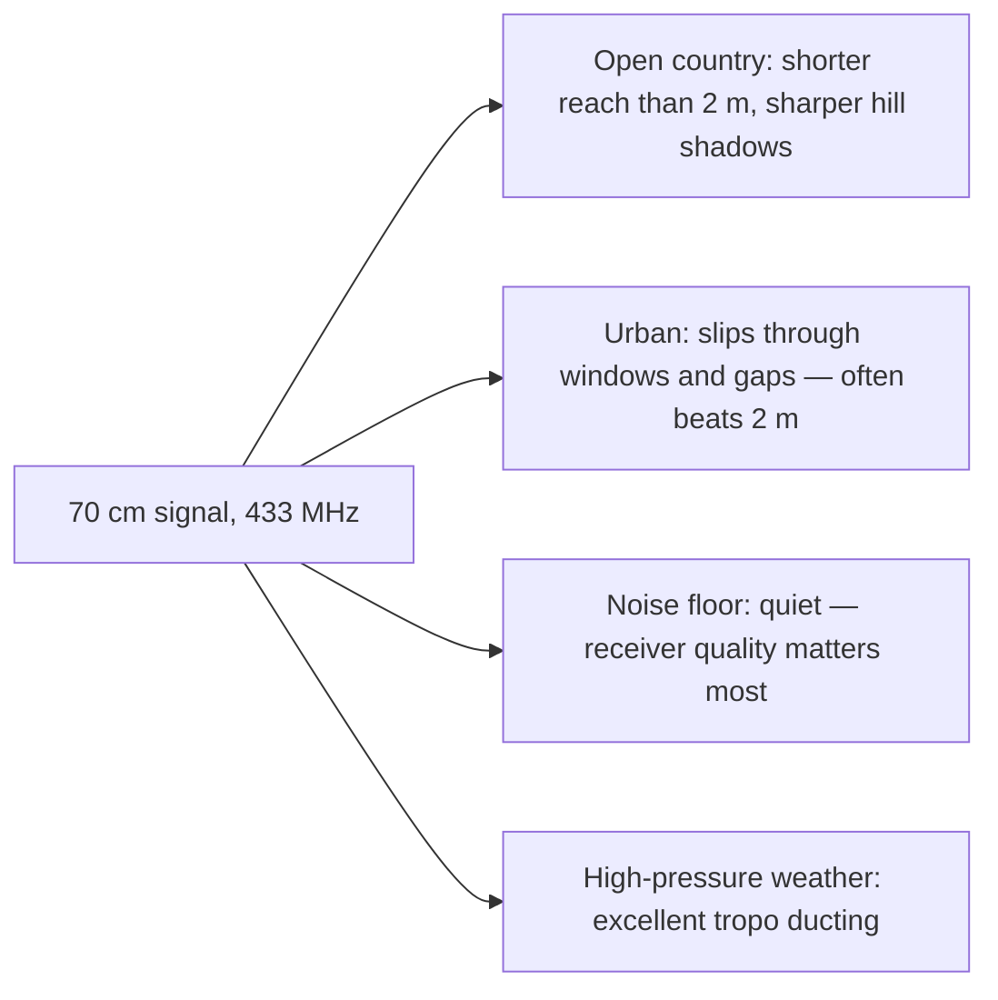
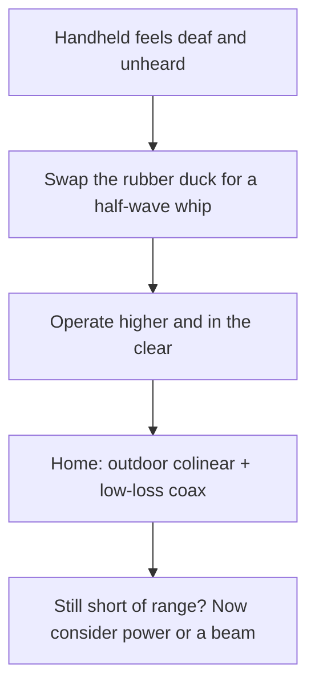

# UHF

UHF — ultra high frequency, 300 MHz to 3 GHz — is the most personal part of the amateur spectrum. It is the band range in your pocket: the handheld clipped to a rucksack strap, the repeater contact from a train platform, the satellite pass worked from a car park with a hand-held Yagi. The horizons are shorter than [VHF](outpost:entry/logbook73.handbook/vhf) and the ionosphere has long since stopped helping, but in exchange UHF offers tiny antennas, a beautifully quiet noise floor, and a knack for threading signals through the urban landscape that lower bands cannot match.

## 70 cm: UHF's home band

For most amateurs, UHF means first and foremost the **70 cm band** — 430–440 MHz in ITU Region 1, 420–450 MHz in the US. Even the narrower Region 1 allocation is a generous 10 MHz wide — five times the width of 2 m — and the band hosts the full menu: FM simplex (calling channel **433.500 MHz** in Region 1; 446.000 MHz in the US), a large population of repeaters, a weak-signal SSB/CW segment around **432.200 MHz**, digital voice, data links, amateur television and the uplinks and downlinks of dozens of satellites.

One thing to know from the start: in most countries amateurs are a _secondary_ user of 70 cm — in the UK the primary user is the Ministry of Defence; in the US, government radar. In practice this rarely affects everyday operating, but it shapes the band plan (some segments carry restrictions in certain areas), and it is a standing reminder to check your national band plan rather than assuming the whole band is a free-for-all.

A rough sketch of where things live (simplified, and a Region 1 layout — your national band plan is the authority):

| Segment (MHz)   | Main use                                                  |
| --------------- | --------------------------------------------------------- |
| 430.000–432.000 | Digital links, internet gateways, some repeater outputs   |
| 432.000–432.500 | CW and SSB weak-signal work — activity centre 432.200     |
| 432.500–433.000 | Beacons and narrowband modes                              |
| 433.000–433.400 | Repeater outputs (analogue and digital voice)             |
| 433.400–434.600 | FM simplex — calling 433.500 — plus digital voice simplex |
| 434.600–435.000 | Repeater inputs                                           |
| 435.000–438.000 | Amateur satellite segment                                 |
| 438.000–440.000 | Data, more digital links and repeater channels            |

A wavelength of 70 cm means a quarter-wave antenna is only about 17 cm long. Everything shrinks: a high-gain Yagi for 70 cm fits on a broom handle, and a respectable base-station colinear is shorter than you are. This miniaturisation is UHF's quiet superpower — gain that would need a garden on [HF](outpost:entry/logbook73.handbook/hf) fits on a chimney here (see [Antennas](outpost:entry/logbook73.handbook/antennas) for why more elements in less space means more gain).

## How UHF behaves: short horizons, sharp shadows, quiet skies

Propagation at 430 MHz is line-of-sight-plus, just like 2 m — the radio-horizon formula `d(km) ≈ 4.12 × √h(m)` from the [VHF](outpost:entry/logbook73.handbook/vhf) chapter applies unchanged — but three characterful differences emerge as the wavelength shrinks.

**Free-space loss is higher, and shadows are sharper.** For the same path and the same antennas, the path loss at 433 MHz is about 9.5 dB worse than at 145 MHz (path loss grows with frequency — see [Decibels](outpost:entry/logbook73.handbook/decibels) for what 9.5 dB costs you). Shorter waves also diffract less around hills, so terrain shadows are deeper: behind a ridge, 70 cm fades sooner than 2 m.

**But buildings are strangely permeable.** Here is the everyday paradox: in a city centre, 70 cm often _outperforms_ 2 m. A 70 cm wave is short enough to slip through window openings, stairwells and gaps in the concrete, and to reflect usefully off walls, filling streets with a mosaic of usable signal paths. It is precisely why professional handheld radios — police, security, PMR — congregate around UHF. Rule of thumb: open countryside favours 2 m, dense urban canyons favour 70 cm.

**The noise floor is blissfully low.** Man-made electrical [noise](outpost:entry/logbook73.handbook/noise) — switch-mode supplies, LED lighting, broadband-over-mains — plagues HF and still bothers VHF, but falls away steeply with frequency. At 430 MHz the background is quiet enough that receiver quality, not local racket, usually sets what you can hear. Weak-signal work rewards a good low-noise design (and short, good-quality feedline — more in a moment).

And the pleasant surprise: **tropospheric ducting works even better at UHF than VHF.** The same high-pressure inversions described in the [VHF](outpost:entry/logbook73.handbook/vhf) chapter guide 430 MHz signals very efficiently, and big autumn tropo openings regularly carry 70 cm hundreds of kilometres over sea paths. Distant repeaters appearing on normally quiet channels is the classic giveaway.

## The handheld: your first radio, and its honest limits

For most newcomers, UHF arrives as a dual-band (2 m / 70 cm) FM handheld — and often a remarkably cheap one. It is a genuinely good first radio: it gets you listening, working repeaters and joining nets for the price of a family takeaway or three.

But be clear-eyed about what a handheld is: typically 5 W into the least effective antenna in amateur radio. The stock **"rubber duck"** is a helically wound quarter-wave compromise, deliberately shortened for convenience, radiating from roughly head height — remember, `4.12 × √2 ≈ 6 km` of horizon — with your own body absorbing a good share of the signal. When a handheld disappoints, the wattage is almost never the problem.

So the classic first-upgrade advice, in strict order of value for money:

1. **A better antenna.** A decent flexible half-wave whip transforms a handheld for a modest price — often worth 6 dB or more over the stock duck, which is like quadrupling your transmit power.
2. **Height and position.** Step outside, get clear of the building, find the top of the hill. Free, and worth more than any accessory.
3. **An outside antenna for home.** A small dual-band colinear at chimney height, fed with _good_ coax, turns the same handheld into a genuine base station. At 433 MHz feedline loss is serious: thin RG-58 loses roughly 0.5 dB per metre, so 15 m of it swallows about 7.5 dB — over 80 % of your power — before the antenna sees a thing. Spend on the fat, low-loss stuff; the [Transmission Lines](outpost:entry/logbook73.handbook/transmission-lines) chapter has the numbers.
4. **Only then** think about more transmit power.

A short, non-alarmist safety note: a handheld's antenna sits centimetres from your head, which is exactly why licence conditions keep handheld power modest. The sensible habits are easy — hold the radio so the antenna is upright and slightly away from your face, use a speaker-mic if you transmit a lot, and follow the RF-exposure guidance in your licence terms. At 5 W these are precautions, not perils; the [RF Power](outpost:entry/logbook73.handbook/rf-power) chapter covers exposure more fully.

## Repeaters and digital voice: where the activity lives

Day to day, most 70 cm activity flows through **repeaters** — hilltop relays that receive your 5 W and re-transmit it from a commanding height. 70 cm repeaters listen a fixed distance from where they transmit, using an offset that is a national convention (+1.6 MHz in the UK, +5 MHz in the US, −7.6 MHz in much of Europe), and your radio handles the shift automatically once set up. The full story — offsets, CTCSS access tones, etiquette, how to find machines near you and keep your own list on LogBook73's Repeaters page — is in the [Repeaters](outpost:entry/logbook73.handbook/repeaters) chapter.

The other thing you will quickly meet on 70 cm is **digital voice**: DMR, D-STAR and System Fusion, which encode speech as data and can link repeaters worldwide over the internet. A growing share of UHF repeaters are digital or dual-mode. If you scan across the band and hear rhythmic buzzing rather than voices, that is what it is. The systems, their codecs and their hotspots are a chapter of their own: [Digital Voice](outpost:entry/logbook73.handbook/digital-voice).

## Look up: satellites live here

Some of the most exciting signals on 70 cm come from orbit. Most amateur satellites use a **VHF/UHF pair** — uplink on one band, downlink on the other — because these frequencies pass cleanly through the ionosphere (the very property that makes them useless for HF-style sky wave makes them perfect for space). A whole fleet of small satellites, plus the ISS, can be worked with a dual-band handheld and a small hand-held Yagi from a garden. If that sounds implausible, the [Satellites](outpost:entry/logbook73.handbook/satellites) chapter will happily prove otherwise.

## 23 cm, briefly

The next amateur band up, **23 cm (in the region of 1240–1300 MHz; exact edges vary by country)**, marks the doorway to the microwave world. It offers enormous bandwidth — enough for amateur television — a narrowband activity centre at 1296 MHz, and even quieter skies, but off-the-shelf radios are scarce, feedline losses climb again, and activity is thinner: mostly enthusiasts with transverters and dish or Yagi antennas, plus some satellite uplinks. Treat it as a signpost: if 70 cm leaves you curious about what happens as wavelengths keep shrinking, the [Microwave](outpost:entry/logbook73.handbook/microwave) chapter is your next stop.

## PMR446 and FRS: the licence-free cousins

Just above the amateur band in Europe sits **PMR446** (446.0–446.2 MHz): sixteen FM channels, 500 mW, fixed antennas, no licence needed. These are the little radios sold in blister packs for hiking and skiing — in the Americas the equivalent service is **FRS**, on channels around 462/467 MHz. They are _not_ amateur radio — you must not use amateur gear on licence-free frequencies, nor licence-free sets on amateur ones — but they are a genuinely useful spectrum-cousin: family walks, event marshalling, a taste of UHF behaviour for someone not yet licensed. Many amateurs keep a pair in the glovebox. And if a friend's licence-free radio reaches about a kilometre in town while your 5 W handheld through the local repeater reaches the whole county, the pair of them neatly demonstrates everything this chapter has said about power, height and infrastructure.

## Try it yourself

1. **Map your local 70 cm repeaters.** Using your national repeater directory, find machines within, say, 50 km and add them to LogBook73's Repeaters page. Note each one's output frequency and its listed CTCSS tone, then just _listen_ for a few evenings — no licence needed to receive. Compare which ones are workable from indoors versus the garden.
2. **Run the urban experiment.** With a dual-band handheld or scanner (or an RTL-SDR — 433 MHz is comfortably within a ~$30/€30-class dongle's range, see [Software Defined Radio](outpost:entry/logbook73.handbook/software-defined-radio)), monitor the same repeater on 2 m and a repeater on 70 cm from deep inside a building, then from outside. Which band survives the walls better where you live?
3. **Hear the licence-free world.** Tune 446.00625–446.19375 MHz (PMR446, in Europe) or the FRS channels around 462 MHz (Americas) on a Saturday afternoon near a park or shopping street. Those are licence-free users — half a watt each, and a useful calibration of what UHF does at ground level.
4. **Catch a satellite.** Look up the next good ISS or amateur-satellite pass and listen on the published 70 cm or 2 m downlink with a handheld held aloft. Details and step-by-step guidance are in [Satellites](outpost:entry/logbook73.handbook/satellites) — but the listening itself needs nothing you don't already have.

## Key takeaways

- UHF life centres on **70 cm** (430–440 MHz in Region 1, 420–450 MHz in the US): FM calling on 433.500 MHz in Region 1, a weak-signal end near 432.200 MHz, dense repeater and digital-voice activity — and amateurs are usually secondary users, so honour your national band plan.
- UHF propagation is line of sight with character: **sharper terrain shadows** but **better building penetration** than 2 m, a **low noise floor**, and superb tropo ducting under high pressure.
- A handheld's weak point is its antenna, not its power: upgrade the **antenna first**, then height, then feedline — thin coax at 433 MHz can eat most of your signal.
- Repeaters carry most day-to-day UHF activity; digital voice (DMR, D-STAR, Fusion) is widespread and has its [own chapter](outpost:entry/logbook73.handbook/digital-voice).
- **Satellites** favour VHF/UHF pairs because these signals pass cleanly through the ionosphere — a handheld and small Yagi genuinely reach orbit.
- **23 cm** is the gateway to microwave territory, and **PMR446** (Europe) and **FRS** (Americas) are the licence-free cousins nearby.

Keep shrinking the wavelength and radio turns into something closer to optics — dishes, waveguides and rain that scatters signals like fog scatters headlights: onward to [Microwave](outpost:entry/logbook73.handbook/microwave).
