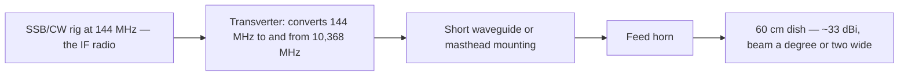
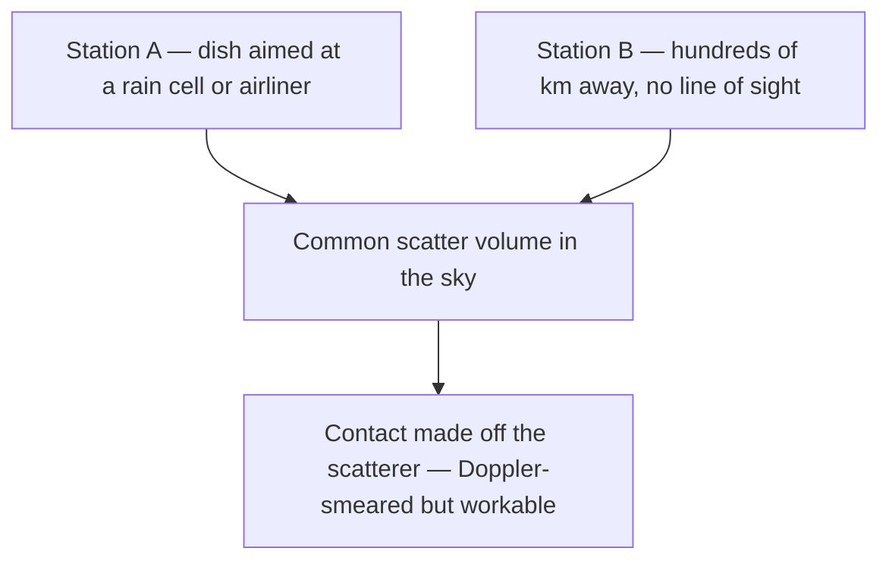

# Microwave

Above 3 GHz, amateur radio stops looking like radio and starts looking like optics. Antennas become dishes, feeder cable becomes the enemy, and signals behave like beams of light — casting shadows, bouncing off rain showers and glinting off passing aircraft. It is the least crowded, most experimental corner of the hobby, where a contact across a county can feel like a triumph and yet, thanks to one friendly geostationary satellite, a beginner inside its footprint can also talk across half the planet. You do not need any of this to get on the air — but knowing what lives up here rounds out your map of the spectrum, and for a certain kind of tinkerer it becomes the whole hobby.

## What actually changes above 3 GHz

Nothing magical happens at 3 GHz — the physics is continuous — but several trends that started at [UHF](outpost:entry/logbook73.handbook/uhf) reach their logical conclusions.

**Every metre of coax hurts.** Cable loss rises steeply with frequency. Thin RG-58 that loses about 0.5 dB per metre at 433 MHz loses several dB per metre at 10 GHz — meaning a mere 3 m patch lead can swallow well over 90 % of your power before the antenna sees it (revisit [Decibels](outpost:entry/logbook73.handbook/decibels) and [Transmission Lines](outpost:entry/logbook73.handbook/transmission-lines) for why a handful of dB is so expensive). Microwavers respond in two ways: they use **waveguide** — hollow rectangular metal pipe that carries microwaves with almost no loss, no centre conductor required — and, more importantly, they _move the radio to the antenna_. The standard microwave station puts the transmit/receive electronics in a weatherproof box at the dish, with only low-frequency signals and power travelling down the mast.

**Antennas become dishes — and gain comes almost free.** An antenna's gain depends on its size _in wavelengths_, and at 10 GHz the wavelength is just 3 cm. A very portable 60 cm dish — 20 wavelengths across — delivers roughly 33 dBi of gain, equivalent to multiplying your power two-thousandfold. The same trick that needs a football-pitch antenna on [HF](outpost:entry/logbook73.handbook/hf) fits on a camera tripod here. The price is a beam only a degree or two wide: microwave operating means _aiming_, with compass bearings, maps and sometimes a talkback channel on 2 m to coordinate ("I'm pointing 285°, can you hear me yet?") — the QRB calculator turns two Maidenhead locators into the exact heading.

**Precision replaces brute force.** Frequencies must be accurate (a synthesiser drifting 50 parts per million is 500 kHz adrift at 10 GHz — see [Oscillators](outpost:entry/logbook73.handbook/oscillators)), signals are narrow, and the receiving station's low-noise design matters more than the transmitter's wattage. Milliwatts genuinely work when both stations are competent.

## The amateur microwave bands

Amateurs hold a remarkable ladder of allocations stretching from centimetre waves to the edge of light. Exact availability and conditions vary by country (several bands are shared, secondary or by special permission — check your regulator's and national society's current information), but the landscape looks like this:

| Band        | Frequency                 | Flavour                                                                                |
| ----------- | ------------------------- | -------------------------------------------------------------------------------------- |
| 9 cm        | ~3.4 GHz                  | Shared spectrum, restricted in many countries; niche but active on contest days        |
| 6 cm        | ~5.7 GHz                  | Long-haul tropo and rain scatter; drone video links live nearby                        |
| 3 cm        | ~10 GHz                   | **The centre of amateur microwave life** — biggest community, best gear supply         |
| 1.2 cm      | ~24 GHz                   | Serious enthusiast territory; atmospheric water vapour starts to bite                  |
| 6 mm and up | 47, 76, 122, 134, 241 GHz | Record-chasing frontier; oxygen and rain absorb aggressively; contacts are expeditions |

Two things to notice. First, activity concentrates: **10 GHz is where the community lives**, so start there. Second, as frequency climbs, the atmosphere itself becomes an absorber — water vapour and oxygen soak up millimetre waves — which is why the top bands are worked from mountaintops on clear, dry days, and why a 100 km contact at 241 GHz is genuinely record-book material.

## Delightful oddities: rain scatter and aircraft scatter

Microwave propagation is mostly ruthless line of sight, plus the same tropospheric ducting you met at [VHF](outpost:entry/logbook73.handbook/vhf) — sea-path ducts at 10 GHz have carried signals well over 1,000 km. But two modes exist up here that lower bands can only dream of.

**Rain scatter.** At 10 GHz, raindrops are a decent fraction of a wavelength and scatter signals the way fog scatters headlights. A heavy shower or cumulonimbus cell becomes a giant, slowly drifting reflector in the sky: two stations hundreds of kilometres apart — with no line of sight whatsoever — both point their dishes _at the storm_ and work each other off the rain. Signals arrive with a characteristic whooshing, hissy quality (the drops are all moving), so operators often switch from SSB to CW or FT8-style modes to cope. Microwavers are the only radio amateurs who check the rainfall radar and smile.

**Aircraft scatter.** An airliner at 11,000 m has a radio horizon of about `4.12 × √11000 ≈ 430 km` — so a large aluminium tube crossing the midpoint of a 600–800 km path briefly bridges two stations that could never hear each other directly. The reflection lasts tens of seconds and carries a slow Doppler slide as the aircraft moves. Modern operators plan contacts around flight-tracking websites, timing their transmissions for when a scheduled A380 crosses the path. It is half radio, half plane-spotting, and entirely charming.

## The 10 GHz community

Microwave amateurs are few, but they are organised, generous and unusually good engineers — typically gathered in national microwave groups (the UK Microwave Group, for example, or the microwave circles within your national society). The rhythm of the scene: monthly activity days and contests that put stations on hilltops (essential, when everyone is line-of-sight limited); a culture of homebrew and surplus conversion — many 10 GHz stations began life as satellite-TV components or decommissioned telecom link hardware; and beacons scattered around the country so you can verify your receiver works before the harder job of finding another human — your national microwave group's beacon list will show you what is listening-distance from you. Do not be surprised when a microwaver's proudest contact is 150 km — over a path that physics said needed a mountain removed.

## Spectrum awareness: you already own microwave gear

Here is the pleasant surprise: you use these frequencies every day. **Wi-Fi** operates at 2.4 and 5 GHz — and the 2.4 GHz Wi-Fi band overlaps the amateur 13 cm allocation, which is why that band is noisy and why amateurs there use narrow modes to slide beneath the racket. **Bluetooth** and microwave ovens sit at 2.4 GHz too (the oven is why your Wi-Fi stutters when reheating soup). **GPS** whispers down from orbit near 1.2 and 1.6 GHz at power levels below the noise floor, recovered only by clever signal processing. Satellite TV arrives at 10–12 GHz — the same neighbourhood as the amateur 3 cm band, which is exactly why cheap satellite-TV low-noise blocks (LNBs) make superb amateur receivers. Radar, radio astronomy and 5G fill the gaps. The microwave spectrum is the most valuable real estate in radio, and amateurs hold slivers of it on sufferance and good behaviour: know where your allocation ends, because the neighbours are services worth billions.

## Realistic ways in

You cannot walk into a shop and buy a 10 GHz transceiver the way you buy a 2 m handheld. The genuine on-ramps, in rising order of commitment:

**Just listen — nearly free.** An RTL-SDR dongle (see [Software Defined Radio](outpost:entry/logbook73.handbook/software-defined-radio)) with a ~$20/€20-class satellite-TV LNB pointed at the sky receives 10 GHz signals today: the LNB converts them down to frequencies the dongle understands. Many people's first microwave reception is a 10 GHz beacon — or QO-100 — heard this way.

**QO-100: the friendly on-ramp.** Since 2019, amateurs across a vast footprint — Europe, Africa, the Middle East and much of Asia — have had a geostationary satellite: **QO-100 (Es'hail-2)**, parked at 25.9° East. Uplink at 2.4 GHz, downlink at 10.489 GHz, footprint from Brazil to Thailand — and because it is geostationary, it never moves. No tracking, no waiting for passes: point a small dish once (the same 60–80 cm dish sold for satellite TV), and you have an always-on microwave path to a third of the planet. A receive setup is an LNB and an SDR; adding a modest 2.4 GHz uplink completes a full station for roughly the price of a mid-range HF transceiver. It is the single most beginner-friendly project in amateur microwave, and the [Satellites](outpost:entry/logbook73.handbook/satellites) chapter covers the satellite-operating side of it.

**Transverters: your VHF rig grows up.** The classic terrestrial route: a **transverter** converts a band you already own — usually a 144 MHz SSB/CW rig acting as the _IF_ (intermediate frequency) radio — up to 10 GHz on transmit and back down on receive, as in the block diagram above. Kits and ready-built modules exist from small specialist suppliers, and second-hand gear circulates at rallies. Add a feed horn, a dish and patience.

A short safety note before you build: a dish concentrates power into a narrow beam, so even a few watts at the feed can exceed RF-exposure limits directly in front of it. The habit is simple — never look down a live feed horn or stand in front of a transmitting dish, keep beams above head height where people walk, and follow the RF-exposure assessment guidance in your licence terms. Received signals, of course, carry no risk at all: listen as much as you like.

**Adopt the community first.** Honestly the best starter path: join a microwave activity day as a passenger. Microwavers love recruits, portable stations always need a hand carrying dishes up hills, and one afternoon watching a contact made over a "impossible" path teaches more than a month of reading.

## Try it yourself

1. **Survey your house at microwave.** List every microwave device you own — Wi-Fi router (2.4/5 GHz), Bluetooth, GPS, car radar sensors, satellite dish, the oven. You already operate more microwave links than HF ones; now you know where they sit on the dial.
2. **Hear 10 GHz for pennies.** Salvage or buy a satellite-TV LNB, power it through a bias-tee, and connect it to an RTL-SDR. Tune around 739 MHz (the LNB's downconversion of 10,489 MHz) and, with the LNB aimed along a clear sky path toward 25.9° East (you need to be within QO-100's Europe/Africa/Middle East/Asia footprint), look for QO-100's beacon on the waterfall. A geostationary amateur transponder, received with scrap TV parts, is a genuinely thrilling first microwave signal.
3. **Check the beacons.** Find your national microwave group's beacon list and look for anything above 1 GHz within 100 km or so — then add any you can hear to LogBook73's Beacons page as your own entries, so you can log an SNR each time you check. Beacons are exactly how real microwavers verify their receivers, and knowing one exists nearby makes the whole band feel less abstract.
4. **Watch a rain-scatter day happen.** Next time heavy showers cross the country during a microwave activity weekend, watch the 10 GHz activity on a DX cluster website and match the reported paths against the rainfall radar. The correlation is unmistakable — and delightful.

## Key takeaways

- Above 3 GHz, radio behaves like light: dish antennas with enormous gain, pencil beams that must be aimed, and line-of-sight paths plus exotic scatter.
- **Feed losses dominate** — coax becomes hopeless, so microwavers use waveguide and mount the electronics at the antenna.
- The amateur bands run from 3.4 GHz to beyond 241 GHz; **10 GHz (3 cm)** hosts the main community, activity days and beacon network.
- **Rain scatter** and **aircraft scatter** turn storms and airliners into reflectors — beyond-horizon contacts by pointing at weather or aeroplanes.
- Wi-Fi, Bluetooth, GPS and satellite TV share this spectrum: amateur allocations are slivers among giants, so know your band edges — and exploit the cheap hardware spill-over (LNBs!).
- Realistic starter paths: LNB + SDR listening, the geostationary **QO-100** satellite as the friendly full-station on-ramp, and 144 MHz-IF **transverters** for terrestrial work.

Back down to earth — literally, to a box on a hilltop that gives your 5 W handheld a 70 km horizon: next, [Repeaters](outpost:entry/logbook73.handbook/repeaters).
