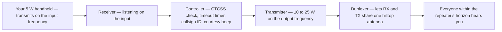
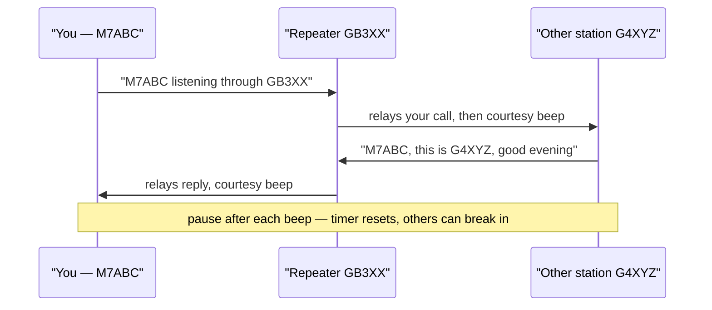
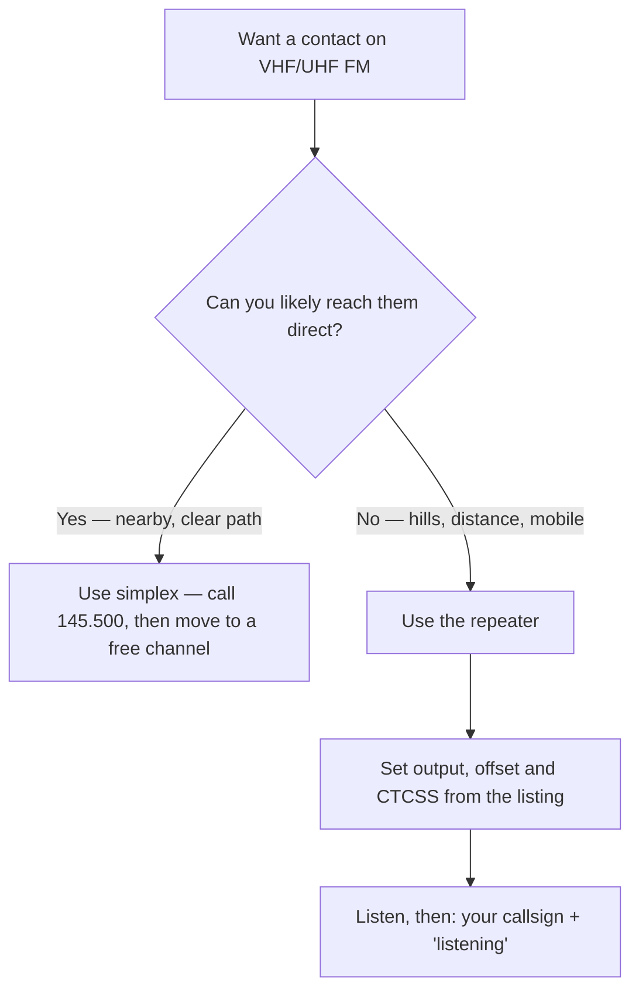

# Repeaters

A 5 W handheld at head height has a radio horizon of about 6 km — respectable for calling across town, hopeless for talking across a county. But somewhere near you, on a hilltop or a tall building, sits a box that has been listening patiently for decades: hear it once, and your little radio suddenly covers everything _it_ can see, which might be 70 km in every direction. Repeaters are amateur radio's shared infrastructure — built, paid for and maintained by volunteers — and for many newly licensed amateurs, a repeater carries their very first contact. This chapter explains how the box works, how to open it, and how to sound like you belong on it.

## What a repeater actually does

A repeater is beautifully single-minded: it **receives on one frequency and simultaneously re-transmits what it hears on another**, from the best location its keepers could find. Your signal only has to make the one hop up to the hilltop; the repeater's transmitter — higher, better-antenna'd and often more powerful than yours — does the hard work of covering the region.

The frequency it listens on is the **input**; the frequency it transmits on is the **output**. You listen to the output, and when you press the transmit button your radio automatically shifts to the input. Because a repeater must receive and transmit _at the same time_ from the same mast, it needs its two frequencies decently separated, plus a remarkable piece of plumbing called a **duplexer** — a set of high-Q cavity [filters](outpost:entry/logbook73.handbook/filters) that stops the repeater's own transmitter (perhaps 25 W, metres away) from deafening its own receiver listening for your microwatts. It is one of the harder filtering jobs in radio, quietly solved on every repeater site.

Around that core sits a **controller** — the machine's small brain. It decides when to switch the transmitter on (signal received, correct access tone present), identifies the repeater periodically by sending its callsign in voice or Morse (a legal requirement — that beeping you hear _is_ its name), enforces a **timeout timer** that cuts off anyone who talks too long, and sends the famous courtesy beep — the short "pip" after each transmission that means "the other station has finished; the timeout timer has reset; you may speak."



## Offsets: the automatic frequency hop

The gap between input and output is the **offset** (or _shift_), and by convention it is standardised per band — but the convention is set country by country, so radios can apply it automatically once they know where they are. The common patterns:

| Band  | Typical offset (your TX relative to output)                                                     |
| ----- | ----------------------------------------------------------------------------------------------- |
| 2 m   | **±600 kHz** nearly everywhere (−600 kHz in the UK and much of Region 1)                        |
| 70 cm | Varies by country: **+1.6 MHz** in the UK, **±5 MHz** in the US, **−7.6 MHz** in much of Europe |
| 10 m  | −100 kHz                                                                                        |

Worked example, using the UK conventions: your local 2 m repeater's output is `145.700 MHz`. You listen there; when you transmit, your radio hops to `145.700 − 0.600 = 145.100 MHz` — the repeater's input — and hops back the instant you release the button. On 70 cm, a UK repeater with output `433.150 MHz` listens on `433.150 + 1.6 = 434.750 MHz`.

These are conventions, not laws of physics — some machines (particularly digital voice and newer allocations) use different splits. So treat the table as the _usual_ pattern and **always check your repeater's individual listing** for its exact input, output and tone: your local repeater listing is the truth. Modern radios store all three in a memory channel, and most set the offset automatically when you dial an output frequency in a recognised repeater segment.

In some countries (the UK among them) you will also see repeaters referred to by **channel designators** — RV48, RB15, RU70 and so on — which are shorthand for standard frequency pairs. Useful to recognise, never essential to memorise.

## CTCSS: the polite knock on the door

Squelch on a repeater cannot simply open for _any_ signal on the input — distant repeaters share frequencies, and lightning, noise or a repeater a duct away (remember [tropo](outpost:entry/logbook73.handbook/vhf)) would key the transmitter constantly. So nearly all analogue repeaters require **CTCSS**: Continuous Tone Coded Squelch System.

CTCSS is a quiet, continuous low-frequency tone — one of a standard set of 39 between 67 and 254.1 Hz (the full list is in the CTCSS reference), below the range the receiver passes to the loudspeaker — that your radio adds underneath your voice. The repeater's controller listens for its _specific_ tone, and only opens up when it hears it: a sub-audible password, or better, a polite knock. Each repeater's listing states its tone (for example `71.9 Hz` or `103.5 Hz`; in many countries tones follow a regional pattern so that repeaters sharing a channel respond only to their own neighbourhood). Set the tone in your radio's memory channel along with the offset, and you never think about it again.

```viz
{
  "type": "wave",
  "title": "CTCSS: a slow tone hiding underneath your voice",
  "caption": "Stylised (the real tone is far quieter): the repeater's squelch listens only for its slow sub-audible tone — the dashed line riding beneath the voice — while receivers filter it out, so listeners never hear it.",
  "xLabel": "time →",
  "traces": [
    { "kind": "beat", "freq": 25, "mod": 3, "label": "transmitted audio", "tone": "primary" },
    { "kind": "sine", "freq": 3, "amp": 0.5, "style": "dashed", "tone": "success", "label": "CTCSS tone alone" }
  ]
}
```

Two practical notes. First, if you can hear a repeater clearly but it utterly ignores you, a missing or wrong CTCSS tone is the most common cause — check the listing before blaming your antenna. Second, you can usually also set your radio to _require_ the tone on receive (often shown as "CTCSS" or "TSQL" rather than just "Tone" or "CTCSS TX"), which keeps your speaker quiet unless the genuine repeater is transmitting — handy on shared channels during tropo openings. Some older or specialist machines instead need a short 1750 Hz _toneburst_ at the start of a transmission — increasingly rare, but the option is still on most radios' menus.

## Etiquette: sounding like you belong

Repeater culture has its own manners, evolved for good engineering reasons. None of them are difficult, and using them marks you instantly as someone who has done their homework.

**Listen first.** A minute of listening tells you whether the machine is busy, what the local style is, and whether a net is running.

**To announce yourself, just say you are listening.** No "CQ" on repeaters — that is an [HF](outpost:entry/logbook73.handbook/hf) habit. The idiom is your callsign plus "listening": `"M7ABC listening through GB3XX"`. Anyone fancying a chat will come back to you. Silence does not mean failure; it means nobody was free — try again later.

**Pause before you reply — and between overs.** When the other station releases, _wait for the courtesy beep, then a beat more_, before pressing your button. This does two things: it lets the timeout timer reset (reply too fast on some machines and the timer keeps counting, eventually cutting you off mid-sentence), and it leaves a gap for another station to join, or for someone with urgent traffic to say "break". Machine-gun handovers with zero gaps lock everyone else out.

**Keep overs short.** The timeout timer (commonly somewhere between one and three minutes) will truncate a monologue without mercy, and long overs are hard on a shared resource. Say your piece, hand it back.

**Identify clearly and legally.** Give your callsign at the start, at sensible intervals, and at the end of the contact, per your licence conditions. On a repeater everyone within 70 km can hear you — clarity is kindness.

**Don't kerchunk.** Keying the repeater without speaking — just to see the S-meter twitch — is called _kerchunking_, and it is the hobby's most gently mocked sin. If you want to test, do it properly: `"M7ABC testing access"`, then listen for the tail.

**Remember it is a party line.** Repeaters are monitored by many ears, including newcomers deciding whether this hobby is friendly. Be the reason they stay.



## Finding repeaters — and choosing simplex when you can

**Finding machines near you** is easy. Most countries have a national repeater directory — the RSGB's ETCC list in the UK, RepeaterBook across North America and much of the world — with each machine's output, input, tone, location and status. And inside this app, LogBook73's **Repeaters page** is where you keep your own copy of the essentials: add the machines that matter to you — near home, work or a holiday cottage — and it puts them on a map and lays out the details you need to programme your radio's memory channels. Programming ten local machines into memories (frequency, offset, tone, sensible name) is a classic first-evening job with a new radio — and repeaters also carry a bonus for the unlicensed: listening to your local machine is legal, free, and the best possible way to absorb operating style before your licence arrives.

**But know when _not_ to use one.** A repeater is a shared, donated resource, and the courteous habit is: **if simplex works, use simplex** — call on the FM calling channel (145.500 MHz in Region 1), then move off to a free simplex channel. If the other station is across town, you do not need the hilltop. A repeater earns its keep when terrain blocks the direct path, when one station is mobile or portable and coverage is patchy, or when you want the wide-area company of whoever is around.



## Beyond the hilltop: linked repeaters and digital voice

Two developments have stretched what "repeater" means.

**Internet linking.** Systems such as **EchoLink** and **AllStarLink** connect analogue repeaters (and home stations) to each other over the internet. Key up your local machine, send the right codes, and your voice emerges from a repeater in Auckland or Vancouver; a laptop or phone app can join the same network from a hotel room. Purists note — fairly — that the intercontinental leg is broadband rather than radio wizardry, but as a way for a new licensee with a handheld to speak to the world, it is hard to beat, and it keeps repeaters lively.

**Digital voice repeaters.** A large and growing share of repeaters — especially on [70 cm](outpost:entry/logbook73.handbook/uhf) — carry DMR, D-STAR or System Fusion instead of (or alongside) analogue FM. The hilltop box works on exactly the principles in this chapter: input, output, offset, identification. What changes is what travels over the channel — voice encoded as data, plus talkgroups, reflectors and worldwide routing that make internet linking a native feature rather than a bolt-on. If you scan past a repeater output and hear rhythmic buzzing instead of speech, you have found one. The systems, their differences and how to get started are the subject of the [Digital Voice](outpost:entry/logbook73.handbook/digital-voice) chapter.

## Try it yourself

1. **Map your local machines.** Using your national repeater directory, find every 2 m and 70 cm repeater within about 50 km and add them to LogBook73's Repeaters page. For each, note output, input (apply your country's standard offset yourself as a check — then verify against the listing), and CTCSS tone.
2. **Listen for a week.** With any receiver that covers 145.6–145.8 MHz — a handheld, scanner or RTL-SDR — park on your busiest local repeater around commute time. Hear the courtesy beep, the pauses, the periodic callsign ID in Morse or voice, the "listening" calls. This is a masterclass in operating style, free, licence not required.
3. **Verify the plumbing.** During a quiet spell, tune your receiver to the repeater's _input_ frequency while someone is talking through it. If they are close to you, you will hear them directly on the input — and simultaneously, relayed on the output. You have just watched the whole block diagram happen in real time.
4. **Licensed already? Do a textbook first contact.** Programme the machine (output, offset, tone), listen for a full minute, then: your callsign, "listening through" the repeater's callsign. Pause after every courtesy beep. Keep your overs under a minute. Somewhere, a repeater keeper is nodding approvingly.

## Key takeaways

- A repeater **receives on its input and simultaneously re-transmits on its output** from a high site — your signal only has to reach the hilltop.
- Typical offsets: **±600 kHz on 2 m** nearly everywhere; on 70 cm the convention varies by country (**+1.6 MHz** UK, **±5 MHz** US, **−7.6 MHz** much of Europe) — always check the individual repeater's listing.
- Most machines require a **CTCSS sub-audible tone** to open; a wrong or missing tone is the usual reason a repeater ignores you.
- The controller runs the courtesies: **callsign ID, timeout timer, courtesy beep** — pause after the beep so the timer resets and others can break in.
- Etiquette in one line: listen first, say "_callsign_ listening", pause between overs, keep them short, identify properly, never kerchunk.
- Find machines via your national repeater directory (ETCC in the UK, RepeaterBook in North America and beyond), keep your own list mapped on **LogBook73's Repeaters page** — and if simplex would work, leave the repeater free.
- EchoLink/AllStar link analogue machines over the internet; digital voice repeaters take that further — see [Digital Voice](outpost:entry/logbook73.handbook/digital-voice).

You now know how the infrastructure works; the next chapter steps back to the people and the culture that built it — [Amateur Radio](outpost:entry/logbook73.handbook/amateur-radio) itself, and the anatomy of a proper QSO.
