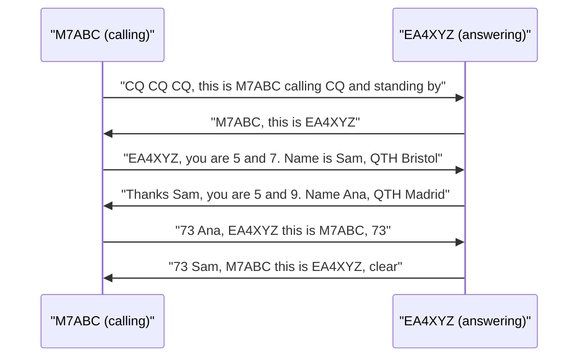
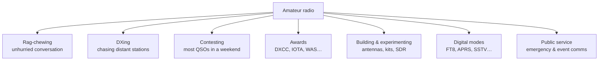
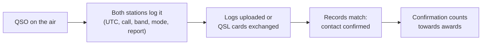

# Amateur Radio

Everything in this handbook so far has been about _how_ radio works. This chapter is about _who_ — the worldwide community of licensed experimenters who have been putting these ideas into practice for over a century, and how you join them. Amateur radio is where waterfalls, antennas and propagation stop being theory and become Tuesday evening: a voice from Slovenia answering your call, a five-watt signal logged in Japan, a friend on the local [repeater](outpost:entry/logbook73.handbook/repeaters) asking how the new dipole is getting on.

## A service, not just a hobby

"Amateur" is one of the most misunderstood words in radio. It does not mean unskilled — it means _unpaid_, in the original sense of doing something for the love of it. Formally, the amateur service is defined in international radio regulations as a service of **self-training, intercommunication and technical investigation** carried out by licensed people with a personal, non-commercial interest in radio. That definition matters, because it is why governments set aside slices of valuable spectrum — the amateur bands — for private individuals to use free of charge.

Three ideas sit at the heart of it:

- **Experimentation.** Amateurs are allowed to build, modify and test their own transmitters — a freedom almost no other radio user has. Many technologies you now take for granted, from early SSB voice to modern weak-signal digital modes like [FT8](outpost:entry/logbook73.handbook/ft8), were pioneered or matured on the amateur bands.
- **Self-training.** The licence system (covered in the next chapter, [Getting Licensed](outpost:entry/logbook73.handbook/getting-licensed)) is built as a ladder: you learn, you demonstrate what you know, you gain privileges, and the learning never really stops.
- **Emergency capability.** When mains power, mobile networks and the internet fail, a battery, a radio and a wire in a tree still work. Amateur operators have provided communications in floods, earthquakes and storms worldwide; in many countries, volunteer groups train specifically to support emergency services and community events.

None of this means the hobby is solemn. Most of what happens on the bands is people enjoying themselves. But the "service" framing explains the culture you will meet: a strong tradition of operating skill, of helping newcomers, and of self-policing the bands so they stay useful for everyone.

## Callsigns: your name on the air

Every licensed amateur is issued a **callsign** — a short, globally unique string of letters and numbers that identifies you on the air. `M7ABC`, `2E0XYZ`, `G4AAA`, `W1AW`, `JA1XYZ`: each one encodes a country (the prefix — `M` and `G` are UK, `W` is USA, `JA` is Japan) and an individual (the suffix). You must identify with your callsign when you transmit, and in practice your callsign becomes your on-air name. Amateurs who have held the same call for forty years are known by it the way you are known by your first name.

Callsigns are also the key that makes logging work. Because every callsign is unique and its country is encoded in the prefix, a logbook full of callsigns is automatically a map of everywhere you have reached — which is exactly how awards and the tools in LogBook73 work, as we will see shortly.

Until you have a licence you do not have a callsign, but many listeners adopt an informal **SWL identifier** (SWL = shortwave listener), and listening needs no licence at all — more on that at the end of this chapter.

## The QSO: radio's unit of conversation

A contact between two stations is called a **QSO** (pronounced "cue-ess-oh"). The name comes from the _Q-code_, a set of three-letter abbreviations inherited from the days of Morse telegraphy, when saving keystrokes mattered. Many Q-codes are still everyday vocabulary, even on voice (the Q-codes reference decodes the full set):

| Q-code | Meaning in modern use                              |
| ------ | -------------------------------------------------- |
| `QSO`  | A contact between two stations                     |
| `QTH`  | Location ("my QTH is Leeds")                       |
| `QRM`  | Interference from other signals                    |
| `QRN`  | Interference from natural noise (static)           |
| `QSB`  | Fading — signal strength rising and falling        |
| `QRP`  | Low-power operation (typically 5 W or less)        |
| `QSL`  | Confirmation of contact ("QSL?" = "did you copy?") |
| `QRZ?` | "Who is calling me?"                               |

Alongside the Q-codes sits a small dictionary of number codes from old telegraph practice. The one you will hear constantly is **73**, meaning "best regards" — the standard friendly sign-off. (It is already plural, so purists wince at "73s"; either way, everyone understands the warmth.)

### Anatomy of a first contact

A basic QSO has a simple, almost ritual shape. One station calls **CQ** — a general "calling anyone" invitation. Another answers. They exchange the minimum that makes it a valid contact — callsigns and signal reports — usually pad it out with names, locations and equipment, then sign off with 73. Here is the whole dance:

That is genuinely all there is to it. Your first QSO will feel like a driving test — script memorised, heart thumping — and your twentieth will feel like saying hello to a neighbour. (When you are ready to key up for real, [Making Contacts](outpost:entry/logbook73.handbook/making-contacts) is the full phrase-book: exactly what to say, how to call and answer CQ, repeater manners and the digital equivalents.) The exchange can stretch into an hour-long chat or compress into four seconds in a contest, but the skeleton (call, answer, report, sign-off) never changes.

### Spelling things out: the phonetic alphabet

On a noisy channel, "B", "D", "E" and "P" all sound alike. So amateurs spell callsigns and names using the international (NATO) phonetic alphabet, where every letter is a distinct word. `M7ABC` becomes "Mike Seven Alfa Bravo Charlie" — unmistakable even through static. Learn it early; fluency here marks you as a competent operator faster than anything else.

| Letter | Word    | Letter | Word     | Letter | Word    |
| ------ | ------- | ------ | -------- | ------ | ------- |
| A      | Alfa    | J      | Juliett  | S      | Sierra  |
| B      | Bravo   | K      | Kilo     | T      | Tango   |
| C      | Charlie | L      | Lima     | U      | Uniform |
| D      | Delta   | M      | Mike     | V      | Victor  |
| E      | Echo    | N      | November | W      | Whiskey |
| F      | Foxtrot | O      | Oscar    | X      | X-ray   |
| G      | Golf    | P      | Papa     | Y      | Yankee  |
| H      | Hotel   | Q      | Quebec   | Z      | Zulu    |
| I      | India   | R      | Romeo    |        |         |

You will hear informal variants ("Germany" for G, "Portugal" for P) from operators around the world — fine to understand, but stick to the standard set when you transmit.

## Signal reports: the RST system

Nearly every QSO includes a **signal report** — a compact statement of how well you are receiving the other station. The traditional format is **RST**: Readability, Strength, Tone.

- **R — Readability, 1 to 5.** How much of the content you can actually copy. 5 = perfectly readable, 3 = readable with considerable difficulty, 1 = unreadable.
- **S — Strength, 1 to 9.** How strong the signal is, nominally matching the S-meter on your receiver. 9 = extremely strong, 5 = fairly good, 1 = barely perceptible. Very strong signals get reports like "9 plus 20 dB" — see [Decibels](outpost:entry/logbook73.handbook/decibels) for what that means.
- **T — Tone, 1 to 9.** Used only for Morse (CW) and describes the purity of the note; 9 is a clean tone. Voice contacts drop it, which is why you hear two-digit reports like "five and nine" (`59`).

So `59` means "perfectly readable and extremely strong", and `33` means "I can just about copy you and you are weak". An honest `47` is far more useful to the other station than a reflexive `59` — though be warned, in contests everyone exchanges `59` regardless, because the report is a formality and speed is everything. Digital modes use a different currency: [FT8](outpost:entry/logbook73.handbook/ft8) exchanges signal-to-noise ratios in dB, such as `-15`. LogBook73's Console has fields for both sent and received reports (`RST sent` / `RST rcvd`) — filling them honestly builds a genuinely useful record of your station's performance.

## Many hobbies in one

Ask ten amateurs what the hobby _is_ and you will get ten answers, because amateur radio is really a bundle of pursuits sharing spectrum and a licence. The main flavours:

- **Rag-chewing** is the unhurried conversation: two or more stations chatting about antennas, the weather, life. Much of it happens on local [VHF](outpost:entry/logbook73.handbook/vhf) repeaters and on the lower [HF](outpost:entry/logbook73.handbook/hf) bands in the evenings. It is the social heart of the hobby.
- **DXing** is the pursuit of distance. "DX" is old telegraph shorthand for _distant station_, and DXers chase contacts with far-off countries — especially rare ones. When a temporary **DXpedition** activates some uninhabited island, thousands of stations will queue in a roaring **pile-up** for a four-second contact. It is equal parts propagation science and big-game fishing.
- **Contesting** turns operating into sport: scheduled weekends where the goal is the most contacts with the most places in 24 or 48 hours. Exchanges are stripped to callsign, report and a serial number or zone. Even if contests are not your thing, a contest weekend is a superb time to fill your log, because thousands of loud, motivated stations are begging to work you — LogBook73's Events page shows what is coming up.
- **Award-chasing** gives long-term structure. The most famous is **DXCC** (DX Century Club): confirm contacts with 100 distinct countries — "entities", in the award's careful language. Others include **WAS** (Worked All States), **IOTA** (Islands on the Air) and countless national and club awards. LogBook73's Awards page tracks your progress automatically from your log, which is one of the quiet pleasures of keeping it tidy.
- **Building and experimenting** ranges from soldering a kit to designing [antennas](outpost:entry/logbook73.handbook/antennas) to writing SDR software — the original point of the service, and still thriving.
- **Public service** covers emergency-communication groups and providing radio cover for marathons, fell races and community events.

You do not have to choose. Most amateurs drift between flavours over the years, and the licence covers all of them.

One hard-won truth binds all of it, and DXing especially: **hearing a station does not mean they can hear you.** Radio paths are often not reciprocal — the ionosphere, terrain, power and antennas can all favour one direction over the other — so you can copy a big station across the world while your own signal never makes it back. The cure is not to give up but to call anyway, try a different band or time, and be patient:

## Logging: the hobby's memory

Amateurs have kept logbooks since the very beginning — once a legal requirement, and in many countries now simply universal good practice (check your own licence conditions). A log records the who, when, where and how of every contact: date and time in UTC, callsign, frequency, mode, reports exchanged. Why bother?

- **It is your evidence.** Awards like DXCC require _confirmed_ contacts, and a confirmation starts with matching log entries on both sides.
- **It is your station's diary.** Six months of honest logs tell you which antenna outperforms which, what time the 20 m band opens to North America, and whether that new noise source is killing your weekends. This is [Propagation](outpost:entry/logbook73.handbook/propagation) study with your own data.
- **It answers QSL requests.** If someone queries a contact from three years ago, the log settles it.
- **It is oddly pleasurable.** A log is a diary of moments — first DX, first contact on a home-made antenna, the night the aurora opened 6 m.

Confirmation has its own culture. The traditional **QSL card** is a postcard bearing your callsign and the contact details, exchanged directly or through national **QSL bureaux** — and a shoebox of cards from a hundred countries remains one of the hobby's great physical artefacts. These days most confirmations travel electronically through matching services run by national societies and clubs, with logs exchanged in the standard **ADIF** file format. LogBook73 speaks ADIF, so your log can flow to and from these services and other software without retyping.

The habit to build from day one: **log at the moment of contact, in UTC**. Amateur radio runs on Coordinated Universal Time so that a QSO appears identically in both logs regardless of time zones; LogBook73's Console timestamps entries for you.

## Clubs, societies and finding your people

Amateur radio is easier and more fun with company. A local **radio club** gives you people to ask daft questions of (everyone's questions were daft once), equipment to try before buying, antennas you could never fit at home, and usually training courses for the licence exams. Clubs run special-event stations, contest teams, construction evenings and talks; many will let you operate under supervision before you hold a licence, which is the single best way to discover whether the hobby grips you.

Nationally, nearly every country has an amateur radio society, all federated worldwide through the **International Amateur Radio Union (IARU)**, which represents the hobby at the international level. The pattern is the same everywhere: the society speaks for amateurs to the national regulator, supports training and exams, runs the QSL bureau, publishes a magazine and maintains a club directory. Examples: the **RSGB** in the UK (founded 1913, [rsgb.org](https://rsgb.org)), the **ARRL** in the United States, the **DARC** in Germany, the **JARL** in Japan. You do not need to join anything to get licensed, but a club shortcut-keys almost every early obstacle, from "which radio should I buy?" (ask before spending!) to "why won't my SWR come down?".

## Start now: listening needs no licence

Here is the part many newcomers miss: **you can join in today, without a licence, by listening**. Shortwave listening — **SWLing** — is a venerable branch of the hobby in its own right, with its own awards and clubs. Every skill that makes a good operator (tuning accurately, reading a waterfall, judging propagation, copying callsigns through noise, keeping a tidy log) is a _listening_ skill, and you can build all of them before your licence ever arrives.

A cheap RTL-SDR dongle (see [Software Defined Radio](outpost:entry/logbook73.handbook/software-defined-radio)) or a WebSDR in your browser puts the amateur bands in front of you tonight. And this is exactly what LogBook73's **Receive Log** is for: a full logbook for stations you have _heard_, with the same fields — callsign, frequency, mode, report — that you will use for contacts later. Some amateurs treat a well-kept SWL log with real respect; many operators will even send QSL cards to listeners who report hearing them.

## Try it yourself

1. Open a WebSDR or your own SDR and tune to the 40 m band (`7.0–7.2 MHz`) in the evening, or 20 m (`14.0–14.35 MHz`) during the day. Find an SSB voice QSO — try around `7.1` or `14.2` MHz — and just listen. Identify the parts you now know: the callsigns, the phonetic spelling, the report, the 73.
2. Copy one complete callsign through the noise and log it in LogBook73's **Receive Log**, with frequency, mode, time and your own honest RST report of how they sounded to you. That entry is your first act of amateur radio.
3. Say your own name and postcode aloud in phonetics, then spell `CQ DX` the same way. Do it until it stops feeling silly — on the air, it never is.
4. Open the **Awards** page in LogBook73 and look at what DXCC progress tracking will look like once your log starts filling. Consider it a preview of coming attractions.
5. Find your nearest club in your national society's club directory (RSGB, ARRL, DARC, JARL…) and note when they meet. Turning up is free, and "I'm thinking about getting licensed" is a sentence every club loves to hear.

## Key takeaways

- Amateur radio is a licensed, non-commercial _service_ for self-training, experimentation and emergency capability — which is why amateurs get free spectrum and the rare right to build their own transmitters.
- Your callsign is your globally unique on-air identity; its prefix encodes your country, and it is the key that makes logging and awards work.
- A QSO has a simple ritual shape — CQ, answer, exchange of callsigns and reports, 73 — decorated with Q-codes, phonetics and the RST report system.
- The hobby is many hobbies: rag-chewing, DXing, contesting, awards like DXCC, building, digital modes and public service, all under one licence.
- Log every contact at the time it happens, in UTC, honestly — your log is your evidence for awards, your station's diary, and eventually a treasured record.
- You can start today without a licence: SWLing with LogBook73's Receive Log builds every operating skill except pressing the transmit button.

The one thing listening cannot give you is your own callsign — so let's fix that: [Getting Licensed](outpost:entry/logbook73.handbook/getting-licensed) is closer than you think.
