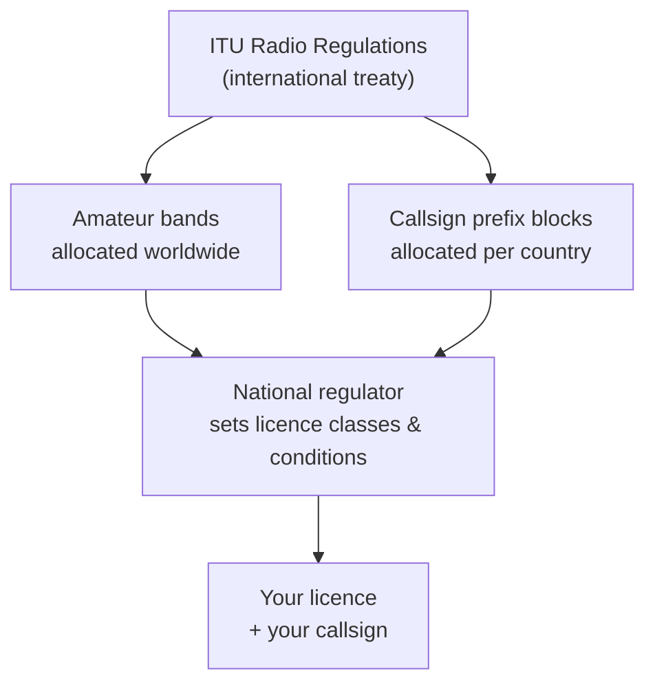
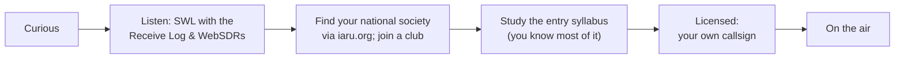

# Getting Licensed

In the [last chapter](outpost:entry/logbook73.handbook/amateur-radio) you met the hobby; this one hands you the door key. Wherever you live, there is a legal path from "interested listener" to "on the air with your own callsign", and it is far shorter and friendlier than most newcomers expect. This chapter explains why licences exist at all, what one actually gives you, how the near-universal ladder of licence classes works, and — most practically — what your first step looks like from wherever you are reading this.

## Why radio is licensed at all

The radio spectrum is one of the strangest resources humans share. It is invisible, it ignores borders completely, and every user of a frequency is a potential source of interference to every other user of that frequency within range — which, on [HF](outpost:entry/logbook73.handbook/hf), can mean the other side of the planet. A shortwave transmitter in one country is heard in dozens of others whether they like it or not. No fence works.

So the world manages spectrum by treaty. The **International Telecommunication Union (ITU)** — a United Nations agency, and one of the oldest international organisations in existence — coordinates who may use which frequencies for what, worldwide. Its Radio Regulations divide the spectrum among _services_: broadcasting, aviation, maritime, satellites, and, written in alongside them, the **amateur service** — spectrum set aside internationally for self-training, technical experimentation and person-to-person communication by licensed individuals, explicitly _not_ for commercial gain. Every amateur band you have met in this handbook exists because of that treaty.

Each country's **national regulator** (Ofcom in the UK, the FCC in the US, the BNetzA in Germany, the ACMA in Australia — every country has one) turns the international framework into national rules, and issues licences to individuals. The licence is the regulator's way of saying: _this person has shown they understand enough to share the spectrum without harming other users_. That is the entire logic. An amateur licence is not a tax or a gatekeeping ritual; it is the mechanism that lets millions of independent experimenters run transmitters — devices that can genuinely interfere with aviation, emergency services and each other — on trust, worldwide, with remarkably little trouble.

It is also why the amateur bands feel different from, say, unlicensed Wi-Fi channels. Everyone transmitting there has passed the same kind of assessment, identifies openly with a callsign, and has agreed to the same broad rules. The licence is what makes the band a community rather than a free-for-all.

## What a licence changes

Everything in this handbook so far, you can do as a listener. So what does the licence actually add?

- **You may transmit.** Listening teaches you enormously, but the moment you key a transmitter you go from watching the conversation to being in it — calling CQ, answering a weak station, joining a net, sending your first [FT8](outpost:entry/logbook73.handbook/ft8) frame.
- **You get a callsign.** A unique identifier, issued to _you_, recognised worldwide. It becomes your name on the air, your logbook's anchor, and — for many amateurs — a small piece of identity they keep for life.
- **You may build and experiment.** The amateur service is legally an experimental service. Depending on your licence class and country, you may design, build, modify and repair transmitting equipment — a freedom almost no other radio service grants to individuals.
- **You join the two-way hobby.** Contests, awards like DXCC, satellite operation, [repeaters](outpost:entry/logbook73.handbook/repeaters), emergency communication exercises — nearly all of it assumes you can transmit.

One reassurance worth stating plainly: in most countries the entry-level licence is a _real_ licence, not a learner's permit. You operate your own station, unsupervised, from day one, with enough power and enough bands to work other continents — especially on the digital modes, where modest power goes a very long way.

## The ladder: entry, intermediate, full

Details vary country by country, but the _shape_ of amateur licensing is remarkably consistent worldwide: a ladder of two or three classes, where each rung asks for more technical knowledge and gives back more privileges — typically higher transmit power, more bands or band segments, and sometimes extra freedoms such as running a repeater or supervising others.

Here is the same ladder as it appears in four countries, purely as examples — your country's version will rhyme with these even if the names differ:

| Country   | Entry level | Middle level | Highest level |
| --------- | ----------- | ------------ | ------------- |
| UK        | Foundation  | Intermediate | Full          |
| US        | Technician  | General      | Amateur Extra |
| Germany   | Class N     | Class E      | Class A       |
| Australia | Foundation  | Standard     | Advanced      |

A few honest generalisations about how these ladders behave, in almost every country:

- **The entry class is designed to be reachable** by a motivated beginner in weeks, not years. It checks safe, legal, competent operating — not engineering mastery.
- **The rungs are cumulative but optional.** You can climb when and if you want; plenty of amateurs stay happily at the entry level for years, because entry-level privileges are genuinely enough to enjoy the whole hobby.
- **Power and privileges grow as you climb.** Entry classes typically allow enough power to work the world on a decent [antenna](outpost:entry/logbook73.handbook/antennas); the highest classes allow much more, plus full access to every amateur allocation.
- **The trend is toward more generous entry levels.** Many countries have modernised their frameworks in recent years, and the direction of travel has consistently been _more_ freedom, sooner.

Exactly which bands, powers and conditions attach to each class is precisely the kind of detail that differs by country and drifts over time — so take it from your national society and regulator, never from a book (this one included). What will not drift is the concept: a short first climb, then optional higher rungs.

## What you will study

Entry-level syllabuses worldwide cover strikingly similar ground, because the underlying question is the same everywhere: _can this person operate safely and legally?_ Conceptually, expect four strands:

- **Basic radio theory.** Frequency and wavelength, volts, amps, watts and ohms, what [modulation](outpost:entry/logbook73.handbook/modulation) is, simple block diagrams of a [transmitter](outpost:entry/logbook73.handbook/transmitters) and [receiver](outpost:entry/logbook73.handbook/receivers), why [SWR](outpost:entry/logbook73.handbook/swr) matters, and a cartoon-level picture of [propagation](outpost:entry/logbook73.handbook/propagation).
- **Regulations.** What your licence permits, how to identify with your callsign, band plans, and who may use your station. This is the one strand that is genuinely national — and it is a finite list that just has to be learned.
- **Operating practice.** Calling CQ, the phonetic alphabet, Q-codes, band-plan etiquette — essentially the previous chapter of this handbook.
- **Safety.** Mains electricity, antennas near power lines, working at height, and RF exposure. Respect for mains voltage and for ladders is, frankly, the most important content in any syllabus on Earth.

Here is the encouraging truth: **this handbook already covers most of the theory.** If you have read the Foundations chapters plus antennas and propagation, the technical questions in an entry-level syllabus will feel familiar to the point of comfort. What remains new is your country's regulations — and every national society provides current study material for exactly that.

## Callsigns: your name on the air

Callsigns are one of the loveliest pieces of international machinery in the hobby, and they work because of the same ITU framework that creates the bands. The ITU allocates blocks of callsign **prefixes** to each country, so the first letter or two of any callsign tells you, anywhere in the world, which country issued it. A typical amateur callsign is _prefix + digit + suffix_: the prefix and digit identify the country (and sometimes a region or licence class within it), and the suffix letters identify the individual.

A few example prefix blocks, to give the flavour:

| Prefix block             | Country        |
| ------------------------ | -------------- |
| `G`, `M`, `2`            | United Kingdom |
| `W`, `K`, `N`, `AA`–`AL` | United States  |
| `DA`–`DR`                | Germany        |
| `VK`                     | Australia      |
| `JA`–`JS`                | Japan          |
| `VE`, `VA`               | Canada         |
| `F`                      | France         |
| `PY`, `PP`               | Brazil         |
| `ZS`                     | South Africa   |

This is why tuning across a band with LogBook73's **Receive Log** open is such good training: every callsign you copy is a small geography lesson. Hear `JA1ABC` on 20 m and you have just detected Japan with a wire and a receiver. Some countries also encode the licence class or the operator's region in the prefix or digit, which is why experienced operators can often tell roughly _who_ is behind a signal before a word is exchanged.

When your licence is issued, you will usually have some choice of suffix. Choose something you can say comfortably in phonetics — you will be saying it a great deal.

## Getting started: find your national society

The single most useful move a would-be amateur can make is to find their **national amateur radio society**. Nearly every country has one, and nearly all of them are members of the **International Amateur Radio Union (IARU)** — the worldwide federation that represents amateurs at the ITU. The IARU's website, [iaru.org](https://www.iaru.org), lists every member society, so wherever you live, that is your reliable starting point.

Examples you will hear named often: the **RSGB** in the UK, the **ARRL** in the US, the **DARC** in Germany, the **WIA** in Australia — but these are examples, not defaults; yours is on the IARU list. National societies typically provide the entry-level study material, explain the current path to a licence in your country, and — crucially — connect you to **local clubs**.

Do not underestimate the club. Contacting a local amateur radio club is, anecdotally and repeatedly, the strongest predictor of a beginner actually getting licensed. Clubs run courses, lend equipment, help raise first antennas, and greet new callsigns on the local repeater. Radio is a solitary-_looking_ hobby that is actually deeply social.

Online communities fill the gaps between club nights: forums, national society groups, mode-specific communities (the FT8 and Meshtastic worlds are particularly welcoming), and video channels that walk through everything from antenna building to first contacts. Listen widely; the culture of the hobby is generous with beginners.

### The journey, honestly sized

Most people travel this whole path in a few months of gentle effort, and the listening stage is not a queue you wait in — it is where a large part of the learning happens. Students who listen daily walk into their assessment having personally witnessed the things the syllabus describes.

## What you can do today, without a licence

You do not have to wait for anything to start being a radio person tonight:

- **Shortwave listening (SWL).** Listening requires no licence in most of the world. Open LogBook73's **Receive Log**, tune a receiver or a WebSDR, and start logging what you hear. SWLing is a complete hobby in its own right, with its own awards and a proud history — many of the best operators on the air spent years as listeners first.
- **WebSDRs.** Internet-connected receivers around the world let you listen to any band from any country through a browser, free. You can compare how 40 m sounds from Europe, North America and Asia in a single evening.
- **Licence-free bands.** Most regions set aside short-range voice allocations that anyone may use with approved equipment — PMR446 in much of Europe, FRS in North America, and similar services elsewhere. Low power and fixed antennas, but real, legal transmitting practice.
- **Meshtastic and LoRa.** The licence-free ISM allocations (868 MHz in Region 1, 915 MHz in Regions 2/3, among others) host a thriving experimental scene — see [LoRa & Meshtastic](outpost:entry/logbook73.handbook/lora-and-meshtastic). Building a mesh node teaches antennas, propagation and protocol thinking, all before any licence.

None of this is a consolation prize. It is the traditional first half of the hobby, and it makes the second half better.

## Crossing borders

One pleasant consequence of the international framework: many countries recognise each other's amateur licences, through arrangements such as the CEPT agreement in and around Europe and various bilateral reciprocal agreements elsewhere. In practice this often means a licensed amateur can operate while travelling, using their home callsign with a host-country prefix. The details — which agreement applies, which licence classes qualify, what conditions attach — vary by country pair, so the rule of thumb is short and friendly: _many countries recognise each other's licences; check with your national society before you travel._ For now, file it away as one more reason the licence is worth having: it travels better than almost any other qualification you own.

## Try it yourself

1. Visit [iaru.org](https://www.iaru.org) and find your country's member society. Open its website and locate the "getting licensed" or training section — note the name of your country's entry-level licence class and the regulator that issues it.
2. Find your nearest amateur radio club (your national society will have a list) and send one email or message. This single step is the strongest predictor of actually getting on the air.
3. Spend an evening with LogBook73's **Receive Log** on the 20 m or 40 m band via a WebSDR. Log five callsigns from at least three different countries, and decode each prefix using an ITU prefix list. You are learning to read the world's family tree.
4. Skim your national entry-level syllabus (your society publishes it) and tick off every topic this handbook has already covered. Most readers find the remaining list — regulations, mostly — reassuringly short.
5. Draft a few callsign suffixes you would enjoy owning, and say each aloud in phonetics. If it is a tongue-twister in phonetics, you will regret it in pile-ups; choose accordingly.

## Key takeaways

- Radio is licensed because spectrum ignores borders: the **ITU** coordinates it by treaty, national regulators issue licences, and the amateur service exists in that treaty as spectrum for licensed self-training and experimentation.
- A licence lets you **transmit, hold a callsign, and build equipment** — turning you from a spectator of the conversation into a participant.
- Nearly every country uses a **ladder of licence classes** (entry → intermediate → full, under local names like Foundation/Technician/Class N), with power and privileges growing at each rung — and the entry rung is deliberately reachable.
- Entry-level study covers **basic theory, regulations, operating practice and safety** — and this handbook already covers most of the theory.
- Callsign **prefixes are allocated per country by the ITU**, so any callsign tells you where it was issued: `G` and `M` for the UK, `W` and `K` for the US, `DL` for Germany, `VK` for Australia, `JA` for Japan.
- Start today: find your national society via **iaru.org**, contact a local club, and log what you hear with the **Receive Log** — SWLing, WebSDRs, licence-free bands and Meshtastic need no licence at all.
- Many countries recognise each other's licences through reciprocal arrangements such as CEPT — check with your national society before travelling.

With a callsign in hand (or on the way), it is time to meet the modes — starting with what happens when your voice becomes data: [Digital Voice](outpost:entry/logbook73.handbook/digital-voice).
