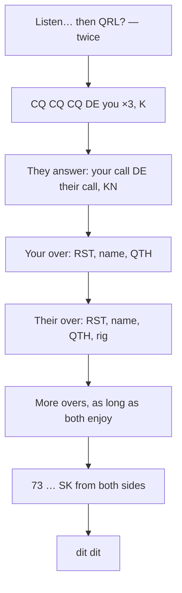
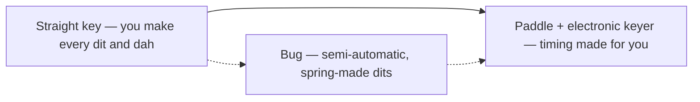
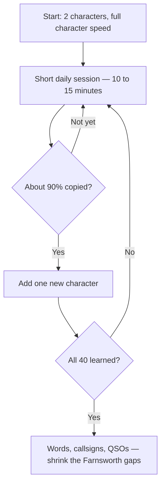

# Operating CW

In [Making Contacts](outpost:entry/logbook73.handbook/making-contacts) you learned what to say into a microphone. This chapter is about the contacts you make without one: Morse code, which amateurs call **CW** (for _continuous wave_, after the keyed carrier you met in [Modulation](outpost:entry/logbook73.handbook/modulation)). CW is the oldest operating mode in radio and, by a wide margin, the one its practitioners are most sentimental about — not out of nostalgia, but because a century after it stopped being necessary it stubbornly remains _useful_: the narrowest, furthest-reaching, cheapest-to-build mode a human can operate in real time. This chapter covers the culture and procedure — the vocabulary, the manners, what a whole CW QSO looks like character by character, and how to actually learn the code without wasting months on methods that don't work. The practice itself lives in the Morse trainer built into this app; keep it open in another tab.

## Why CW endures

Nobody has needed Morse code for decades. Commercial and maritime services abandoned it in the 1990s, and almost no country still requires it for an amateur licence. Yet on any evening the CW segments at the bottom of every HF band are busy. Three reasons, all practical:

**It is astonishingly narrow.** A hand-sent CW signal occupies roughly 100 Hz — about 1/27th of an SSB voice signal. That means a receiver can listen through a filter only 100 Hz wide, excluding 96% of the noise an SSB filter must admit ([Filters](outpost:entry/logbook73.handbook/filters) explains why narrower is quieter). The result, as [Modulation](outpost:entry/logbook73.handbook/modulation) worked out in decibels, is a head start of 10 dB or more over voice: a trained ear copies CW at signal levels where speech is an undifferentiated hiss. In propagation terms, 5 watts of CW behaves like 50–100 watts of SSB.

```viz
{ "type": "spectrum", "title": "A 100 Hz ear in a noisy band", "caption": "The receive filter (shaded) wraps tightly around a CW signal, rejecting the noise, the nearby interference and the wide SSB signal alike — this is where CW's weak-signal advantage comes from.", "components": [ { "f": 30, "amp": 0.9, "label": "CW signal", "tone": "primary" }, { "f": 48, "amp": 0.5, "label": "another CW QSO", "tone": "muted" }, { "f": 74, "amp": 0.65, "width": 14, "label": "SSB signal", "tone": "muted" } ], "noiseFloor": 0.15, "mask": { "kind": "bandpass", "from": 26, "to": 34 }, "xLabel": "frequency" }
```

**It reaches far on little.** That decibel advantage is why CW is the natural home of **QRP** — low-power operating, conventionally 5 watts or less (see [RF Power](outpost:entry/logbook73.handbook/rf-power) for what those watts mean). A few watts of CW from a wire in a tree routinely crosses oceans when the [propagation](outpost:entry/logbook73.handbook/propagation) cooperates, which is why the summit and park activators of [Portable & Off-Grid](outpost:entry/logbook73.handbook/portable-operating) love it: small battery, small radio, big reach.

**The gear is gloriously simple.** A CW transmitter is, at heart, an oscillator and a switch. Working CW transceivers have been built from a handful of components for pocket money, and complete commercial QRP CW rigs are among the cheapest transceivers sold. No microphone, no sound card, no computer: a key, a radio, and you.

There is a fourth reason nobody admits to until they're hooked: it is a skill, in the way that playing an instrument is a skill, and using a hard-won skill is simply satisfying. CW operators talk about the code the way musicians talk about sight-reading.

## The rhythm of the code

Before the procedure, thirty seconds on timing, because it explains half the vocabulary that follows. Morse is built from one unit: the length of a **dit**. A **dah** is three units. The gap between elements of one character is one unit; between characters, three; between words, seven. Everything scales together, so "speed" is a single number — words per minute (wpm), measured against the standard word `PARIS` (50 units long). At 20 wpm a dit lasts 60 ms; at 10 wpm, 120 ms.

```viz
{ "type": "wave", "title": "The letter R (di-dah-dit) as keyed carrier", "caption": "CW is on-off keying with strict proportions: dah = 3 dits, inter-element gap = 1 dit. Rhythm, not dots and dashes, is what your ear learns.", "xLabel": "time (dit units)", "traces": [ { "kind": "cw", "freq": 40, "pattern": [1, 1, 3, 1, 1, 3], "label": "R", "tone": "primary" } ] }
```

Two consequences worth knowing now. First, because it is pure rhythm, experienced operators copy code as _sound-shapes_ — the letter R is the sound "di-dah-dit", not a picture of dot-dash-dot — which is the key to the learning section later. Second, a received CW signal is just a carrier switching on and off; your receiver turns it into an audible tone (typically 500–700 Hz) whose pitch depends on your tuning — which is why "zero-beating", below, matters. The full character table lives in the Morse reference, and the same table with audio is the Code chart tab of the Morse trainer.

## The vocabulary

CW conversation runs on three layers of compression, all invented in the telegraph era and preserved intact. You met a few of them in the keyboard-mode table in [Making Contacts](outpost:entry/logbook73.handbook/making-contacts) — CW is where they all come from.

### Prosigns: punctuation you can hear

A **prosign** is two letters run together with no gap, making a single new character that acts as procedural punctuation. In print they're written with a bar over the letters or in angle brackets; here, bold:

| Prosign | Sent as             | Meaning                                                |
| ------- | ------------------- | ------------------------------------------------------ |
| **AR**  | di-dah-di-dah-dit   | End of message ("that's my over done")                 |
| **K**   | dah-di-dah          | Any station, go ahead (a plain letter, but procedural) |
| **KN**  | dah-di-dah-dah-dit  | Go ahead — _only_ the station I am working             |
| **BT**  | dah-di-di-di-dah    | Pause / new thought — written as `=` in transcripts    |
| **AS**  | di-dah-di-di-dit    | Wait, stand by                                         |
| **SK**  | di-di-di-dah-di-dah | End of contact ("silent key" in another, sadder usage) |

`K` invites anyone to answer (right after a CQ); `KN` closes the door to everyone but your QSO partner (mid-contact, or when a pile of stations is waiting). `BT` is the workhorse — sent between thoughts, it is the CW equivalent of a comma-and-breath, and transcripts show it as `=`.

### Q-codes: three letters, one sentence

**Q-codes** are three-letter abbreviations that work as both question and statement — with a question mark they ask, without one they assert. Dozens exist; these eight carry most CW traffic:

| Q-code | As a question                  | As a statement                           |
| ------ | ------------------------------ | ---------------------------------------- |
| `QRL?` | Is this frequency in use?      | The frequency is in use                  |
| `QRZ?` | Who is calling me?             | —                                        |
| `QRS`  | Shall I send slower?           | Send slower (please)                     |
| `QRQ`  | Shall I send faster?           | Send faster                              |
| `QRM`  | Are you being interfered with? | I have interference (from other signals) |
| `QRN`  | Are you troubled by static?    | I have noise (natural — static crashes)  |
| `QSB`  | Is my signal fading?           | Your signal is fading                    |
| `QTH`  | What is your location?         | My location is…                          |

`QRM` versus `QRN` is a distinction worth keeping: QRM is other people (man-made interference), QRN is nature (thunderstorm static). `QSB` explains why important items get sent twice. And `QRS` is the single most useful code a beginner owns — more on that under manners.

### Abbreviations: vowels are a luxury

Everyday words get clipped to save keystrokes — the original text-speak, 150 years early:

| Abbreviation       | Meaning                                       |
| ------------------ | --------------------------------------------- |
| `DE`               | From ("M7ABC DE F5ABC" = F5ABC calling M7ABC) |
| `ES`               | And                                           |
| `UR`               | Your / you're                                 |
| `TNX` / `TU`       | Thanks / thank you                            |
| `FB`               | Fine business — excellent, great              |
| `OM`               | Old man — friendly term for any operator      |
| `HW?`              | How do you copy?                              |
| `RST`              | The signal report (see below)                 |
| `WX`               | Weather                                       |
| `RIG`              | Transmitter/receiver equipment                |
| `CUL`              | See you later                                 |
| `GL` / `GM` / `GE` | Good luck / morning / evening                 |
| `73`               | Best regards (already plural — never "73s")   |

One more compression trick: **cut numbers**. On CW the signal report is the full three-digit RST from [Amateur Radio](outpost:entry/logbook73.handbook/amateur-radio) — readability, strength, and (unlike voice) **tone**, so a perfect report is `599`. But 9 is dah-dah-dah-dah-dit, five elements, while N is dah-dit, two. So in fast exchanges `599` becomes `5NN` — same meaning, half the sending time. You will hear `5NN` thousands of times before you hear an honest `579`.

## The shape of a CW QSO

Structurally, a CW contact is the QSO you already know from [Making Contacts](outpost:entry/logbook73.handbook/making-contacts) — report, name, QTH, rig, weather — wearing telegraph dress. The skeleton:



Here is a complete, realistic QSO, the CW sibling of the voice contact with Ana in [Making Contacts](outpost:entry/logbook73.handbook/making-contacts). Sam in Bristol calls CQ on 40 m and Luc in Lyon answers:

```
QRL?   QRL?
CQ CQ CQ DE M7ABC M7ABC M7ABC K
M7ABC DE F5ABC F5ABC KN
F5ABC DE M7ABC = GE ES TNX FER CALL = UR RST 579 579 =
  NAME SAM SAM = QTH BRISTOL BRISTOL = HW? AR F5ABC DE M7ABC KN
M7ABC DE F5ABC = R R GE SAM FB = UR RST 559 559 QSB =
  NAME LUC LUC = QTH LYON LYON = RIG 5W ES DIPOLE = AR M7ABC DE F5ABC KN
F5ABC DE M7ABC = FB LUC TNX INFO = RIG HR 10W ES WIRE ANT =
  WX CLOUDY = TNX FER FB QSO ES 73 = CUL F5ABC DE M7ABC SK
M7ABC DE F5ABC = R TNX SAM 73 ES GL = M7ABC DE F5ABC SK
(M7ABC sends: dit dit)   (F5ABC answers: dit)
```

Reading it line by line:

- **`QRL?`** — "is this frequency in use?", sent after listening, then once more. Silence means it's yours; a `C` (yes), `QRL` or even just a dit in reply means move on.
- **The CQ** — same 3×3 pattern as voice, ending in `K`: anyone, go ahead.
- **The answer** — their call once, your call twice, `KN`. Note nobody says "over": the prosigns do that work.
- **The first over** — `GE ES TNX FER CALL` = "good evening and thanks for the call" (`FER` = "for"). Then the essentials, each sent _twice_ because there is no repeat as cheap as repetition: report, name, QTH. `HW?` asks "how do you copy?", `AR` ends the message, and the over closes with the same baton-pass as voice — their call, `DE`, your call, `KN`.
- **`R R`** — "received, received": I copied everything. (Only send `R` if you truly copied it all.) Luc's `559` with `QSB` says: readable, fairly weak, fading — an honest report, worth more than a reflexive `5NN`.
- **The sign-off** — thanks, `73`, `CUL`, and the contact formally ends with **SK** from each side.
- **dit dit** — the untranslatable last ritual: after the final SK, one station sends two dits ("bye-bye") and the other answers with one or two. Pure custom, universally observed, and somehow the warmest part of the whole exchange.

That QSO at 15 wpm takes about four minutes, and it is entirely typical: many CW contacts never go beyond this friendly skeleton, and — exactly as with voice — stopping after report, name and QTH is complete and polite. When two operators click, the abbreviations stretch into real conversation, one thought per `=`, for as long as both fists hold out. The QSO trainer tab in the Morse trainer plays exactly this script with you, turn by turn, at whatever speed you can manage — it is the closest thing to a first CW contact with no licence required.

## Procedure and manners

CW inherits every courtesy from [Making Contacts](outpost:entry/logbook73.handbook/making-contacts) — listen first, always — plus a few of its own:

**Ask the frequency, properly.** `QRL?` before calling CQ is the CW version of "is this frequency in use?". Listen first for a good half-minute: with narrow signals and one-sided propagation you can easily sit right on top of a QSO whose other half you can't hear.

**Zero-beat before you call.** Your receiver renders a CW station as a tone whose pitch depends on your tuning. To answer someone, you want your transmitted signal _on their frequency_, which means tuning until their tone's pitch matches your rig's **sidetone** (the tone you hear when you key, typically 600–700 Hz). That matching is **zero-beating**. Do it carelessly and you may be transmitting a few hundred hertz away — where they, listening through that razor-thin filter, cannot hear you at all. Most modern rigs have an auto-tune or spot button that does this for you; use it.

**Answer at the speed you hear.** The iron rule of CW manners: reply at (or below) the speed of the station you're calling, and never call CQ faster than you can _receive_ — an answer will come back at your sending speed, and you have advertised that you can cope with it.

**Ask QRS proudly.** Send `PSE QRS` ("please send slower") and virtually any operator will halve their speed on the spot, delighted. Every CW operator alive was slow once, and the culture remembers it: many bands have recognised slow-speed segments, and organisations of experienced operators exist specifically to give beginners patient practice QSOs. Struggling at 8 wpm with a real human is worth ten app sessions — and nobody is judging.

**Sending errors happen to everyone.** The convention for "scratch that" is eight (or so) rapid dits — the error signal — followed by the corrected word. Send it without embarrassment; you will hear seasoned operators do it in every session.

### Straight keys, paddles and bugs

What your hand does has its own progression:



A **straight key** is the classic up-down lever: you personally form every dit, dah and space, which teaches timing in your bones and imposes a natural speed ceiling around 15–20 wpm. A **paddle** is two levers squeezed sideways, feeding an **electronic keyer** (built into nearly all modern rigs) that generates perfectly timed dits from one paddle and dahs from the other — squeeze both and an **iambic** keyer alternates them (dah-di-dah-di…), which is how `C` or `K` become a single rocking squeeze. Between the two eras sits the **bug**, a semi-automatic mechanical key from 1905: a weighted pendulum makes the dits automatically while you form dahs by hand, giving old-timers their famously swingy "fist" (every operator's sending rhythm is as recognisable as handwriting, and "fist" is its name). Beginners argue endlessly about starting on straight key versus paddle; the honest answer is that both work, straight key builds deeper timing sense, paddle is easier on the wrist — and the Send tab of the Morse trainer simulates an iambic paddle with real radios' keyer behaviours, so you can try the squeeze before buying anything.

## Learning it, honestly

Here is the truth the brochures skip: learning Morse takes months of small daily effort, not a weekend. But it is months, not years, the method is well understood, and the failure modes are avoidable because they are always the same two.

**Failure mode one: learning from a chart.** If you memorise "R = dot dash dot" from a printed table, you build a mental lookup: hear sounds → count elements → picture symbols → find letter. That detour works up to about 8–10 wpm and then hits a wall — at real speeds there is no time to count. The wall is so universal it has a name (the plateau), and climbing it means unlearning the chart. So don't learn the chart. From the first minute, learn each character as a _sound-shape_ at full speed: "di-dah-dit" _is_ R, the way a spoken word just _is_ its meaning.

**Failure mode two: slow characters.** Practising with characters slowed down (long lazy dits at 5 wpm) teaches you to recognise slow characters — a different skill from recognising fast ones, and one you'll have to relearn. The fix is **Farnsworth timing**: send each _character_ fast (18–25 wpm character speed) but stretch the _gaps_ between characters, so the code arrives as quick sound-shapes with generous thinking time. As you improve, you shrink the gaps, never the characters.

The standard method built on these two insights is the **Koch method**: start with just two characters at full character speed, copy random groups of them, and add one new character each time you reach about **90% accuracy** — never before, never demanding 100%. The 90% rule matters in both directions: below it you're guessing, but waiting for perfection stalls you on anxiety rather than skill. Two characters feel absurdly easy, which is the point — you are always practising real-speed recognition with a manageable working set, and 40 characters later you can copy everything.



The Receive tab of the Morse trainer implements exactly this — Koch ordering, Farnsworth timing, and it tracks your per-character accuracy so the 90% decision is made from data, not mood.

**Realistic expectations**, from thousands of people who have done it: 10–15 minutes a day, _every_ day, beats an hour on Sundays by a wide margin — this is motor and auditory learning, and it consolidates between sessions, not during them. Most people reach the full character set in one to three months, comfortable 15 wpm copy in three to six, and there will be plateaus where a week of practice seems to change nothing before a sudden jump. All normal. The only genuinely fatal mistake is stopping for a fortnight and concluding you "can't do it" — the skill was still forming. And start sending early (keyer or straight key, a few minutes per session): sending is easier than receiving, teaches timing, and is encouraging on the days receiving feels hopeless.

## Contest and POTA CW: the four-second version

Just as on voice, CW compresses brutally when volume matters. A contest or POTA/SOTA activator exchange strips the QSO to callsigns and the required exchange, with `5NN` as a formality and `TU` ("thank you") as the full stop:

```
CQ POTA DE K3ABC K3ABC K
       M7ABC
M7ABC 5NN 5NN BK
       R 5NN TU
TU E E   CQ POTA DE K3ABC K
```

(`BK` — "break" — flips the transmission straight back without the full baton-pass; `TU E E` is thank-you plus the dit-dit farewell at maximum compression.) These exchanges run at 25–35 wpm, but don't be scared off: the format is so rigid that many beginners copy their first "fast" CW here, because you always know what's coming — and park activators in particular will slow down for a caller who sends slowly. It is also the best free listening practice on the air: sit on an activator's frequency and copy callsigns from the pile. More on the activation side in [Portable & Off-Grid](outpost:entry/logbook73.handbook/portable-operating).

## Try it yourself

- **Start the Koch course today.** Open the Morse trainer, do the first Receive lesson (two characters, a few minutes), and do it again tomorrow. The entire method is showing up daily; the Progress tab will hold you honest about the 90% rule.
- **Copy one real callsign.** On your radio or a public WebSDR, tune the bottom 30–40 kHz of the 40 m or 20 m band, find a slow CQ, and copy just the callsign — even one letter at a time across several repeats counts. Keep the Morse reference open while you do.
- **Squeeze a paddle.** In the trainer's Send tab, send your own callsign with the simulated iambic paddle until it flows. Then try `CQ` — a squeeze and a rock.
- **Run a fake QSO for real.** The trainer's QSO practice tab plays the other station in a turn-based contact just like Sam and Luc's above. Do one at 10 wpm, then log an imaginary entry for it — by the time it's a real one, the logging will be the familiar part.

## Key takeaways

- CW endures because ~100 Hz of bandwidth buys a 10+ dB weak-signal advantage: a few QRP watts and a wire reach continents, with gear an oscillator and a switch.
- The vocabulary is three layers of telegraph-era compression: prosigns (**AR**, **SK**, `=` for **BT**, **KN**, **AS**), Q-codes (`QRL QRZ QRS QRQ QRM QRN QSB QTH`), and abbreviations (`DE ES UR TNX FB OM HW?`) — with `599` cut to `5NN` because N is shorter to send than 9.
- A CW QSO is the same report–name–QTH ritual as voice: `QRL?`, a 3×3 CQ ending in `K`, essentials sent twice, overs closed with `KN`, the contact closed with `73`, **SK** — and the dit-dit farewell.
- Manners: listen then `QRL?`, zero-beat before calling, answer at the speed you hear, and ask `QRS` proudly — the culture is built to welcome slow senders.
- Learn sounds, never charts: Koch method (two characters, add at 90%) with Farnsworth timing (fast characters, stretched gaps) in short daily sessions — expect months, plateaus and then sudden jumps, all of it normal.
- Contest and POTA exchanges compress to `5NN TU` at speed, but their rigid format makes them surprisingly beginner-friendly copy practice.

With the human-keyed original covered, the next chapters turn to the modes where machines do the modulating — starting with the modern voice systems in [Digital Voice](outpost:entry/logbook73.handbook/digital-voice).
