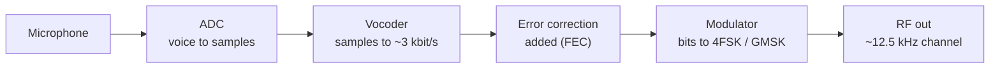
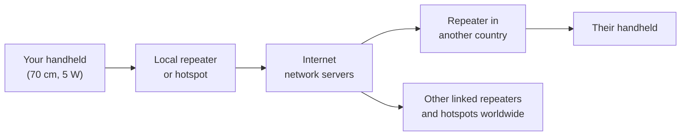

# Digital Voice

Tune across the 70 cm band today and between the familiar analogue FM voices you will hear something new: bursts of raspy, rhythmic buzzing, like a fax machine with opinions. That is digital voice — speech converted to data before it ever touches the transmitter — and it has quietly become the default on many [repeaters](outpost:entry/logbook73.handbook/repeaters), especially in towns. This chapter explains how a voice becomes bits, untangles the three competing systems you will meet (DMR, D-STAR and System Fusion), and shows how a pocket-money hotspot the size of a matchbox links your handheld to the world.

## From voice to bits to RF

Analogue FM sends your voice directly: the microphone's wiggle becomes a frequency wiggle, as covered in [Modulation](outpost:entry/logbook73.handbook/modulation). Digital voice inserts a translation step. Your voice is first digitised, then _compressed_ by a **codec** (coder-decoder) — a specialised algorithm, called a **vocoder** when built for speech, that models how human voices work and transmits only the parameters of the model rather than the waveform itself. That compression is drastic: telephone-quality speech needs around 64,000 bits per second raw, but amateur digital voice vocoders squeeze intelligible speech into roughly **2,000–3,600 bits per second**. Error-correction bits are added so the receiver can repair damage from noise and fading, and the resulting stream modulates the carrier — typically as a form of FSK (frequency-shift keying).



The receiver runs the chain backwards: demodulate, correct errors, hand the parameters to the vocoder, synthesise speech. Two consequences of that architecture define everything you will hear:

- **The good:** within its working range, digital voice is remarkably consistent. A signal that would be a hissy struggle on FM arrives clean and quiet, because the error correction silently repairs it. Alongside the voice, spare bits carry your callsign, position data and text — so the far radio _displays who is talking_.
- **The trade-off:** vocoded speech has a slightly synthetic, "processed" character — music and background sounds fare poorly, since the model only understands speech. And where analogue FM degrades gracefully into noise, digital hits a **cliff edge**: as errors exceed what the correction can fix, audio goes robotic and "underwater" (amateurs say _R2-D2_), then stops entirely. FM whispers its failures; digital works perfectly, then vanishes.

```viz
{
  "type": "wave",
  "title": "Graceful fade versus the digital cliff",
  "caption": "Stylised audio quality against a weakening signal: analogue FM grows steadily hissier but stays readable a long way down, while digital voice sounds perfect right up to the point where the error correction fails — then drops off the cliff.",
  "xLabel": "signal getting weaker →",
  "traces": [
    { "kind": "points", "label": "analogue FM", "tone": "muted", "style": "dashed",
      "points": [[0, 0.85], [0.15, 0.74], [0.3, 0.6], [0.45, 0.44], [0.6, 0.26], [0.75, 0.05], [0.9, -0.25], [1, -0.45]] },
    { "kind": "points", "label": "digital voice", "tone": "primary",
      "points": [[0, 0.9], [0.4, 0.9], [0.55, 0.89], [0.65, 0.85], [0.72, 0.7], [0.77, 0.2], [0.8, -0.5], [0.85, -0.85], [1, -0.9]] }
  ]
}
```

Neither wins outright. Analogue FM remains wonderfully interoperable — every FM radio speaks to every other. Digital buys consistency, data features and, crucially, easy **internet linking**.

## The big three (and a newcomer)

Amateur digital voice grew three incompatible ecosystems, each championed by different manufacturers. A radio built for one cannot talk to the others over the air, so your first practical question is not "which is best?" but "which are my local repeaters using?".

|                   | DMR                                              | D-STAR                                           | System Fusion (C4FM)          |
| ----------------- | ------------------------------------------------ | ------------------------------------------------ | ----------------------------- |
| Origin            | Commercial standard (ETSI), adopted by amateurs  | Designed for amateurs (JARL, Japan); Icom radios | Yaesu's amateur system        |
| Voice + data rate | 2 slots × ~3.6 kbit/s                            | ~3.6 kbit/s total                                | ~3.6 kbit/s (voice-wide mode) |
| Channel sharing   | **TDMA**: two conversations per 12.5 kHz channel | One conversation per channel                     | One conversation per channel  |
| Organising idea   | Numbered **talkgroups**                          | **Callsign routing** + reflectors                | Rooms via **Wires-X**         |
| Radio price       | Cheapest (commercial volumes)                    | Mid to high                                      | Mid to high                   |
| Character         | Powerful, configuration-heavy                    | Elegant, amateur-native                          | Friendliest migration from FM |
| Typical networks  | Brandmeister, DMR+ and others                    | REF/XRF/XLX reflectors                           | Wires-X, YSF rooms            |

A few notes the table cannot hold:

- **DMR (Digital Mobile Radio)** came from the commercial world — the radios on a builder's hip or behind a supermarket till — which is why DMR handhelds are the cheapest digital radios you can buy. Its **TDMA** (time-division multiple access) design chops each channel into two alternating **timeslots**, so one repeater carries two simultaneous conversations. Conversations are organised into **talkgroups** — numbered virtual channels (for example, a worldwide talkgroup, a country-wide one, regional and special-interest ones) that repeaters and users subscribe to. A **colour code** (0–15) acts like the CTCSS tone on an analogue repeater, keeping co-channel systems apart. You will also hear about DMR _tiers_: Tier I is licence-free short-range kit, Tier II is the repeater-capable standard amateurs use. The cost of all this power is configuration: DMR radios are programmed with a **code plug**, a file defining every channel, talkgroup and slot combination. Building your first code plug is a rite of passage; asking a local amateur for theirs is the traditional shortcut.
- **D-STAR** (Digital Smart Technologies for Amateur Radio) was designed _by_ amateurs, and it shows: your callsign is woven into every transmission, and the original vision was **callsign routing** — call a person, and the network finds which gateway they last used. In practice most activity happens on **reflectors**, conference servers that many repeaters and users link to at once. Icom builds nearly all the radios.
- **System Fusion** is Yaesu's system, using **C4FM** modulation (a four-level FSK). Its distinctive trick is friendliness to the analogue world: Fusion repeaters can automatically detect whether an incoming signal is C4FM or analogue FM and behave accordingly, which made it an easy upgrade path for FM repeater keepers. Internet linking runs over Yaesu's **Wires-X** network and community-run rooms.
- **M17** deserves a mention as the open-source newcomer: an amateur-built digital voice protocol with a royalty-free codec (Codec 2), designed to escape the patented vocoders the big three rely on. Activity is still small but growing, and it is philosophically the most amateur-radio of the lot — the experimenters' choice.

The vocoder point matters more than it first appears: DMR, D-STAR and Fusion all use proprietary **AMBE**-family vocoders licensed from one company, which is why cross-mode bridging usually needs special hardware or transcoding servers, and why M17's open codec excites people.

## Repeaters, networks and the internet

Here is where digital voice stops being merely a different way to sound and becomes a different way to _reach_. Digital repeaters are almost always connected to the internet, joined into networks that link them worldwide. Key in the right talkgroup, reflector or room, and your 5 W handheld on 70 cm is in conversation with a mobile station in Melbourne — RF at each end, internet in the middle.



Purists occasionally mutter that this is "not real radio" — you will notice the same argument orbiting [FT8](outpost:entry/logbook73.handbook/ft8) — but it is better understood as a different sport: local RF engineering plus global community. For a licensee with modest power and a small antenna, it is also the most reliable worldwide voice capability money can buy.

Each system has its own network geography. In DMR the dominant amateur network is **Brandmeister**, alongside others such as DMR+; a repeater's network membership decides which talkgroups behave how, so _check your local repeater's listing_. D-STAR repeaters register through gateways and link to reflectors. Fusion repeaters join Wires-X rooms or community YSF servers. Your national repeater directory (the RSGB's in the UK, RepeaterBook across North America and much of the world) shows each repeater's modes and networks — consult it **before** buying a radio. The best digital handheld in the world is a paperweight if every repeater within range speaks a different system. In areas with no digital repeater at all, the answer is a hotspot.

## Hotspots: a repeater on your bookshelf

A **hotspot** is a tiny, very low-power (typically ~10 mW) digital transceiver plus a small computer — most famously an **MMDVM** board (Multi-Mode Digital Voice Modem) riding on a Raspberry Pi running the free **Pi-Star** software. It listens for your handheld across the room, and pipes everything to the internet networks directly. It is, in effect, a personal micro-repeater covering your house and garden.

Why hotspots transformed the scene:

- **Coverage stops mattering.** No digital repeater in range? Irrelevant — your hotspot is your gateway.
- **Freedom of connection.** A shared repeater's talkgroups are chosen by its keeper; your hotspot connects wherever you like, whenever you like, without tying up a community machine for a long natter.
- **Multi-mode.** MMDVM hardware speaks DMR, D-STAR, Fusion (and more, including M17) — one gadget serves whichever radio you own, and some setups bridge between modes.
- **Legality still applies.** A hotspot transmits RF, so you need your amateur licence, and it must operate on sensible frequencies — Pi-Star warns you away from frequencies that clash with other users (follow your national band plan's current guidance for personal hotspots). Ten milliwatts is tiny, but the licence conditions apply at any power.

A duplex hotspot (separate transmit and receive, like a real repeater) costs more than a simplex one; for one person in one house, simplex is fine.

## Getting a DMR ID (and other admin)

Digital systems need to know who you are, in machine-readable form.

- **DMR** identifies radios by a seven-digit **DMR ID**, issued free against your callsign by the volunteer-run global RadioID database. Registration takes minutes with a copy of your licence; the ID goes into your radio and follows you across networks. One ID per operator is the norm.
- **D-STAR** uses your callsign directly, registered once through your local gateway or network so the routing system knows you.
- **Fusion/Wires-X** likewise registers your callsign and radio with Yaesu's system for room access.

None of this costs anything, and all of it is one-time setup. Because IDs map to callsigns, most digital radios show the name and callsign of whoever is speaking — handy for the log you are about to keep.

## What it sounds like, honestly

Set expectations before your first listen. Good digital voice through a quiet channel sounds _clear but characterful_ — slightly compressed, faintly synthetic, unmistakably intelligible. Weak-signal behaviour is the real difference from FM: where FM grows hiss, digital stays clean right up to the cliff, then briefly does its underwater-robot impression, then drops out. On balance, across a typical repeater's service area, digital delivers consistently better _usable_ coverage; at the extreme fringe, a skilled ear can still pull an FM voice out of hiss after digital has given up. And latency — the vocoder and network add a noticeable fraction of a second, so leave a beat after pressing the push-to-talk switch before speaking, or your first word will be clipped. Everyone learns this by having their first word clipped.

## Try it yourself

1. **Hear it without buying anything.** Several digital networks stream live audio on the web — Brandmeister's streaming service lets you listen to busy talkgroups in a browser. Notice the vocoder character, and how every transmission is tagged with a callsign.
2. **See it on a waterfall.** With an RTL-SDR (see [Software Defined Radio](outpost:entry/logbook73.handbook/software-defined-radio)), find a local digital repeater on 70 cm and look at the signal in [the waterfall](outpost:entry/logbook73.handbook/ffts-and-waterfalls): a crisp ~12.5 kHz block of structured data, quite unlike FM's fuzzy caterpillar. Free decoder software for DMR and D-STAR exists if you fancy going further.
3. **Map your local scene.** Using your national repeater directory, list every repeater within ~40 km of you and note its modes: FM, DMR (which network?), D-STAR, Fusion. This one piece of research answers "which digital radio should I buy?" better than any review.
4. **Log what you hear.** Each callsign you catch from a digital repeater or stream goes in LogBook73's **Receive Log** — mode `DMR`, `DSTAR` or `C4FM` — building the habit for when you are transmitting.
5. **Licensed already?** Get your DMR ID, borrow or buy a cheap DMR handheld, ask a local for a starter code plug, and make your first digital QSO — then log it in the Console and note how different the "signal report" conversation is when everyone is perfectly readable.

## Key takeaways

- Digital voice converts speech to ~3 kbit/s of vocoder data plus error correction before transmission — buying clean, consistent audio with callsign and data tagging, at the cost of a "cliff edge" instead of FM's graceful fade.
- The big three systems are mutually incompatible over the air: **DMR** (commercial roots, talkgroups, colour codes, two TDMA timeslots per channel, cheapest radios), **D-STAR** (amateur-native, callsign routing, reflectors), and **System Fusion/C4FM** (Yaesu, analogue-friendly, Wires-X) — with open-source **M17** the idealist newcomer.
- Buy a radio for the system your local repeaters actually use — check your national repeater directory first — or sidestep geography entirely with an MMDVM/Pi-Star hotspot (licence still required).
- Internet linking is the point: talkgroups, reflectors and rooms connect your low-power handheld to conversations worldwide.
- Admin is free and one-time: a DMR ID (from the RadioID database) or callsign registration is what lets networks route you and display your identity.
- Digital wins on consistency and features; analogue FM wins on universal interoperability and graceful degradation. Most amateurs end up valuing both.

Digital voice sends speech as data; the next chapter goes one step further and deletes the speech entirely — meet [FT8](outpost:entry/logbook73.handbook/ft8), the fifteen-second mode that works the world on milliwatts.
