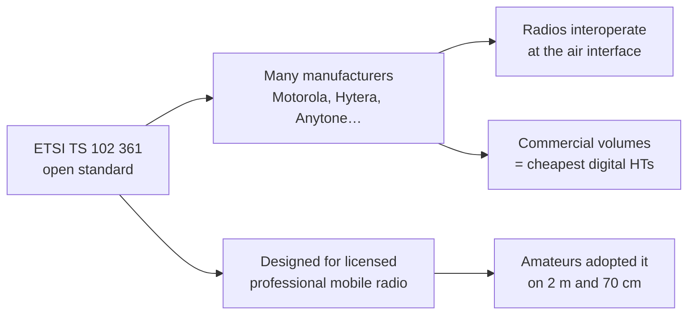
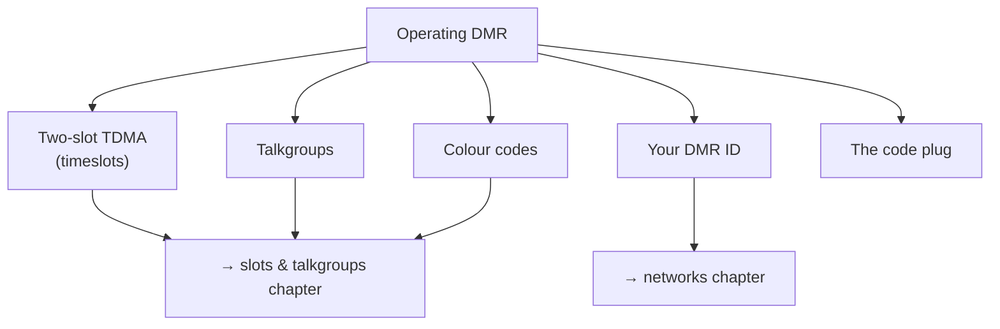
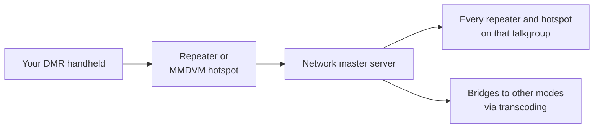

# DMR

Of the three digital voice systems you will meet on the amateur bands, DMR is the odd one out: nobody designed it for us. It was built for the two-way radios on a security guard's belt and a delivery fleet's dashboard, standardised so that any manufacturer could build to it, and then adopted wholesale by amateurs who noticed the radios were cheap, capable and everywhere. This chapter is the opening of a short family of DMR chapters. It explains what DMR is, where its commercial roots still show, and lays out the handful of ideas — timeslots, colour codes, talkgroups, IDs and code plugs — that the later chapters take apart one by one.

If you have not yet read the shared [Digital Voice](outpost:entry/logbook73.handbook/digital-voice) overview, start there: it covers how a voice becomes bits, why digital hits a "cliff edge" instead of fading gracefully, and how DMR, [D-STAR](outpost:entry/logbook73.handbook/dstar) and [System Fusion](outpost:entry/logbook73.handbook/c4fm) compare side by side. This chapter assumes that ground and digs into the first of the three.

## What DMR actually is

**DMR** stands for **Digital Mobile Radio**, and the word that matters most is _mobile_ — as in commercial mobile radio, the licensed professional kit used by taxi firms, factories, event crews and utilities. It is defined by an open standard published by ETSI, the European Telecommunications Standards Institute, catalogued as **TS 102 361** and issued in four parts: the air interface (how bits go over the air), the voice and generic services, the data protocol, and the trunking specification. "Open standard" is the crucial phrase. Unlike D-STAR (shaped by Japan's national society and carried almost entirely by Icom) or System Fusion (a single manufacturer's design, Yaesu's), DMR belongs to no one company. Anyone may build a DMR radio that conforms to the standard, and radios that conform interoperate at the air-interface level.

That openness has one consequence you will feel immediately in your wallet. Because dozens of manufacturers compete — Motorola sells DMR under its **MOTOTRBO** brand, alongside Hytera, Anytone, TYT, Retevis, Baofeng, Radtel and more — and because the commercial market buys these radios by the tens of thousands, prices have collapsed. A basic DMR handheld is the **cheapest digital voice radio you can buy**, often in the ~$50/£50 class, where a comparable D-STAR or Fusion handheld sits well above it — the companion [Radtel RT-4D guide](outpost:entry/logbook73.guide.rt-4d) decodes one such pocket-money set menu by menu. You are, in effect, riding on the back of a huge commercial production run.

The engineering was done for a professional world, not a hobbyist one, and that shows in two ways. The radios assume you will programme them from a computer with a configuration file rather than twiddle the front panel — more on that shortly. And they ship with features amateurs must never use, encryption being the obvious one, because the identical hardware is sold into licensed business radio services where scrambling traffic is perfectly legal. On the amateur bands it is not, and we will come back to that.

## The three tiers

DMR is not one thing but three system classes, called **tiers**, and knowing which tier you are dealing with clears up most early confusion. The tiers are not interoperable with one another; they describe fundamentally different ways of using the standard.

| Tier     | What it is                            | Infrastructure           | Who uses it                          |
| -------- | ------------------------------------- | ------------------------ | ------------------------------------ |
| Tier I   | Licence-exempt, simplex (direct) only | None; low power (≤0.5 W) | Consumer/licence-free personal radio |
| Tier II  | Licensed conventional two-slot TDMA   | Base station / repeater  | **Amateur radio** and business PMR   |
| Tier III | Licensed trunking with a controller   | Multi-repeater network   | Commercial fleets, public safety     |

**Tier I** is the licence-free tier — direct radio-to-radio (simplex) working only, an integral antenna, a hard power ceiling of about half a watt, and no repeaters. It sits in the same conceptual space as the licence-free consumer allocations you may know, such as PMR446 in some regions or FRS in others. No amateur licence is needed because no amateur privileges are used.

**Tier II** is the one that matters to you. It is licensed, conventional (meaning fixed channels, not dynamically allocated ones), and uses the two-slot TDMA scheme that is DMR's signature. It works either simplex or, far more usefully, through a base station or [repeater](outpost:entry/logbook73.handbook/repeaters). Almost every amateur DMR radio is a Tier II radio, and almost everything in these chapters describes Tier II operation on the 2 m and (much more commonly) 70 cm bands — check your national band plan for the digital voice segments in your ITU region.

**Tier III** is licensed trunking: a central controller watches a bank of repeaters and hands each new call whichever channel happens to be free, the way a large office phone system shares a pool of outside lines. It is superb for a police force or a national utility with hundreds of users; it is essentially never used by amateurs, who have no need of a trunking controller and every reason to keep things simple. You can safely file Tier III under "exists, not your problem".

## The headline ideas: a map of what is coming

Everything distinctive about operating DMR grows from five ideas. This section introduces each one at altitude; the later chapters in this family take them apart properly. Think of it as the table of contents for the mode.

### Two-slot TDMA

DMR splits a single 12.5 kHz channel not by frequency but by **time**. **TDMA** — time-division multiple access — chops the channel into two alternating 30-millisecond **timeslots**, called Slot 1 and Slot 2. A radio transmits a 30 ms burst, falls silent for 30 ms while the other slot has its turn, transmits again, and so on, far too fast for your ear to notice any gap. The pay-off is striking: one repeater, on one input frequency and one output frequency, carries **two completely independent conversations at once**. Picture two trains sharing a single track by taking strict, rapid, alternating turns — the passengers never know they are not on their own line. This doubling of capacity is why commercial operators loved DMR, and the [slots and talkgroups chapter](outpost:entry/logbook73.handbook/dmr-slots-talkgroups) shows exactly how it maps onto amateur repeaters.

### Colour codes

A **colour code** is a number from 0 to 15 carried in every DMR transmission, and it does the same job for digital that a CTCSS tone does for analogue FM: it keeps co-channel systems from interfering. A repeater ignores any signal whose colour code does not match its own, and your radio must be set to the repeater's colour code or you will key up into total silence — no error, no beep, just nothing, which is a classic beginner's "my radio is broken" moment. Unlike a CTCSS tone, the colour code is not a sub-audible signal but a digital field decoded from the data stream. Colour Code 1 is the de-facto amateur default.

### Talkgroups

Here is the biggest mental shift from analogue. On FM, a conversation lives on a **frequency** — you tune to it. On DMR, a conversation lives on a numbered **talkgroup**, and the internet-linked network routes it to wherever it needs to go. Key up on a worldwide talkgroup and your audio reaches every repeater and hotspot subscribed to that group; key up on a regional one and it stays local. Talkgroups are the addressing scheme of DMR, and they are subtle enough — static versus dynamic, which slot they live on, how network prefixes differ — that the [next chapter](outpost:entry/logbook73.handbook/dmr-slots-talkgroups) is devoted to them.

### Your DMR ID

Every DMR operator needs a unique seven-digit **DMR ID**, transmitted with every over, which the network resolves to your callsign for the display and the logs. That is why a DMR radio can show you the name and callsign of whoever is speaking. IDs are issued free by the volunteer-run global registry (RadioID.net) after you upload proof of licence, and the same ID works on every network worldwide. One ID per operator is the norm. The [networks chapter](outpost:entry/logbook73.handbook/dmr-networks) covers registration and what the ID structure means.

### The code plug

A DMR radio is not programmed by hand on the front panel; it is loaded with a **code plug**, a configuration file built on a computer that defines every channel, talkgroup, slot, colour code and contact the radio knows about. This is the price of DMR's power and the single steepest part of its learning curve. Building your first code plug is a rite of passage, and the traditional shortcut — asking a local amateur for theirs and editing it — is not cheating, it is the culture. The [operating chapter](outpost:entry/logbook73.handbook/dmr-operating) walks through it.

## Where DMR fits among the three

You do not need to re-read the full comparison — the [Digital Voice](outpost:entry/logbook73.handbook/digital-voice) overview has the side-by-side table — but it is worth fixing DMR's position in your head before going deeper. All three mainstream amateur digital voice systems squeeze speech into a low-bit-rate stream using a vocoder from the same family (the AMBE lineage, licensed from one company, which is precisely why cross-mode contact needs transcoding in the network rather than happening over the air). Where they diverge is in modulation, addressing and culture.

- **DMR** is the open, multi-vendor, TDMA one. It routes by **numbered talkgroup**, carries two conversations per channel, offers the cheapest and widest choice of radios, and hangs it all on the biggest amateur digital network. Its cost is the steepest learning curve — code plugs, IDs, slots and colour codes to get right.
- **System Fusion / [C4FM](outpost:entry/logbook73.handbook/c4fm)** is Yaesu's single-vendor system. One conversation per channel (it is FDMA, not TDMA), and its headline trick is that a Fusion repeater can automatically tell analogue FM from digital and answer in kind — which makes it the gentlest on-ramp from FM.
- **[D-STAR](outpost:entry/logbook73.handbook/dstar)** is the amateur-native one, shaped by Japan's national society and carried mostly by Icom. It uses a different modulation again and routes by **callsign**, with a one-time registration step that is its own classic stumbling block.

Crucially, none of the three talk to each other directly on the air — even DMR and Fusion, which share a vocoder, use incompatible RF framing. Bridging between modes always happens in the infrastructure, via multiprotocol reflectors and transcoding hardware, never radio-to-radio.

The single most important buying decision is not "which mode is best?" but "which mode do my local repeaters actually run?". Consult your national repeater directory before you spend a penny. A brilliant DMR handheld is a paperweight in a town whose only digital repeater speaks Fusion — though, as the [hotspots chapter](outpost:entry/logbook73.handbook/dmr-hotspots) explains, a small MMDVM hotspot sidesteps local geography entirely.

## The learning curve, honestly

It would be dishonest to pretend DMR is friendly to a beginner. It is not. The reward is real, but so is the effort, and it helps to know that going in.

The friction is concentrated in one place: the code plug. To make your first contact you must register a DMR ID and wait a day or two for verification, install a manufacturer's configuration program (the "CPS", or customer programming software) on a computer, understand talkgroups well enough to pick some, get the colour code and timeslot right for your target repeater, and assemble all of that into a file that uploads over a cable. Any one field wrong and the radio sits in silence with no clue as to why. Budget radios compound this: their programming software is often clunky and frequently revised, and their receivers are modest, prone to being swamped near strong transmitters. None of it is hard once explained; all of it is opaque until it is.

Against that, weigh what you get. The cheapest route into worldwide digital voice, on radios that cost less than a decent FM handheld. Two conversations per repeater channel, so busy machines stay usable. The largest and best-connected amateur digital network, bridging to other modes and services. And, once your code plug exists, operating is genuinely easy — turn a knob to the channel for the talkgroup you want and press the button. The steep part is a one-time climb. The [operating chapter](outpost:entry/logbook73.handbook/dmr-operating) is your guide up it, and the traditional shortcut of borrowing a working code plug from a local flattens the slope enormously.

One legal point belongs in every DMR chapter, so here it is early. These radios ship with encryption because they are commercial-heritage kit, but **transmitting encrypted or coded messages to obscure their meaning is prohibited on amateur bands in essentially every jurisdiction** — the FCC's Part 97 in the US, Ofcom's licence terms in the UK, and equivalents worldwide; check your own national regulator, but the answer is the same everywhere. Leave every encryption setting off. And remember that even unencrypted DMR gives you no privacy whatsoever: anyone with a compatible radio can monitor it, so never say anything on DMR you would not say on open FM.

## Try it yourself

You can start meeting DMR today, whether or not you own a radio.

1. **Map your local scene first.** Open your national repeater directory and list every DMR repeater within reach. For each, note its output frequency, its colour code, and which network it belongs to. This one piece of homework decides whether DMR is even the right mode for you, and it is the raw material for your first code plug.
2. **Listen without transmitting.** Several DMR networks stream busy talkgroups live in a web browser. Pick a worldwide or a country-wide group and listen for a while. Notice the slightly synthetic vocoder character, how every over is tagged with a callsign and name, and the brief pauses as the network keys up.
3. **See it on a waterfall.** With an [RTL-SDR](outpost:entry/logbook73.handbook/software-defined-radio), find a local DMR repeater output and look at it on [the waterfall](outpost:entry/logbook73.handbook/ffts-and-waterfalls). A DMR signal is a crisp, structured block quite unlike FM's fuzzy caterpillar — and if you watch closely on a busy machine you can sometimes see the two timeslots pulsing in alternation.
4. **Log what you hear.** Every callsign you catch from a DMR repeater or a network stream goes into LogBook73's **Receive Log** with mode `DMR`. It builds the habit and the log for the day you start transmitting.
5. **Licensed and keen?** Register your free DMR ID now — the verification wait means starting early is wise — so it is ready when your radio and code plug are.

## Key takeaways

- **DMR is an open ETSI standard** (TS 102 361), built for commercial mobile radio and adopted by amateurs — which is why so many manufacturers make it and why its handhelds are the cheapest digital radios you can buy.
- **Three tiers:** Tier I is licence-free simplex, **Tier II is what amateurs use** (licensed, two-slot, repeater-capable), and Tier III is commercial trunking you will never touch.
- **Five ideas** define operating DMR — two-slot **TDMA**, **colour codes**, **talkgroups**, your **DMR ID** and the **code plug** — and each gets a full chapter in this family.
- **Two-slot TDMA** lets one repeater carry two independent conversations at once by interleaving 30 ms bursts in time; **talkgroups** replace frequencies as the way conversations are addressed and routed.
- **DMR routes by number, D-STAR by callsign, Fusion by named room** — none interoperate over the air, so buy for the mode your local repeaters actually run.
- The learning curve is real and lives almost entirely in the **code plug**; borrowing a working one from a local amateur is the traditional and sensible shortcut.
- **Never enable encryption** on amateur bands, and never treat DMR as private — anyone with a compatible radio can monitor it.

With the map drawn, the first landmark to explore in detail is the pair of ideas that make DMR feel so different from FM: [timeslots and talkgroups](outpost:entry/logbook73.handbook/dmr-slots-talkgroups).
