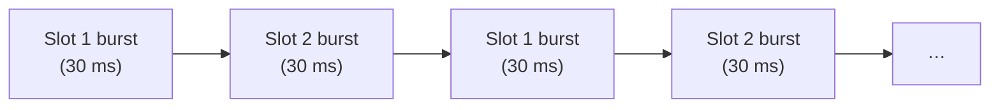
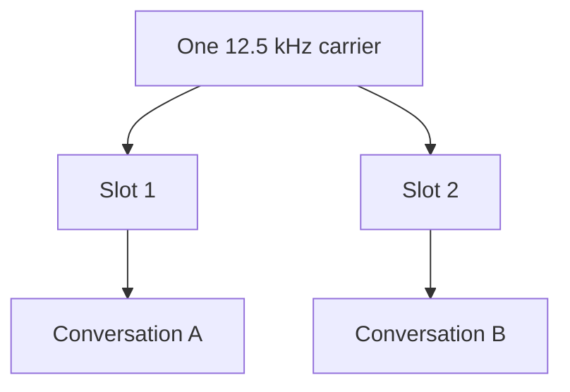
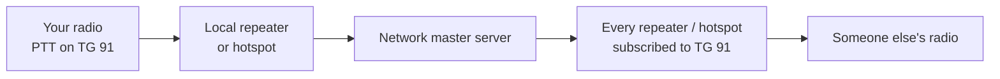
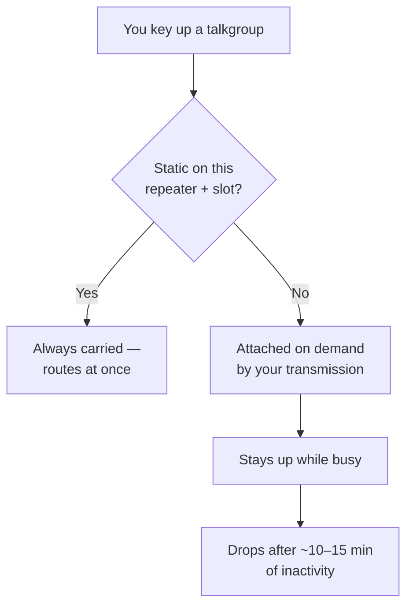

# DMR: Timeslots, Colour Codes & Talkgroups

Point a DMR radio at a single repeater and you are, without realising it, sharing that one machine with a second conversation happening in the gaps between your own words. Four small numbers decide whether your press of the push-to-talk switch reaches anyone at all: a frequency, a timeslot, a colour code and a talkgroup. Get all four right and your handheld drops into a worldwide net; get one wrong and the radio sits in total silence with no error to tell you why. This chapter takes those four settings apart, one at a time, so that a DMR channel stops being a mystery and becomes something you can read.

If you have not yet met the wider family of digital voice modes, start with the [digital voice overview](outpost:entry/logbook73.handbook/digital-voice) and the [DMR introduction](outpost:entry/logbook73.handbook/dmr); this chapter assumes you know that DMR (Digital Mobile Radio) is an open standard that turns your speech into data. Here we go one level down, into the mechanics that make it tick.

## Two conversations on one carrier

Analogue FM is generous with spectrum: one repeater, one channel, one conversation at a time. DMR is not. It squeezes **two** independent conversations onto a single 12.5 kHz radio channel by dividing that channel not in frequency but in **time**. The technique is called **TDMA** — Time Division Multiple Access — and it is the single most important idea in DMR.

Here is how it works. The channel is chopped into **timeslots** that take strict alternating turns. Each turn lasts 30 milliseconds — thirty-thousandths of a second. Your radio transmits a 30 ms **burst** of data, then falls silent for the next 30 ms while the other slot has its turn, then bursts again, and so on, dozens of times a second. Two conversations interleave like this all day, each using only half the airtime but neither aware of the other.

A good analogy is two trains sharing one length of track by taking turns so quick that no passenger ever notices a wait. Your receiver buffers the incoming bursts and stitches the 30 ms fragments back together, so what you hear is smooth, continuous speech — the gaps are invisible to your ears.

The pay-off is real capacity. One repeater has **one** input frequency and **one** output frequency, yet it carries two fully independent QSOs at once, because they never occupy the channel at the same instant.

That doubling is why engineers describe DMR as achieving roughly **6.25 kHz-equivalent** efficiency: two calls sharing a 12.5 kHz channel works out, per call, as though each had only 6.25 kHz to itself. It is also the headline difference from the other digital voice modes — [D-STAR](outpost:entry/logbook73.handbook/dstar) and [System Fusion](outpost:entry/logbook73.handbook/c4fm) put one conversation on one channel, the way FM does. DMR's two-slot trick came straight from its commercial heritage, where doubling the calls a repeater can carry directly halves the cost of running a fleet.

### Slot 1 versus Slot 2

Because there are two slots, every DMR channel through a repeater must say which one it uses: **Timeslot 1** or **Timeslot 2**, usually written `TS1` and `TS2`. This is not a preference — it is a physical lane, and the repeater owner decides which conversations live in which lane.

A widespread convention keeps the two lanes tidy. **Local and regional** traffic — the chatter most likely to be busy, and most likely to be wanted by people nearby — is placed on one slot, while **wide-area and worldwide** traffic is placed on the other. The reasoning is neighbourly: a long international net can run for an hour without ever tying up the slot that local operators use to call each other. Which slot is "local" and which is "wide" varies from network to network and even repeater to repeater, so it is not something to guess.

The practical rule follows directly: **read the repeater's published list**, and set the slot it specifies for the talkgroup you want. Keying the correct talkgroup on the _wrong_ slot achieves nothing useful — your audio goes nowhere — and worse, it may block the other conversation the repeater is carrying on that slot. Slot and talkgroup travel as a pair; always take them from the same line of the repeater's listing.

## The colour code: DMR's digital squelch

If you have set up an analogue [repeater](outpost:entry/logbook73.handbook/repeaters), you have met CTCSS — the sub-audible tone your radio adds so the repeater only opens for the right users, ignoring signals from other systems sharing the frequency. DMR has an exact counterpart, and it is called the **colour code**.

A colour code is a number from `0` to `15` carried inside every DMR transmission. A repeater — and your own receiver — ignores any traffic whose colour code does not match the one it expects. Two DMR repeaters can therefore share the same frequency in neighbouring areas, each set to a different colour code, without ever keying each other up. Your radio's colour code **must** match the repeater's, or your transmission is simply discarded. Colour code `1` is the de-facto amateur default, but never assume it — check the listing.

The name is a little misleading, because there are no colours involved and nothing audible either. Unlike CTCSS, which really is a quiet tone mixed under your voice, the colour code is a **digital field** decoded from the signalling — a number the radios read from the data stream, not a sound. It is squelch by arithmetic rather than by tone.

Here is the trap that catches nearly every beginner. A wrong colour code produces **total silence, with no warning whatsoever**. The repeater does not chirp, flash or complain; it just does not repeat you, and you do not hear the traffic on it. Newcomers reasonably conclude that their radio is broken, or that the repeater is off the air, when in fact a single mismatched digit is the whole problem. If a DMR channel seems utterly dead where others report it busy, the colour code is the first thing to check.

The colour code has one further job. It feeds the "polite" transmit logic that decides when your radio is allowed to key up on a busy machine — a setting worth its own explanation in the [operating chapter](outpost:entry/logbook73.handbook/dmr-operating). For now, hold on to the simple version: **wrong colour code equals silence**.

## Talkgroups: conversations by number, not by frequency

On analogue FM a conversation _is_ a frequency: to join it you tune there. DMR breaks that link completely. A DMR conversation lives on a numbered **talkgroup** — a virtual channel identified by a number, not a frequency — and the internet-linked network routes it to wherever it is wanted.

Think of a talkgroup as a channel on a switchboard rather than a spot on the dial. Key up on a **worldwide** talkgroup such as `TG 91`, and the network carries your audio to every repeater and hotspot on Earth that is currently subscribed to `91`. Key up on a **national** talkgroup — for example a country-wide group like the UK's `235`, or whatever number your own country uses — and you reach every machine carrying that group inside your nation, and no further. There are regional talkgroups, special-interest talkgroups, and quiet corner talkgroups for a couple of friends. Routing is by **group number**; the frequency you happen to be transmitting on is almost incidental.

This is the mental shift that trips up operators coming from FM. You are no longer choosing _where_ to talk; you are choosing _whom_ to talk to, by name and number, and the network works out where they are. The same physical channel on the same repeater can carry a village natter one minute and a cross-continental net the next, purely because someone selected a different talkgroup.

The exact talkgroup numbers, and how you write them into the radio, depend on which **network** the repeater belongs to — and networks disagree about the details in ways that catch people out. That is a whole subject of its own, covered next in [DMR networks](outpost:entry/logbook73.handbook/dmr-networks). For this chapter, the concept is what matters: a talkgroup is a numbered destination that the network delivers to every station listening for it.

### Static versus dynamic talkgroups

Not every talkgroup is present on a repeater all the time. There are two ways a talkgroup can be attached to a repeater and slot, and knowing the difference explains a lot of otherwise-baffling behaviour.

A **static** talkgroup is permanently bound to a particular repeater and slot by the owner — it is _always on_. Whatever happens on that talkgroup anywhere in the world is always audible on that machine, and you can call into it at any time. Repeater keepers make their most important local and regional groups static so they are reliably there.

A **dynamic** talkgroup — also called _user-activated_ — is not carried until someone asks for it. When you transmit on a talkgroup that is not currently on the repeater, your call **attaches** it on demand: the network links that group to the repeater and slot for as long as it stays busy. After the conversation goes quiet, an inactivity timer — commonly around **10 to 15 minutes** — automatically **drops** the group again, freeing the slot. Any fresh transmission re-triggers it.

The practical consequence: if you are waiting to hear a friend on a dynamic talkgroup and nobody has keyed it recently, it may not be attached to your repeater at all — so their call never reaches you until someone re-triggers the link. Treating a dynamic group as though it were always-on is a classic source of "why can't I hear anything?" confusion. When in doubt, key up briefly yourself to pull the group onto the machine.

### Group call versus private call

One more distinction hides inside the "talkgroup" idea. What you send when you press push-to-talk is set by a **contact** — the destination the radio transmits to — and a contact comes in two flavours.

A **group call** sends to a talkgroup number, and everyone subscribed to that group hears you. This is the normal mode of DMR operation and what all the talkgroup discussion above describes: a one-to-many conversation on `91`, `235` or any other group.

A **private call** sends instead to a single individual's **DMR ID** — the unique seven-digit number that identifies one operator's radio (issued free, one per operator, as explained in the [DMR introduction](outpost:entry/logbook73.handbook/dmr)). A private call routes the network's way to that one person, wherever they are logged in, for a one-to-one chat that others on the talkgroup do not hear. It is the digital equivalent of stepping off the net onto a private frequency, except no frequency change is needed — the number does the addressing.

## Four settings make a channel

Now the pay-off. Everything above collapses into one clean mental model, and it is worth committing to memory:

> **A DMR channel = frequency + slot + colour code + talkgroup.**

Miss any one of the four and the channel does not work. In analogue FM a "channel" is essentially just a frequency (plus perhaps a CTCSS tone); in DMR it is these four settings bundled together, and this is exactly why DMR feels more fiddly to programme. Each channel in your radio is one specific combination — which is why operators keep a separate channel for every talkgroup they use, rather than tuning around.

Take a worked example. Suppose your local repeater's listing shows a national talkgroup on the following terms, and you want to programme a channel for it:

| Setting     | Value                       | What it does                                                               |
| ----------- | --------------------------- | -------------------------------------------------------------------------- |
| Frequency   | the repeater's 70 cm output | Which repeater you reach (from the directory; per your national band plan) |
| Timeslot    | `TS2`                       | Which of the two time lanes carries this group                             |
| Colour code | `1`                         | The digital squelch that must match the repeater                           |
| Talkgroup   | `235` (group call)          | The numbered destination your audio routes to                              |

Read that as a sentence: _"On this repeater's output frequency, in timeslot 2, carrying colour code 1, send a group call to talkgroup 235."_ All four are true at once, or the channel fails — and each fails silently in its own way. Wrong frequency: you are not on the repeater. Wrong slot: your audio routes nowhere and may block the other conversation. Wrong colour code: the repeater ignores you entirely. Wrong or unattached talkgroup: your words reach the network but nobody is listening on that group here.

Once the four are right, using the channel is trivial: select it, wait a beat after pressing push-to-talk (the vocoder and network add a fraction of a second of delay — see the [digital voice overview](outpost:entry/logbook73.handbook/digital-voice)), and speak. To move to a different talkgroup you select a different channel, one that was built with that group's own four settings. Build a handful of these channels — a local group, a national group, a worldwide group, each on its correct slot and colour code — and you have a working DMR radio.

## Try it yourself

You can explore all four settings before you ever transmit — receiving needs no licence in most countries, and a good deal can be learned just by listening and reading.

1. **Read a real repeater listing.** Open your national repeater directory (RepeaterBook covers much of the world; your national society's list is another source) and find a DMR repeater near you. Note down its output frequency, colour code, and — for two or three talkgroups — which slot each one lives on. You have just written the four settings for several channels.
2. **Spot the local/wide split.** On that same listing, see whether the busy local talkgroups sit on one slot and the worldwide or national ones on the other. That is the convention in action; not every repeater follows it, which is exactly why you check.
3. **Hear talkgroup routing without a radio.** Several DMR networks stream busy talkgroups live in a web browser. Listen to a worldwide group and a regional one side by side, and notice how each transmission is tagged with a callsign — the network resolving DMR IDs to names, the same mechanism a private call uses to address one person.
4. **See the carrier on a waterfall.** With an [RTL-SDR](outpost:entry/logbook73.handbook/software-defined-radio), find a local DMR repeater's output and watch it in [the waterfall](outpost:entry/logbook73.handbook/ffts-and-waterfalls): a crisp block of structured data about 12.5 kHz wide. You are looking at both timeslots at once — two conversations interleaved in a single carrier, indistinguishable to the eye.
5. **Log what you catch.** Every callsign you pick off a DMR repeater or stream goes into LogBook73's **Receive Log** with mode `DMR`. Note the talkgroup too where you can tell it — building the habit for when it is your turn to key up.

## Key takeaways

- DMR uses **2-slot TDMA**: a single 12.5 kHz carrier is split in _time_ into two alternating 30 ms timeslots, so one repeater carries **two independent conversations** at once — roughly 6.25 kHz-equivalent efficiency per call.
- Each channel uses **Timeslot 1 or Timeslot 2**; a common convention keeps local traffic on one slot and wide-area traffic on the other, but the repeater owner decides — read the listing and match it.
- The **colour code** (`0`–`15`) is DMR's digital squelch, the CTCSS analogue: it must match the repeater or you get total silence with no warning. `1` is the usual amateur default.
- A **talkgroup** is a numbered virtual channel; the network routes your audio by group number to every station subscribed, so you choose _whom_ you talk to, not _where_.
- Talkgroups are **static** (always carried on that repeater and slot) or **dynamic** (attached on demand and dropped after ~10–15 minutes of inactivity) — an un-triggered dynamic group may not reach you at all.
- A **group call** addresses a talkgroup (one-to-many); a **private call** addresses one operator's DMR ID (one-to-one).
- Remember the model: **a DMR channel = frequency + slot + colour code + talkgroup**, and each of the four fails silently in its own way if it is wrong.

Four settings get you onto one repeater — but the talkgroup numbers, the routing rules and the "polite" transmit logic all depend on which system that repeater belongs to. Next, meet the [DMR networks](outpost:entry/logbook73.handbook/dmr-networks) that tie the whole thing together.
