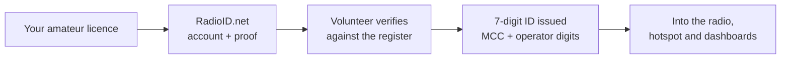
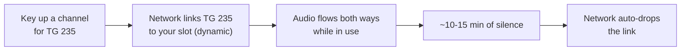
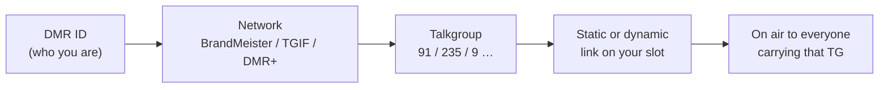

# DMR: IDs & the Networks

Every time a DMR radio transmits, it sends a number before it sends a single syllable of your voice — a seven-digit code that says, in effect, "this is me". That number is your ticket onto the network, and without it the whole system quietly refuses to route you. This chapter is about the layer above the radio itself: the identity you register, the competing networks your traffic can ride on, and the numbered "rooms" — talkgroups — that decide who hears you. If [the DMR overview](outpost:entry/logbook73.handbook/dmr) explained the two-slot machinery and [slots and talkgroups](outpost:entry/logbook73.handbook/dmr-slots-talkgroups) explained the on-radio mechanics, this one explains the plumbing that connects your handheld to a voice on the far side of the planet.

## Your DMR ID: the number that is you

Analogue FM asks nothing of you before you press the push-to-talk switch — you tune up, you talk. Digital Mobile Radio (DMR) is different: it identifies every operator by a numeric **DMR ID**, normally seven digits, that your radio transmits with every over. The network resolves that number to your callsign and name for the displays and dashboards, which is exactly why a DMR radio can show you _who_ is speaking. No ID, no transmitting — the network has nowhere to file you.

You obtain one, free, from **RadioID.net**, the single global registry shared by every major network. The process is deliberately gate-kept: you create an account, submit your callsign and **proof of an amateur licence** — a screenshot of your entry in the national licence database is the usual evidence — and a volunteer checks it against the record before approving the ID, typically within a day or two. This licence check is the whole point. It means a DMR ID is a verified claim to a callsign, not a self-declared handle, which is why the number can stand in for your identity across the entire network.

### Reading the number

The seven digits are not random. The first three are your country's **Mobile Country Code** (MCC) — the same E.212 code the telephone system uses — so the network can tell at a glance where an ID was issued. The remaining digits identify you within that country. The codes are examples worth recognising rather than memorising: `235` is issued in the United Kingdom, the `310`–`316` range in the United States, and every other country has its own. When you see an ID beginning `505` you are looking at an Australian operator; the prefix is a small piece of geography baked into the identity.

### One ID, every network, one operator

Three rules save beginners a lot of grief. First, **one ID per operator** — you register once, and the same number works on BrandMeister, TGIF, DMR-MARC and the rest. You do not register separately per network. Second, the ID is **required to transmit** but costs nothing and never expires while your licence stands. Third, if you own several radios or run a hotspot alongside a handheld, do not put the bare seven-digit ID on two transmitters that might be on the network at once — that causes routing collisions, because the network cannot tell which device is which. The fix is built in: RadioID issues **suffixed IDs**, your seven digits plus a two-digit tail (so `1234567` gains `123456701`, `123456702` and so on), giving each device its own identity while still resolving to you. Borrowing someone else's ID, or inventing a plausible-looking one, breaks routing for both of you — always use your own, verified number.

## The three networks (and why your repeater's choice matters)

A DMR ID gets you _recognised_; a **network** is what actually carries your audio from one radio to another over the internet. Amateur DMR grew several of these, run by different volunteer groups, and although they share the RadioID registry they are separate systems with different cultures and, crucially, different talkgroups. Which network a repeater or hotspot connects to therefore decides what you can reach through it.

|                    | BrandMeister                                   | DMR-MARC / DMR+                         | TGIF                                     |
| ------------------ | ---------------------------------------------- | --------------------------------------- | ---------------------------------------- |
| Character          | Largest, most flexible, feature-rich           | Older, structured, moderated            | Newest, lightweight, hotspot-centric     |
| Talkgroups         | Thousands; dynamic linking                     | Curated, moderated list                 | User-created in seconds on the dashboard |
| Infrastructure     | Many repeaters + hotspots                      | Repeater-oriented (c-Bridge heritage)   | Few repeaters, mostly hotspots           |
| Self-service       | SelfCare dashboard: SMS, APRS, live monitoring | More centrally administered             | Simple dashboard, minimal extras         |
| Cross-mode bridges | Yes — to Fusion, D-STAR, P25 and more          | Limited                                 | Limited                                  |
| Best for           | Maximum reach and features                     | Structured, well-behaved wide-area nets | Clubs and private rooms                  |

A few things the table cannot hold. **BrandMeister** is the giant — the default most newcomers meet — with a powerful self-service dashboard (its **SelfCare** pages) where you configure SMS, position reporting and static talkgroups, a live "Hoseline" web stream that lets you _listen_ to any talkgroup in a browser, and bridges that stitch DMR to other digital modes. Its flexibility is also its cost: it can be congested at peak times. Note one historical trap — BrandMeister switched off the old **reflector** linking system in 2020 in favour of talkgroups, so any instruction you find telling you to connect to a `4xxx` reflector on BrandMeister is out of date. Reflector-style linking survives on **DMR+/DMRplus**, a separate, more structured lineage, and on **DMR-MARC**, the original amateur network built on commercial c-Bridge infrastructure with a curated, moderated talkgroup list — much of its traffic is now bridged into BrandMeister anyway.

**TGIF** is the newcomer and the odd one out: lightweight, aimed at hotspot users, and notable because an ordinary operator can **create a custom talkgroup** on its dashboard in seconds. That makes it the natural home for a club net or a private family room, at the price of few repeaters and few of BrandMeister's data extras. The practical upshot: before you buy a radio or set up a hotspot, find out which network your local repeaters use, because a talkgroup only exists _within_ its network. Consult a directory such as RepeaterBook, or your national repeater listing, for each machine's network, slot, colour code and talkgroups — the same homework the [DMR overview](outpost:entry/logbook73.handbook/dmr) urges before any purchase.

## Talkgroup geography

A **talkgroup** (TG) is a numbered virtual channel — a "room" defined by subject or by geography rather than by frequency. In analogue FM a conversation lives on a frequency; in DMR it lives on a talkgroup number, and the network routes it to every repeater and hotspot currently carrying that group. The numbers form a rough hierarchy of reach, and although the exact assignments vary by network and country, the _shape_ is consistent enough to learn.

| Reach              | Typical example (check your network's list) | What it does                                        |
| ------------------ | ------------------------------------------- | --------------------------------------------------- |
| Worldwide          | `91`                                        | Global — everyone, everywhere, on that group        |
| Continental        | e.g. a Europe-wide or region group          | A whole continent or ITU region                     |
| Country / national | `235` (UK), `3100` (USA-wide)               | Everyone in one country                             |
| Regional / state   | state, county or district groups            | A slice of one country                              |
| Local              | `9` (TG9)                                   | This repeater/timeslot only — does **not** leave it |
| Special-interest   | nets, clubs, hobby and language groups      | A community regardless of geography                 |

Two numbers deserve a warning. `91` **Worldwide** reaches the entire planet, so keying it for a long local ragchew, or transmitting over a scheduled net running on it, is the classic beginner faux pas — listen first, and take a rambling chat to a quieter group. And `TG9` is the opposite trap: newcomers assume it goes far because the number is small, but **TG9 means _local_** — traffic stays on that one repeater and timeslot and never travels the network. It is the right choice for talking to someone through the same machine, and useless for reaching another country.

### Finding your talkgroups

The frustrating truth is that there is no single master list, because talkgroups belong to networks. The reliable sources are your network's own dashboard (BrandMeister and TGIF both publish searchable talkgroup lists), a directory such as RepeaterBook's DMR talkgroup and repeater pages, and — for a specific repeater — the owner's published table of slot, colour code and talkgroup. Find your **national** and **local/regional** groups from those, and you have the handful you will actually use day to day.

One networking wrinkle bites people when they program the radio. On **BrandMeister** you enter the raw talkgroup number — `91` is `91`, `235` is `235`. On **TGIF**, custom talkgroups are entered with a `4` prefix, zero-padded to seven digits, so TGIF talkgroup `777` is programmed as `4000777` and `31665` as `4031665`. A TGIF group entered as its bare number will not connect. It is a per-network convention, not a DMR rule, so always check how your chosen network expects the number written.

## Static versus dynamic in practice

A talkgroup reaches your radio only if the repeater or hotspot you are using is currently _carrying_ it, and there are two ways that happens. A **static** talkgroup is permanently linked to a particular timeslot on that machine — it is always live, always audible, whether or not anyone has spoken recently. A **dynamic** (or user-activated) talkgroup is linked _on demand_: the instant someone transmits on a channel programmed for it, the network attaches that group to the slot, keeps it up while the conversation flows, and then **automatically drops it after an inactivity timer**, usually around ten to fifteen minutes of silence.

In everyday use you set a few statics and reach everything else dynamically. On a hotspot you configure statics in the network dashboard (BrandMeister's SelfCare) or the hotspot software; on a shared repeater the owner chooses them. A sensible pattern is one or two statics — your local group, perhaps one regional favourite — so those are always there when you switch on, and then any of the thousands of other talkgroups reached simply by selecting its channel and keying up. The dynamic link lasts as long as the chat, then tidies itself away.

Two habits keep this pleasant. First, resist loading many statics onto one timeslot: several always-on wide-area groups on the same slot means constant unrelated audio and, worse, **collisions**, where two groups try to use the slot at once and traffic gets dropped. Fewer statics, more dynamics, is the calmer setup. Second, learn your network's housekeeping calls. On BrandMeister a **Private Call to `4000`** unlinks the dynamic talkgroups on that slot — a tidy way to hang up a chat you have finished. And the **Parrot** echo test, a Private Call to `9990`, records your transmission and plays it straight back, so you can check your audio, deviation and that the whole link is working without troubling another soul. Treat Parrot as your microphone check before joining a busy group.

## TX Politely: the admit criteria

There is one more network-courtesy setting that lives in the radio but matters to everyone else on the machine: the **admit criteria**, which decide _when_ your radio is allowed to transmit after you press the push-to-talk switch. Because a DMR repeater is carrying up to two live conversations, keying up blindly can stamp on someone mid-sentence. The admit criteria stop that from happening, and most manufacturers (including the budget radios many beginners start on) label them "**TX Politely**".

There are three settings:

- **Always** (impolite) — transmits the instant you key, regardless of what is on the channel. It will interrupt a conversation in progress. Reserve it for controlled tests; it is poor manners on a shared system.
- **Channel Free** (most polite) — transmits only if the RF channel is _completely idle_. Any signal at all, even one on the other timeslot or with a different colour code, blocks you. This is the courteous default on **shared or simplex** frequencies, where you cannot assume the other traffic is yours.
- **Colour Code Free** — transmits if the slot is free, _or_ if the only signal present carries the **same colour code** as yours. In plain terms, it defers to strangers on the frequency but lets you into your own busy repeater. This is the recommended default on **repeater** channels.

The colour code, remember, is DMR's equivalent of a CTCSS tone (covered in the [DMR overview](outpost:entry/logbook73.handbook/dmr)): a number `0`–`15`, usually `1` on amateur systems, that keeps co-channel machines apart. "Colour Code Free" simply reads that field to judge whether the busy channel is _your_ system or someone else's. In the "TX Politely" wording you will meet in the radio's programming software, **Off** means Always, **for Channel** means Channel Free, and **for Same Colour Code** means Colour Code Free; set the companion "In-Call Criteria" to "Follow Admit Criteria" so the rule holds mid-conversation too. Setting these correctly is not a personal preference — it is the difference between slotting into a conversation cleanly and doubling with the person already talking.

## Putting it together: identity to on-air

Stand back and the whole layer is a short chain. Your verified identity chooses nothing on its own; the network you connect through offers a set of talkgroups; you select one; and your voice is routed to everyone currently carrying it — RF at each end, internet in the middle.

Notice that only the first box is truly fixed — your ID is yours for good. Everything after it is a choice you make per conversation, and getting fluent in DMR is mostly getting fluent in those choices: which network the machine in front of you speaks, which talkgroup suits the chat, and whether it is already linked or you need to bring it up.

One legal note that spans every network. Amateur DMR is **unencrypted by rule**. The radios ship with an encryption menu because they are re-badged commercial equipment where scrambling is legal, but amateur regulations almost everywhere — the FCC's Part 97 in the United States, Ofcom's licence terms in the United Kingdom, and their counterparts elsewhere — forbid transmissions intended to obscure their meaning. Leave that setting **off** on every amateur channel, and treat DMR as fully public: anyone with a compatible radio can monitor it. Your national regulator's rules are the ones that bind you; the takeaway is the same in every country.

## Try it yourself

You can explore almost this entire layer before you ever transmit.

1. **Listen without a radio.** Open BrandMeister's Hoseline web stream and pick a busy talkgroup — your country's national group is a good start. Notice how every over is tagged with a callsign and name: that is a DMR ID being resolved in real time. Log the callsigns you catch in LogBook73's **Receive Log** with mode `DMR`.
2. **Map your local networks.** Using RepeaterBook or your national repeater directory, list every DMR repeater within ~40 km and note, for each, its **network**, timeslot and colour code. This single sheet tells you what you could actually reach and which radio makes sense to buy.
3. **Decode an ID.** From any callsign you heard, look up its DMR ID and read the first three digits. Confirm the Mobile Country Code matches where the operator is — you are reading geography straight out of the number.
4. **Plan your talkgroups.** For your chosen network, find its worldwide, national and local/regional talkgroup numbers, plus one special-interest group that appeals to you. Write down how each is entered (raw number, or a `4`-prefixed TGIF code) — that list is the core of a first code plug.
5. **Licensed already?** Register for your DMR ID at RadioID.net now — it takes minutes and the approval arrives in a day or two, so it is worth doing before your hardware arrives. Then, once you are on the air through a hotspot, send a Private Call to `9990` and hear yourself played back by Parrot before you join a live group.

## Key takeaways

- A **DMR ID** from RadioID.net — free, licence-verified, usually seven digits — is required before you can transmit; it rides every over and the network resolves it to your callsign.
- The first three digits are your **Mobile Country Code**, so an ID carries its country of issue; you get **one ID per operator** across all networks, with two-digit suffixes for extra radios and hotspots.
- The major networks differ in character: **BrandMeister** (largest, most features, reflectors retired in 2020 for talkgroups), **DMR-MARC/DMR+** (older, structured, moderated), and **TGIF** (lightweight, hotspot-centric, user-created talkgroups) — and a talkgroup exists only within its network, so a repeater's network choice sets what you can reach.
- **Talkgroups** form a geography from `91` Worldwide down to `TG9` local (which never leaves the machine); find your national and regional numbers from your network's dashboard or a directory, and mind the per-network entry convention (raw on BrandMeister, `4`-prefixed on TGIF).
- **Static** talkgroups are always linked; **dynamic** ones link on transmit and auto-drop after ~10–15 minutes idle — keep statics few to avoid collisions, use Parrot (`9990`) to test, and `4000` to unlink on BrandMeister.
- **TX Politely** admit criteria decide when you may key up: _Colour Code Free_ for repeaters, _Channel Free_ for shared/simplex, and _Always_ almost never.
- Encryption stays **off** on amateur DMR everywhere; treat it as fully public and follow your own national regulator's rules.

With your identity registered and the network map in your head, the last piece is the little box that gets you on it from your own desk — read on to [DMR hotspots](outpost:entry/logbook73.handbook/dmr-hotspots).
