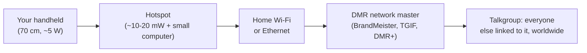
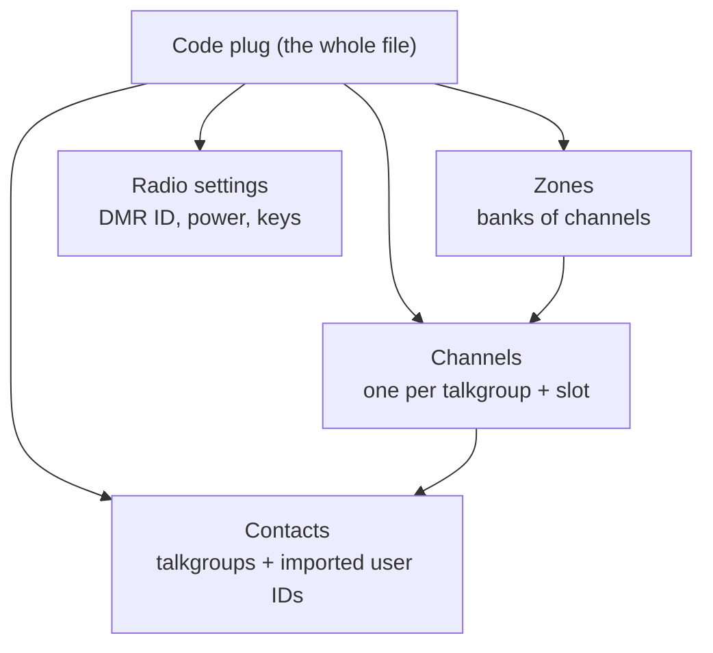
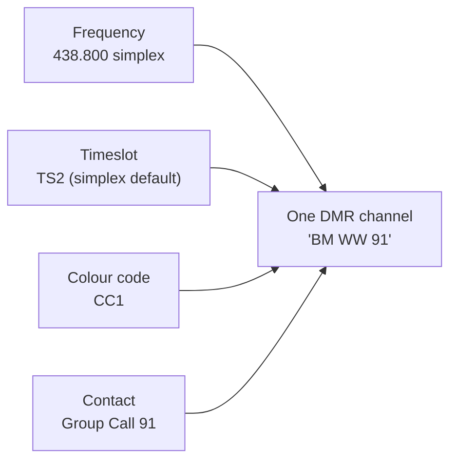

# DMR: Hotspots & Code Plugs

Your licence is framed on the wall, a pocket-money DMR handheld has arrived in the post, your [DMR ID](outpost:entry/logbook73.handbook/dmr) is registered — and then you check the repeater directory and discover the nearest DMR machine is forty miles away over a hill. This is the moment most amateurs meet the **hotspot**: a matchbox-sized gadget that turns your home internet connection into a personal gateway onto the world's DMR networks. This chapter is about that box and the file you must build to talk through it — the two practical hurdles between a new DMR radio and your first contact. It builds on the [Digital Voice](outpost:entry/logbook73.handbook/digital-voice) overview and the [DMR](outpost:entry/logbook73.handbook/dmr) chapter, so keep those handy.

## Why a hotspot, not a repeater?

A DMR **repeater** is a shared, high-power, internet-connected machine on a hilltop, covering a whole town or region. If one is within range of your antenna and it carries the talkgroups you want, wonderful — use it, exactly as you would an analogue [repeater](outpost:entry/logbook73.handbook/repeaters). But two problems push most home operators toward a hotspot instead. First, **coverage**: digital repeaters are still thin on the ground in many areas, and a handheld indoors may not reach the one that exists. Second, **freedom**: a shared repeater's linked talkgroups are chosen by its keeper, and tying up a community machine for a long natter is poor manners. A hotspot solves both at a stroke.

A hotspot is, in effect, a personal micro-repeater for your house and garden. It is a very low-power digital transceiver — typically around **10–20 mW**, a fraction of a nightlight — bolted to a small computer with an internet connection. Your handheld transmits across the room to the hotspot; the hotspot converts that RF into data and pipes it over your home Wi-Fi or Ethernet straight to the DMR network servers. The reply comes back the same way and out of the hotspot's tiny aerial to your radio. The forty-mile repeater becomes irrelevant: your gateway is on the bookshelf.

The trade you are making is honest: a hotspot gives you global reach but no wide-area RF coverage. Step out of the garden and you are out of range of your own gateway. For a licensee with a modest station, that is usually a fine bargain — the internet does the distance, and your radio does the last few metres.

### The legal footnote

A hotspot radiates RF, however faintly, so it operates **under your amateur licence**, on an amateur frequency, within your licence conditions — ten milliwatts is still transmitting. Most DMR radios include a "privacy" or "encryption" menu; on the amateur bands that must stay **off**, because rules in essentially every jurisdiction (the FCC's Part 97, comparable Ofcom terms in the UK, and other national regulators) forbid obscuring the meaning of a transmission. Your callsign, carried as your DMR ID and voiced per your national rules, must remain identifiable.

## The hotspot hardware zoo

"Hotspot" covers a small family of devices that do the same job in different packages. The distinction that matters most for your wallet and your radio programming is simplex versus duplex; the rest is which box you fancy.

The classic build is an **MMDVM** board — the initials stand for Multi-Mode Digital Voice Modem — a small circuit board that plugs onto a **Raspberry Pi** (a credit-card-sized single-board computer). The Pi runs a free operating-system image, most famously **Pi-Star**, though the newer **WPSD** image has a keen following. Because MMDVM hardware is multi-mode, the same board also speaks D-STAR, Fusion and M17, so one hotspot serves whichever digital radio you own. At the tidier end, all-in-one commercial units such as the **SharkRF openSPOT** need no separate Pi and bring their own web interface; the **DVMega** is another well-known board. Treat all of these as _examples_ — the workflow is the same whichever you buy, and prices run from a ~$30/£30 bare board to a ~$200/£200 polished all-in-one.

### Simplex versus duplex

- A **simplex** hotspot uses a single frequency: it transmits and receives on the same channel and so cannot do both at once — exactly like a handheld on simplex. It is the cheapest option (one MMDVM board) and perfectly adequate for one person monitoring one conversation at a time. A quirk to remember: because a simplex hotspot has only one real timeslot, the network makes an assumption about which slot you are on — BrandMeister, for instance, treats a simplex hotspot as **timeslot 2**. On a simplex hotspot the timeslot setting in your radio is therefore largely cosmetic.
- A **duplex** hotspot uses a transmit/receive frequency split, like a real repeater in miniature, and can genuinely handle both **timeslots** at once. It costs more and is worth it only if you want true two-slot behaviour or a small local fill-in for several radios.

For one operator in one house, simplex is the sensible default. The important thing is to match your radio's channel to the hotspot's mode: programme a **simplex** channel (transmit frequency equal to receive frequency) against a simplex hotspot. A transmit/receive split aimed at a simplex hotspot will link to nothing.

## Setting up the hotspot

Bringing a Pi-Star hotspot to life is a web-browser exercise, not a soldering one: you connect to its configuration page over your home network and fill in a handful of fields. The ones that matter conceptually are:

| Setting              | What it is                                                     | Watch out for                                                                                                                      |
| -------------------- | -------------------------------------------------------------- | ---------------------------------------------------------------------------------------------------------------------------------- |
| **DMR ID**           | Your personal RadioID number, same one that goes in the radio  | Reusing one bare ID on two live transmitters at once confuses the network — add a `01`/`02` suffix for extra devices               |
| **Modem/board type** | Which MMDVM hardware you have                                  | Pick the wrong board and the RF simply will not work                                                                               |
| **RF frequency**     | The 70 cm (or 2 m) frequency the hotspot listens on            | Choose a clear spot **away from real repeater inputs** and calling frequencies — check your national band plan                     |
| **Colour code**      | The 0–15 access code, DMR's version of a CTCSS tone            | Your radio must match it; hotspots commonly default to `CC1`                                                                       |
| **Simplex/duplex**   | Which mode above                                               | Must match how you programme the radio channel                                                                                     |
| **DMR master**       | Which network the hotspot logs into (BrandMeister, TGIF, DMR+) | For BrandMeister you must also set a **hotspot security password** in its SelfCare dashboard, or the hotspot will not authenticate |

The frequency choice deserves a moment. Ten milliwatts will not reach a distant repeater's input, but courtesy and the band plan still apply: pick a frequency that no nearby repeater or common simplex activity is using, so your hotspot's chatter stays entirely within your own four walls. Pi-Star will steer you away from obviously bad choices, but the responsibility is yours.

Switching networks later — say from BrandMeister to TGIF to try a club's private talkgroup — is just a matter of changing the DMR master field and, where required, its password. The hardware does not care which network it logs into.

## Why DMR radios are computer-programmed

Now the second hurdle. Pick up an analogue handheld and you can add a repeater from the keypad in a minute: a frequency, a shift, a CTCSS tone, done. DMR radios do not work like that, and the reason is baked into where DMR came from — the commercial land-mobile world (see the [DMR](outpost:entry/logbook73.handbook/dmr) chapter). Two things make hand-programming impractical.

First, the **contact list**. So that your radio can display _"G4ABC — Jane"_ instead of a bare number when someone speaks, it carries a database of DMR IDs mapped to callsigns and names — potentially hundreds of thousands of them, downloaded from the RadioID registry. Nobody is typing that in by hand.

Second, the **channel model**. An analogue channel is defined by two or three things. A DMR channel bundles **four**: transmit/receive frequency, timeslot, colour code, and a **contact** — the talkgroup or ID it keys up. Crucially, a channel points at exactly _one_ talkgroup. So if you use ten talkgroups, you build ten channels, all perhaps on the same frequency and colour code but each pointing at a different talkgroup. "Changing talkgroup" on DMR really means "selecting a different channel". To keep dozens of near-identical channels manageable they are grouped into **zones** — banks of channels, often capped at 16 or 250 per zone depending on the radio.

Because of all this, DMR radios are programmed by PC using **CPS** — Customer Programming Software — and the file it produces is your **code plug**: the complete configuration of contacts, the imported user database, channels, zones, scan lists and radio settings. Every manufacturer has its own CPS (AnyTone, TYT, Retevis, Radioddity); the open-source **qDMR** works across many radios and platforms. Build the code plug once, then edit it as you add talkgroups.

If you forget to import the RadioID user database, everything still works — but incoming calls show only bare seven-digit numbers instead of callsigns and names. Import it, and your radio suddenly gets sociable.

## Build your first channel

Here is the single most useful skill in DMR, worked end to end for a **simplex hotspot** on BrandMeister. We will build one channel that keys up the _Worldwide_ talkgroup, `TG91`. The frequencies below are illustrative — use whatever clear frequency you set on your hotspot, within your national band plan.

The four ingredients of a DMR channel:

Step by step in your CPS:

1. **Create the talkgroup as a contact.** In the Contacts list, add a **Group Call** named `Worldwide` with the number `91`. A channel can only point at a talkgroup that exists as a contact, so this comes first.
2. **Add a channel.** Create a new **Digital** channel and name it something you will recognise in a menu, such as `BM WW 91`.
3. **Set the frequencies.** For a simplex hotspot, receive and transmit are the _same_: `RX 438.8000`, `TX 438.8000`. (On a duplex hotspot or a repeater you would enter the split here instead.)
4. **Set the timeslot.** Choose `TS2` — the slot BrandMeister assigns a simplex hotspot. On simplex this is cosmetic, but match it anyway for tidiness.
5. **Set the colour code.** Enter `CC1` to match the colour code you configured on the hotspot. Get this wrong and the hotspot will silently ignore you — you will think you are transmitting to the world while nothing leaves the box.
6. **Set the transmit contact.** Point the channel's TX contact at the `Worldwide (91)` group call you made in step 1. This is the talkgroup the channel keys up.
7. **Drop it in a zone.** Add the channel to a zone (create one called `Hotspot` if you like) so it appears on the radio's dial.

Save, write the code plug to the radio over its programming cable, select the `BM WW 91` channel, and key up. To confirm the whole chain works without disturbing anyone, key up on a channel pointed at the **Parrot** test — a Private Call to `9990` on BrandMeister — which records your transmission and plays it straight back. Remember DMR's setup latency: press the push-to-talk switch, pause for the beat of a second, _then_ speak, or your first word is clipped.

To add a second talkgroup — say your national or regional one — you repeat the whole recipe with a new contact and a new channel, changing only the talkgroup number (and, on a duplex hotspot or repeater, possibly the timeslot). That is the rhythm of DMR: one channel per talkgroup you want to reach. The [talkgroups and timeslots](outpost:entry/logbook73.handbook/dmr-slots-talkgroups) chapter goes deeper on choosing which ones.

## Borrowing a starter code plug

Building a code plug from a blank file is a rite of passage, and doing it once — as above — teaches you what every field means. But the traditional shortcut, and the one most newcomers take, is to **borrow a starter code plug**: a ready-made file for your exact radio model, usually shared by a local club or a regional DMR group, pre-loaded with the popular talkgroups, sensible zones and the user database already imported. You load it into your CPS, change the DMR ID to your own and the hotspot frequency and colour code to match your setup, and you are on the air in minutes.

This is not cheating — it is how the community works, and the same reason people share configurations for every fiddly hobby. A shared code plug also encodes local knowledge: which talkgroups are actually used in your area, sensible zone groupings, and the correct slot and colour code for nearby repeaters. Just be sure the file matches your **exact radio model** (an AnyTone code plug will not load into a TYT), and check the frequencies against your national band plan before you transmit. Once you understand the channel recipe, editing someone else's code plug feels natural — you are just adding and tweaking channels you now fully understand.

## Try it yourself

1. **Map your gap.** Using your national repeater directory ([RepeaterBook](https://www.repeaterbook.com/) covers much of the world), list the DMR repeaters within ~40 km and note which network and talkgroups they carry. If the list is short or empty, you have just proved why a hotspot is your route in.
2. **Plan a hotspot frequency.** Pick a clear 70 cm frequency for a hypothetical simplex hotspot: check the band plan segment for simplex/hotspot use and confirm no local repeater input or calling frequency sits there. Write down the frequency, `CC1`, and `TS2`.
3. **Design three channels on paper.** For a simplex hotspot on BrandMeister, sketch a small table of three channels — Worldwide `91`, your country/region talkgroup, and Parrot `9990` — each with its frequency, timeslot, colour code and contact. This is the exact table you would type into CPS.
4. **Log the mode.** As you hear DMR stations — on a hotspot, a repeater, or BrandMeister's web audio stream — record each callsign in LogBook73's **Receive Log** with mode `DMR`, building the habit before you transmit. Note how the network resolves each ID to a name.
5. **Licensed with kit in hand?** Load or build a code plug, set your DMR ID, bring up the hotspot in Pi-Star, and make a Parrot call to hear yourself. Then key a real talkgroup, wait the beat after PTT, and log your first digital QSO in the Console.

## Key takeaways

- A **hotspot** is a ~10–20 mW digital modem plus a small internet-connected computer — an MMDVM board on a Raspberry Pi running Pi-Star, or an all-in-one like an openSPOT — that links your handheld to the DMR networks when no local repeater is in range.
- **Simplex** hotspots use one frequency and are the cheap default for a single operator (BrandMeister treats them as `TS2`); **duplex** hotspots run a real two-slot split for more money.
- Pi-Star setup means entering your DMR ID, board type, a clear RF frequency, a colour code, the simplex/duplex mode and the network master — and, for BrandMeister, a hotspot security password.
- DMR radios are **computer-programmed** because they carry a huge callsign database and because a channel points at exactly one talkgroup; the whole configuration file is the **code plug**, built in CPS software.
- A DMR channel bundles **four** things — frequency, timeslot, colour code and a contact (talkgroup) — so "changing talkgroup" means selecting a different channel, and channels are grouped into **zones**.
- Build one channel per talkgroup: create the group-call contact, set the frequencies, timeslot, colour code and TX contact, then test with the Parrot (`9990`) — and pause after keying PTT to avoid clipping your first word.
- **Borrowing a starter code plug** for your exact radio model is the accepted shortcut; change the DMR ID and hotspot settings to your own and check frequencies against your band plan.

You can now get on the air — but keying up politely is a craft of its own, so next we cover slots, colour codes, that TG9-is-not-worldwide trap and net etiquette in [DMR Operating](outpost:entry/logbook73.handbook/dmr-operating).
