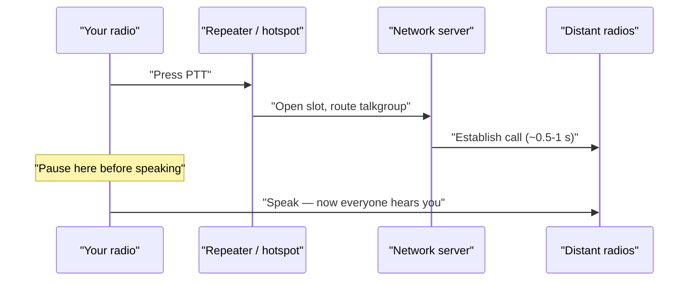
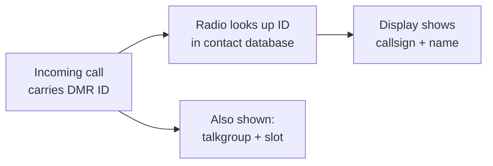
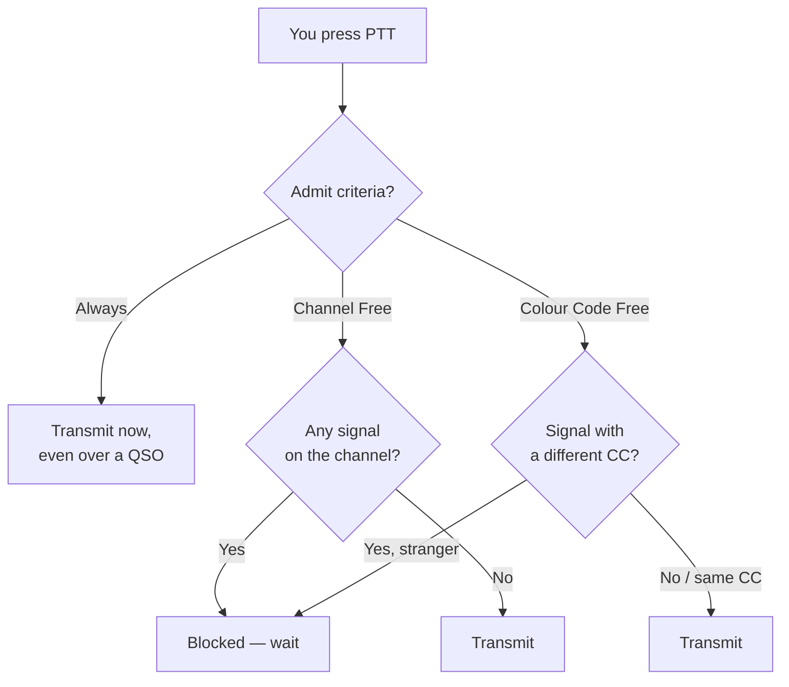
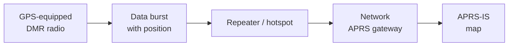

# Operating DMR

You have built a code plug, registered a [DMR ID](outpost:entry/logbook73.handbook/dmr), programmed a channel for each talkgroup, and your handheld or hotspot is finally on the network. Now comes the part no configuration file can teach: how to actually _use_ it without treading on anyone. DMR rewards good manners more than most modes, because a single careless over can tie up a talkgroup heard on hundreds of machines at once. This chapter is the on-air apprenticeship — how to make a clean call, read who is talking, listen politely, and avoid the handful of mistakes every newcomer makes.

If you have not yet met the building blocks — [talkgroups and timeslots](outpost:entry/logbook73.handbook/dmr-slots-talkgroups), [networks](outpost:entry/logbook73.handbook/dmr-networks) and [hotspots](outpost:entry/logbook73.handbook/dmr-hotspots) — read those first. Here we assume the radio is programmed and turn to the operating itself.

## Making a call, cleanly

On analogue FM you press the push-to-talk (PTT) switch and start speaking almost at once. On DMR, doing that clips your first word every single time. The reason is the chain your voice travels: the radio has to establish the digital call, the local repeater or [hotspot](outpost:entry/logbook73.handbook/dmr-hotspots) must open the timeslot, and — for anything beyond your local machine — a network server has to route the call out to every subscribed repeater and hotspot worldwide. All of that takes roughly half a second to a second, and until it completes nobody hears you.

So the rhythm is: **key up, pause a beat, then talk.** Press PTT, wait for the radio to confirm the call is established — many radios chirp or show a "TX" indicator, and on a repeater you will hear the far end open up, sometimes called the _kerchunk_ — and only then begin speaking. Everyone learns this the hard way by having their callsign chopped in half on the first over.

Two more habits make a call land where you intend. First, **confirm you are on the right talkgroup and the right slot before you key.** A DMR channel bundles four things — frequency, [timeslot](outpost:entry/logbook73.handbook/dmr-slots-talkgroups), colour code and the talkgroup it transmits to — and "changing talkgroup" really means selecting a different channel. Key the correct talkgroup on the wrong slot and your audio goes nowhere useful, while possibly stamping on the repeater's other conversation. Glance at the display, not just the channel knob.

Second, **leave generous gaps between overs.** The network needs a moment to tear down one call and set up the reply, and a dynamic talkgroup (more on those below) needs to hear activity to stay linked. A gap of a couple of seconds also lets a third station break in — the digital equivalent of "leaving a space for others" — and gives repeater keepers' hang timers room to work. Rapid-fire, no-gap exchanges that feel natural on FM will drop syllables and lock others out on DMR.

## Reading the display: who is talking

The quiet luxury of DMR is that your radio tells you who is speaking before they have finished their first sentence. Every transmission carries the sender's numeric DMR ID, and your radio looks that number up in its contact list — ideally the full user database downloaded from the global registry (RadioID.net is the usual source) — to show a **callsign and name** instead of a bare number. Build a code plug without that database and you will see only digits; import it and the display reads like a friendly caller ID.

A typical DMR display, mid-call, shows you four useful things at a glance:

- **The caller** — their callsign and name (or just their ID if uncatalogued).
- **The talkgroup** the call is on — for example a worldwide, national or regional group, shown by number or by the name you gave it in the code plug.
- **The timeslot** — TS1 or TS2 — so you know which of the repeater's two conversations you are hearing.
- **A call-type hint** — whether this is a normal **group call** (a talkgroup everyone can join) or a **private call** aimed at one individual's ID.

That last distinction matters in practice. If the display shows a group call on a talkgroup you are set up for, you can answer normally. If it shows a private call to your ID, someone is trying to reach _you_ specifically. And if you see a call on a talkgroup you are only _monitoring_ — not transmitting to — replying will not put you in that conversation, a trap the next section explains.

## Promiscuous mode: hearing everything versus hearing one thing

By default a DMR channel only un-mutes for the talkgroups you have listed for it to receive. That keeps things tidy: park on your local channel and you hear your local group, nothing else. But it also means traffic physically present on your slot — a regional net, a passing DX contact — stays silent because it is not on your receive list. Beginners often sit in apparent silence on a busy machine for exactly this reason.

**Promiscuous mode** (also labelled Digital Monitor on many radios) flips that behaviour. Switch it on and the radio decodes _every_ talkgroup on the current frequency and slot whose colour code matches, ignoring your receive filter entirely. Some radios take it further and scan for any active talkgroup and colour code. It is the tool for discovery: turn it on to learn what a repeater actually carries, to catch a call on a group you never programmed, or to keep an ear on a whole busy hotspot.

The catch is worth stating plainly, because it causes real confusion:

> Hearing a talkgroup in promiscuous mode does **not** mean your PTT joins it. Your radio still transmits only to the talkgroup its current channel is set to. Reply to something you are merely monitoring and your audio goes to a _different_ group — you will be talking past the people you meant to answer.

So promiscuous mode is for _listening_. When you hear a call on a monitored group and want to join, first switch to a channel that actually transmits to that talkgroup, then reply. Use promiscuous mode for exploration and situational awareness; turn it off when you want a quiet, focused session on one group, or a busy repeater will feel like chaos.

## Admit criteria: the "TX Politely" setting in practice

Buried in every DMR radio is a per-channel rule deciding _when_ pressing PTT is actually allowed to transmit. Manufacturers name it differently — you will see **Admit Criteria** or, on some radios, **TX Politely** — but there are three behaviours, and choosing well is the difference between a courteous operator and a channel-hog.

Read the three settings like this:

| Setting               | Behaviour                                                                                             | When to use                                                  |
| --------------------- | ----------------------------------------------------------------------------------------------------- | ------------------------------------------------------------ |
| **Always** (impolite) | Transmits the instant you key, regardless of any activity                                             | Controlled testing only — it will interrupt QSOs in progress |
| **Channel Free**      | Transmits only if the RF channel is completely idle; _any_ signal blocks you                          | Shared or simplex frequencies, to avoid doubling with anyone |
| **Colour Code Free**  | Transmits if the slot is free, or if the only signal present shares your [colour code](outpost:entry/logbook73.handbook/dmr) | The sensible default for repeater channels                   |

The logic behind **Colour Code Free** repays a second look. It lets you into your own busy repeater — where the traffic naturally carries your colour code — while still deferring to a stranger's unrelated system sharing the frequency on a different colour code. That is the polite middle ground: don't collide with outsiders, but don't lock yourself out of your own machine either. **Channel Free** is stricter and belongs on shared simplex, where any signal at all is a reason to wait. **Always** belongs almost nowhere on the amateur bands; leave it for a bench test and switch it back.

If your radio also offers an "in-call" criterion, set it to follow the admit criteria so the same politeness applies when you try to break into a call already under way. The whole point is to make your radio wait its turn automatically, the way a well-mannered operator would.

## Nets, dynamic talkgroups and the courtesy of disconnecting

The single most common etiquette failure on DMR is talking on a talkgroup heard far more widely than you realise. A worldwide group is monitored on thousands of machines; a long local ragchew there is like holding a private chat over a stadium tannoy. The remedy is simple: **listen before you transmit, and keep wide-area groups for wide-area contacts.** For a long natter, move to a quieter regional group, a club talkgroup, or your local-only group — the one that stays on your repeater or hotspot's own slot and never travels the network.

Nets — scheduled on-air meetings, often with a net controller taking check-ins — deserve special care. Before keying any talkgroup, make sure a net is not already running on it; dropping a casual call into the middle of a formal net is the classic newcomer stumble. If there is a net, either wait, check in properly when invited, or find another group.

### Dynamic talkgroups and cleaning up after yourself

Talkgroups come in two flavours, and the difference shapes your manners. A **static** talkgroup is permanently linked to a repeater or hotspot slot — always audible, always there. A **dynamic** (user-activated) talkgroup links on demand: the instant you transmit on a channel programmed for it, the network attaches that group to your slot, keeps it live while there is activity, then automatically drops it after roughly ten to fifteen minutes of silence.

That auto-drop is convenient, but the courteous operator does not wait for it. When you finish using a dynamic talkgroup — especially on a shared repeater — **disconnect it deliberately** so it stops occupying the slot for everyone else. On the largest network (BrandMeister is the common example), a private call to the special ID `4000` unlinks the dynamic talkgroups on that slot; other networks and the DMR+/reflector world have their own disconnect conventions, so check your network's documentation. Leaving a dynamic group linked because you could not be bothered to drop it is how a shared machine ends up cluttered with half a dozen strangers' leftover connections, all colliding.

The same courtesy applies to your hotspot's _static_ links. Piling many static talkgroups onto one slot produces constant unrelated audio and, worse, contention where transmissions collide and drop. Keep a small, deliberate set of statics — perhaps your local group plus one regional favourite — and reach everything else dynamically.

### The parrot: your private mic check

Before you inflict a doubtful signal on a real talkgroup, test it. Most networks run a **parrot** or **echo** service: a special destination that records your transmission and plays it straight back to you, so you can judge your audio, your deviation and whether the whole link is even working. On BrandMeister the parrot is a **private call to ID `9990`**. Key up, say a few words, unkey, and a moment later the network replays them to you alone. It bothers no one, confirms your radio and internet path end to end, and is the proper way to check a new code plug, a fresh hotspot, or a suspicious-sounding microphone. Treat it as your DMR sound check.

## Text and position: DMR's quiet data channel

DMR carries data alongside voice, and two features occasionally earn their keep.

**Short messages (SMS).** Most DMR radios can send short text messages, either to another operator's ID (a private message) or to network services. It is fiddly to type on a handheld keypad and rarely used for chat, but it is genuinely handy for passing a callsign, a frequency or a "back in five" without occupying a voice slot. Networks also expose text-based services — for example commands you message to a service ID — though these vary, so lean on your network's documentation rather than guessing.

**GPS and APRS-over-DMR.** A GPS-equipped DMR radio can report its position without a separate [APRS](outpost:entry/logbook73.handbook/aprs) rig. The radio bundles your location into a small DMR data burst; the network's APRS gateway injects it into the internet APRS system, and your station appears on the map just as a VHF APRS tracker would.

Setup has two halves that newcomers often half-finish. In the _radio_, you enable GPS and set the APRS destination to your network's data ID — on the US masters of the largest network this is `310999`, where the first three digits are the master's country code, so **check your own network's wiki for the right number**. On the _network dashboard_ (BrandMeister's SelfCare, for example), you set how your station appears on the map: callsign, SSID and icon. Miss the dashboard half and your position goes nowhere. A pleasant side effect: because the position rides a discrete data path, you never hear the tell-tale APRS _brrraap_ over your audio the way you would on a shared VHF APRS channel.

Note that not every DMR radio has GPS — many budget handhelds do not — so this is a feature of the better-equipped sets rather than a universal one.

## Encryption stays off — always

DMR radios ship with an encryption menu — often labelled Basic, Enhanced or AES — and it is a trap for the unwary amateur. These radios are re-badged commercial equipment, sold into a professional land-mobile world where scrambling traffic is licensed and legal. On the **amateur bands it is not**, essentially anywhere in the world.

The principle is close to universal: amateur regulations forbid transmissions in codes or ciphers intended to obscure their meaning. In the United States, for example, the FCC's Part 97 rules prohibit "messages in codes or ciphers intended to obscure the meaning thereof"; in the United Kingdom, Ofcom's amateur licence terms require that transmissions between amateur stations are not encrypted to obscure meaning, with only a narrow domestic-emergency carve-out. Different regulator, same conclusion — so check your own national rules, but expect them to say: **keep encryption off.**

Two practical points reinforce the rule. First, if you accidentally leave encryption on, others simply cannot decode you — you will hear silence or noise from stations who should be answering, and you will be transmitting unlawfully the whole time. Confirm the setting is disabled on _every_ amateur channel in your code plug. Second, understand that unencrypted DMR offers **no privacy anyway**: anyone with a compatible radio can monitor it, and there is no legal way for an amateur to change that. So never say anything on DMR you would not happily say on open FM. The encryption menu exists because of the radio's commercial heritage; on your licence, it is furniture you must never touch.

## Common pitfalls, and how to dodge them

Almost every "my DMR doesn't work" story is one of a short list of mistakes. Learn them once:

- **Wrong colour code — silent failure.** A mismatched [colour code](outpost:entry/logbook73.handbook/dmr) means the repeater ignores you and you hear nothing, with no error at all. Beginners assume the radio is broken. Always check the colour code first when a channel seems dead.
- **Wrong timeslot.** The talkgroup number can be right, but if it lives on TS2 and you are on TS1, nothing routes — and you may block the repeater's other conversation.
- **Talking over a wide net, or hogging a busy worldwide group.** The top etiquette failure. Listen first; move long chats to a quieter or local group.
- **Not pausing after PTT.** Network latency clips your first word. Key up, pause, then speak.
- **Leaving a dynamic talkgroup linked, or piling on statics.** Disconnect dynamics when done; keep statics few. Too many links on one slot means collisions and dropped overs.
- **Tying up a shared talkgroup with a personal hotspot.** Your hotspot connecting to a wide-area group puts your local ragchew onto every machine carrying it, exactly as a repeater would. Prefer a quiet or custom group for extended hotspot chats.
- **Replying to a promiscuously-monitored group.** Hearing a group is not joining it — switch to a channel that transmits to it before you answer.
- **Assuming DMR is private, or enabling encryption.** It is neither private nor legally encryptable on ham. Leave the setting off.
- **The digital cliff fooling you about coverage.** DMR sounds perfect until the link marginally fails, then drops to robotic garble or silence — quite unlike FM's gentle fade. Do not mistake flawless audio for a strong margin; when it starts to break up, you are already at the edge.

## Try it yourself

1. **Run a parrot check.** Program a private call to your network's echo service (`9990` on the largest network) and record a test over. Play it back and listen critically: is your audio clipped at the start (pause longer after PTT), too hot, or clean? This is the single most useful habit on DMR.
2. **Watch the caller ID work.** With the full user database imported into your code plug, monitor a busy talkgroup and note how each caller resolves to a callsign and name. Then look at a radio _without_ the database loaded and see the same calls appear as bare numbers — proof of what that import buys you.
3. **Toggle promiscuous mode.** On a busy repeater or hotspot, switch Digital Monitor on and note how much more traffic appears; switch it off and feel the channel go quiet and focused. Decide which you prefer for everyday listening.
4. **Log what you hear.** Every callsign you catch on a DMR talkgroup — whether transmitting or just monitoring — goes into LogBook73's **Receive Log** with mode `DMR`. Note the talkgroup in the comments; over a week you will map which groups are active in your region far better than any published list.
5. **Practise the disconnect.** After using a dynamic talkgroup on a shared repeater, deliberately send the disconnect (a private call to `4000` on the common network) and confirm the group drops. Making cleanup a reflex marks you out as a considerate operator.

## Key takeaways

- **Key up, pause, then talk** — DMR's network latency clips your first word if you speak the instant you press PTT, and generous gaps between overs let others break in and dynamic groups stay linked.
- The display resolves each caller's **DMR ID to a callsign and name** when the user database is loaded, and shows the talkgroup, timeslot and call type — so you always know who is talking and where.
- **Promiscuous mode** un-mutes every talkgroup on the slot for listening, but your PTT still only transmits to the channel's own group — hearing a group is not joining it.
- Set admit criteria to **Colour Code Free** on repeaters and **Channel Free** on shared simplex; leave **Always** for the test bench.
- Keep wide-area groups for wide-area contacts, never talk over a net, and **disconnect dynamic talkgroups** (and keep statics few) so you don't clutter a shared machine.
- DMR carries **SMS and GPS/APRS** data, but the position feature needs configuring both in the radio and on the network dashboard to work.
- **Encryption must stay off** — it is prohibited on amateur bands almost everywhere, offers no real privacy anyway, and exists only because these are commercial-heritage radios.

That completes the DMR series — you can now build a station and operate it courteously. Next we cross the aisle to the second of the big three, Yaesu's home-grown digital voice system, in [System Fusion and C4FM](outpost:entry/logbook73.handbook/c4fm).
