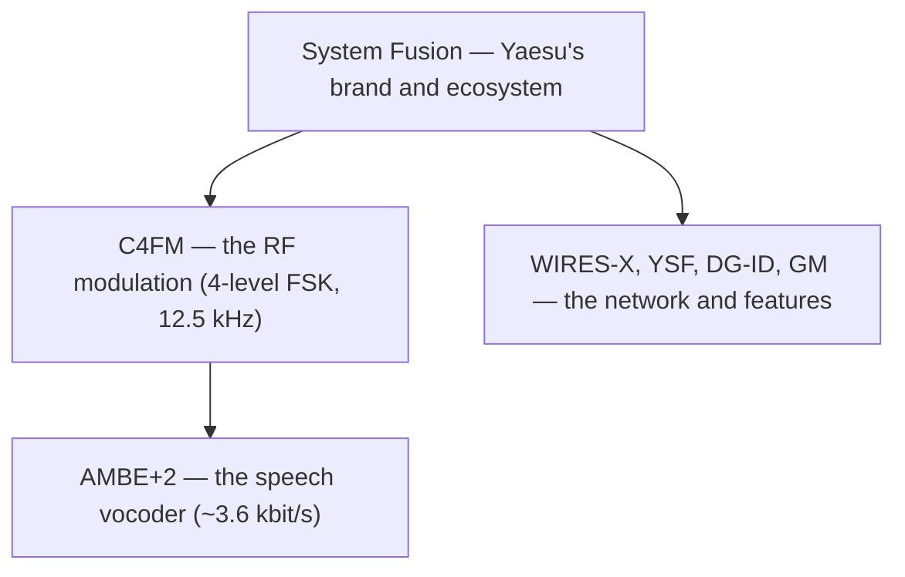
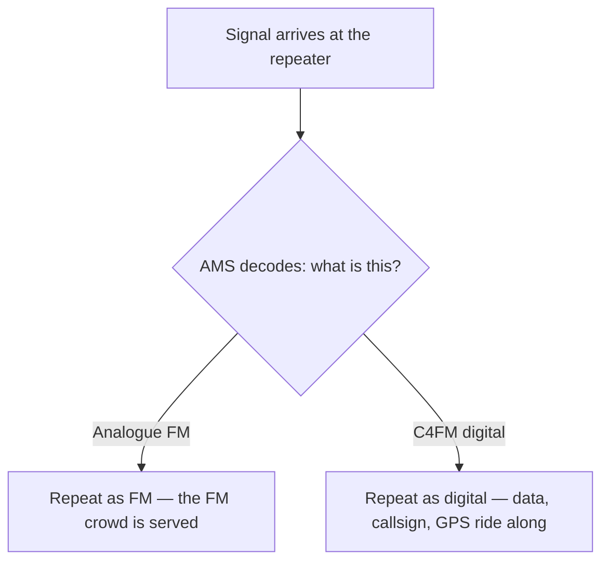

# System Fusion & C4FM

Of the three main digital-voice systems an amateur meets, one was built from the start to be gentle on newcomers — and on the club treasurer who has to justify replacing a working analogue repeater. That is Yaesu's **System Fusion**, and its party trick is that a Fusion repeater can listen to whoever keys up, decide in a fraction of a second whether they are analogue or digital, and answer in kind. This chapter opens the Fusion family: what the technology actually is under the marketing name, why it slips so easily alongside old-fashioned FM, and a map of the deeper chapters that follow. If you have not yet read the shared [digital voice](outpost:entry/logbook73.handbook/digital-voice) overview — how any voice becomes bits, and why DMR, D-STAR and Fusion cannot talk to each other over the air — start there, then come back.

## Three names for one thing

The first thing that trips people up is that "System Fusion", "C4FM" and "AMBE+2" all get used for what feels like the same subject, and they are not interchangeable. They name three different **layers**, stacked one on top of the other, and keeping them straight makes everything afterwards easier.

- **System Fusion** (often just "Fusion", and written **C4FM/System Fusion** on radio boxes) is Yaesu's brand for the whole ecosystem — the radios, the [WIRES-X](outpost:entry/logbook73.handbook/c4fm-wires-x) internet network, the presence-and-mapping features, the lot. It is a product family, not a technical term.
- **C4FM** is the actual radio modulation — the physical way the bits are painted onto the carrier. The name expands to **Continuous 4-level Frequency Modulation**: the transmitter shifts the carrier's frequency between **four** distinct levels rather than the smooth continuum of analogue FM. Because four levels encode two bits at a time (2² = 4), each symbol on the air carries two bits, and the stream runs at roughly **9.6 kbit/s** gross inside a standard **12.5 kHz** channel. It is a form of frequency-shift keying, cousin to the modulation you met in [Modulation](outpost:entry/logbook73.handbook/modulation).
- **AMBE+2** is the **vocoder** — the speech-compression algorithm that turns your voice into the low-rate data C4FM carries. It is the same proprietary AMBE-family vocoder that DMR uses, licensed from one company, which is a large part of why cross-mode contact is so awkward.



Say it once out loud: Fusion is the brand, C4FM is how it flies through the air, AMBE+2 is how the voice is packed. When a repeater listing says "C4FM", when a radio menu says "DN", when a review says "Fusion", they are all pointing at the same system from different heights.

### Four frequency levels, two bits each

Analogue FM lets the carrier wander anywhere across its deviation range in step with your voice. C4FM instead parks the carrier at one of exactly four frequencies — think of them as two "high" and two "low" steps around the centre — and each of those four states stands for a two-bit pattern (`00`, `01`, `10`, `11`). Thousands of times a second the transmitter jumps between these four rungs, and the receiver reads the rungs back into bits.

```viz
{
  "type": "wave",
  "title": "C4FM: four deviation levels, read as pairs of bits",
  "caption": "The carrier is held at one of four frequency levels per symbol; each level stands for a two-bit pattern, so the smooth wiggle of analogue FM becomes a four-rung staircase.",
  "xLabel": "time (one symbol per step) →",
  "traces": [
    { "kind": "points", "label": "4-level FSK", "tone": "primary",
      "points": [[0, 1], [0.12, 1], [0.12, -0.33], [0.24, -0.33], [0.24, 0.33], [0.36, 0.33], [0.36, -1], [0.48, -1], [0.48, 1], [0.6, 1], [0.6, 0.33], [0.72, 0.33], [0.72, -1], [0.84, -1], [0.84, -0.33], [1, -0.33]] }
  ]
}
```

This is **FDMA** — frequency-division multiple access — meaning one voice conversation fills the whole channel at a time. That is a deliberate contrast with [DMR](outpost:entry/logbook73.handbook/dmr), which uses **TDMA** to interleave two conversations in alternating time-slots on one channel, and it is why a Fusion repeater carries a single conversation where a DMR one carries two. It is also why Fusion's on-air behaviour feels so much like ordinary FM: one signal, one channel, one over at a time.

## The easy on-ramp: Automatic Mode Select

Here is the feature that defines Fusion's character and explains most of its popularity: **AMS**, Automatic Mode Select. A Fusion radio (or repeater) examines each incoming transmission, works out whether it is analogue FM or one of the C4FM digital modes, and switches its receiver to match — automatically, per transmission, with no knob-twirling from you.

The consequence for a repeater keeper is enormous. A traditional club machine forces a choice: stay analogue and keep everyone, or go digital and strand every member with an FM-only handheld. An AMS-equipped Fusion repeater refuses the choice. An analogue user keys up and hears analogue; a digital user keys up and hears digital; the same box serves both worlds off the same antenna. For a keeper eyeing an upgrade, that is the difference between a controversial rip-and-replace and a quiet swap that nobody complains about. It is the single biggest reason Fusion spread through FM repeater estates the way it did.



There is a subtlety worth flagging even in this opener, because it catches people out. AMS governs what your radio _receives_ automatically, but _transmit_ is a separate choice. On a Fusion radio you can set transmit to **AUTO** (send in whatever mode you last heard), **TX FM** (always analogue), or **TX DN** (always digital). In AUTO the radio can occasionally answer in the "wrong" mode if it mistracked a weak signal — so on a net where certainty matters, operators pin transmit to a fixed mode. The [operating chapter](outpost:entry/logbook73.handbook/c4fm-operating) returns to this properly; for now, just hold the thought that "automatic" applies to listening, not necessarily to talking.

## The four on-air modes, in one glance

C4FM is not a single digital mode but a small family, and Fusion lets a transmission use whichever suits the moment. You will meet these constantly, so here is the map — the [next chapter](outpost:entry/logbook73.handbook/c4fm-modes) takes each one apart.

| Mode     | Yaesu name              | What it does                                                                                 | Everyday use                                                |
| -------- | ----------------------- | -------------------------------------------------------------------------------------------- | ----------------------------------------------------------- |
| V/D      | **DN** (Digital Narrow) | Half the stream is voice, half is error-correction plus data (GPS, callsign, short messages) | The workhorse — repeaters, WIRES-X, YSF, anything networked |
| Voice-FR | **VW** (Voice Wide)     | The whole stream goes to voice for better fidelity; little data, weaker error correction     | Strong, close simplex where audio quality is the point      |
| Data-FR  | **DW**                  | The whole channel carries data — images, text, fast data                                     | Rare in conversation; there for completeness                |
| Analogue | **FM**                  | Plain old FM, for backward compatibility                                                     | Talking to the analogue world                               |

The one rule to carry forward: **DN is the mode for essentially everything**. It is what repeaters, WIRES-X rooms and reflectors expect, it degrades gracefully as signals weaken, and — crucially — it is the _only_ mode in which the position, callsign and group-presence data features work. VW trades all of that away for a little more audio polish on a strong local link. If in doubt, you are in DN.

## The ecosystem: a map of what comes next

Fusion is more than a modulation; it is a set of features and networks that the rest of this family of chapters explores. Think of this section as the table of contents for everything Fusion can do once your voice is bits.

### WIRES-X — the internet network

Just as [DMR](outpost:entry/logbook73.handbook/dmr-networks) has BrandMeister and [D-STAR](outpost:entry/logbook73.handbook/dstar-reflectors) has its reflectors, Fusion's internet-linking system is Yaesu's **WIRES-X**. Its geography is built from two ideas: a **node** is an RF station bridged to the internet, and a **room** is a named meeting place that many nodes and users join at once, each with a live count of who is present. You reach rooms either through a local WIRES-X repeater or by running your own node — Yaesu's **HRI-200** interface box turns a radio and a PC into a full node, and the free **Portable Digital Node** (PDN) mode does a similar job with just a compatible radio and a PC, needing no special box and no fixed public IP address. The [WIRES-X chapter](outpost:entry/logbook73.handbook/c4fm-wires-x) walks the whole thing.

### YSF reflectors — the open-source parallel

WIRES-X is Yaesu's own closed network, but a community-run parallel grew up beside it: **YSF reflectors** (and the related FCS servers), reached through an [MMDVM hotspot](outpost:entry/logbook73.handbook/dmr-hotspots) running Pi-Star or WPSD software. These give you WIRES-X-style room-hopping over open, self-hostable servers rather than Yaesu's infrastructure. Cleverly, Pi-Star offers "WIRES-X passthrough", so you can steer these open rooms from your radio's familiar WIRES-X screen. They are genuinely separate networks — only some rooms bridge between them — but for anyone without a local Fusion repeater, a matchbox-sized hotspot plus a YSF reflector is the usual way in.

### DG-ID and DP-ID — lightweight group gates

On a shared C4FM frequency you filter who you hear with a **DG-ID** (Digital Group ID): a two-digit number, `00` to `99`, set separately for transmit and receive. Set the same non-zero number at both ends and you have a private group sharing one channel; `00` is the open, universal value that hears everything. It behaves rather like a CTCSS tone on an analogue repeater — an addressing and filtering tool, emphatically _not_ encryption. Alongside it, **DP-ID** (Digital Personal ID) is a per-radio identifier the presence feature uses so specific radios can talk even with mismatched DG-IDs. These are the single most misunderstood corner of Fusion — set a receive DG-ID wrong and your radio appears to go stone deaf — so the [operating chapter](outpost:entry/logbook73.handbook/c4fm-operating) gives them a proper going-over.

### GM — see who is in range

Finally, **GM** (Group Monitor) is a feature that is essentially unique to Fusion among the big three. Switch it on and the radio passively lists other GM-active stations on the same DN frequency, colours the ones in range differently from those out of range, and — with a GPS fix at both ends — plots them on a compass with distance and bearing. For a group on a hike, a convoy, or a [SOTA](outpost:entry/logbook73.handbook/making-contacts) outing, it turns your handheld into a little situational-awareness display of who is around and how far off. GM works only in DN mode, and it is worth its own treatment later.

## Where Fusion fits — and its one big catch

Set against its rivals, Fusion's positioning is easy to summarise. It is the **friendliest on-ramp** of the three: AMS makes a mixed analogue/digital repeater painless, DG-ID gating is simpler than building a DMR **code plug** with talkgroups and colour codes, and there is no one-time callsign registration step to forget as there is with D-STAR. If your priority is "get on digital voice with the least fuss", Fusion earns its reputation.

The catch is spelled with one word: **Yaesu**. Where DMR is an open standard built by dozens of manufacturers — which is exactly why DMR handhelds are the cheapest digital radios you can buy — every Fusion radio is a Yaesu radio. There is no budget clone, no shop-around on price, no third-party handset. You are buying into a single vendor's roadmap. That is not automatically bad — single-vendor means fewer incompatibilities and a consistent menu — but it does mean Fusion radios sit in the mid-to-higher price class, and your choices are whatever Yaesu currently sells.

|                   | System Fusion (C4FM)             | DMR                           | D-STAR                        |
| ----------------- | -------------------------------- | ----------------------------- | ----------------------------- |
| RF layer          | 4-level FSK, FDMA                | 4-level FSK, TDMA (2 slots)   | GMSK                          |
| Vocoder           | AMBE+2                           | AMBE+2                        | AMBE (older)                  |
| Made by           | Yaesu only                       | Many vendors                  | Mostly Icom                   |
| Grouping idea     | DG-ID + WIRES-X rooms            | Talkgroups + colour codes     | Callsign routing + reflectors |
| Signature feature | AMS analogue/digital auto-switch | Two conversations per channel | Callsign routing              |
| On-ramp           | Easiest                          | Cheapest, most flexible       | Elegant, registration needed  |

Remember the universal rule from the [overview](outpost:entry/logbook73.handbook/digital-voice): the best mode is whichever one is _active on your local repeaters and nets_. A Fusion handheld is a paperweight in a town where every digital machine is DMR. Check your national repeater directory before you buy — that one piece of homework beats any review.

## Try it yourself

You need no licence to _receive_, so you can meet Fusion tonight:

1. **Hear the modulation.** With an [RTL-SDR](outpost:entry/logbook73.handbook/software-defined-radio), find a local Fusion repeater on 70 cm (check your national repeater directory for one listed as "C4FM" or "Fusion"; band edges differ by ITU region, so consult your band plan). In [the waterfall](outpost:entry/logbook73.handbook/ffts-and-waterfalls) a C4FM signal is a crisp, structured block quite unlike FM's fuzzy caterpillar — and if the repeater runs AMS, you may catch it alternating between analogue and digital users on the same frequency.
2. **Spot AMS in action.** Listen across several overs. When an analogue station and a digital station use the same machine back to back, you are watching Automatic Mode Select do the thing that made Fusion popular.
3. **Log what you hear.** Every callsign you catch from a Fusion repeater or a WIRES-X stream goes in LogBook73's **Receive Log** with mode `C4FM` — building the habit for when you transmit.
4. **Read a real radio's manual.** For a worked example of every feature in this chapter on an actual set — the `[X]`, `[GM]` and `[MODE]`/`[AUTO]` keys, DN-versus-VW, DG-ID setup — see the [Yaesu FT5DR C4FM guide](outpost:entry/logbook73.guide.ft5dr/c4fm). Seeing the abstractions land on real buttons makes them stick.
5. **Map your local scene.** List every repeater within reach and note its modes. If several are Fusion, a Yaesu handheld makes sense; if they are all DMR or D-STAR, you have just saved yourself a costly mistake.

## Key takeaways

- **Three layers, three names:** System Fusion is Yaesu's brand and ecosystem; C4FM is the modulation (4-level FSK, FDMA, ~9.6 kbit/s in 12.5 kHz); AMBE+2 is the vocoder. Do not use them interchangeably.
- **AMS is the headline:** a Fusion repeater auto-detects analogue FM versus C4FM per transmission and answers in kind, making it the easy upgrade path for FM repeater keepers and the friendliest on-ramp of the three digital systems.
- **DN is the everyday mode.** Of C4FM's four modes (DN, VW, DW, FM), Digital Narrow carries voice plus data plus error correction, works everywhere networked, and is the only mode where GPS, callsign and GM features function.
- **The ecosystem is a set of chapters:** WIRES-X (Yaesu's network of nodes and rooms), YSF reflectors (the open-source parallel via hotspots), DG-ID/DP-ID (lightweight group gates, not encryption), and GM (see who is in range) — each explored deeper ahead.
- **Single-vendor reality:** every Fusion radio is a Yaesu radio, so it is simpler and more consistent than DMR but offers no budget clones and sits in the mid-to-high price class.
- **Buy for your local scene.** Fusion, DMR and D-STAR do not interoperate over the air; the right choice is whatever your nearby repeaters and nets actually use — check the directory first.

With the family mapped, the next chapter zooms in on the modes themselves — DN, VW, DW and FM — and exactly when to reach for each: [C4FM Modes: DN, VW and When to Use Them](outpost:entry/logbook73.handbook/c4fm-modes).
