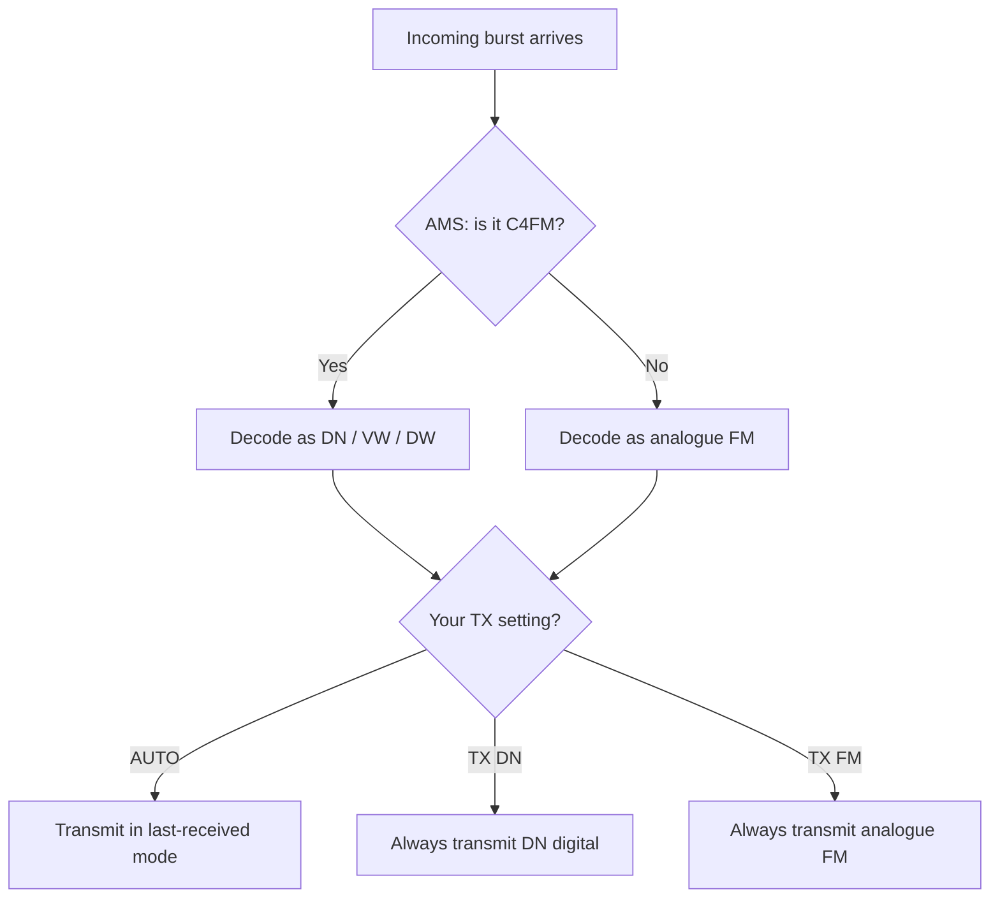
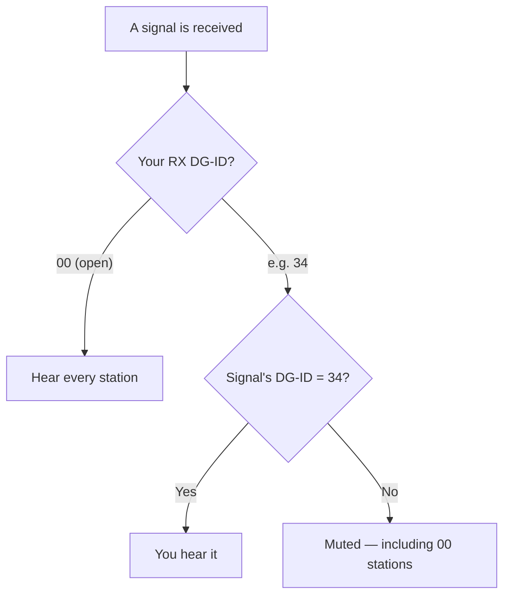
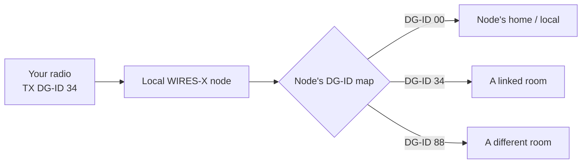

# C4FM: Modes, AMS & DG-ID

Buy a System Fusion radio and the first surprise is that it does not have _one_ digital mode — it has several, plus plain analogue FM, and it can switch between them faster than you can turn a knob. The second surprise is a pair of little two-digit numbers, `DG-ID` and `DP-ID`, that quietly decide who you hear and who hears you. Get those two ideas straight and Fusion feels effortless; get them muddled and your radio appears to go stone deaf on a busy repeater. This chapter is the map: what each transmission mode is for, how the radio picks one automatically, and how those group numbers work like a digital squelch for whole conversations.

If you have not yet met the three amateur digital-voice systems and where Fusion sits among them, start with the [digital voice overview](outpost:entry/logbook73.handbook/digital-voice) and the [C4FM primer](outpost:entry/logbook73.handbook/c4fm); this chapter assumes you know that **C4FM** — Continuous 4-level Frequency Modulation, Yaesu's four-level [FSK](outpost:entry/logbook73.handbook/modulation) — is the radio layer, and **System Fusion** (or just _Fusion_) is the brand around it.

## The four transmission modes

C4FM squeezes a gross data stream of about `9.6 kbit/s` into a `12.5 kHz` channel. What the radio _does_ with that stream is where the modes differ. There are four, and the radio's mode menu (labelled `[MODE]` on many handhelds) cycles through them.

| Mode     | Yaesu name            | What the payload carries                                        | Data (GPS, callsign, text)? |
| -------- | --------------------- | --------------------------------------------------------------- | --------------------------- |
| V/D      | `DN` (Digital Narrow) | Half-rate voice + error correction + data, simultaneously       | Yes — full data             |
| Voice-FR | `VW` (Voice Wide)     | The whole payload as full-rate voice                            | No — voice only             |
| Data-FR  | `DW` (Data Wide)      | The whole `12.5 kHz` as data — images, files, fast text         | Data only, no live voice    |
| FM       | analogue              | Ordinary [FM](outpost:entry/logbook73.handbook/modulation) voice, no digitising at all | N/A                         |

The two that matter day to day are `DN` and `VW`, and the trade-off between them is the whole story.

### DN — the everyday workhorse

**V/D mode**, which every Yaesu menu shows as **`DN`** for _Digital Narrow_, splits the bitstream in half. One half carries **half-rate voice** — your speech run through the AMBE+2 [vocoder](outpost:entry/logbook73.handbook/digital-voice) at a lower bitrate — and the other half carries **forward error correction** (the redundancy that repairs a damaged signal) _plus_ a data channel. That data channel is what makes Fusion feel modern: it ships your callsign, your GPS position and short text messages alongside the audio, so the far radio can display who is talking and how far away they are.

Because half the payload is protection, `DN` degrades gracefully. It holds intelligibility deeper into the noise than analogue FM before it "cliffs" — the abrupt drop-out that all digital voice shares. That robustness is why essentially every Fusion repeater, every [WIRES-X](outpost:entry/logbook73.handbook/c4fm-wires-x) room and every open-source YSF reflector is provisioned for `DN`. It is also the _only_ mode in which the presence-and-mapping feature called **Group Monitor (GM)** works, because GM rides on that same data channel. If you are unsure what to use, the answer is `DN`.

### VW — audio quality when you can afford it

**Voice-FR**, shown as **`VW`** for _Voice Wide_, throws the whole payload at the audio. No data channel, and much less error correction — so you get noticeably richer, fuller voice, at the cost of GPS, callsign data, GM, and a good deal of weak-signal resilience. `VW` is a strong-signal luxury: a close, stable, usually simplex ragchew between two stations where fidelity is the point and nobody needs position data.

Three cautions follow from that:

- On many handhelds `VW` is hidden until you switch it on. On the Yaesu FT5DR, for example, you must go to `Set Mode` → `[TX/RX]` → `[2 DIGITAL]` → `[4 DIGITAL VW]` and turn it `ON` (it ships `OFF`); until then the mode key only offers AMS, `DN` and `FM`.
- Because most repeaters and reflectors expect `DN`, pushing `VW` into them may not link at all, or may sound _worse_ at range — its thinner error correction gives up sooner over a marginal path.
- You cannot swap `DN` and `VW` mid-over on the same contact; both ends must be in the same mode.

### DW and FM — the bookends

**Data-FR (`DW`)** hands the entire `12.5 kHz` to data — images or high-speed file transfer — with no conversational voice. You will rarely select it by hand; it exists for completeness and for specific data applications. **FM** is exactly what it says: ordinary analogue voice, no digitising, so a Fusion radio can still work every analogue [repeater](outpost:entry/logbook73.handbook/repeaters) and simplex contact you already know. Keeping that analogue path is the whole reason Fusion migrated so easily from FM clubs — and it is what the next feature exploits.

## AMS — the radio that reads the room

Left to choose modes by hand, a mixed analogue-and-digital repeater would be miserable: you would have to know in advance whether the next station is digital or FM. **Automatic Mode Select (AMS)** removes the guesswork. With AMS on, the radio inspects every incoming burst, decides whether it is analogue FM or one of the C4FM flavours (`DN`, `VW`, `DW`), and switches the _receiver_ to match — all in a fraction of a second, before you hear a thing. One rig, one channel, and it just works whoever calls.

The subtlety, and the source of most AMS confusion, is that **receive and transmit are decided separately**. AMS auto-follows on receive; your _transmit_ mode is a second, independent choice:

- **`AUTO`** — transmit in whatever mode you last _received_. Answer a digital station digitally, an FM station in FM, automatically.
- **`TX FM`** — always transmit analogue FM, whatever you hear.
- **`TX DN`** — always transmit `DN` digital, whatever you hear.

On the FT5DR these live under an `[AUTO]` soft key that cycles `AUTO` / `TX FM` / `TX DN`, while the `[MODE]` key turns AMS on (an AMS icon appears) and, pressed again, begins cycling the fixed modes instead.

The trap lives in `AUTO`. If AMS mistracks — a noisy burst, a half-heard signal — the radio can end up transmitting in the "wrong" mode, answering a digital net in FM or an FM station in digital, so nobody hears you properly. The cure is certainty: on a known digital net, force **`TX DN`**; on a known analogue machine, force **`TX FM`**. Reserve `AUTO` for genuinely mixed channels where you want the convenience and can tolerate the occasional mismatch.

## DG-ID — a squelch for whole conversations

Here is the idea that unlocks Fusion. On an analogue FM repeater, a **CTCSS tone** (a sub-audible tone your radio adds to open a repeater, covered with [repeaters](outpost:entry/logbook73.handbook/repeaters)) keeps unwanted signals from bothering you. Fusion's digital equivalent, but far more flexible, is the **Digital Group ID**, or **`DG-ID`**: a two-digit number from `00` to `99` that tags your transmission and filters what you hear. Think of it as a private label stuck on every packet, letting many separate conversations share one frequency without treading on each other.

`DG-ID` has two independent halves — a **TX DG-ID** (the label you stamp on your own transmissions) and an **RX DG-ID** (the label your radio will listen for) — and the value `00` is special:

- **RX `00`** is _open_: you hear **every** `DG-ID`, exactly like an ordinary receiver.
- **RX** set to any **non-zero** number hears **only** that number — and silences everything else, _including_ open `00` stations.
- **TX `00`** transmits "open", audible to anyone listening on RX `00`.

That silencing behaviour is the single most common Fusion support call: "my radio has gone deaf." Nine times out of ten, RX `DG-ID` has been left on a non-zero number and is dutifully muting the whole repeater. On the FT5DR the fast fix is to press and hold `[GM]` to open the `DG-ID` screen, then press and hold `[DISP]` to slam both TX and RX back to `00`.

### A worked example

Picture four friends on a hill walk, keeping in touch on a simplex frequency from your national band plan's digital-voice segment. The frequency is busy — other groups, a passing repeater's output, general chatter. They agree on a group number: say **`DG-ID 34`**. Each operator sets **both** TX and RX `DG-ID` to `34`.

Now every one of the four stamps `34` on their transmissions, and every one listens only for `34`. To them, the frequency sounds like a private channel — they hear each other perfectly and nothing else. A walker in another party, calling on open `DG-ID 00`, is inaudible to the group, and the group is inaudible to _him_, even though they share the exact same frequency and mode. No tones to remember, no separate channel to find: one shared number carves a private room out of a crowded band.

Contrast that with joining a repeater. Many Fusion repeaters and nodes _gate_ on a `DG-ID` — you must transmit the machine's required number to be let in. There the usual recipe is different: set **TX** to the repeater's required `DG-ID` (so it accepts you), but leave **RX** on **`00`** (so you still hear the full downlink, whatever `DG-ID` it carries). Setting RX to the same non-zero number is the classic mistake that leaves you talking to a machine you cannot hear.

| Situation                       | TX DG-ID         | RX DG-ID            | Result                                            |
| ------------------------------- | ---------------- | ------------------- | ------------------------------------------------- |
| Open operating, hear everything | `00`             | `00`                | Normal — everyone hears everyone                  |
| Closed group on a busy channel  | `34` (agreed)    | `34`                | Private room; outsiders muted both ways           |
| Accessing a gated repeater/node | machine's number | `00`                | Repeater lets you in; you still hear all downlink |
| "My radio went deaf"            | anything         | non-zero by mistake | Everything else muted — reset RX to `00`          |

## DP-ID — the personal ID for Group Monitor

There is a second identity number, and it is easy to confuse with the first, so hold the distinction firmly: **`DG-ID` is a group gate you choose (`00`–`99`); `DP-ID` is a per-radio personal identity you do not.**

**Digital Personal ID (`DP-ID`)** is derived uniquely from each individual transceiver — it is the radio's own fingerprint, not a number you type. Its job is inside **Group Monitor (GM)**, the presence feature that lists who is on frequency and, with GPS, plots them on a compass. When two radios exchange transmissions under GM, they can register each other's `DP-ID`. Once registered, those two specific radios can talk **even if their `DG-ID` numbers differ** — the personal ID overrides the group gate for that pair.

One firm rule ties it back to the previous section: **`DP-ID` does nothing while RX `DG-ID` is `00`**. Open receive means "hear everyone", so there is no filtering for the personal ID to override. To use `DP-ID` you must first set a non-zero RX `DG-ID`; then the personal registrations decide who slips through. That dependency catches people out, which is why it belongs right next to the `DG-ID` rules in your mental model — and in the pitfalls list at the end.

## How DG-ID routes on WIRES-X

`DG-ID` does more than gate a local channel — on a **WIRES-X** node it can also steer you across the internet. A WIRES-X **node** is an RF station bridged to Yaesu's linking network, and a **room** is a named meeting place many nodes join at once (all covered in [C4FM and WIRES-X](outpost:entry/logbook73.handbook/c4fm-wires-x)). A node operator can map particular `DG-ID` numbers to particular destinations, so that _which number you transmit_ chooses _where your voice comes out_ — without you ever touching the WIRES-X menu.

So on a suitably configured node, transmitting `DG-ID 34` might drop you into one room and `88` into another, purely by changing the group number — a quick, radio-only way to hop destinations. The exact number-to-room mapping is entirely the node operator's choice; there are no universal assignments, so you must find each node's own scheme from its keeper or its published notes. The same trick reaches the open-source side too: a hotspot running Pi-Star or WPSD with **WIRES-X passthrough** lets `DG-ID` and the familiar WIRES-X screen steer YSF and FCS reflector rooms, even though those are a separate network from Yaesu's. The takeaway for now: `DG-ID` is not just a local squelch — on the network it can be a routing key.

## A note on legality

None of this is encryption, and that distinction matters. `DG-ID`, `DP-ID` and their equivalents on other systems are **addressing and filtering** tools — labels that decide who hears whom — not ways to _obscure the content_ of a message. Deliberately scrambling the meaning of a transmission is generally prohibited on the amateur service worldwide (your national regulator's rules will spell this out — Ofcom's licence terms in the UK, the FCC's Part 97 in the US, and their counterparts elsewhere). Filtering by `DG-ID` stays firmly on the legal side: anyone can set RX `00` and hear you plainly. Your normal station-identification duties still apply, too — C4FM embeds your callsign as data, which satisfies identification in-mode, but periodic-ID rules and your national band plan's digital-voice segments still govern the contact.

## Try it yourself

You can explore all of this with one Fusion handheld, and much of it needs no transmission at all.

1. **Watch AMS work.** With AMS on, monitor a repeater that carries both analogue and digital traffic. Notice the mode indicator flip between FM and `DN` as different stations key up — the radio is reading each burst and re-deciding. Log a couple of the digital callsigns it displays in LogBook73's **Receive Log** under mode `C4FM`.
2. **Prove the DG-ID mute.** On a busy digital frequency, deliberately set RX `DG-ID` to a non-zero number that nobody is using — say `77` — and watch the channel fall silent even though the signal meter still moves. Then reset RX to `00` (on the FT5DR: hold `[GM]`, then hold `[DISP]`) and hear it come back. You have just reproduced the number-one "deaf radio" support call on purpose.
3. **Run a closed group.** With a friend on a simplex digital frequency from your band plan, both set TX and RX `DG-ID` to the same agreed number. Confirm you hear each other, then have one of you change RX to a different number and watch the other vanish — the private-room effect in miniature.
4. **Compare DN and VW.** If your radio has `VW` enabled, arrange a strong, close simplex contact and swap between `DN` and `VW` (both ends together). Listen for the fuller audio on `VW` — and note that the position and callsign data on your screen goes quiet, because the data channel is gone.
5. **Map your local nodes.** From your national repeater directory, find Fusion repeaters and WIRES-X nodes near you and note any published `DG-ID` requirements. That one piece of homework tells you exactly what to set TX and RX to before you ever key up.

## Key takeaways

- C4FM offers four modes: **`DN`** (V/D — half-rate voice plus data and strong error correction, the everyday default), **`VW`** (Voice-FR — best audio, no data, weak-signal-fragile, strong-simplex only), **`DW`** (Data-FR — data only), and analogue **FM**.
- Use **`DN`** for anything networked or where you want GPS, callsign data or Group Monitor; reserve **`VW`** for close, strong, simplex contacts — and remember it is often disabled by default.
- **AMS** auto-selects the _receive_ mode per incoming burst; **transmit** is a separate choice — `AUTO`, `TX FM` or `TX DN` — and forcing `TX DN`/`TX FM` avoids answering in the wrong mode.
- **`DG-ID`** (`00`–`99`, separate TX and RX) is a digital squelch for whole conversations: RX `00` hears everyone, RX non-zero hears _only_ that number and mutes the rest — the usual cause of a "deaf" radio.
- For a private group set both ends to the same non-zero number; for a gated repeater set TX to its number but keep RX `00` so you still hear the downlink.
- **`DP-ID`** is a per-radio personal identity (not a number you pick) used by GM so specific radios talk despite mismatched `DG-ID`s — and it only works when RX `DG-ID` is non-zero.
- `DG-ID` is filtering, not encryption (which is generally prohibited on the amateur bands), and on a WIRES-X node it can also route you to different rooms by number.

Now that you can pick a mode and set a group, the next step is putting your voice on the network: [C4FM and WIRES-X](outpost:entry/logbook73.handbook/c4fm-wires-x) shows how nodes, rooms and reflectors carry a Fusion contact around the world.
