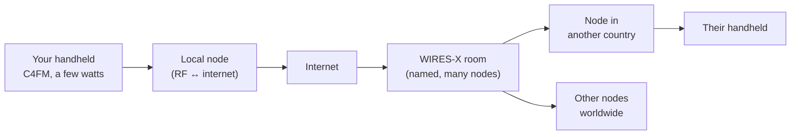
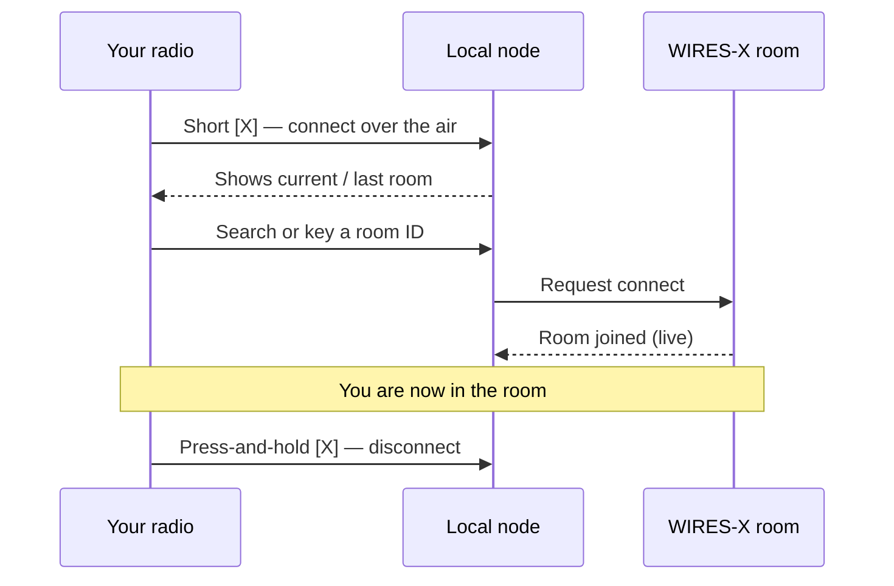
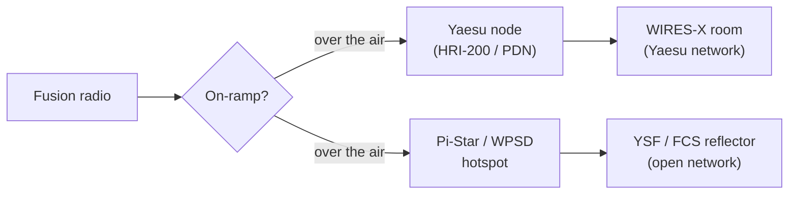

# C4FM: WIRES-X & YSF

Your Fusion handheld puts out a few watts and reaches, at best, the nearest hilltop. Yet key the right sequence and that same radio joins a conversation running across a dozen countries at once — the local hop is still radio, but everything past your antenna travels as internet data. That linking layer is what turns [System Fusion](outpost:entry/logbook73.handbook/c4fm) from a better local repeater into a worldwide network, and it comes in two flavours: Yaesu's own **WIRES-X**, and a community-built open-source parallel reached through a hotspot. This chapter shows how both work, how you drive them from the radio's `[X]` button, and how a two-digit setting called the DG-ID quietly decides which door opens.

If you have not yet met the idea that digital repeaters are almost always joined to the internet, the [Digital Voice overview](outpost:entry/logbook73.handbook/digital-voice) sets the scene; here we go deep on the Fusion-specific machinery.

## Nodes and rooms: the shape of the network

WIRES-X is Yaesu's internet-linking system for C4FM (the four-level FSK modulation Fusion transmits, covered in [the C4FM chapter](outpost:entry/logbook73.handbook/c4fm)). It is built from two kinds of thing, and almost everything else follows once you have those two words straight.

A **node** is an RF station with one foot on the air and one on the internet. It might be a full repeater on a mast, or a single low-power radio in someone's shack, but its job is the same: relay whatever it hears on the air up to the network, and play whatever comes back down out over the air. When your handheld talks to a node, the node is your on-ramp — the point where local radio becomes global data.

A **room** is a named meeting place that many nodes can join at once. Think of it as a conference call with a name and a live headcount: any node connected to a given room hears every other node in that room, so a station in one country and a station in another, each talking through their own local node, share the room and hear each other. Rooms carry an activity figure — how many nodes are currently connected — so you can see at a glance which are busy and which are ghost towns.

The mental model to hold: you never connect your radio _to a room_ directly. You connect your radio to a **node** over the air, and then you tell that node which **room** to join. The node does the internet part; your radio only ever speaks C4FM to the node in front of it. That separation is why the same handheld works identically whether the node is a mountaintop repeater or a matchbox hotspot on your desk — the radio cannot tell the difference, and does not need to.

## Building a node: the two hardware paths

Someone has to run each node, and Yaesu offers two ways to be that someone. You do not need either to _use_ WIRES-X — any node in range will do — but knowing how nodes are built explains what you are connecting to.

The full path uses a dedicated Yaesu interface box, the **HRI-200**, which sits between a compatible C4FM transceiver and a PC. The PC runs Yaesu's WIRES-X software and handles the internet side; the radio provides the RF. This is what a club or an individual builds for a proper, always-on node — a repeater or a base station that others can connect through. It needs the usual internet-facing plumbing (the software walks the router through opening the right ports), and a modest hardware outlay for the box.

The lighter path is **Portable Digital Node** mode, usually written **PDN**. Here a compatible C4FM radio plugs straight into a PC by cable, with **no HRI-200 box at all** and — importantly — no need for a fixed or publicly reachable IP address. PDN is the low-cost way for one operator to put a personal node on the air: your own radio becomes your gateway to WIRES-X rooms, much as a hotspot does, but using Yaesu's official software and your existing transceiver.

Both kinds of node appear the same to you as a user. When your handheld keys up a node — HRI-200 or PDN, repeater or shack station — you drive it with exactly the same button on your radio.

## Driving WIRES-X from the [X] button

On a Fusion radio the whole linking layer lives behind one control, usually marked `[X]` (some sets spell it out as a WIRES-X menu key). The exact labels vary by model, so treat the following as the shape of the workflow rather than a script for your particular radio — always check your model's manual.

A short press of `[X]` starts WIRES-X. The radio looks for a node it can hear on the current frequency, connects to it over the air, and shows you what that node is currently linked to — the room it last joined, or "no connection." From that screen you choose a room, and there are three usual ways to find one:

- **Search by category or nearby list** — browse the node's presets or a categorised directory.
- **Sort by activity** — Yaesu publishes a live web directory of active nodes and rooms with their headcounts, so you can note the ID of a busy room in advance and preset your radio's frequency to reach a node that carries it.
- **Direct ID or keyword** — if you already know a room's numeric ID or part of its name, key it straight in and request a connect.

Once you request a room, the node joins it and you are on the air with everyone else connected there. While you stay connected, a further short press of `[X]` re-links you to your local node (handy if the link drops or you want to hop rooms), and a **press-and-hold** of `[X]` for more than a second cancels the connection and drops you back to ordinary operation. That tap-versus-hold split — tap to connect or re-link, hold to disconnect — is worth committing to muscle memory, because the same key does two different jobs depending on how long you press it.

One important limit: an **analogue FM** user can reach a WIRES-X node too, but only by sending **DTMF** tones (the touch-tone digits) to command it, and they get none of the digital extras — no callsign display, no data. The rich experience is a C4FM-to-C4FM one; analogue is a courtesy back door.

## DG-ID: the key that opens the door

Here is the setting that most often decides whether a newcomer gets into a room or sits there baffled. The **DG-ID** — Digital Group ID — is a two-digit number from `00` to `99` that acts as a group gate on a shared C4FM channel. You set it separately for transmit (TX) and receive (RX), and it does two related jobs.

On a plain simplex frequency or a shared repeater, matching TX and RX DG-IDs to the same non-zero number gives a group a private lane: everyone in the group sets, say, DG-ID `15`, and only they hear each other, even though other Fusion users are on the same frequency. The value `00` is special — it means **open**. An RX DG-ID of `00` hears _every_ DG-ID; an RX DG-ID set to any non-zero number hears **only** that number, and mutes everyone else, including open `00` stations.

Where WIRES-X comes in is node and repeater access. A node keeper can assign a DG-ID to a function — commonly, one DG-ID that means "relay me to the internet-linked room" and another that keeps traffic local. To use such a machine you set your **TX DG-ID** to the value the node requires, so your transmissions are gated through to the room. Crucially, you normally leave your **RX DG-ID at `00`** so you still hear all the downlink coming back. Set both TX and RX to the same non-zero number and you may transmit fine yet hear nothing, because your receiver is now deaf to the `00` traffic the node sends down.

| Situation                          | TX DG-ID      | RX DG-ID      | Result                                       |
| ---------------------------------- | ------------- | ------------- | -------------------------------------------- |
| Everyday open operation            | `00`          | `00`          | Hear and are heard by everyone               |
| Node requires a DG-ID for the room | node's value  | `00`          | Gated into the room, still hear all downlink |
| Private group on a busy channel    | group's value | group's value | Only your group is audible                   |
| The "my radio went deaf" trap      | anything      | non-zero      | You hear only that DG-ID, silencing `00`     |

That last row is the single most common Fusion support call. If a room goes silent on you, check the RX DG-ID first and set it back to `00`. On many radios there is a fast path to the DG-ID screen (often a press-and-hold of a nearby key) and a shortcut to slam both TX and RX back to `00` at once — look it up for your model, because you will want it.

DG-ID is a filtering and addressing mechanism, not encryption. It hides nobody's meaning; it only chooses who is relayed and who is heard, which is exactly why it is permitted. Deliberately obscuring the _content_ of a transmission is generally prohibited on the amateur service worldwide — check your national regulator's wording (Ofcom, the FCC, ACMA, ISED and the rest all forbid it in their own words), but the principle is universal.

## The open-source parallel: YSF reflectors

WIRES-X is Yaesu's own closed network — the rooms live on Yaesu's infrastructure and the full nodes run Yaesu's HRI-200. Alongside it, the amateur community built a completely separate, open network that does much the same job for Fusion: **YSF reflectors**.

A **YSF reflector** (from _Yaesu System Fusion_) is the open-source equivalent of a WIRES-X room — a conference server that many stations link to at once. There is a companion family called **FCS** reflectors that works the same way. These run on ordinary servers, are self-hostable by anyone with a Raspberry Pi and a reachable internet port, and are catalogued in public host lists rather than a manufacturer's directory. Where WIRES-X is Yaesu's walled garden, the YSF/FCS world is the allotment next door — same crop, different owners.

You reach these reflectors not through a Yaesu node but through a **hotspot** — the same little MMDVM board plus Raspberry Pi running [Pi-Star](outpost:entry/logbook73.handbook/dmr-hotspots) (or its cousin WPSD) that also handles DMR and D-STAR. This is the answer to "there is no Fusion repeater anywhere near me": a ~$50/£50-class hotspot on your bookshelf becomes your personal node into the YSF network, covering your house on a few milliwatts and piping everything to the reflectors over your home internet. Because a hotspot transmits RF, your amateur licence still applies, and you must keep it on a sensible frequency per your national band plan — ten milliwatts is tiny, but the rules do not have a lower power limit.

### WIRES-X passthrough: driving the open network with the familiar button

The clever part is that Pi-Star supports something called **WIRES-X passthrough**. With it enabled, your hotspot lets you steer YSF and FCS reflectors from the radio's own **WIRES-X screen** — you drive the open network using the very same `[X]` workflow and room-number entry you would use for Yaesu's rooms. The software running on the hotspot maps your familiar "connect to room number" gesture onto "link to reflector number." So you learn one set of controls on the radio and use it for both networks, with the hotspot quietly translating.

That convenience hides a genuine boundary, and it is worth stating plainly: **WIRES-X and YSF are separate networks.** A WIRES-X room and a YSF reflector are not the same place; connecting to one does not put you in the other. Only certain FCS reflectors are deliberately bridged across to WIRES-X rooms, and only where a keeper has set that up. Assuming the two are one network is a classic source of confusion — you call CQ in a busy WIRES-X room from your hotspot expecting a YSF crowd, and hear nothing, because you are steering the open side and they are on Yaesu's. Know which network your on-ramp belongs to.

### Choosing your on-ramp

Which path you use is really a question of what is around you and what you own:

|                         | WIRES-X                  | YSF reflectors              |
| ----------------------- | ------------------------ | --------------------------- |
| Owner                   | Yaesu (closed)           | Open-source community       |
| Full node hardware      | HRI-200 box, or PDN mode | Pi-Star / WPSD hotspot      |
| Meeting place           | Room (activity count)    | Reflector (host list)       |
| Directory               | Yaesu's active-node list | Public reflector host lists |
| Drive it from the radio | `[X]` natively           | `[X]` via passthrough       |
| Bridged to the other?   | Only some FCS rooms      | Only some FCS reflectors    |

If your area has a Fusion repeater on WIRES-X, that is your easy entry — no equipment beyond the radio. If it does not, a hotspot into the YSF network gets you on the air from home, and passthrough means the radio feels almost the same either way.

## A note on modes

One detail links back to [the C4FM modes](outpost:entry/logbook73.handbook/c4fm-modes): virtually all of this networked operation happens in **DN** mode (also called V/D — the standard digital-narrow mode that carries half-rate voice plus data and callsign). Rooms and reflectors are provisioned for DN, and the callsign display, position and messaging that make Fusion feel modern all ride in DN's data half. The full-rate **VW** voice mode trades that data away for fidelity and weaker error correction, so it is a strong-signal, simplex luxury — pushing it into a DN-provisioned room may not pass cleanly. When in doubt on the network, stay in DN.

## Try it yourself

1. **Browse the directory before you touch a radio.** Open Yaesu's live WIRES-X active-node and room list in a web browser and sort by activity. Note two or three busy rooms and their IDs. You are reading the same headcount your radio would show, and building a shortlist of somewhere to call.
2. **Find your nearest on-ramp.** Using your national repeater directory (the RSGB's in the UK, RepeaterBook across much of the world), list every Fusion/C4FM repeater within ~40 km and note which run WIRES-X. If the answer is "none," you have just proved the case for a hotspot.
3. **Map the two networks.** On paper, draw your radio, then two branches — one to a WIRES-X room via a Yaesu node, one to a YSF reflector via a hotspot. Label which button drives each (both `[X]`, but one native and one via passthrough). Making the split explicit now saves the "why can't I hear them?" confusion later.
4. **Rehearse the DG-ID reset.** Even without transmitting, open the DG-ID screen on a borrowed or owned Fusion radio and practise setting TX to a value and RX back to `00`, then zeroing both. When a room goes quiet on you for real, this will be reflex.
5. **Log what you hear.** If you can listen to a Fusion node — over the air, or a friend's hotspot — put each callsign the radio displays into LogBook73's **Receive Log** with mode `C4FM`, and note which room or reflector it came from. It is the same habit you will want when you start calling into rooms yourself.

## Key takeaways

- WIRES-X is built from **nodes** (RF stations gatewayed to the internet) and **rooms** (named meeting places many nodes share); you connect your radio to a node over the air, then tell the node which room to join.
- A full node uses Yaesu's **HRI-200** box plus a PC; **Portable Digital Node (PDN)** mode runs a radio straight into a PC with no box and no fixed IP — the cheap way to run your own.
- You drive it all from the `[X]` key: tap to connect or re-link, press-and-hold to disconnect; find rooms by category, by activity, or by keying an ID. Analogue users get in only via DTMF, with no digital features.
- **DG-ID** (`00`–`99`, set separately for TX and RX) gates access: set TX to a node's required value, keep RX at `00` to still hear the downlink. A non-zero RX DG-ID silences everyone else — the commonest "my radio went deaf" trap.
- **YSF (and FCS) reflectors** are the open-source parallel to WIRES-X rooms, reached through a **Pi-Star/WPSD hotspot** — the way onto Fusion when no local repeater exists.
- **WIRES-X passthrough** lets a hotspot steer YSF/FCS reflectors from the radio's WIRES-X screen, so one workflow drives both — but the two networks are **separate**, bridged only where certain FCS rooms are deliberately linked.
- Nearly all networked Fusion runs in **DN** mode; that is where the callsign, position and data live.

With the linking layer mapped, the next step is putting it to use on the air — call signs, nets, etiquette and the small courtesies that make a good digital contact. Carry on to [C4FM operating](outpost:entry/logbook73.handbook/c4fm-operating).
