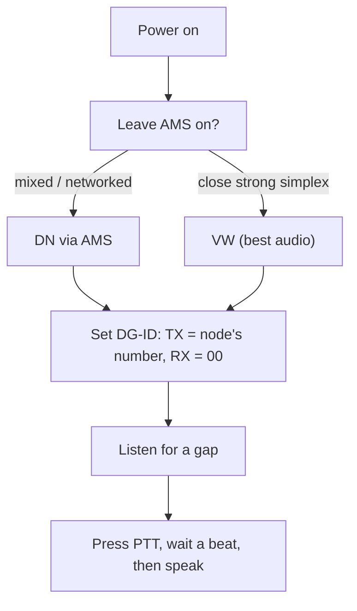
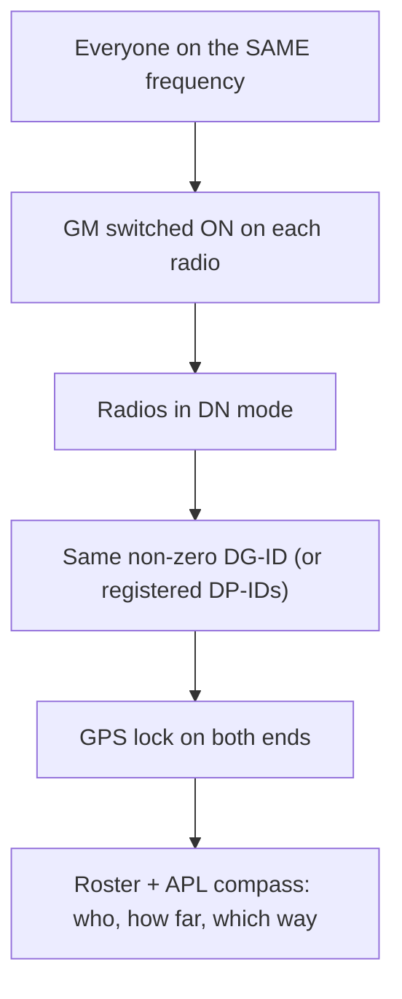
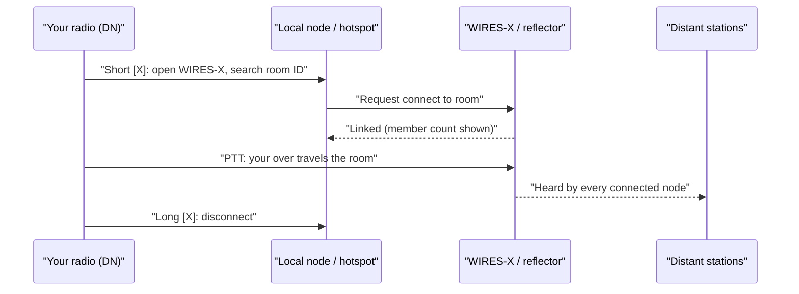

# Operating Fusion & GM

You have the radio, you understand [C4FM](outpost:entry/logbook73.handbook/c4fm), you know the [four modes and the DG-ID gate](outpost:entry/logbook73.handbook/c4fm-modes), and you have read how [WIRES-X and its open cousins](outpost:entry/logbook73.handbook/c4fm-wires-x) stitch repeaters together over the internet. This chapter is the part nobody prints on the box: how to actually _operate_ — which knob to turn before you key up, how to see who else is out there with Group Monitor, and how to share a globe-spanning room without becoming the station everyone mutes. It closes the System Fusion series, so we will also be honest about the two things reviews gloss over: the audio, and the fact that one company builds all of it.

## A day on Fusion: the flow before you talk

Fusion rewards a small ritual before your first over. Three questions, in order, and you are on the air correctly rather than transmitting into silence or answering a digital station in analogue.

**One — what mode?** For essentially everything you will do, the answer is **DN** (Digital Narrow, also written V/D for voice-and-data). DN splits the bitstream between half-rate voice and a generous helping of error correction plus data — your callsign, your GPS position, short messages — and it is what every repeater, every WIRES-X room and every reflector expects. Leave the radio in **AMS** (Automatic Mode Select) and it will decode each incoming burst — analogue FM or one of the C4FM modes — and match its receiver automatically, which is exactly why a Fusion set is such a painless single radio for a club machine that carries both. The one mode you might deliberately choose instead is **VW** (Voice Wide, full-rate voice): the whole payload goes to audio for noticeably richer sound, at the cost of data and much of the error protection. That makes VW a strong-signal, close-in, simplex luxury and nothing more — push it into a repeater provisioned for DN and it may sound worse at range or not pass at all. When in doubt, DN.

**Two — what DG-ID?** The **Digital Group ID** is a two-digit number, `00` to `99`, that gates who you hear and who hears you on a shared frequency. It is set separately for transmit and receive, and the trap is the receive side: `RX 00` hears every group, but any non-zero `RX` value hears _only_ that number and silences everyone else — the classic "my radio has gone deaf" support call. For a repeater or node that demands a particular DG-ID, the usual setup is `TX` = the machine's required number, `RX` = `00`, so you unlock the input but still hear all the downlink. Group of friends on a simplex channel? Same non-zero number both ends, and the rest of the frequency's traffic melts away.

**Three — call.** Listen first, leave a beat after pressing the push-to-talk (the vocoder and any network link add a fraction of a second — your first word is clipped otherwise), then call as you would on FM.

That is the whole pre-flight. Everything else — rooms, Group Monitor, media — sits on top of a radio that is already in DN with the right DG-ID.

## Group Monitor: seeing who is out there

**Group Monitor**, or **GM**, is System Fusion's party trick and the feature the other digital modes simply do not have. Switch it on and the radio passively watches the current frequency for other stations that also have GM running, and builds a live roster of them: who is present, whether each one is close enough to work, and — when both radios have a GPS fix — how far away they are and in which direction. It turns a bare frequency into a little situational-awareness display.

On a set like the FT5DR (whose GM and PMG buttons the [FT5DR guide](outpost:entry/logbook73.guide.ft5dr) walks through key by key) the roster holds up to twenty-four stations. Callsigns you can currently work are drawn in white; stations that have drifted out of range go grey but stay listed, so you watch someone fade rather than vanish. Tap through to the **APL** screen — Automatic Position Locating — and up to four members are plotted on a compass centred on you, each with its bearing and distance, out to a radius of around 1,000 km. You can pick North-up or heading-up, and register a member's live position as a navigation target to steer towards.

Where GM earns its keep is any activity where a scattered group needs to keep loose track of each other without constant "where are you now?" overs: a hilltop [SOTA or POTA](outpost:entry/logbook73.handbook/making-contacts) team spread across a summit, a convoy of vehicles, a club event with marshals dotted around a course, a search on foot. Nobody has to describe their position; the radios trade it in the background.

Three conditions are non-negotiable, and they are where GM outings go wrong. First, GM lives in **DN** — position and data exchange only happen there, so switching GM on actually forces the radio to its A-band and to DN, and a member who has wandered into VW or FM simply will not appear. Second, everyone must be on the _same_ frequency with GM on and, unless you have registered each other's **DP-IDs**, the same non-zero DG-ID. (A DP-ID — Digital Personal ID — is a per-radio identifier the sets swap during a GM contact, letting two specific radios keep talking even when their DG-ID numbers differ; it only works with `RX` DG-ID set non-zero, so it is the opposite of the `RX 00` default.) Third, distance and direction need a GPS fix at both ends — no lock, no arrow.

GM also carries media between members: short text (a bank of ready-made standard messages plus a handful you write yourself), recorded voice snippets, and pictures from a camera microphone. All of that — and only that, not the voice and position basics — needs a **microSD card** formatted in the radio; note that the high-capacity microSDXC format is not supported, so stick to a modest card. It is a lovely feature for an event, and completely optional for a natter.

## Connecting a room, and calling through it

Voice-plus-position on a local frequency is only half of Fusion. The other half is reaching a **room** — a named meeting place that ties many stations together over the internet through **WIRES-X**, Yaesu's linking network. A **node** is a single RF station bridged to the internet; a room is where a crowd of nodes and hotspots gather, each room showing a live count of who is connected. Key into a busy room and your handheld is suddenly in a net that spans continents.

Getting into one is a short conversation with whatever node you are using — a local WIRES-X repeater, or your own hotspot. On the FT5DR the WIRES-X button is marked `[X]`: a short press opens the WIRES-X screen, where the radio shows your current or last connection and lets you search — by category, by most-active rooms, or by typing a room's ID or name directly — then request the link. While connected, another short `[X]` re-links you to your local node; a long press (over a second) drops the connection and backs out. Analogue-only operators can reach WIRES-X too, but they connect with DTMF tones and get none of the digital extras.

If there is no WIRES-X repeater near you, a [hotspot](outpost:entry/logbook73.handbook/repeaters) running Pi-Star or similar reaches the open-source **YSF reflector** network instead — the community's parallel to Yaesu's rooms. Handily, that software can offer "WIRES-X passthrough", so you steer reflectors from the very same `[X]` screen by dialling their numbers. The two networks are genuinely separate, but the operating gesture is the same.

## Registration and admin: refreshingly little

Here Fusion is the gentlest of the three big systems. To simply get on the air and talk — locally, through a club repeater, into a room via someone else's node — you need your amateur **licence** and your **callsign** programmed into the radio, and nothing more. There is no central user ID to apply for, no equivalent of a DMR ID from a registry. Your callsign travels embedded in every DN transmission as data, so the far radio displays who is speaking without any sign-up on your part.

The registration that does exist is for the people who _run_ the infrastructure. If you decide to stand up your own **WIRES-X node** — bridging a radio to the internet, either with Yaesu's HRI-200 interface box and a PC, or in the cheaper Portable Digital Node software mode that needs neither the box nor a fixed public IP address — you register that node and its room with Yaesu's system to receive an ID others can find and connect to. Running an open YSF reflector is similar in spirit: you register the server with the community host list so hotspots can dial it. But as an operator who just wants to press the button and chat, you are spared all of it.

One point of law worth stating plainly, because it looks like a lock. DG-ID and DP-ID are **addressing and filtering**, not secrecy — they decide who your radio bothers to play, not what a monitoring station can decode. That distinction matters: deliberately encrypting or obscuring the _meaning_ of a transmission is generally prohibited on the amateur service worldwide (Ofcom's licence in the UK and the FCC's Part 97 in the US both forbid it, and your national regulator will say the same), whereas a group gate that anyone with the number can join is perfectly legal. Your normal station-identification duties still apply, too; the embedded callsign satisfies them in-mode, but the usual "identify periodically" rules in your licence still govern the QSO.

## Etiquette: you are sharing a global machine

The moment you connect to a room you stop being a local station and become one voice among many, some of them on the far side of the planet. A few habits keep you welcome.

**Leave gaps.** This is the big one and it has two reasons. Networks and repeaters need a moment between overs to un-key, re-key and let the audio catch up across the internet, and other operators need a window to break in. So drop a deliberate two-second pause at the end of each over before anyone replies, and — separately — wait that beat after pressing PTT before you speak, so the link is fully up and your opening word survives. On a linked system, silence is not dead air; it is the space the network and other people live in.

**Do not hog the room.** A large room is shared by everyone connected to it, worldwide. A long ragchew that would be perfectly friendly on a quiet local repeater ties up hundreds of stations who cannot get a word in. If you want a proper natter, take it to a quieter room, agree a private DG-ID on a simplex frequency, or use your own hotspot where you are only tying up yourself. Treat the big rooms as somewhere to make contact and move on, not somewhere to camp.

**Announce your linking.** If you connect a shared repeater to a distant room, say so — "linking to room X" — and, on the way out, disconnect it and drop it back to its default rather than leaving it pointed somewhere odd for the next person. On a repeater the room is a shared setting, and the next operator inherits whatever you left.

**Mind the `RX 00` rule in a group.** If your radio has "gone deaf" it is almost always a non-zero receive DG-ID muting everyone; know how to slam both TX and RX back to `00` (on the FT5DR, that shortcut lives on the DG-ID screen). Leaving a set filtered to a group you have left is a quiet way to miss calls.

## Honest notes: the audio and the single vendor

Two things the marketing skips.

**The audio.** In DN, half the payload is error correction, which leaves half-rate voice — and it sounds like it. Good Fusion audio through a clean channel is clear and perfectly intelligible, but it carries the faintly compressed, slightly synthetic character common to every [digital voice](outpost:entry/logbook73.handbook/digital-voice) mode that leans on the AMBE vocoder family. VW noticeably improves fidelity by spending the whole payload on voice, which is precisely why people who care about how they sound reach for it on strong simplex links — at the cost of the data and robustness that make DN the sensible default everywhere else. And like all digital voice, Fusion degrades to a point and then _cliffs_: it holds intelligibility deeper into the noise than analogue FM, then, over a small change in signal, goes robotic and drops out rather than fading gently. This is a trade, not a triumph; FM still wins at the ragged fringe.

**The single vendor.** System Fusion is Yaesu's, end to end. The radios are Yaesu, the C4FM modulation is Yaesu's implementation, the WIRES-X network is Yaesu's, and the HRI-200 node interface is Yaesu's box. That coherence is exactly why Fusion is the friendliest of the three modes to adopt — the AMS auto-bridge to analogue and the simple DG-ID gate really do make it plug-and-play — but it is also a genuine dependence on one company's roadmap, pricing and support. The open-source YSF reflector world softens this by giving you a linking network Yaesu does not own, reachable from the same radio, and it is well worth leaning on. Contrast this with [DMR](outpost:entry/logbook73.handbook/dmr), an open commercial standard with radios from many makers, and you can see the shape of the choice: Fusion trades vendor breadth for a smoother out-of-the-box experience. Neither is wrong; know which you are buying.

## Try it yourself

1. **Run the pre-flight from memory.** On your radio (or a friend's), set DN via AMS, then open the DG-ID screen and deliberately set `RX` to a non-zero number. Notice the frequency go silent — that is the "deaf radio" fault in miniature — then reset both TX and RX to `00` and hear it come back.
2. **Watch a room without transmitting.** If a WIRES-X repeater is in range, connect (or listen to a hotspot on the bench) and just monitor a busy room for ten minutes. Time the gaps between overs and count how many stations the room says are connected — it recalibrates how you will pace your own overs.
3. **Try GM with one other operator.** Agree a simplex frequency, both switch to DN, set the same non-zero DG-ID, enable GM, and get a GPS lock outdoors. Walk apart and watch each other's callsign move on the APL compass and eventually turn grey. It is the clearest way to feel what GM is for.
4. **Log every callsign you catch.** Each station you hear on a Fusion repeater or room — its callsign displayed for you on screen — goes into LogBook73's **Receive Log** as mode `C4FM`. Do it while monitoring and you build the logging habit before you ever key up, and you leave a record of which rooms are active near you.
5. **Read the button guide.** If your radio is an FT5DR, walk through the [FT5DR guide](outpost:entry/logbook73.guide.ft5dr) for the exact tap-versus-hold behaviour of the `[X]`, `[GM]` and `[PMG]` keys — each does one thing pressed and a different thing held, and knowing which is which turns fumbling into fluency.

## Key takeaways

- Before you key up, settle three things in order: **mode** (DN via AMS for almost everything; VW only for strong simplex where audio quality is the point), **DG-ID** (`TX` = the node's number, `RX` = `00` so you still hear the downlink), then listen and call.
- **Group Monitor (GM)** is Fusion's unique feature: a live roster of nearby GM stations with distance and direction on the APL compass — but only in **DN**, only on a shared frequency with matching non-zero DG-ID (or registered DP-IDs), and only with a GPS lock at both ends.
- A **room** is a shared internet meeting place reached through a WIRES-X **node** or a hotspot; the same `[X]` workflow also steers open-source **YSF reflectors** via passthrough.
- Everyday operating needs **no central registration** — your callsign travels embedded in DN; only node and reflector _operators_ register their infrastructure.
- DG-ID and DP-ID are **filtering, not encryption**, and deliberately obscuring a message is generally prohibited on the amateur service — check your national regulator and keep identifying as your licence requires.
- Etiquette on a linked network: **leave two-second gaps** so links and other stations can break in, **do not hog** globally-shared rooms, and announce and tidy up any linking you do on a shared repeater.
- Be honest about the trade: DN's half-rate voice sounds slightly synthetic and cliffs like all digital modes, and the whole ecosystem is **one vendor** — the source of both its plug-and-play ease and its dependence.

That is System Fusion, front to back. The last of the big three takes a different philosophy again — your callsign is not just embedded data but the very thing the network routes on — so meet [D-STAR](outpost:entry/logbook73.handbook/dstar), the amateur-native mode built around who you are calling.
