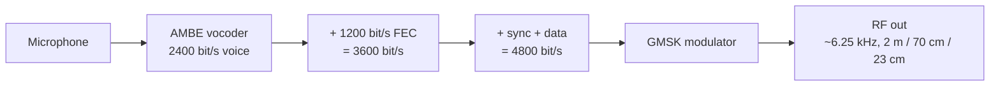
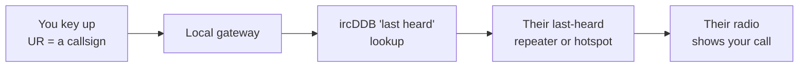
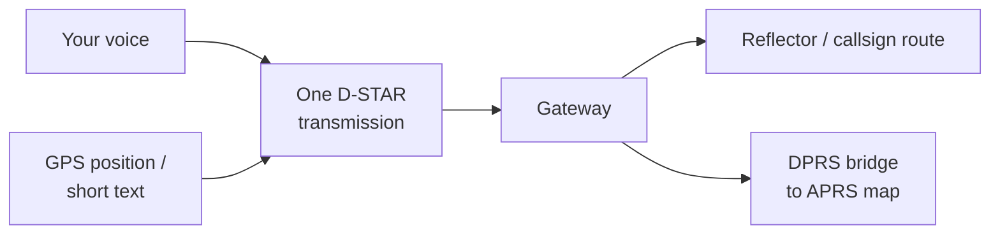

# D-STAR

Of the three digital-voice systems you will meet on the amateur bands, one was designed from a blank sheet _by radio amateurs, for radio amateurs_ — and it wears that heritage on its sleeve. Where the others borrowed their guts from the commercial two-way trade, D-STAR asked a different question: not "how do we carry more calls per channel?" but "how do we let one licensed operator find and talk to another, anywhere, by nothing more than their callsign?" That single idea — your callsign woven into every transmission — shapes everything that follows. This chapter is the doorway to the D-STAR family: what it is, the one idea that makes it tick, and a map of the deeper chapters to come.

If you have not yet read the shared [Digital Voice](outpost:entry/logbook73.handbook/digital-voice) overview — how any voice becomes bits, and why DMR, D-STAR and Fusion cannot talk to each other over the air — start there. This chapter assumes it and goes deeper on D-STAR alone.

## What D-STAR actually is

**D-STAR** stands for **D**igital **S**mart **T**echnologies for **A**mateur **R**adio, and the emphasis belongs on those last three words. It began as a research project of the **JARL** (the Japan Amateur Radio League — that country's national amateur society, the equivalent of the RSGB, the ARRL or the DARC), funded by Japan's then Ministry of Posts and Telecommunications, and was published as an open specification in 2001. "Open specification" matters: anyone may build a D-STAR radio or write D-STAR network software, which is why much of the linking infrastructure you will meet is free and community-maintained. In practice, though, **Icom** builds almost all the radios — a handful of Kenwood models aside — so in the shop D-STAR and Icom are nearly synonymous. The first commercial hardware, the IC-2200H, shipped in April 2004.

Under the bonnet, D-STAR's everyday voice mode (called simply **DV**, for Digital Voice) works like this. Your speech is compressed by an **AMBE** vocoder — a **vocoder** being a codec built specifically to model human speech and transmit only its parameters, covered in the [Digital Voice](outpost:entry/logbook73.handbook/digital-voice) overview. That produces a **3600 bit/s** stream: 2400 bit/s of actual voice plus 1200 bit/s of forward error correction (spare bits that let the receiver repair damage from noise). Add sync patterns and a data channel, and the whole thing becomes a **4800 bit/s** stream that modulates the carrier using **GMSK** — Gaussian Minimum Shift Keying, a smooth, bandwidth-efficient cousin of the frequency-shift keying you met in [Modulation](outpost:entry/logbook73.handbook/modulation). The result occupies roughly **6.25 kHz** of spectrum — narrower than a typical analogue FM channel — and works on the 2 m, 70 cm and 23 cm amateur bands (check your national band plan for the exact segments).

Two footnotes worth carrying forward. First, that AMBE vocoder is the _original_ AMBE generation, older than the AMBE+2 used by DMR and Fusion — one reason some amateurs describe D-STAR audio as slightly thinner or more "robotic" than its rivals. The vocoder is patented (owned by a company called DVSI) and normally runs on a dedicated chip inside the radio; that is an intellectual-property matter, quite separate from whether D-STAR is legal to transmit, which it plainly is. Second, D-STAR defines a rarely used high-speed mode too — **DD** (Digital Data), a 128 kbit/s Ethernet-like link on 23 cm only. Most operators never touch it; when people say "D-STAR" they mean DV.

## The one idea: your callsign is the address

Here is the signature move, the thing that makes D-STAR _D-STAR_. Every single transmission carries a short header — sent before the voice, over the data part of that 4800 bit/s stream — and inside that header are **four callsign fields**. Your own callsign goes in one of them, so the far radio always knows exactly who is talking and can display it. But the deeper consequence is **callsign routing**: because the network knows which repeater or hotspot each callsign was last heard on, you can address a transmission _to a person by their callsign_ and the network will deliver it wherever they currently are — without you knowing their location.

Think of it as the difference between broadcasting into a room and posting a letter. DMR and Fusion mostly work like tuning to a shared channel — a numbered talkgroup or a named room — and whoever is on that channel hears you. D-STAR can do that too, but its founding vision was the letter: write a callsign on the envelope, drop it in, and the postal system (here, a distributed "last heard" database called **ircDDB**) works out which sorting office to route it through. That is a genuinely different philosophy of how a voice network should be organised, and it is why D-STAR feels so amateur-native — identity on this network _is_ your callsign, not a number issued by a database.

Those four callsign fields — with the memorable names `MYCALL`, `UR`, `RPT1` and `RPT2` — are the beating heart of D-STAR, and getting them right (or letting the radio fill them in for you) is what separates "my local repeater works but nothing reaches the wider network" from a working global setup. They deserve a chapter of their own, and they get one: [D-STAR Routing](outpost:entry/logbook73.handbook/dstar-routing) takes the postal metaphor apart field by field. For now, just hold the headline — **on D-STAR, your callsign is the address**.

## Registration: the price of the postal system

A postal network needs to know your address exists, and D-STAR is no exception. Before any of your traffic can leave your local RF site and travel the internet — to reach reflectors, or to route by callsign — your callsign must be **registered once** at any D-STAR gateway. Registration is a one-time, free, administrative step (not a regulatory one; it is the network's own requirement, nothing to do with your national regulator). You do it through a web portal, it propagates worldwide within a day or so, and then your callsign is known to the whole ircDDB fabric.

Skipping it is the classic D-STAR beginner trap, and a cruel one, because it fails _silently_. An unregistered operator can key up their local D-STAR repeater and hear their own voice repeated back on RF — everything seems fine — yet nothing they say ever reaches a reflector or another site, with no error message to explain why. Many a newcomer has misdiagnosed this as a broken radio. If your local RF works but the network never hears you, "am I registered, and does my `MYCALL` exactly match the callsign I registered?" is the first question to ask. Purely local or simplex RF contacts need no registration at all; it is only gateway and reflector traffic that requires it.

## The ecosystem at a glance

Around that core idea sits a small ecosystem of machinery, and the rest of this family of chapters is essentially a guided tour of it. Here is the map.

| Piece                   | What it is                                                           | Deeper chapter                                    |
| ----------------------- | -------------------------------------------------------------------- | ------------------------------------------------- |
| The four fields         | `MYCALL` / `UR` / `RPT1` / `RPT2` — how a transmission is addressed  | [Routing](outpost:entry/logbook73.handbook/dstar-routing)                |
| DR mode                 | The menu-driven front end that fills those fields for you            | [Routing](outpost:entry/logbook73.handbook/dstar-routing)                |
| Gateways & registration | The internet bridge at each site, and the one-time sign-up           | this chapter / [Routing](outpost:entry/logbook73.handbook/dstar-routing) |
| Reflectors              | Conference bridges (REF, XRF, DCS, XLX) that link many sites at once | [Reflectors](outpost:entry/logbook73.handbook/dstar-reflectors)          |
| Hotspots                | A personal micro-gateway for hams with no local repeater             | [Operating](outpost:entry/logbook73.handbook/dstar-operating)            |
| DPRS                    | Position beaconing over the low-speed data channel                   | [Operating](outpost:entry/logbook73.handbook/dstar-operating)            |

A few of these deserve a sentence here so the map makes sense before you dive in.

**DR mode** (D-STAR Repeater mode) is the everyday interface on any modern radio (the ID-31, ID-51, ID-52 and ID-50 handhelds, for example). Instead of hand-editing four callsign fields — the original, error-prone workflow — you pick a **FROM** (your local repeater, from a built-in list) and a **TO** (a local call, a reflector, another callsign, or a gateway call), and the radio composes all four fields for you. You almost certainly want DR mode; the raw fields are the mental model, not the daily chore.

**Reflectors** are conference bridges — think of a large net where dozens of repeaters and hotspots all link into one shared "room" so everyone hears everyone. D-STAR has four families of them (REF, XRF, DCS and the modern multiprotocol XLX), each divided into lettered **modules** (A, B, C…) that act as separate rooms. In practice most wide-area D-STAR activity happens on reflectors rather than by person-to-person callsign routing, which is why they get their own chapter.

**Hotspots** solve the "no D-STAR repeater within range" problem: a tiny, low-power personal gateway (an MMDVM or DVMega board on a Raspberry Pi running the free Pi-Star software) that your handheld talks to across the room and which bridges to the reflector network over your home internet. Icom radios can even do a version of this themselves, via _Terminal mode_ (network access with no RF at all) and _Access Point mode_ (the radio becomes an RF hotspot for other handsets).

## Voice and data, side by side

Remember that 4800 bit/s budget: 3600 bit/s for voice-plus-error-correction, and the rest for sync and a **low-speed data channel** of roughly 900 usable bit/s that runs _concurrently with your voice_. This is quietly one of D-STAR's nicest features. While you are talking, the radio can be sending short text messages or your GPS position in the background, on the same transmission, without interrupting the audio at all.

The best-known use of that data pipe is **DPRS** — D-STAR's bridge to the [APRS](outpost:entry/logbook73.handbook/aprs) mapping network. Turn on your radio's GPS and set it to the compact "GPS-A" format, and every time you transmit, the gateway converts your position into a standard APRS report and pushes it onto the internet, so your station appears on a map like `aprs.fi` alongside the VHF APRS trackers. DPRS is a _conversion_ carried out at the gateway, not a separate radio protocol — which means, as with everything else, your position only reaches the map if you are transmitting through a gateway that has the feature switched on. The full recipe lives in [D-STAR Operating](outpost:entry/logbook73.handbook/dstar-operating).

The takeaway is that D-STAR was never _only_ a voice system. The data channel is a first-class citizen riding alongside every over, and it is part of why the mode appeals to experimenters as much as to ragchewers.

## Where D-STAR fits against DMR and Fusion

You will inevitably weigh D-STAR against the other two mainstream systems, so here is the honest positioning — a philosophy contrast, not a scorecard. All three digitise speech with a DVSI AMBE-family vocoder, but they diverge almost everywhere else, and none of them talk to each other directly over the air.

|                 | D-STAR                            | DMR                                    | System Fusion (C4FM)           |
| --------------- | --------------------------------- | -------------------------------------- | ------------------------------ |
| Origin          | JARL (amateurs); mostly Icom      | ETSI commercial standard; many vendors | Yaesu (single vendor)          |
| Modulation      | GMSK, one stream                  | 4FSK + TDMA (two time slots)           | C4FM (4FSK), one stream        |
| Vocoder         | AMBE (original)                   | AMBE+2                                 | AMBE+2                         |
| Organising idea | **Callsign routing** + reflectors | Numbered **talkgroups**                | **Rooms** via Wires-X          |
| Identity        | Your callsign (registered once)   | Numeric DMR ID                         | Callsign, network-stored rooms |
| Hardware cost   | Mid to high                       | Cheapest, widest choice                | Mid to high                    |
| Character       | Elegant, amateur-native           | Powerful, config-heavy                 | Friendliest on-ramp            |

Read down the "organising idea" row and the differences crystallise. **DMR** is talkgroup-centric: you have a numeric ID issued by a database, and you tune to numbered virtual channels — it feels the most like commercial radio and has the cheapest, most plentiful hardware, but the steepest "code plug" learning curve. **Fusion** is room-centric: its headline trick is a repeater that auto-detects analogue FM versus digital on each over, making it the gentlest migration from FM. **D-STAR** is callsign-centric: identity is your callsign, the network tracks where you were last heard, and you can address a human being directly — elegant, but the radios cost more and there is that one-time registration step.

Two facts about interoperability are worth nailing down because they trip people up. D-STAR cannot talk to DMR or Fusion over the air for _two_ reasons at once: a different modulation (GMSK, not 4FSK) _and_ a different vocoder (original AMBE, not AMBE+2). DMR and Fusion at least share the AMBE+2 vocoder, yet even they cannot decode each other on air because their RF framing differs. So any cross-mode contact — a D-STAR user chatting to a DMR talkgroup — always happens in the _network_, through a transcoding server or hardware (an XLX multiprotocol reflector with an AMBE transcoder is the usual route), never radio-to-radio.

And a legal point, framed internationally: D-STAR's clear, in-the-open callsign header and unencrypted voice are deliberate. Encryption to obscure the meaning of a message is prohibited on the amateur bands under most national rules (Part 97 in the US via the FCC, the licence conditions overseen by Ofcom in the UK, and equivalents in most ITU regions). The AMBE vocoder is _compression_, not a cipher — anyone with a compatible radio can decode it — so plain D-STAR is entirely legal. Your `MYCALL` header even satisfies station identification on every over, though you should still follow your national periodic-ID rules, and of course only ever transmit under a valid licence with a callsign you are authorised to use.

## The golden rule before you buy

None of the above answers the only question that matters on day one: **what are the repeaters near you actually running?** The finest D-STAR handheld in the world is an ornament if every repeater within range speaks DMR. Before spending anything, open your national repeater directory (RepeaterBook covers much of the world; the RSGB's directory in the UK, and similar national listings elsewhere) and list every repeater within, say, 40 km, noting its mode. If your local scene is Icom-and-D-STAR, or there is an active D-STAR net you want to join, this family of chapters is for you. If there is no digital repeater at all in range, a hotspot sidesteps geography entirely — and you can still choose D-STAR for it.

## Try it yourself

You can meet D-STAR before spending a penny, and even before you are licensed (receiving is licence-free in most countries).

1. **Hear the header.** Find a local D-STAR repeater in your national directory and listen — with an [RTL-SDR](outpost:entry/logbook73.handbook/software-defined-radio) tuned to it in FM you will hear the GMSK data burst, and with free D-STAR decoder software you can watch the four callsign fields print out before each over. Notice that _who is talking_ appears on screen automatically; that is the callsign header doing its job.
2. **See it on the map.** Open `aprs.fi`, and look for stations whose comment or symbol marks them as D-STAR — those arrived via the DPRS bridge you read about above. You are watching voice-channel data turn into map pins.
3. **Log what you catch.** Every callsign you hear off a D-STAR repeater or a web stream goes into LogBook73's **Receive Log** with mode `DSTAR` — building the habit, and a record of your local scene, for the day you transmit.
4. **Map your area, then decide.** List your nearby repeaters and their modes. This one piece of homework answers "should I buy into D-STAR?" better than any review, because the right mode is always the one your neighbours are actually using.

## Key takeaways

- **D-STAR** is the amateur-native digital-voice system: a JARL-developed open standard (2001), built almost entirely into Icom radios, using **GMSK** modulation and the original **AMBE** vocoder at a 4800 bit/s on-air rate in ~6.25 kHz.
- Its signature idea is **callsign routing** — your callsign is woven into every transmission via four fields (`MYCALL`/`UR`/`RPT1`/`RPT2`), and a "last heard" network lets you address a person by callsign wherever they are.
- Internet use requires a **one-time, free callsign registration** at a gateway; skip it and local RF works while all network traffic fails silently — the classic beginner trap.
- The ecosystem — **DR mode**, **reflectors**, **gateways**, **hotspots**, **DPRS** — is machinery serving that one idea, and each gets its own chapter in this family.
- A **low-speed data channel** rides alongside voice on every over, carrying short text and (via DPRS) GPS positions onto the [APRS](outpost:entry/logbook73.handbook/aprs) map.
- Against its rivals, D-STAR is callsign-centric where **DMR** is talkgroup-centric and **Fusion** is room-centric; none interoperate over the air (D-STAR differs in both modulation and vocoder), so cross-mode contact happens only through network transcoding.
- Encryption is barred on ham bands worldwide; D-STAR's clear callsign header and open vocoded voice are a feature. Always check which mode your **local** repeaters run before buying.

Ready to open the envelope? The next chapter takes those four callsign fields apart one by one and shows exactly how to address a D-STAR transmission: [D-STAR Routing](outpost:entry/logbook73.handbook/dstar-routing).
