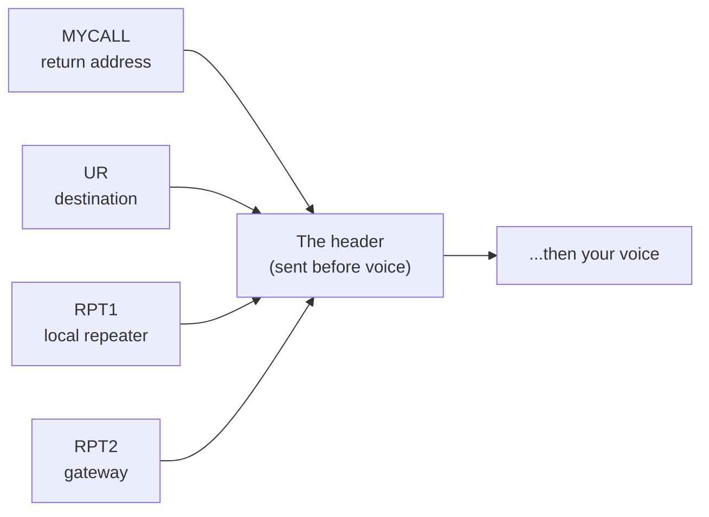
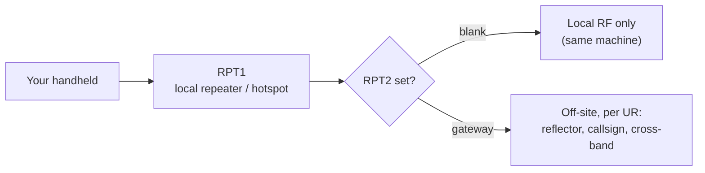
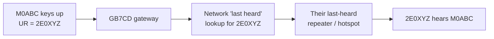
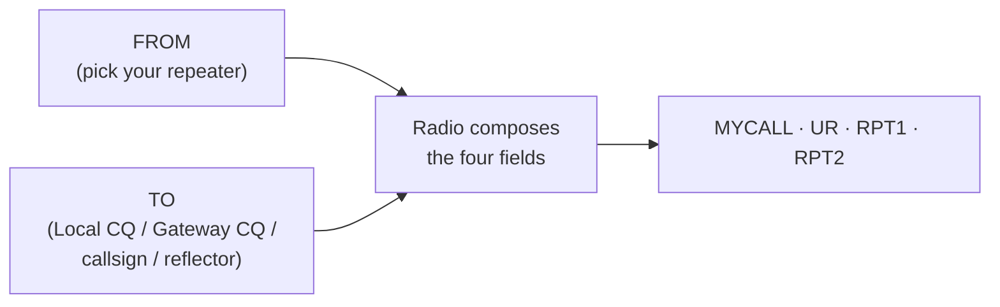

# D-STAR: Callsign Routing & DR Mode

Every time a D-STAR radio keys up it does something no analogue set does: it sends a little addressed envelope ahead of your voice. Four short callsign fields written on that envelope decide whether your words stay in the room, cross town to one named person, or fan out to a reflector on another continent. Get them right — or let the radio fill them in for you — and D-STAR feels effortless; get one wrong and you hit the mode's single most common fault, where your local repeater works perfectly yet nothing ever reaches the wider network. This chapter opens the envelope, reads each field in turn, then shows how **DR mode** hides the lot behind a two-line "from / to" picker.

If you have read the family opener, [D-STAR](outpost:entry/logbook73.handbook/dstar), you met these four fields by name and the one idea behind them — on D-STAR your callsign _is_ the address. Here we take that idea apart and put it to work. If you have not, that headline is the only thing you need to carry in.

## The envelope: four fields on one header

Before a single syllable of vocoded voice goes out, a D-STAR transmission sends a short **header** — carried in the data part of the 4800 bit/s stream you met in the opener — and inside that header sit **four callsign fields**. They have terse, slightly cryptic names, but a postal metaphor makes them stick. Think of every over as a letter dropped into the network:

| Field    | Full name              | Postal role             | You set it to                        |
| -------- | ---------------------- | ----------------------- | ------------------------------------ |
| `MYCALL` | My callsign            | The **return address**  | Your own registered callsign         |
| `UR`     | Your callsign (URCALL) | The **"to" line**       | Where the letter is going            |
| `RPT1`   | Repeater 1             | Your **local post box** | The repeater/hotspot you key over RF |
| `RPT2`   | Repeater 2             | The **sorting office**  | The gateway that forwards off-site   |

Two of the four are about _where you are_ (`RPT1`, `RPT2` — the machine in front of you and its door to the internet), and two are about _who is involved_ (`MYCALL`, the sender; `UR`, the destination). A modern radio composes all four automatically once you have chosen a "from" and a "to", so most days you never type them by hand. But the raw fields are the mental model — understand them once and every odd D-STAR behaviour suddenly has a cause.

The order in which they are filled does not matter to the radio, but a good habit is to read them as a sentence: "_I_ (`MYCALL`) am calling _that destination_ (`UR`), via _this repeater_ (`RPT1`), out through _its gateway_ (`RPT2`)." Let us take each in turn.

## MYCALL — your return address

`MYCALL` (often shown as just `MY`) is your own callsign, stamped into every transmission as the "from" address. It is what lets a D-STAR set do its party trick: the receiving radio decodes your `MYCALL` from the header and _displays who is talking_ before you have said a word. It also satisfies station identification on each over, though you should still follow your national periodic-identification rules.

You set `MYCALL` once, when you first programme the radio, and then leave it alone. There is one make-or-break rule attached to it: **`MYCALL` must exactly match the callsign you registered at a gateway** (see the registration note in [D-STAR](outpost:entry/logbook73.handbook/dstar)) — upper case, in the main callsign slot, no suffix — or every scrap of your internet and reflector traffic is silently dropped. Local RF still works, which is exactly what makes the fault so baffling. If your voice repeats fine on the local machine but no reflector ever hears you, "is my `MYCALL` spelt right and registered?" is the first question, not the last.

There is a small bonus slot too. `MYCALL` has an eighth-character field after the callsign — a short four-character note some operators use for a radio model tag (say `52` for an ID-52) or a brief message. It is cosmetic; it appears on the far radio's display alongside your call and changes nothing about routing.

## UR (URCALL) — the "to" line

`UR` — short for "your callsign", meaning the callsign of the station you are calling — is the destination field, and it is where all the routing intelligence lives. It takes one of three kinds of value:

- **`CQCQCQ`** — a general call. This is the everyday setting: "anyone listening, come back". On a plain local repeater it means a normal call to whoever is on that machine; on a repeater that is _linked_ to a reflector, that same `CQCQCQ` reaches everyone on the reflector, because the linking has already joined your machine to the wider room.
- **A specific callsign** — the original D-STAR vision, **callsign routing**. Put another operator's callsign in `UR` and the network delivers your over to whichever repeater or hotspot that callsign was last heard on, wherever in the world that is. You address a _person_, not a channel, and a distributed "last heard" database (the ircDDB layer) does the finding.
- **A routing or linking command** — a short string such as `REF001CL` (link this repeater to reflector REF001, module C) or an eighth-position `U` (unlink). This is the older, manual way of connecting to reflectors; DR mode has largely replaced it, and we will come back to it.

One classic trap lives here. Once your repeater or hotspot is linked to a reflector, you leave `UR` at `CQCQCQ` and just talk. If instead you leave a _link command_ sitting in `UR`, you re-issue that command every single time you key up — re-linking (or, with an unlink command, re-dropping the link) on every over. Command in, then back to `CQCQCQ`: that is the rhythm.

## RPT1 — your access repeater, and the module letter

`RPT1` ("Repeater 1") is the callsign of the local repeater or hotspot you are actually keying over the air — your post box. On its own that would be simple, but D-STAR repeaters often have more than one radio "port", one per band, and `RPT1` has to say _which_ one. It does that with a **module letter** in the eighth character position:

| Module letter | Band it selects |
| ------------- | --------------- |
| `A`           | 23 cm / 1.2 GHz |
| `B`           | 70 cm           |
| `C`           | 2 m             |

So a 70 cm entry to a repeater with the callsign `GB7CD` is written `GB7CD B` — note the spaces padding the callsign out so that the `B` lands in the eighth position. Get the letter wrong (or in the wrong position) and the repeater simply ignores you: you are knocking on the wrong door. This eighth-character convention is fiddly by hand, which is one of the strongest arguments for letting DR mode do it.

## RPT2 — the gateway that forwards off-site

`RPT2` is the field that decides whether your over ever leaves the building. It names the **gateway** — the box at the repeater site (or inside your hotspot) that bridges RF to the internet and takes part in the routing network. By convention it is the _same_ callsign as `RPT1`, but with the letter `G` (for gateway) in the eighth position: `GB7CD G`.

Here is the rule that catches nearly everyone at least once. If you want your voice to go anywhere beyond the local machine — to a reflector, to a callsign-routed person, across bands — `RPT2` must hold that gateway callsign. If you leave `RPT2` **blank** (or set to `OFF`), your audio is repeated locally on RF and _nothing is forwarded to the network_. It is the mirror image of the `MYCALL` trap: everything sounds fine on the local repeater, yet the reflector never hears a thing, because you never asked the gateway to carry the traffic. "Why can't the reflector hear me?" is, four times out of five, a blank `RPT2`.

For a purely local RF chat — two stations on the same repeater, no internet involved — leaving `RPT2` blank is correct and even polite, since it keeps your natter off the wider network.

## How the four combine: three journeys

Put the fields together and D-STAR supports three quite different journeys, distinguished mostly by `RPT1` and `RPT2`.

- **Simplex** — no repeater at all. Two D-STAR radios (or a radio and a hotspot) talk directly on one frequency. `RPT1` and `RPT2` are both blank; only `MYCALL` and `UR` (usually `CQCQCQ`) matter. This needs no registration, because nothing touches a gateway.
- **Local repeater** — you set `RPT1` to the machine and its module, leave `RPT2` blank, and `UR` at `CQCQCQ`. Your voice is repeated across the local coverage area and no further.
- **Gateway / network** — `RPT1` names the machine, `RPT2` names its gateway, and `UR` says where in the wider world you are aiming: `CQCQCQ` onto a linked reflector, or a specific callsign to route to a person. This is the mode that needs your one-time callsign registration.

## A worked example, two ways

Take a concrete station: your callsign is `M0ABC`, your nearest D-STAR machine is `GB7CD`, and you want to work its 70 cm port.

**Calling CQ out to a reflector.** The repeater is already linked to a reflector (someone linked it, or it starts up linked). You want to call the whole room:

| Field    | Value     | Why                                                             |
| -------- | --------- | --------------------------------------------------------------- |
| `MYCALL` | `M0ABC`   | Your registered callsign                                        |
| `UR`     | `CQCQCQ`  | A general call; the linking already carries it to the reflector |
| `RPT1`   | `GB7CD B` | Your local machine, 70 cm module                                |
| `RPT2`   | `GB7CD G` | Its gateway, so the over leaves the site                        |

Key up, wait a beat for the network to catch up, and say "M0ABC, calling CQ on the reflector." Anyone on that reflector's module — perhaps dozens of repeaters and hotspots across several countries — hears you, and their radios show `M0ABC`.

**Routing to one person by callsign.** Now you want to reach a specific friend, `2E0XYZ`, without knowing or caring which repeater they are near today. Only `UR` changes:

| Field    | Value     | Why                                      |
| -------- | --------- | ---------------------------------------- |
| `MYCALL` | `M0ABC`   | Unchanged                                |
| `UR`     | `2E0XYZ`  | Route to this person wherever last heard |
| `RPT1`   | `GB7CD B` | Unchanged                                |
| `RPT2`   | `GB7CD G` | Gateway still required to leave the site |

Now the network looks `2E0XYZ` up in its "last heard" table and delivers your over to whatever machine they last used. If they were on a repeater three counties away this morning, that is where your call pops out — with no reflector, no shared channel, just a callsign on an envelope.

That callsign-routing path is the founding dream of D-STAR — a genuinely different idea from tuning to a shared channel. In day-to-day practice most wide-area activity has drifted onto reflectors (the subject of the next chapter), because a "room" everyone can join is easier to find than a single person. But the machinery to post a letter to one operator, by callsign alone, is still there under every over.

## DR mode: from and to, and the radio does the rest

Filling four callsign fields — with module letters in exact character positions and gateway `G`s — by hand, for every repeater you might use, is exactly as error-prone as it sounds. It was the original workflow, and it scared a lot of newcomers off. Modern radios (the ID-31, ID-51, ID-52 and ID-50 handhelds, among others) solve it with **DR mode** — "D-STAR Repeater" mode — a menu-driven front end that reduces the whole business to two choices.

You pick a **FROM** and a **TO**, and the radio composes `MYCALL`, `UR`, `RPT1` and `RPT2` for you:

- **FROM** — your access repeater or hotspot, chosen from a built-in list held in the radio's memory. Selecting it sets `RPT1` (with the right module letter) and `RPT2` (its gateway) in one go.
- **TO** — the destination, which sets `UR`. The choices typically read as plain menu entries: **Local CQ** (a call on the local machine, `UR = CQCQCQ`, no gateway), **Gateway CQ** (a general call out through the gateway), a specific **callsign** (callsign routing), or a **reflector** — with a "Use Reflector" action to link or unlink one straight from the same menu, so you never hand-type a command like `REF001CL` again.

The trade-off is that DR mode is only as good as its lists. It relies on an up-to-date **repeater / DV memory list**, usually imported as a CSV file from a national or manufacturer source; if your nearest machine or a new reflector is missing from that list, it will not appear as a pickable FROM or TO. Refreshing that list now and then is the DR-mode equivalent of keeping your post office directory current. Do that, and the guidance is blunt: **you almost certainly want DR mode.** The four raw fields are the model you keep in your head to diagnose faults; DR mode is the interface you actually drive.

## Try it yourself

You can practise reading D-STAR routing before you ever transmit — receiving is licence-free in most countries.

1. **Watch the four fields print out.** Tune an [RTL-SDR](outpost:entry/logbook73.handbook/software-defined-radio) to a local D-STAR repeater in FM, feed the audio to free D-STAR decoder software, and watch the header decode before each over. Identify the `MYCALL`, `UR`, `RPT1` and `RPT2` for a real transmission. Is `UR` a callsign or `CQCQCQ`? Does `RPT2` carry a gateway `G`? You are reading a live envelope.
2. **Spot the module letter.** In the same decode, look at the eighth character of `RPT1`. `B` means the station came in on 70 cm, `C` on 2 m, `A` on 23 cm. Compare it against the repeater's published bands in your national directory.
3. **Build the fields on paper.** For your own (future or current) callsign and your nearest D-STAR machine, write out all four fields for three cases: a local-only call, a CQ out to a linked reflector, and a callsign route to a friend. Check the module letter and gateway `G` land in the eighth position.
4. **Log what you decode.** Every `MYCALL` you catch off a D-STAR machine goes into LogBook73's **Receive Log** with mode `DSTAR` — and note whether it arrived via `CQCQCQ` or a callsign route, so your log records the _how_ as well as the _who_.
5. **If you are licensed and have a radio,** put it in DR mode, pick your local repeater as FROM and "Local CQ" as TO, then key up and read back the four fields the radio composed. Seeing DR mode's choices turn into raw `MYCALL`/`UR`/`RPT1`/`RPT2` is the moment the whole thing clicks.

## Key takeaways

- Every D-STAR over carries a header with **four callsign fields**: `MYCALL` (your return address), `UR` (the destination), `RPT1` (your local repeater and its band **module**), and `RPT2` (the **gateway** that forwards off-site).
- `MYCALL` must **exactly match your registered callsign** or all network traffic is silently dropped; `UR` holds `CQCQCQ`, a person's callsign (callsign routing), or a link/unlink command.
- The **module letter** (`A` = 23 cm, `B` = 70 cm, `C` = 2 m) sits in the eighth character of `RPT1`; the gateway `G` sits in the eighth character of `RPT2` — pad the callsign with spaces so the letter lands right.
- A **blank `RPT2`** gives local RF repeat but sends nothing to the network — the classic "why can't the reflector hear me?" fault, mirrored by an unregistered `MYCALL`.
- The fields distinguish three journeys: **simplex** (no repeater, no registration), **local repeater** (blank `RPT2`), and **gateway/network** (gateway in `RPT2`, destination in `UR`).
- **Callsign routing** posts an over to one operator wherever last heard; a general call on a linked repeater uses `CQCQCQ` and reaches the whole reflector room.
- **DR mode** replaces hand-editing with a simple **FROM / TO** picker that composes all four fields — the interface you should use daily, provided you keep its repeater list current.

Now that you can address a D-STAR call, the obvious next question is _what you are calling into_ — the shared conference bridges where most of the mode's daily life happens: [D-STAR Reflectors](outpost:entry/logbook73.handbook/dstar-reflectors).
