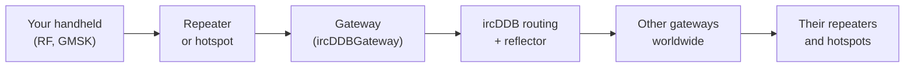
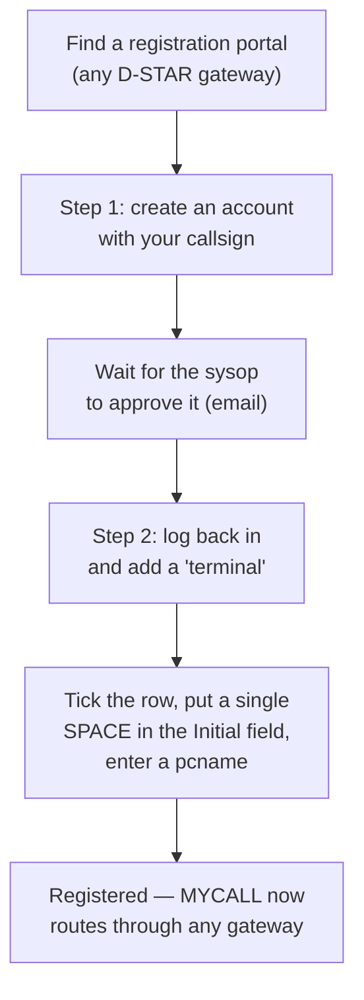
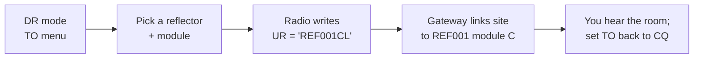

# D-STAR: Reflectors, Gateways & Registration

A single D-STAR repeater on a hill covers a town. Link that repeater to a **reflector** and it suddenly shares a conversation with a hundred other repeaters and hotspots scattered across the planet — one big room, everyone hearing everyone. This chapter is about the invisible half of D-STAR: the internet plumbing that carries your voice between sites, the reflectors that act as conference bridges, and the one-time paperwork — registering your callsign — without which none of it will work for you. If the [D-STAR overview](outpost:entry/logbook73.handbook/dstar) explained how your voice becomes bits over the air, this one follows those bits off the antenna and into the network.

We build it in the order you actually meet it: first the gateway that connects a site to the world, then the reflector families that connect sites to each other, then the registration that connects _you_ to the whole fabric — and finally how you link, unlink and find a room.

## The gateway: a site's door to the internet

Every D-STAR repeater that reaches beyond its own coverage has two parts. There is the **repeater** proper — the radio hardware that hears your handheld and re-transmits it locally — and behind it a **gateway**: a small computer that takes the digital stream and forwards it over the internet. The repeater is the front door onto the airwaves; the gateway is the back door onto the network. A purely local contact — you and a friend both keyed into the same machine — never touches the gateway at all. The moment you want to reach anywhere else, your traffic must go _through_ it.

The gateway is not just a dumb relay. It runs software (the widely used open-source one is **ircDDBGateway**, licensed under the GPL) that joins a worldwide routing layer called **ircDDB**. Think of ircDDB as a shared address book that every gateway helps keep up to date. Each time a callsign is heard at any site, that site quietly tells the network "I last saw `M0ABC` here". This is the machinery behind D-STAR's signature trick, **callsign routing**, covered in [D-STAR Routing](outpost:entry/logbook73.handbook/dstar-routing): because the network remembers where each callsign last appeared, someone can call you by callsign from anywhere and the system finds you. For this chapter the key point is narrower — the gateway is what makes a site reachable, and ircDDB is what lets gateways cooperate.

Your own hotspot has a gateway too. An [MMDVM or DVMega hotspot](outpost:entry/logbook73.handbook/dstar-operating) running Pi-Star bundles the very same `ircDDBGateway` software as a full repeater, so a matchbox on your desk is, network-wise, a peer of a mountaintop machine. Whether you reach the network through a shared repeater or your own hotspot, the same gateway plumbing applies — and, as we are about to see, the same registration requirement.

## Reflectors: one room, many sites

Callsign routing reaches one person. Most of the time you want the opposite — a shared conversation many people can drop into, like a net or a ragchew on a busy [repeater](outpost:entry/logbook73.handbook/repeaters). That is what a **reflector** provides. A reflector is a server on the internet that acts as a **conference bridge**: any repeater or hotspot can _link_ to it, and once linked, whatever one linked site transmits is copied out to every other linked site at once. Speak into your hotspot in one country, and handhelds keyed into linked repeaters on other continents hear you a fraction of a second later.

Reflectors are divided into **modules**, labelled with letters — `A`, `B`, `C` and so on. Each module is an independent room. Two stations linked to module `A` of a given reflector are in one conversation; a third station linked to module `C` of the same reflector is in a completely separate one and hears nothing of the first. This is how a single reflector can host, say, a regional net in one module and a technical chat in another without them colliding. When you read or announce a link, the letter matters as much as the number.

A crucial etiquette point falls straight out of the mechanics: linking a **shared** repeater to a reflector moves the _whole machine_ and everyone on it. You are not joining a room by yourself — you are dragging every other user of that repeater into the room with you. So before you link a community repeater, check whether it is already linked and to where, and when your net or natter is finished, **unlink it** so the next person finds it as they expect. On your own hotspot you may link and unlink as freely as you like, because you are the only user; on a shared repeater, treat the link as a shared resource you are borrowing.

## The four reflector families

D-STAR grew several reflector systems over the years, built by different people using different underlying protocols. Functionally they all do the same job — bridge many sites into lettered rooms — but you will see four names, and it helps to know what each is.

| Family  | Protocol / origin            | Notes                                                                                |
| ------- | ---------------------------- | ------------------------------------------------------------------------------------ |
| **REF** | DPlus (D-Plus), the original | Natively selectable in DR mode on Icom radios; the classic, long-established network |
| **XRF** | DExtra                       | An early open alternative to DPlus                                                   |
| **DCS** | originally German            | Another widely used open reflector system                                            |
| **XLX** | modern, multiprotocol        | Speaks DPlus, DExtra _and_ DCS at once, and can transcode to other modes             |

For a beginner the practical takeaways are two. First, **REF reflectors** (the DPlus family) are the ones your Icom radio can pick straight from its built-in menus without any fuss, so they are the gentlest starting point. Second, **XLX** is the interesting modern one: a single XLX reflector can be reached over more than one protocol at the same time, which is why you will sometimes see the same room addressed two different ways. In the network's own examples, `XRF208 C` and `DCS208 C` both land you in module `C` of reflector `XLX208` — same room, two doors. XLX reflectors can also **transcode**: because D-STAR's [AMBE vocoder](outpost:entry/logbook73.handbook/digital-voice) is not bit-compatible with the vocoders used by DMR or System Fusion, a bridge between modes needs hardware that re-encodes the audio, and a suitably equipped XLX reflector is one place that transcoding happens. That is how a D-STAR room can, in some setups, share a conversation with [DMR](outpost:entry/logbook73.handbook/dmr) or [C4FM](outpost:entry/logbook73.handbook/c4fm) users.

You do not need to memorise the differences. When you find a reflector to join — from a club, a net's website or a reflector dashboard — it will be named with its family prefix, its number and the module letter, and that is all you need to link to it.

## Registration: the one step you cannot skip

Here is the fact that saves the most beginner frustration, so we will state it plainly: **before any of your traffic can pass through a gateway, your callsign must be registered once in the D-STAR network.** Local, RF-only contacts — you and a friend into the same repeater, or a simplex hotspot with no internet path — do not need it. But the instant you try to reach a reflector, route to a callsign, or use any gateway feature, the network checks whether your callsign is registered. If it is not, your audio is repeated on RF locally and then **silently dropped** at the gateway. There is no error tone, no rejection message. Your radio seems to work, the reflector simply never hears you, and newcomers spend evenings convinced the radio is broken when the real problem is a missing database entry.

Registration is free, one-time, and global. You register **once, at any one gateway**, and the ircDDB layer propagates your entry worldwide within a short time — you do not re-register for every repeater or when you travel. The classic web-based process has two stages, and the second stage trips people up, so it is worth spelling out:

**Step one** creates your account: you submit your callsign (usually with proof of licence) and wait for a human administrator to approve it, which can take anywhere from minutes to a day or two. **Step two** is the part people miss — after approval, you must log back in and create a **terminal** (sometimes shown as a personal entry). You tick a blank row, put a **single space** in the first ("initial") field, and give it a short name (a "pcname"). Skipping step two is the most common registration mistake: the account exists, but without the terminal the network still will not route you. Once both steps are done, the exact callsign you registered goes into your radio's **MYCALL** field (uppercase, no suffix in the main field), and it must match your registration character-for-character or the gateway will drop you anyway.

Where do you register? At any ircDDB gateway's portal — your local D-STAR repeater's keeper, a club, or a public registration site will point you to one. Because it propagates everywhere, the specific portal does not matter; pick whichever one a trusted local source recommends.

## Linking and unlinking

With a registered callsign and a gateway to carry you, joining a reflector is a matter of telling your access point which reflector and module to connect to. There are two ways to do it, and they are two faces of the same thing.

### The manual way: UR-field commands

The original method — and still the mental model worth understanding — is to type a command into the **UR** (destination) callsign field. The four callsign fields are dissected in [D-STAR Routing](outpost:entry/logbook73.handbook/dstar-routing); here we only care about UR, the "to" line. A link command is a reflector name, its module letter, and the letter `L` for _link_:

| You type in UR | What it does                                                 |
| -------------- | ------------------------------------------------------------ |
| `REF001CL`     | Link your site to reflector REF001, module `C`               |
| `REF030BL`     | Link to reflector REF030, module `B`                         |
| `DCS208CL`     | Link to XLX208, module `C`, via the DCS protocol             |
| `XRF208CL`     | Link to XLX208, module `C`, via the DExtra protocol          |
| `       U`     | Unlink — a lone `U` in the 8th position, callsign area blank |

Read the pattern and it demystifies: the reflector number, the **module letter**, then `L` to link. The letter immediately before the `L` is the reflector's module — the room — not your local repeater's port. To leave, you send an **unlink**: a `U` sitting in the eighth character position with the rest of the field blank. After you key up once to send a link or unlink command, set UR back to `CQCQCQ` for normal calling. If you leave the link command sitting in UR, you will re-issue it on every over — re-linking or re-unlinking each time you press the push-to-talk switch — which is a classic self-inflicted fault.

### The modern way: DR mode

Almost nobody hand-types those commands day to day any more. Modern Icom handhelds and mobiles (the ID-31, ID-51, ID-52 and ID-50 among them) offer **DR (D-STAR Repeater) mode**, a menu that hides the raw fields behind two friendly choices: **FROM** (which repeater or hotspot you are using, picked from a built-in list) and **TO** (what you want to reach). From the **TO** menu you select a reflector — or "Use Reflector" — and the radio composes the correct UR command and the other fields for you, sends the link, and returns you to normal calling automatically. Unlinking is a menu item too. The command table above is what DR mode is quietly doing on your behalf; you almost certainly want DR mode as your daily interface, and the raw commands as the model of what is happening underneath.

DR mode depends on an up-to-date repeater and reflector list in the radio's memory. Reflectors and repeaters come and go, so import the current list (usually a CSV file the manufacturer or a community maintainer publishes) periodically — otherwise a nearby machine or a newly-added reflector simply will not appear as a pickable destination, and it can look as though it does not exist.

## Finding a reflector to join

None of this helps until you know _which_ reflector to link to, and that is a matter of finding the room where the people you want are. A few reliable routes:

- **Local knowledge.** The single best source is whoever runs your nearest D-STAR repeater or your club. There is usually a "home" reflector and module that the local community uses, and a regular net time. Ask.
- **Reflector dashboards.** Most reflector systems publish a live web **dashboard** showing which module is busy, who is linked and who spoke last. Watching a dashboard tells you at a glance whether a room is active before you commit a shared repeater to it.
- **Net listings.** Many D-STAR nets — regional, national, special-interest — advertise their reflector, module and time on club and society websites. A scheduled net is the easiest place to hear a busy, welcoming room.
- **The DR-mode list itself.** Because Icom radios ship a repeater/reflector list, browsing the **TO** menu is itself a way to discover reflectors that are commonly used in your area.

Because a reflector's traffic is global, do not be shy about linking to a room on another continent to listen — just remember the etiquette. On a shared repeater, listen first, keep an eye on whether it was already linked somewhere, and unlink when you are done so you hand the machine back as you found it. On your own hotspot, roam freely.

## Try it yourself

You can explore the whole network layer before you ever transmit — and the first task needs no licence at all.

1. **Watch a reflector dashboard.** Search for a public D-STAR reflector dashboard (a REF or XLX one) and open it in a browser. Watch the "last heard" list update as stations key up: you are seeing callsigns route in from many different repeaters and hotspots into one shared module. Note how each entry names the site the person came in on — that is ircDDB's last-heard table in action.
2. **Map your local gateway.** Using your national repeater directory, find the nearest D-STAR repeater and check whether it lists a gateway and a "home" reflector. That one lookup tells you which room your local community lives in.
3. **Log what you hear.** Put an [RTL-SDR](outpost:entry/logbook73.handbook/software-defined-radio) on a local D-STAR repeater's output, or listen via a dashboard, and record each callsign in LogBook73's **Receive Log** with mode `DSTAR`. You will start to recognise which callsigns appear whenever the repeater is linked to its home reflector.
4. **If you are licensed:** register your callsign once at a gateway portal your local group recommends — remember both steps, including the single space in the terminal's initial field — put that exact callsign in MYCALL, and use your radio's DR mode to link a hotspot or a quiet repeater to a reflector and listen. Unlink when you finish.

## Key takeaways

- A **gateway** is the computer that bridges a repeater or hotspot to the internet; the **ircDDB** layer lets gateways share a worldwide "last heard" table, and a local RF-only contact never uses either.
- A **reflector** is an internet conference bridge divided into lettered **modules** (rooms); linking a site copies its audio to every other linked site in that module.
- The four families — **REF** (DPlus, the original, native in DR mode), **XRF** (DExtra), **DCS**, and multiprotocol **XLX** (which can be reached several ways and can transcode to other modes) — all do the same job with different plumbing.
- **Registration is mandatory for any gateway use:** register your callsign once, at any gateway, and it propagates worldwide; skip it and your traffic is silently dropped with no error. Do both steps, and make MYCALL match exactly.
- **Linking/unlinking** is a UR-field command (`REF001CL` to link, a lone `U` to unlink) — but in practice you drive it from **DR mode's** TO menu, which writes those commands for you.
- Linking a **shared** repeater moves the whole machine and everyone on it: check the current link, and unlink when you are done. On your own hotspot, roam freely.
- Find rooms through local clubs, reflector **dashboards**, net listings and your radio's built-in list; keep the DR-mode repeater list up to date.

With the network layer in place — a gateway to reach it, a registration to be recognised, and reflectors to gather in — you are ready to actually work the world: on to [D-STAR Operating](outpost:entry/logbook73.handbook/dstar-operating).
